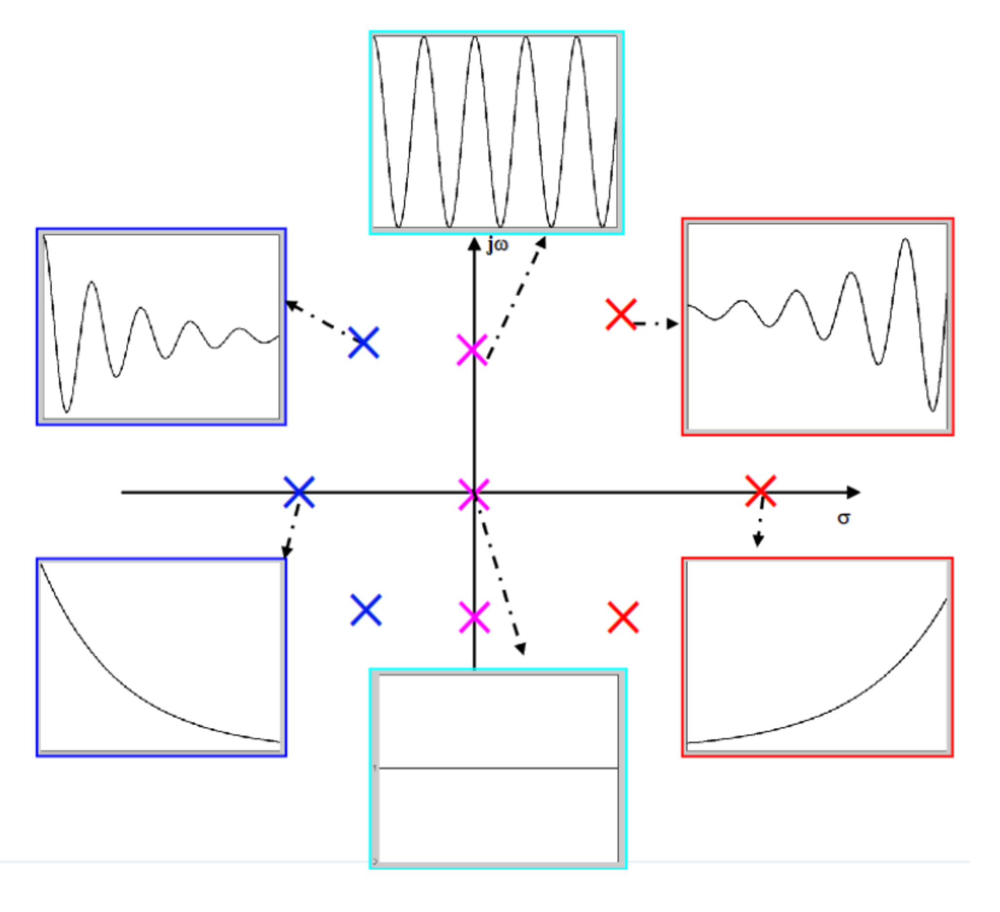
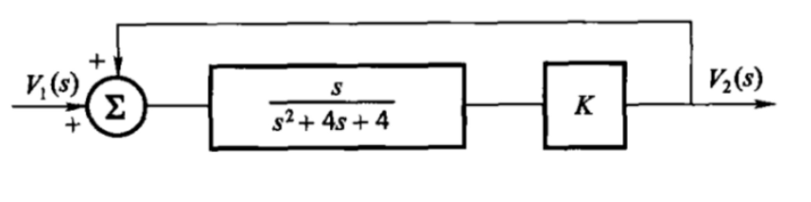

# 信号与系统 第4次作业答案（2024春）

## 题目与答案

### 1

#### 题目

判断题或简答题，需要简述理由。

(1) 有一个系统的单位冲激响应为： $h(t)=e^{-t}u(t)$，其是否是因果系统？

(2) 有一个系统的单位冲激响应为： $h(t)=e^{-|t|}$，其是否是因果系统？

(3) 考虑一个稳定因果系统，单位冲激响应为 $h(t)$，系统函数为 $H(t)$。假定 $H(t)$ 是有理的，有一个极点 $s=-2$，原点没有零点，其余的零极点位置未知。请问

① $\mathcal{F}[h(t)e^{3t}]$ 是否收敛？

② $H(s)=H(-s)$ 是否正确？

#### 答案

**答案：**

(1) $t<0$ 时 $h(t)=0$，因此是因果的。

(2) $t<0$ 时 $h(t)\neq 0$，因此不是因果的。

(3) ① $\mathcal{F}[h(t)e^{3t}]$ 相应于 $h(t)$ 的拉普拉斯变换在 $s=-3$ 的值。如果此值收敛，那就意味着 $s=-3$ 在收敛域内。但是一个稳定因果系统的收敛域总是在它的全部极点的右边，而 $s=-3$ 不在 $s=-2$ 的右边。

② 不正确，否则系统在 $s=2$ 也有一个零点。

小结：

(1) 是，因为冲激信号在 0 时刻到达，那之前没有响应；

(2) 不是，因为在冲激信号到达之前，就有了响应；

(3) ① 不收敛，因为稳定因果系统的收敛域总是在全部极点的右边，但是 $s=-3$ 步不在 -2 的右边。② 是错的，因为此时如果在 $s=-2$ 有一个极点，那么在 $s=2$ 也有一个，会导致系统不稳定。

① 如果一个系统的冲激响应信号是因果信号（0 之后才有值），那么该系统就是一个因果系统。

② 对于一个具有有理系统函数的系统来说，系统的因果性等效于收敛域位于最右边极点的右边的右半平面。

### 2

#### 题目

给定系统微分方程、起始状态以及激励信号分别为以下两种情况：

(1) $\displaystyle\frac{\mathrm{d}}{\mathrm{d}t}r(t)+2r(t)=e(t),\ r(0_{-})=0,\ e(t)=u(t)$

(2) $\displaystyle\frac{\mathrm{d}}{\mathrm{d}t}r(t)+2r(t)=3\displaystyle\frac{\mathrm{d}}{\mathrm{d}t}e(t),\ r(0_{-})=0,\ e(t)=u(t)$

判断在起始点是否发生跳变，写出 $r(0_{+})$ 的值。

#### 答案

**答案：**

(1) 无 $\delta$ 分量，因此无跳变， $r(0_{+})=r(0_{-})=0$

(2) 在 0 附近有： $\displaystyle\frac{\mathrm{d}}{\mathrm{d}t}r(t)+2r(t)=3\delta(t)$，因此有跳变。（0 附近）令 $\displaystyle\frac{\mathrm{d}}{\mathrm{d}t}r(t)=a\delta(t)+b\Delta u(t)$， $r(t)=a\Delta u(t)$，代入解得 $a=3,b=-6$，因此跳变量为 3。

### 3

#### 题目

求解下列系统微分方程：

(1) 按照步骤求解系统微分方程

$$\frac{\mathrm{d}^{2}}{\mathrm{d}t^{2}}r(t)+3\frac{\mathrm{d}}{\mathrm{d}t}r(t)+2r(t)=\frac{\mathrm{d}}{\mathrm{d}t}e(t)+3e(t)$$

$$e(t)=u(t),\ r(0_{-})=1,\ r'(0_{-})=2$$

a. 求出自由响应和受迫响应；

b. 求出零输入响应；

c. 分别用两种方法求出零状态响应：①求出冲激响应，并与输入做卷积；②直接由零状态响应的形式，根据 $0_{-}$ 处条件待定系数法求解；③使用频域法（拉普拉斯变换）求解。

d. 比较三种方法求出的最终结果。

(2) 用三种方法中的任意一种（自由+受迫，或零输入+零状态，或拉普拉斯变换），求解系统微分方程

$$\frac{\mathrm{d}^{2}}{\mathrm{d}t^{2}}r(t)+4\frac{\mathrm{d}}{\mathrm{d}t}r(t)+3r(t)=e^{-2t}u(t)$$

$$r(0_{+})=1,\ r'(0_{+})=1$$

#### 答案

**答案：**

(1)

a. 自由响应： $\left(2e^{-t}-\displaystyle\frac{5}{2}e^{-2t}\right)u(t)$，受迫响应： $\displaystyle\frac{3}{2}u(t)$

b. 零输入响应： $\left(4e^{-t}-3e^{-2t}\right)u(t)$

c. 零状态响应：

① 冲激响应是 $h(t)=2e^{-t}-e^{-2t}$，然后做卷积即可

② 重点在于得到 $r(0_{+})=0,\ r'(0_{+})=1$，然后通过假设的形式 $r_{zs}(t)=ae^{-t}+be^{-2t}+\displaystyle\frac{3}{2}u(t)$ 待定系数求解

③ $R(s)=\displaystyle\frac{s+3}{s(s^{2}+3s+2)}$

(2) $r(t)=\left(\displaystyle\frac{5}{2}e^{-t}-e^{-2t}-\frac{1}{2}e^{-3t}\right)u(t)$

### 4

#### 题目

求拉普拉斯逆变换。

(1) $\displaystyle\frac{2(s+2)}{s^{2}+7s+12}$

(2) $\displaystyle\frac{s-2}{(s+1)^{3}s}$

#### 答案

**答案：**

(1) $\mathcal{L}^{-1}\left(\displaystyle\frac{-2}{s+3}+\frac{4}{s+4}\right)=\left(-2e^{-3t}+4e^{-4t}\right)u(t)$

(2) $\mathcal{L}^{-1}\left(\displaystyle\frac{3}{(s+1)^{3}}+\frac{2}{(s+1)^{2}}+\frac{2}{(s+1)}+\frac{-2}{s}\right)=\left(2e^{-t}+2te^{-t}+\frac{3}{2}t^{2}e^{-t}-2\right)u(t)$

### 5

#### 题目

关于某个线性时不变系统，已知下列条件信息：

(1) 系统是因果的

(2) 系统函数是有理的，且仅有两个极点在 $s=-2,4$

(3) 若 $x(t)=1$，则 $y(t)=0$

(4) 单位冲激响应在 $0^{+}$ 的时刻值为 4

请确定该系统的系统函数和单位冲激响应。

#### 答案

**答案：**

这里我们希望考察的主要是初值定理和终值定理。但是由于题目来源对于因果信号的说明与本书不同，在此统一做出说明，根据郑君里版本《信号与系统》的定义，第一个条件（因果性）无法得到分子阶次小于等于分母阶次的结论。

然而，本题还是可以做，首先可以假设系统函数为 $H(s)=\displaystyle\frac{p(s)}{(s+2)(s-4)}$，其中 $p(s)$ 是 $s$ 的多项式。

由条件 3 可以得到，分子 $p(s)$ 一定包含 $s$ 项，即可以写成 $p(s)=sq(s)$ 的形式。

由条件 4 和初值定理， $\displaystyle\lim_{s\to+\infty}sH(s)=\frac{s^{2}q(s)}{(s+2)(s-4)}=4$，这就可以得出分母阶次不会超过 2 的结论，同时还可以得出 $q(s)=4$。

因此本题答案是 $H(s)=\displaystyle\frac{4s}{s^{2}-2s-8}$。

### 6

#### 题目

谈一下自己对下图的理解，包括：图中的点是什么意思？框起来的是什么信号？具有什么样的特征？

针对图中的每种信号，试着给出自己的例子。

#### 答案

**答案：**

可以参考 ppt 中的图，此处不做赘述。

### 7

#### 题目

求出下图的系统函数，写出系统稳定的条件，并求出临界稳定时系统的冲激响应。

#### 答案

**答案：**

系统函数： $H(s)=\displaystyle\frac{4s}{s^{2}+4}$

稳定条件： $k<4$

冲激响应： $h(t)=4\cos(2t)$
