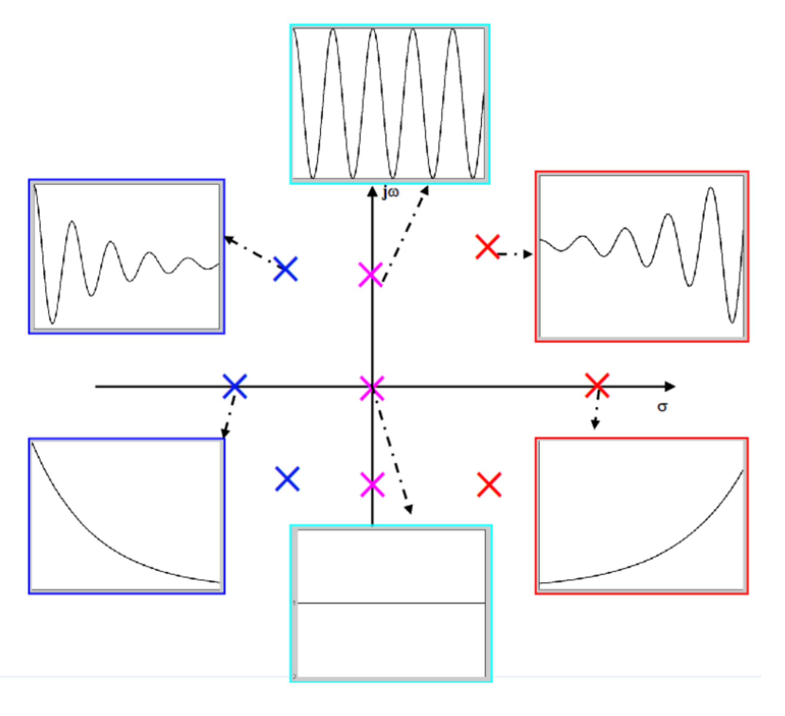
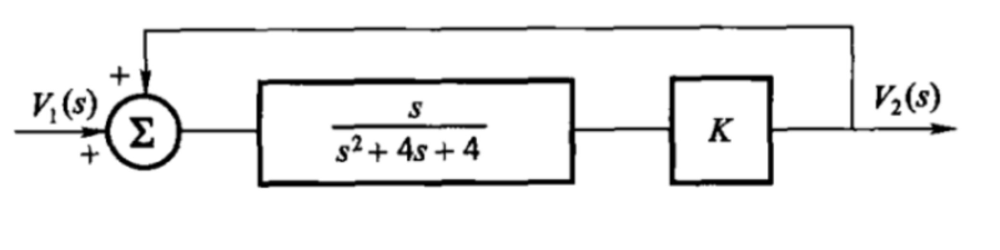

# 信号与系统 第4次作业题目（2024春）

## 题目

### 1

判断题或简答题，需要简述理由。

(1) 有一个系统的单位冲激响应为： $h(t)=e^{-t}u(t)$，其是否是因果系统？

(2) 有一个系统的单位冲激响应为： $h(t)=e^{-|t|}$，其是否是因果系统？

(3) 考虑一个稳定因果系统，单位冲激响应为 $h(t)$，系统函数为 $H(t)$。假定 $H(t)$ 是有理的，有一个极点 $s=-2$，原点没有零点，其余的零极点位置未知。请问

① $\mathcal{F}[h(t)e^{3t}]$ 是否收敛？

② $H(s)=H(-s)$ 是否正确？

### 2

给定系统微分方程、起始状态以及激励信号分别为以下两种情况：

(1) $\displaystyle\frac{\mathrm{d}}{\mathrm{d}t}r(t)+2r(t)=e(t),\ r(0_{-})=0,\ e(t)=u(t)$

(2) $\displaystyle\frac{\mathrm{d}}{\mathrm{d}t}r(t)+2r(t)=3\displaystyle\frac{\mathrm{d}}{\mathrm{d}t}e(t),\ r(0_{-})=0,\ e(t)=u(t)$

判断在起始点是否发生跳变，写出 $r(0_{+})$ 的值。

### 3

求解下列系统微分方程：

(1) 按照步骤求解系统微分方程

$$\frac{\mathrm{d}^{2}}{\mathrm{d}t^{2}}r(t)+3\frac{\mathrm{d}}{\mathrm{d}t}r(t)+2r(t)=\frac{\mathrm{d}}{\mathrm{d}t}e(t)+3e(t)$$

$$e(t)=u(t),\ r(0_{-})=1,\ r'(0_{-})=2$$

a. 求出自由响应和受迫响应；

b. 求出零输入响应；

c. 分别用两种方法求出零状态响应：①求出冲激响应，并与输入做卷积；②直接由零状态响应的形式，根据 $0_{-}$ 处条件待定系数法求解；③使用频域法（拉普拉斯变换）求解。

d. 比较三种方法求出的最终结果。

(2) 用三种方法中的任意一种（自由+受迫，或零输入+零状态，或拉普拉斯变换），求解系统微分方程

$$\frac{\mathrm{d}^{2}}{\mathrm{d}t^{2}}r(t)+4\frac{\mathrm{d}}{\mathrm{d}t}r(t)+3r(t)=e^{-2t}u(t)$$

$$r(0_{+})=1,\ r'(0_{+})=1$$

### 4

求拉普拉斯逆变换。

(1) $\displaystyle\frac{2(s+2)}{s^{2}+7s+12}$

(2) $\displaystyle\frac{s-2}{(s+1)^{3}s}$

### 5

关于某个线性时不变系统，已知下列条件信息：

(1) 系统是因果的

(2) 系统函数是有理的，且仅有两个极点在 $s=-2,4$

(3) 若 $x(t)=1$，则 $y(t)=0$

(4) 单位冲激响应在 $0^{+}$ 的时刻值为 4

请确定该系统的系统函数和单位冲激响应。

### 6

谈一下自己对下图的理解，包括：图中的点是什么意思？框起来的是什么信号？具有什么样的特征？

针对图中的每种信号，试着给出自己的例子。

### 7

求出下图的系统函数，写出系统稳定的条件，并求出临界稳定时系统的冲激响应。

