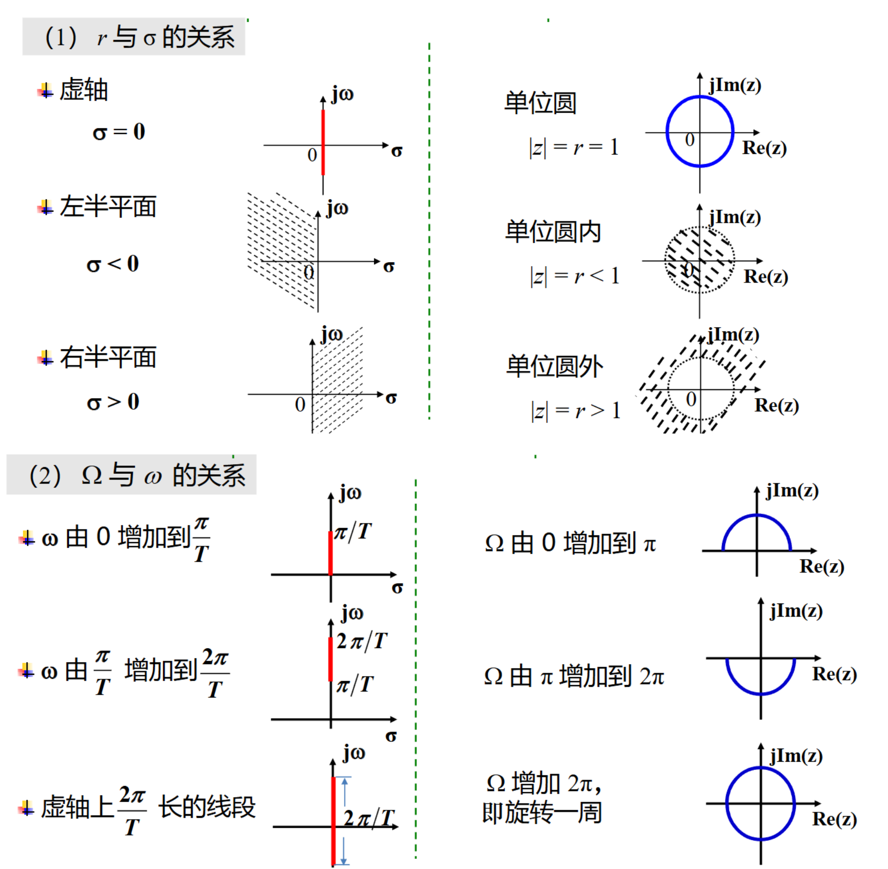
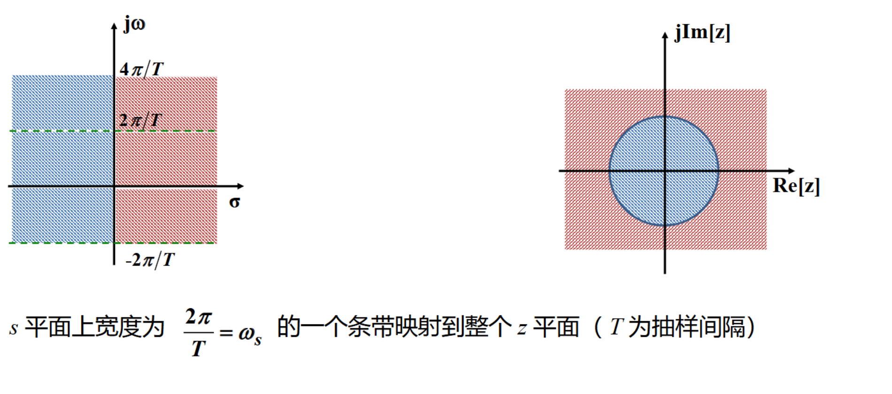

# 信号与系统 第6次作业答案（2024春）

## 题目与答案

### 1

#### 题目

从 $s$ 变换到 $z$ 变换。

(1) $s$ 平面上， $e^{(\sigma+j\omega)T}$ 的 $\sigma$ 不同取值与 $z$ 平面上 $z$ 的取值的关系；

(2) $s$ 平面上， $e^{(\sigma+j\omega)T}$ 的 $\omega$ 不同取值与 $z$ 平面上 $z$ 的取值的关系；

(3) $s$ 平面上，什么样的区域可以映射到整个 $z$ 平面？

#### 答案

**答案：**

$s$ 平面的虚轴，对应 $z$ 平面的单位圆。 $s$ 平面的左半平面，对应 $z$ 平面的单位圆内； $s$ 平面的右半平面，对应 $z$ 平面的单位圆外。

$s$ 平面上每增加一个 $\frac{2\pi}{T}$（即虚轴上长度为 $\frac{2\pi}{T}$ 的线段），则 $z$ 平面上相应的旋转一周。 $s$ 平面上宽度为 $\frac{2\pi}{T}$ 的水平带映射到整个 $z$ 平面，即 $s$ 平面到 $z$ 平面的映射是多值映射。

可以参考下图或课上老师 PPT 给出的关系：

### 2

#### 题目

求出下列序列的 $z$ 变换，标出收敛域并绘制零极点分布图。

(1) $x(n)=\left(\displaystyle\frac{1}{3}\right)^{-n}u(n)$

(2) $x(n)=\left(\displaystyle\frac{1}{3}\right)^{n}u(-n)$

(3) $x(n)=\left(\displaystyle\frac{1}{2}\right)^{|n|}$

#### 答案

**答案：**

(1) $\displaystyle\frac{z}{z-3}$， $|z|>3$

(2) $\displaystyle\frac{1}{1-3z}$， $|z|<\frac{1}{3}$

(3) $\displaystyle\frac{-1.5z}{(z-0.5)(z-2)}$
注意比较 (1)(2) 的区别和联系。联系三种序列的特点，总结为什么收敛域分别是三种形态。

### 3

#### 题目

求下列 $X(Z)$ 的逆 $z$ 变换 $x(n)$。

(1) $X(z)=-2z^{-2}+2z+1$（ $0<|z|<+\infty$）

(2) $X(z)=\displaystyle\frac{1}{1-3z^{-1}}$（ $|z|<3$）

(3) $X(z)=\displaystyle\frac{1-0.5z^{-1}}{1-\frac{1}{4}z^{-2}}$（ $|z|>0.5$）

(4) $X(z)=\displaystyle\frac{z^{-1}}{(1-6z^{-1})^{2}}$（ $|z|>6$）

#### 答案

**答案：**

(1) $\delta(n)+2\delta(n+1)-2\delta(n-2)$

(2) $-3^{n}u(-n-1)$

如果收敛域是 $|z|>3$，则逆变换结果为 $3^{n}u(n)$。

(3) $(-0.5)^{n}u(n)$

(4) $n6^{n-1}u(n)$

### 4

#### 题目

(1) 已知 $x(n)$ 的双边 $z$ 变换为 $X(z)$，证明 $\mathcal{Z}(x(-n))=X(z^{-1})$

(2) 已知因果序列 $x(n)$ 的 $z$ 变换为 $X(z)$，求序列的初值 $x(0)$ 和终值 $x(\infty)$

- $X(z)=\displaystyle\frac{1+z^{-1}+z^{-2}}{(1-z^{-1})(1-2z^{-1})}$
- $X(z)=\displaystyle\frac{1}{(1-0.5z^{-1})(1+0.5z^{-1})}$

#### 答案

**答案：**

(1) 直接利用定义导出即可。

(2) 对第一个 $X(z)$： $x(0)=1$， $x(\infty)$ 不存在；对第二个 $X(z)$： $x(0)=1$； $x(\infty)=0$。

### 5

#### 题目

已知 $\mathrm{DTFT}(0.8^{n}u[n])=\displaystyle\frac{1}{1-0.8e^{-j\omega}}$，利用性质计算接下来这些序列的离散时间傅里叶变换（DTFT）。

(1) $x[n]=0.8^{n}u[n-2]$

(2) $x[n]=0.8^{n}u[n]\cos(0.1\pi n)$

(3) $x[n]=n0.8^{n}u[n]$

(4) $x[n]=0.8^{-n}u[-n]$

(5) $x[n]=0.8^{n}$， $0\leq n\leq 5$，其余时刻 $x[n]=0$

#### 答案

**答案：**

(1) $\displaystyle\frac{(0.8e^{-j\omega})^{2}}{1-0.8e^{-j\omega}}$

(2) $\displaystyle\frac{1}{2}\left(\frac{1}{1-0.8e^{-j(\omega+0.1\pi)}}+\frac{1}{1-0.8e^{-j(\omega-0.1\pi)}}\right)$

(3) $\displaystyle\frac{0.8e^{-j\omega}}{(1-0.8e^{-j\omega})^{2}}$

(4) $\displaystyle\frac{1}{1-0.8e^{j\omega}}$

(5) $\displaystyle\frac{1-(-0.8e^{-j\omega})^{6}}{1-0.8e^{-j\omega}}$
