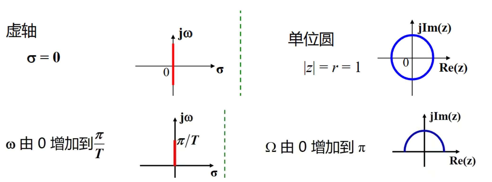

# 信号与系统 第6次作业题目（2024春）

## 题目

### 1

从 $s$ 变换到 $z$ 变换。

$z$ 变换的由来是通过将拉氏变换中 $e^{(\sigma+j\omega)T}$ 记作 $z$ 而得到的，目的是为了更方便地计算离散信号在频域的表示。请你写出二者在 $s$ 平面和 $z$ 平面的对应关系，这对于理解后续的离散傅里叶变换有很大帮助：

(1) $s$ 平面上， $e^{(\sigma+j\omega)T}$ 的 $\sigma$ 不同取值与 $z$ 平面上 $z$ 的取值的关系；

(2) $s$ 平面上， $e^{(\sigma+j\omega)T}$ 的 $\omega$ 不同取值与 $z$ 平面上 $z$ 的取值的关系；

(3) $s$ 平面上，什么样的区域可以映射到整个 $z$ 平面？

下面给出了完成第一、第二问的两个示例。

### 2

求出下列序列的 $z$ 变换，标出收敛域并绘制零极点分布图。

(1) $x(n)=\left(\displaystyle\frac{1}{3}\right)^{-n}u(n)$

(2) $x(n)=\left(\displaystyle\frac{1}{3}\right)^{n}u(-n)$

(3) $x(n)=\left(\displaystyle\frac{1}{2}\right)^{|n|}$

### 3

求下列 $X(Z)$ 的逆 $z$ 变换 $x(n)$。

(1) $X(z)=-2z^{-2}+2z+1$（ $0<|z|<+\infty$）

(2) $X(z)=\displaystyle\frac{1}{1-3z^{-1}}$（ $|z|<3$）

(3) $X(z)=\displaystyle\frac{1-0.5z^{-1}}{1-\frac{1}{4}z^{-2}}$（ $|z|>0.5$）

(4) $X(z)=\displaystyle\frac{z^{-1}}{(1-6z^{-1})^{2}}$（ $|z|>6$）

### 4

(1) 已知 $x(n)$ 的双边 $z$ 变换为 $X(z)$，证明 $\mathcal{Z}(x(-n))=X(z^{-1})$

(2) 已知因果序列 $x(n)$ 的 $z$ 变换为 $X(z)$，求序列的初值 $x(0)$ 和终值 $x(\infty)$

- $X(z)=\displaystyle\frac{1+z^{-1}+z^{-2}}{(1-z^{-1})(1-2z^{-1})}$
- $X(z)=\displaystyle\frac{1}{(1-0.5z^{-1})(1+0.5z^{-1})}$

### 5

已知 $\mathrm{DTFT}(0.8^{n}u[n])=\displaystyle\frac{1}{1-0.8e^{-j\omega}}$，利用性质计算接下来这些序列的离散时间傅里叶变换（DTFT）。

(1) $x[n]=0.8^{n}u[n-2]$

(2) $x[n]=0.8^{n}u[n]\cos(0.1\pi n)$

(3) $x[n]=n0.8^{n}u[n]$

(4) $x[n]=0.8^{-n}u[-n]$

(5) $x[n]=0.8^{n}$， $0\leq n\leq 5$，其余时刻 $x[n]=0$
