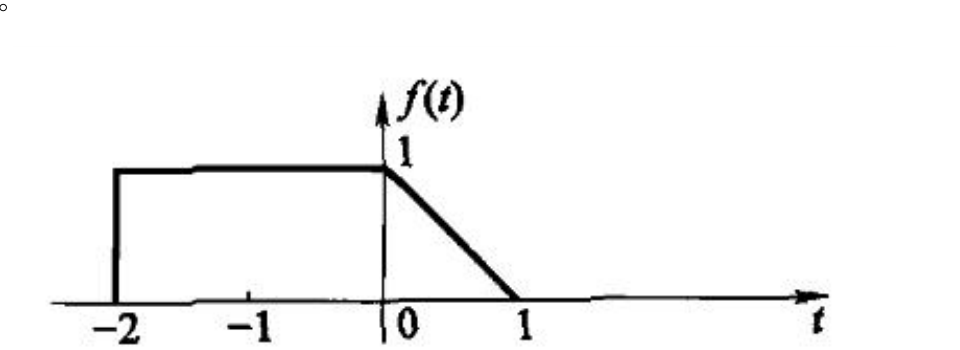
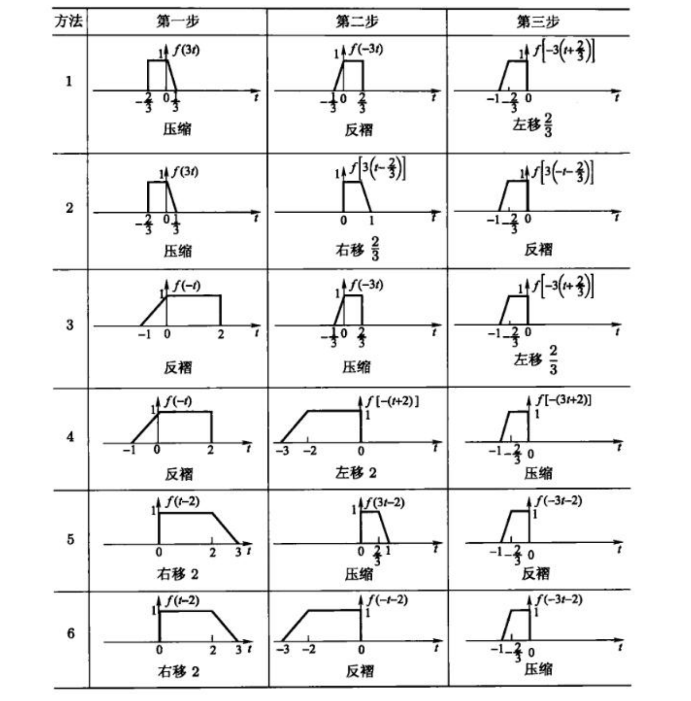

# 信号与系统 第1次作业答案（2025春）

## 题目与答案

### 1

#### 题目

判断正误，如果错误请给出原因。

(1) $X[n]=\cos n$ 为数字信号

(2) 周期信号之和是周期信号

(3) 非周期信号之和是非周期信号

(4) 能量信号一定是非周期信号

#### 答案

**答案：**

(1) 错，幅值仍是连续的。

(2) 错，例如 $\sin t+\sin(\pi t)$。

(3) 错，例如 $(\sin t+t)+(\sin t-t)$。

(4) 错，事实上除了 0 之外的能量信号才是非周期信号。

### 2

#### 题目

证明下列表达式成立：

(1) $\displaystyle\int_{-\infty}^{\infty}f(t)\delta(at+b)\,\mathrm{d}t=\int_{-\infty}^{\infty}\frac{f(t)}{|a|}\delta\left(t+\frac{b}{a}\right)\mathrm{d}t,\quad a\neq 0$

(2) $\displaystyle\int_{-\infty}^{\infty}f(t)\delta'(t)\,\mathrm{d}t=-f'(0)$

#### 答案

**答案：**

(1)

$$\text{左式}=\int_{-\infty}^{\infty}\frac{f(t)}{|a|}\,\mathrm{d}\big(u(at+b)\big)=\left.\frac{f(t)}{|a|}u(at+b)\right|_{-\infty}^{\infty}-\int_{-\infty}^{\infty}\frac{f'(t)}{|a|}u(at+b)\,\mathrm{d}t$$

$$=\frac{f(\infty)}{|a|}-\left(\frac{f(\infty)}{|a|}-\frac{f\left(-\frac{b}{a}\right)}{|a|}\right)=\text{右边}$$

(2)

$$\text{左式}=\int_{-\infty}^{\infty}f(t)\,\mathrm{d}\big(\delta(t)\big)=\left.f(t)\delta(t)\right|_{-\infty}^{\infty}-\int_{-\infty}^{\infty}\delta(t)\,\mathrm{d}\big(f'(t)\big)=-f'(0)$$

### 3

#### 题目

判断下列信号是否为周期信号，若是则给出最小正周期。

(1) $\cos(\cos t)$

(2) $e^{j2025t}$

(3) $\displaystyle f(t)=\sum_{n=0}^{\infty}(-1)^{n}[u(t-nT)-u(t-nT-T)]$（考虑正半轴部分）

#### 答案

**答案：**

(1) $\cos(\cos(t+\pi))=\cos(-\cos t)=\cos(\cos t)$，因此其周期为 $\pi$。（既然 $\pi$ 出来了，周期就不会是 $2\pi$。）

(2) 原信号的周期为 $\dfrac{2\pi}{2025}$。

(3) 化简求和号内的表达式，有

$$(-1)^{n}[u(t-nT)-u(t-nT-T)]=(-1)^{n},\quad nT<t<(n+1)T$$

也即原信号中任意一项只在 $T$ 的时间间隔内取值 $(-1)^{n}$，并且每一项的定义域不重叠，那么原式 $=(-1)^{\left\lfloor\frac{t}{T}\right\rfloor}$。因此原信号的周期为 $2T$。

### 4

#### 题目

$f(t)$ 的波形如下图所示，请用至少两种运算顺序（如先伸缩后平移）求 $f(-3t-2)$ 的波形。

#### 答案

**答案：** 6 种运算顺序结果一致： $f(-3t-2)$ 的波形在 $-1\le t\le -\dfrac{2}{3}$ 上由 0 线性上升到 1，在 $-\dfrac{2}{3}\le t\le 0$ 上恒为 1，区间外为 0。

各方法的三步运算如下。

| 方法 | 第一步 | 第二步 | 第三步 |
| --- | --- | --- | --- |
| 1 | $f(3t)$，压缩 | $f(-3t)$，反褶 | $f\left[-3\left(t+\frac{2}{3}\right)\right]$，左移 $\frac{2}{3}$ |
| 2 | $f(3t)$，压缩 | $f\left[3\left(t-\frac{2}{3}\right)\right]$，右移 $\frac{2}{3}$ | $f\left[3\left(-t-\frac{2}{3}\right)\right]$，反褶 |
| 3 | $f(-t)$，反褶 | $f(-3t)$，压缩 | $f\left[-3\left(t+\frac{2}{3}\right)\right]$，左移 $\frac{2}{3}$ |
| 4 | $f(-t)$，反褶 | $f[-(t+2)]$，左移 2 | $f[-(3t+2)]$，压缩 |
| 5 | $f(t-2)$，右移 2 | $f(3t-2)$，压缩 | $f(-3t-2)$，反褶 |
| 6 | $f(t-2)$，右移 2 | $f(-t-2)$，反褶 | $f(-3t-2)$，压缩 |

### 5

#### 题目

计算下列表达式的值。

(1) $\sin t\,\delta(t)$

(2) $\displaystyle\int_{-\infty}^{\infty}f(t_{0}-t)\delta(t)\,\mathrm{d}t$

(3) $\displaystyle\int_{-\infty}^{\infty}(e^{-t}+t)\delta(t+2)\,\mathrm{d}t$

(4) $\displaystyle\int_{-\infty}^{\infty}e^{-j\omega t}[\delta(t)-\delta(t-t_{0})]\,\mathrm{d}t$

#### 答案

**答案：**

(1) 原式 $=0$。

(2) 原式 $\displaystyle=\int_{-\infty}^{\infty}f(t_{0})\delta(t)\,\mathrm{d}t=f(t_{0})$。

(3) 原式 $=e^{2}-2$。

(4) 原式 $\displaystyle=\int_{-\infty}^{\infty}e^{-j\omega t}\delta(t)\,\mathrm{d}t-\int_{-\infty}^{\infty}e^{-j\omega t}\delta(t-t_{0})\,\mathrm{d}t=1-e^{-j\omega t_{0}}$。

### 6

#### 题目

判断正误，并给出过程：

(1) 函数集 $\{1,x,x^{2},\dots\}$ 是区间 $(0,2)$ 内的正交函数集

(2) 函数集 $\{1,\cos(t),\cos(2t),\dots\}$ 是区间 $(0,2\pi)$ 内的正交函数集

(3) 函数集 $\{\cos(t),\cos(2t),\dots\}$ 是区间 $\left(0,\dfrac{\pi}{2}\right)$ 内的正交函数集

#### 答案

**答案：**

(1) 错误，（构造反例） $\displaystyle\int_{0}^{2}x\,\mathrm{d}x=2\neq 0$。

(2) 正确， $\displaystyle\int_{0}^{2\pi}\cos(nt)\cos(mt)\,\mathrm{d}t=\frac{1}{2}\int_{0}^{2\pi}\cos((n+m)t)+\cos((n-m)t)\,\mathrm{d}t=0$。

(3) 错误， $\displaystyle\int_{0}^{\frac{\pi}{2}}\cos(t)\cos(2t)\,\mathrm{d}t=\frac{1}{2}\int_{0}^{\frac{\pi}{2}}\cos(3t)+\cos(t)\,\mathrm{d}t=\frac{1}{3}$。

### 7

#### 题目

对信号 $(t+1)e^{-t^{2}}$ 进行奇偶分解，并据此写出任意信号 $f(t)$ 的奇偶分解。

#### 答案

**答案：**

$$f_{\text{奇}}(t)=\frac{f(t)-f(-t)}{2},\qquad f_{\text{偶}}(t)=\frac{f(t)+f(-t)}{2}$$

由此可得

$$(t+1)e^{-t^{2}}=\frac{(t+1)e^{-t^{2}}-(-t+1)e^{-t^{2}}}{2}+\frac{(t+1)e^{-t^{2}}+(-t+1)e^{-t^{2}}}{2}=te^{-t^{2}}+e^{-t^{2}}$$

### 8

#### 题目

对信号 $e^{-t}$ 在区间 $(0,3)$ 进行直流-交流分解。

#### 答案

**答案：** 直流分量 $DC=\dfrac{1}{3}\displaystyle\int_{0}^{3}e^{-t}\,\mathrm{d}t=\dfrac{1-e^{-3}}{3}$，交流分量 $AC=e^{-t}-\dfrac{1-e^{-3}}{3}$。

### 9

#### 题目

考虑均方误差准则下的分解，用 $f(t)=at^{2}+bt+c,\ a\neq 0$ 在区间 $(-1,1)$ 上近似表示信号 $g(t)=te^{t}$。对比 $g(t)$ 在 0 处的二阶泰勒展开，谈谈你对两种分解方式的理解。

#### 答案

**答案：**

方法 1（考虑均方误差）：

均方误差 $\overline{\varepsilon^{2}}=\dfrac{1}{2}\displaystyle\int_{-1}^{1}\left[te^{t}-at^{2}-bt-c\right]^{2}\mathrm{d}t$，对 $a,b,c$ 求偏导，得

$$\frac{\partial\overline{\varepsilon^{2}}}{\partial a}=\int_{-1}^{1}\left(te^{t}-at^{2}-bt-c\right)t^{2}\,\mathrm{d}t=-2e+16e^{-1}-\frac{2}{5}a-\frac{2}{3}c$$

$$\frac{\partial\overline{\varepsilon^{2}}}{\partial b}=\int_{-1}^{1}\left(te^{t}-at^{2}-bt-c\right)t\,\mathrm{d}t=e-5e^{-1}-\frac{2}{3}b$$

$$\frac{\partial\overline{\varepsilon^{2}}}{\partial c}=\int_{-1}^{1}\left(te^{t}-at^{2}-bt-c\right)\mathrm{d}t=2e^{-1}-\frac{2}{3}a-2c$$

令 $\dfrac{\partial\overline{\varepsilon^{2}}}{\partial a}=\dfrac{\partial\overline{\varepsilon^{2}}}{\partial b}=\dfrac{\partial\overline{\varepsilon^{2}}}{\partial c}=0$，得

$$a=\frac{45}{4}\left(\frac{23}{3}e^{-1}-e\right),\quad b=\frac{3}{2}\left(e-5e^{-1}\right),\quad c=\frac{15}{4}e-\frac{111}{4}e^{-1}$$

即

$$f(t)=\left(\frac{345}{4}e^{-1}-\frac{45}{4}e\right)t^{2}+\frac{3}{2}\left(e-5e^{-1}\right)t+\frac{15}{4}e-\frac{111}{4}e^{-1}$$

方法 2（考虑正交函数）：

给出 $(-1,1)$ 上的正交函数集，易知 1 和 $t$ 在区间 $(-1,1)$ 上正交，求 $t^{2}+a_{1}t+a_{2}$ 使其与 1 和 $t$ 正交，即

$$\int_{-1}^{1}t^{2}+a_{1}t+a_{2}\,\mathrm{d}t=0,\qquad \int_{-1}^{1}t\left(t^{2}+a_{1}t+a_{2}\right)\mathrm{d}t=0$$

解得 $a_{1}=0,\ a_{2}=-\dfrac{1}{3}$。即 $\left\{1,t,t^{2}-\dfrac{1}{3}\right\}$ 为 $(-1,1)$ 的一个正交函数集。设 $f(t)=c_{1}+c_{2}t+c_{3}\left(t^{2}-\dfrac{1}{3}\right)$，则

$$c_{1}=\frac{\displaystyle\int_{-1}^{1}te^{t}\,\mathrm{d}t}{\displaystyle\int_{-1}^{1}1^{2}\,\mathrm{d}t}=e^{-1}$$

$$c_{2}=\frac{\displaystyle\int_{-1}^{1}t\left(te^{t}\right)\mathrm{d}t}{\displaystyle\int_{-1}^{1}t^{2}\,\mathrm{d}t}=\frac{3}{2}\left(e-5e^{-1}\right)$$

$$c_{3}=\frac{\displaystyle\int_{-1}^{1}\left(t^{2}-\frac{1}{3}\right)te^{t}\,\mathrm{d}t}{\displaystyle\int_{-1}^{1}\left(t^{2}-\frac{1}{3}\right)^{2}\mathrm{d}t}=\frac{16e^{-1}-2e-\frac{1}{3}\left(2e^{-1}\right)}{\left.\left(\frac{1}{5}t^{5}-\frac{2}{9}t^{3}+\frac{1}{9}t\right)\right|_{-1}^{1}}=\frac{45}{4}\left(\frac{23}{3}e^{-1}-e\right)$$

即

$$f(t)=\left(\frac{345}{4}e^{-1}-\frac{45}{4}e\right)t^{2}+\frac{3}{2}\left(e-5e^{-1}\right)t+\frac{15}{4}e-\frac{111}{4}e^{-1}$$

（其他正交分解类似。）

理解处言之有理即可。可以针对二者的计算方式进行思考，如泰勒展开目标在于精确拟合波形的变化趋势，均方误差下的分解侧重于使拟合波形与实际波形「能量」差最小等。

### 10

#### 题目

给定锯齿波形

$$f(t)=\begin{cases}t+2\pi, & -2\pi\le t<0\\[2pt] t, & 0\le t<2\pi\end{cases}$$

试使用正弦正交函数集 $\{1,\sin t,\sin 2t,\dots\}$，在 $(-2\pi,2\pi)$ 上做均方误差准则下的正交分解：

$$f(t)\approx c_{0}+c_{1}\sin t+c_{2}\sin(2t)+c_{3}\sin(3t)+\dots+c_{n}\sin(nt)$$

求出对应系数，并计算出 $n=2$ 时的均方误差 $\overline{\varepsilon^{2}}$。

#### 答案

**答案：**

$$c_{0}=\frac{\displaystyle\int_{-2\pi}^{2\pi}f(t)\,\mathrm{d}t}{\displaystyle\int_{-2\pi}^{2\pi}1^{2}\,\mathrm{d}t}=\pi$$

$$c_{n}=\frac{\displaystyle\int_{-2\pi}^{2\pi}\sin(nt)f(t)\,\mathrm{d}t}{\displaystyle\int_{-2\pi}^{2\pi}\sin^{2}(nt)\,\mathrm{d}t}=\frac{\displaystyle\int_{-2\pi}^{0}(t+2\pi)\sin(nt)\,\mathrm{d}t+\int_{0}^{2\pi}t\sin(nt)\,\mathrm{d}t}{\displaystyle\int_{-2\pi}^{2\pi}\frac{1-\cos(2nt)}{2}\,\mathrm{d}t}$$

$$=\frac{\displaystyle\int_{-2\pi}^{2\pi}t\sin(nt)\,\mathrm{d}t}{\displaystyle\int_{-2\pi}^{2\pi}\frac{1}{2}\,\mathrm{d}t}=\frac{\left.\left(-\frac{1}{n}t\cos(nt)+\frac{1}{n^{2}}\sin(nt)\right)\right|_{-2\pi}^{2\pi}}{\displaystyle\int_{-2\pi}^{2\pi}\frac{1}{2}\,\mathrm{d}t}=-\frac{2}{n},\quad n\neq 0$$

因此 $f(t)\approx\pi-\displaystyle\sum_{1}^{n}\frac{2}{n}\sin(nt)$。

$$\overline{\varepsilon^{2}}=\frac{1}{4\pi}\int_{-2\pi}^{2\pi}\left(f(t)-\pi+2\sin(t)+\sin(2t)\right)^{2}\mathrm{d}t$$

$$=\frac{1}{4\pi}\int_{-2\pi}^{2\pi}(f(t)-\pi)^{2}+4\sin^{2}(t)+\sin^{2}(2t)+4(f(t)-\pi)\sin t+2(f(t)-\pi)\sin 2t+4\sin t\sin(2t)\,\mathrm{d}t$$

$$=\frac{1}{4\pi}\int_{-2\pi}^{2\pi}(f(t)-\pi)^{2}+2(1-\cos(2t))+\frac{1-\cos(4t)}{2}+4t\sin t+2t\sin 2t+2[\cos t-\cos(3t)]\,\mathrm{d}t$$

$$=\frac{1}{4\pi}\left[2\int_{-\pi}^{\pi}t^{2}\,\mathrm{d}t+\int_{-2\pi}^{2\pi}\frac{5}{2}+4t\sin t+2t\sin(2t)\,\mathrm{d}t\right]=\frac{\pi^{2}}{3}-\frac{5}{2}$$
