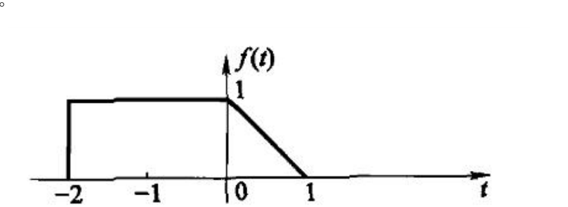

# 信号与系统 第1次作业题目（2025春）

## 题目

### 1

判断正误，如果错误请给出原因。

(1) $X[n]=\cos n$ 为数字信号

(2) 周期信号之和是周期信号

(3) 非周期信号之和是非周期信号

(4) 能量信号一定是非周期信号

### 2

证明下列表达式成立：

(1) $\displaystyle\int_{-\infty}^{\infty}f(t)\delta(at+b)\,\mathrm{d}t=\int_{-\infty}^{\infty}\frac{f(t)}{|a|}\delta\left(t+\frac{b}{a}\right)\mathrm{d}t,\quad a\neq 0$

(2) $\displaystyle\int_{-\infty}^{\infty}f(t)\delta'(t)\,\mathrm{d}t=-f'(0)$

### 3

判断下列信号是否为周期信号，若是则给出最小正周期。

(1) $\cos(\cos t)$

(2) $e^{j2025t}$

(3) $\displaystyle f(t)=\sum_{n=0}^{\infty}(-1)^{n}[u(t-nT)-u(t-nT-T)]$（考虑正半轴部分）

### 4

$f(t)$ 的波形如下图所示，请用至少两种运算顺序（如先伸缩后平移）求 $f(-3t-2)$ 的波形。

### 5

计算下列表达式的值。

(1) $\sin t\,\delta(t)$

(2) $\displaystyle\int_{-\infty}^{\infty}f(t_{0}-t)\delta(t)\,\mathrm{d}t$

(3) $\displaystyle\int_{-\infty}^{\infty}(e^{-t}+t)\delta(t+2)\,\mathrm{d}t$

(4) $\displaystyle\int_{-\infty}^{\infty}e^{-j\omega t}[\delta(t)-\delta(t-t_{0})]\,\mathrm{d}t$

### 6

判断正误，并给出过程：

(1) 函数集 $\{1,x,x^{2},\dots\}$ 是区间 $(0,2)$ 内的正交函数集

(2) 函数集 $\{1,\cos(t),\cos(2t),\dots\}$ 是区间 $(0,2\pi)$ 内的正交函数集

(3) 函数集 $\{\cos(t),\cos(2t),\dots\}$ 是区间 $\left(0,\dfrac{\pi}{2}\right)$ 内的正交函数集

### 7

对信号 $(t+1)e^{-t^{2}}$ 进行奇偶分解，并据此写出任意信号 $f(t)$ 的奇偶分解。

### 8

对信号 $e^{-t}$ 在区间 $(0,3)$ 进行直流-交流分解。

### 9

考虑均方误差准则下的分解，用 $f(t)=at^{2}+bt+c,\ a\neq 0$ 在区间 $(-1,1)$ 上近似表示信号 $g(t)=te^{t}$。对比 $g(t)$ 在 0 处的二阶泰勒展开，谈谈你对两种分解方式的理解。

### 10

给定锯齿波形

$$f(t)=\begin{cases}t+2\pi, & -2\pi\le t<0\\[2pt] t, & 0\le t<2\pi\end{cases}$$

试使用正弦正交函数集 $\{1,\sin t,\sin 2t,\dots\}$，在 $(-2\pi,2\pi)$ 上做均方误差准则下的正交分解：

$$f(t)\approx c_{0}+c_{1}\sin t+c_{2}\sin(2t)+c_{3}\sin(3t)+\dots+c_{n}\sin(nt)$$

求出对应系数，并计算出 $n=2$ 时的均方误差 $\overline{\varepsilon^{2}}$。
