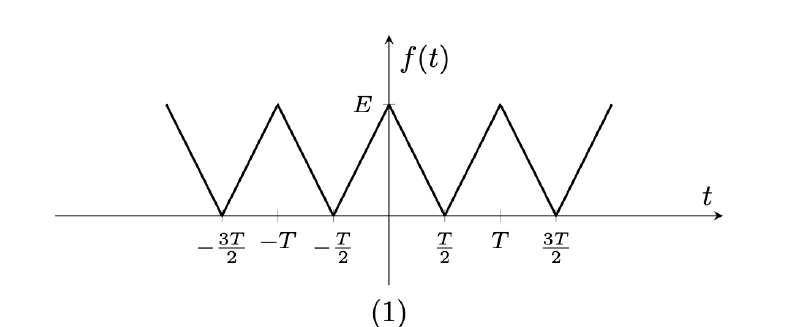
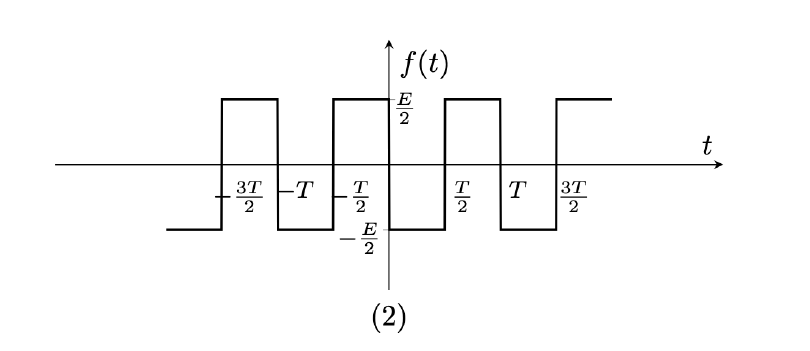
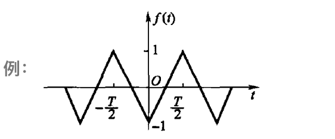
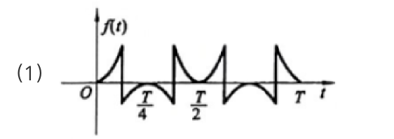
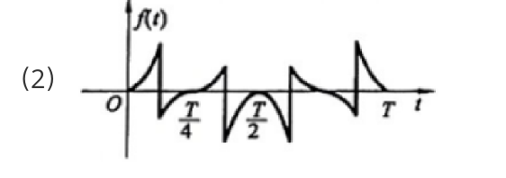
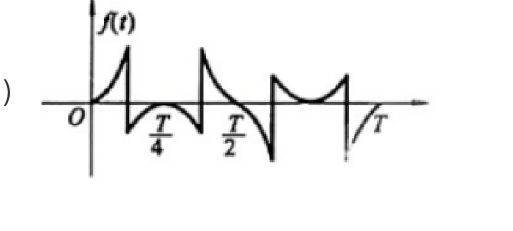
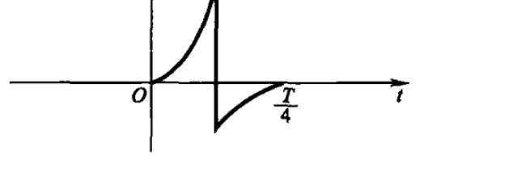
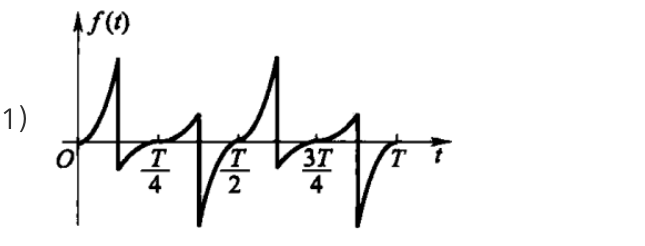
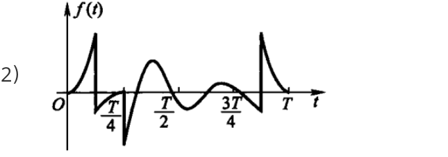

# 信号与系统 第2次作业答案（2025春）

## 题目与答案

### 1

#### 题目

求下图所示周期信号的傅里叶级数。

(1)

(2)

#### 答案

**答案：**

(1) 如图所示，可以写出 $f(t)$ 的表达式

$$f(t)=\begin{cases}\dfrac{2E}{T}t+E, & -\dfrac{T}{2}<t<0\\[6pt] -\dfrac{2E}{T}t+E, & 0<t<\dfrac{T}{2}\end{cases}$$

由于 $f(t)$ 是偶函数，其傅里叶级数中只有直流和余弦分量，故可设

$$f(t)=\frac{a_{0}}{2}+\sum_{n=1}^{\infty}a_{n}\cos(n\omega_{0}t)$$

求出各项系数

$$a_{0}=\frac{2}{T}\int_{-\frac{T}{2}}^{\frac{T}{2}}f(t)\,\mathrm{d}t$$

$$=\frac{2}{T}\left[\int_{-\frac{T}{2}}^{0}\left(\frac{2E}{T}t+E\right)\mathrm{d}t+\int_{0}^{\frac{T}{2}}\left(-\frac{2E}{T}t+E\right)\mathrm{d}t\right]$$

$$=\frac{2}{T}\left[\left.\left(\frac{E}{T}t^{2}+Et\right)\right|_{-\frac{T}{2}}^{0}+\left.\left(-\frac{E}{T}t^{2}+Et\right)\right|_{0}^{\frac{T}{2}}\right]=E$$

$$a_{n}=\frac{2}{T}\int_{-\frac{T}{2}}^{\frac{T}{2}}f(t)\cos(n\omega_{0}t)\,\mathrm{d}t$$

$$=\frac{2}{T}\left[\int_{-\frac{T}{2}}^{0}\left(\frac{2E}{T}t+E\right)\cos(n\omega_{0}t)\,\mathrm{d}t+\int_{0}^{\frac{T}{2}}\left(-\frac{2E}{T}t+E\right)\cos(n\omega_{0}t)\,\mathrm{d}t\right]$$

$$=\frac{4}{T}\int_{0}^{\frac{T}{2}}\left(-\frac{2E}{T}t+E\right)\cos(n\omega_{0}t)\,\mathrm{d}t$$

$$=-\frac{8E}{T^{2}}\left[\left.t\cdot\frac{\sin(n\omega_{0}t)}{n\omega_{0}}\right|_{0}^{\frac{T}{2}}-\int_{0}^{\frac{T}{2}}\frac{\sin(n\omega_{0}t)}{n\omega_{0}}\,\mathrm{d}t\right]+\left.\frac{4E}{T}\frac{\sin(n\omega_{0}t)}{n\omega_{0}}\right|_{0}^{\frac{T}{2}}$$

$$=-\frac{8E}{n\omega_{0}T^{2}}\cdot\left.\frac{\cos(n\omega_{0}t)}{n\omega_{0}}\right|_{0}^{\frac{T}{2}}$$

$$=\frac{2E}{n^{2}\pi^{2}}\left[1-(-1)^{n}\right]=\begin{cases}0, & n\text{ 为偶数}\\[4pt] \dfrac{4E}{n^{2}\pi^{2}}, & n\text{ 为奇数}\end{cases}$$

其中 $n=1,2,3,\dots$。最终得到 $f(t)$ 的傅里叶级数

$$f(t)=\frac{E}{2}+\sum_{n=0}^{\infty}\frac{4E}{(2n+1)^{2}\pi^{2}}\cos[(2n+1)\omega_{0}t]$$

(2) 如图所示，可以写出 $f(t)$ 的表达式

$$f(t)=\begin{cases}\dfrac{E}{2}, & -\dfrac{T}{2}<t<0\\[6pt] -\dfrac{E}{2}, & 0<t<\dfrac{T}{2}\end{cases}$$

由于 $f(t)$ 是奇函数，其傅里叶级数中只有正弦分量，故可设

$$f(t)=\sum_{n=1}^{\infty}b_{n}\sin(n\omega_{0}t)$$

求出各项系数

$$b_{n}=\frac{2}{T}\int_{-\frac{T}{2}}^{\frac{T}{2}}f(t)\sin(n\omega_{0}t)\,\mathrm{d}t$$

$$=\frac{2}{T}\int_{-\frac{T}{2}}^{0}\frac{E}{2}\sin(n\omega_{0}t)\,\mathrm{d}t+\int_{0}^{\frac{T}{2}}\left(-\frac{E}{2}\right)\cdot\sin(n\omega_{0}t)\,\mathrm{d}t$$

$$=-\frac{2E}{T}\int_{0}^{\frac{T}{2}}\sin(n\omega_{0}t)\,\mathrm{d}t$$

$$=\left.\frac{2E}{T}\frac{\cos(n\omega_{0}t)}{n\omega_{0}}\right|_{0}^{\frac{T}{2}}$$

$$=\frac{E}{n\pi}\left[(-1)^{n}-1\right]=\begin{cases}0, & n\text{ 为偶数}\\[4pt] -\dfrac{2E}{n\pi}, & n\text{ 为奇数}\end{cases}$$

其中 $n=1,2,3,\dots$。最终得到 $f(t)$ 的傅里叶级数

$$f(t)=-\sum_{n=0}^{\infty}\frac{2E}{(2n+1)\pi}\sin[(2n+1)\omega_{0}t]$$

### 2

#### 题目

判断周期信号 $f(t)$ 的对称性，并写出其傅里叶级数中所含有的频率分量。

例：

#### 答案

答： $f(t)$ 是偶函数、奇谐函数。其傅里叶级数中仅含有奇次谐波的余弦分量。

(1)

(2)

(3)

**答案：**

(1) $f(t)$ 是偶函数、偶谐函数。其傅里叶级数中仅含有直流和偶次谐波的余弦分量。

(2) $f(t)$ 是偶函数、奇谐函数。其傅里叶级数中仅含有奇次谐波的余弦分量。

(3) $f(t)$ 是奇函数、奇谐函数。其傅里叶级数中仅含有奇次谐波的正弦分量。

### 3

#### 题目

已知周期函数 $f(t)$ 前四分之一周期的波形如图所示，根据以下情况，补全 $f(t)$ 一个周期的波形。

(1) $f(t)$ 是奇函数，仅含有偶次谐波。

(2) $f(t)$ 是偶函数，含有偶次和奇次谐波。

#### 答案

**答案：**

(1)

(2)

由于 $f(t)$ 同时含有偶次和奇次谐波，在 $\left(\dfrac{T}{4},\dfrac{3T}{4}\right)$ 可能是任意形状，此处以一段衰减的正弦信号为例。

### 4

#### 题目

若已知 $\mathcal{F}[f(t)]=F(\omega)$，利用傅里叶变换性质确定下列信号的傅里叶变换。

(1) $(5-3t)f(-3t)$

(2) $f(5-3t)$

(3) $f(-3t)\cos 5t$

(4) $t\dfrac{\mathrm{d}}{\mathrm{d}t}f(t)$

#### 答案

**答案：**

(1) 定义 $g(t)=f(-3t)$，则根据尺度变换性质，有

$$\mathcal{F}[g(t)]=\mathcal{F}[f(-3t)]=\frac{1}{3}F\left(-\frac{\omega}{3}\right)$$

根据频域微分性质，有

$$\mathcal{F}[tg(t)]=j\frac{\mathrm{d}}{\mathrm{d}\omega}\left[\frac{1}{3}F\left(-\frac{\omega}{3}\right)\right]=-\frac{j}{9}F'\left(-\frac{\omega}{3}\right)$$

根据线性性质，有

$$\mathcal{F}[(5-3t)g(t)]=5\mathcal{F}[g(t)]-3\mathcal{F}[tg(t)]=\frac{5}{3}F\left(-\frac{\omega}{3}\right)+\frac{j}{3}F'\left(-\frac{\omega}{3}\right)$$

(2) 由 (1) 知

$$\mathcal{F}[f(-3t)]=\frac{1}{3}F\left(-\frac{\omega}{3}\right)$$

根据时移性质，有

$$\mathcal{F}[f(5-3t)]=\mathcal{F}\left[f\left(-3\left(t-\frac{5}{3}\right)\right)\right]=\frac{1}{3}F\left(-\frac{\omega}{3}\right)e^{-j\omega\frac{5}{3}}$$

(3) 由 (1) 知

$$\mathcal{F}[f(-3t)]=\frac{1}{3}F\left(-\frac{\omega}{3}\right)$$

根据欧拉公式，有

$$\cos 5t=\frac{1}{2}\left(e^{5jt}+e^{-5jt}\right)$$

根据频移性质，有

$$\mathcal{F}[f(-3t)\cos 5t]=\frac{1}{6}F\left(\frac{-\omega+5}{3}\right)+\frac{1}{6}F\left(\frac{-\omega-5}{3}\right)$$

(4) 定义 $g(t)=\dfrac{\mathrm{d}}{\mathrm{d}t}f(t)$，则根据时域微分性质，有

$$\mathcal{F}[g(t)]=\mathcal{F}\left[\frac{\mathrm{d}}{\mathrm{d}t}f(t)\right]=j\omega F(\omega)$$

根据频域微分性质，有

$$\mathcal{F}[tg(t)]=j\frac{\mathrm{d}}{\mathrm{d}\omega}[j\omega F(\omega)]=-F(\omega)-\omega F'(\omega)$$

### 5

#### 题目

利用时域频域对称性，求出下列信号的傅里叶反变换。

(1) $\pi[u(\omega+\omega_{0})-u(\omega-\omega_{0})]$

(2) $2\pi\delta(\omega-\pi)+4\pi\delta(\omega)+6\pi\delta(\omega+\pi)$

#### 答案

**答案：**

(1) 令 $F(\omega)=\pi[u(\omega+\omega_{0})-u(\omega-\omega_{0})]$。由于

$$\mathcal{F}[u(t)]=\pi\delta(\omega)+\frac{1}{j\omega}$$

根据傅里叶变换时移性质，有

$$\mathcal{F}[F(t)]=\pi\mathcal{F}[u(t+\omega_{0})-u(t-\omega_{0})]$$

$$=\pi\left[\pi\delta(\omega)+\frac{1}{j\omega}\right]\left[e^{j\omega\omega_{0}}-e^{-j\omega\omega_{0}}\right]$$

$$=\pi\left[\pi\delta(\omega)+\frac{1}{j\omega}\right]\cdot 2j\sin(\omega_{0}\omega)$$

$$=\frac{2\pi}{\omega}\sin(\omega_{0}\omega)=f(\omega)$$

根据时域频域对称性，有

$$\mathcal{F}^{-1}\{\pi[u(\omega+\omega_{0})-u(\omega-\omega_{0})]\}=\mathcal{F}^{-1}[F(\omega)]$$

$$=\frac{1}{2\pi}f(-t)=\frac{1}{2\pi}\cdot\frac{2\pi}{t}\sin(\omega_{0}t)=\omega_{0}\,\mathrm{Sa}(\omega_{0}t)$$

(2) 由于

$$\mathcal{F}[1]=2\pi\delta(\omega)$$

故有

$$\mathcal{F}^{-1}[2\pi\delta(\omega)]=1$$

根据傅里叶变换频移性质，有

$$\mathcal{F}^{-1}[2\pi\delta(\omega-\pi)]=e^{j\pi t}$$

$$\mathcal{F}^{-1}[2\pi\delta(\omega+\pi)]=e^{-j\pi t}$$

根据傅里叶变换线性性质，有

$$\mathcal{F}^{-1}[2\pi\delta(\omega-\pi)+4\pi\delta(\omega)+6\pi\delta(\omega+\pi)]=e^{j\pi t}+2+3e^{-j\pi t}$$

### 6

#### 题目

(1) 已知三角脉冲 $f_{1}(t)$ 的图像，若 $\mathcal{F}[f_{1}(t)]=F_{1}(\omega)$，根据傅里叶变换定义，证明：

$$F_{1}(\omega)=\frac{E\tau}{2}\,\mathrm{Sa}^{2}\left(\frac{\omega\tau}{4}\right)$$

> $f_{1}(t)=E-\dfrac{2E}{\tau}|t|$（ $|t|\le\dfrac{\tau}{2}$），即峰值为 $E$、底宽为 $\tau$ 的三角脉冲。

(2) 求 $f_{2}(t)=f_{1}\left(t-\dfrac{\tau}{2}\right)\cos(\omega_{0}t)$ 的傅里叶变换 $F_{2}(\omega)$。

#### 答案

**答案：**

(1) 根据傅里叶变换的定义

$$F_{1}(\omega)=\int_{-\frac{\tau}{2}}^{\frac{\tau}{2}}\left(E-\frac{2E}{\tau}|t|\right)e^{-j\omega t}\,\mathrm{d}t$$

$$=2E\int_{0}^{\frac{\tau}{2}}\left(1-\frac{2}{\tau}t\right)\cos(\omega t)\,\mathrm{d}t$$

$$=\left.\frac{2E}{\omega}\sin(\omega t)\right|_{0}^{\frac{\tau}{2}}-\frac{4E}{\omega\tau}\left[\left.t\sin(\omega t)\right|_{0}^{\frac{\tau}{2}}-\int_{0}^{\frac{\tau}{2}}\sin(\omega t)\,\mathrm{d}t\right]$$

$$=\frac{4E}{\omega^{2}\tau}\left[1-\cos\left(\frac{\omega\tau}{2}\right)\right]$$

$$=\frac{8E}{\omega^{2}\tau}\sin^{2}\left(\frac{\omega\tau}{4}\right)$$

$$=\frac{E\tau}{2}\,\mathrm{Sa}^{2}\left(\frac{\omega\tau}{4}\right)$$

(2) 根据傅里叶变换时移性质，有

$$\mathcal{F}\left[f_{1}\left(t-\frac{\tau}{2}\right)\right]=F_{1}(\omega)e^{-j\omega\frac{\tau}{2}}$$

根据欧拉公式，有

$$\cos(\omega_{0}t)=\frac{1}{2}\left(e^{j\omega_{0}t}+e^{-j\omega_{0}t}\right)$$

因此，可以得到

$$F_{2}(\omega)=\frac{1}{2}\left\{\mathcal{F}\left[f_{1}\left(t-\frac{\tau}{2}\right)e^{j\omega_{0}t}\right]+\mathcal{F}\left[f_{1}\left(t-\frac{\tau}{2}\right)e^{-j\omega_{0}t}\right]\right\}$$

$$=\frac{1}{2}\left[F_{1}(\omega-\omega_{0})e^{-j(\omega-\omega_{0})\frac{\tau}{2}}+F_{1}(\omega+\omega_{0})e^{-j(\omega+\omega_{0})\frac{\tau}{2}}\right]$$

$$=\frac{E\tau}{4}e^{-j\omega\frac{\tau}{2}}\left[\mathrm{Sa}^{2}\frac{(\omega-\omega_{0})\tau}{4}e^{j\omega_{0}\frac{\tau}{2}}+\mathrm{Sa}^{2}\frac{(\omega+\omega_{0})\tau}{4}e^{-j\omega_{0}\frac{\tau}{2}}\right]$$
