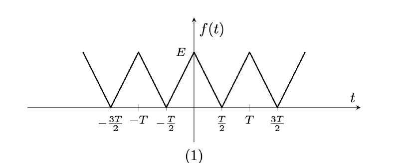
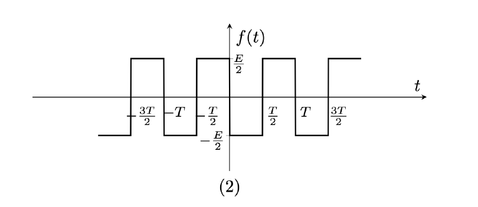
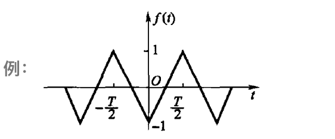
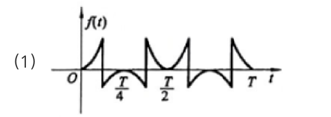
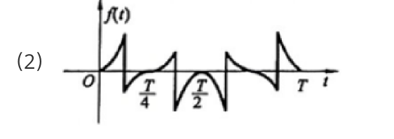
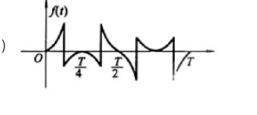
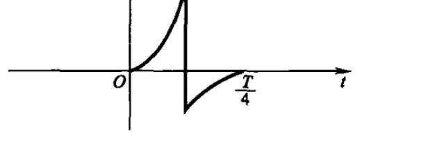

# 信号与系统 第2次作业题目（2025春）

## 题目

### 1

求下图所示周期信号的傅里叶级数。

(1)

(2)

### 2

判断周期信号 $f(t)$ 的对称性，并写出其傅里叶级数中所含有的频率分量。

例：

答： $f(t)$ 是偶函数、奇谐函数。其傅里叶级数中仅含有奇次谐波的余弦分量。

(1)

(2)

(3)

### 3

已知周期函数 $f(t)$ 前四分之一周期的波形如图所示，根据以下情况，补全 $f(t)$ 一个周期的波形。

(1) $f(t)$ 是奇函数，仅含有偶次谐波。

(2) $f(t)$ 是偶函数，含有偶次和奇次谐波。

### 4

若已知 $\mathcal{F}[f(t)]=F(\omega)$，利用傅里叶变换性质确定下列信号的傅里叶变换。

(1) $(5-3t)f(-3t)$

(2) $f(5-3t)$

(3) $f(-3t)\cos 5t$

(4) $t\dfrac{\mathrm{d}}{\mathrm{d}t}f(t)$

### 5

利用时域频域对称性，求出下列信号的傅里叶反变换。

(1) $\pi[u(\omega+\omega_{0})-u(\omega-\omega_{0})]$

(2) $2\pi\delta(\omega-\pi)+4\pi\delta(\omega)+6\pi\delta(\omega+\pi)$

### 6

(1) 已知三角脉冲 $f_{1}(t)$ 的图像，若 $\mathcal{F}[f_{1}(t)]=F_{1}(\omega)$，根据傅里叶变换定义，证明：

$$F_{1}(\omega)=\frac{E\tau}{2}\,\mathrm{Sa}^{2}\left(\frac{\omega\tau}{4}\right)$$

> $f_{1}(t)=E-\dfrac{2E}{\tau}|t|$（ $|t|\le\dfrac{\tau}{2}$），即峰值为 $E$、底宽为 $\tau$ 的三角脉冲。

(2) 求 $f_{2}(t)=f_{1}\left(t-\dfrac{\tau}{2}\right)\cos(\omega_{0}t)$ 的傅里叶变换 $F_{2}(\omega)$。
