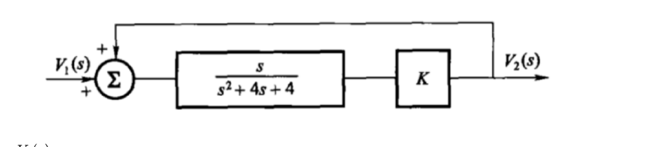
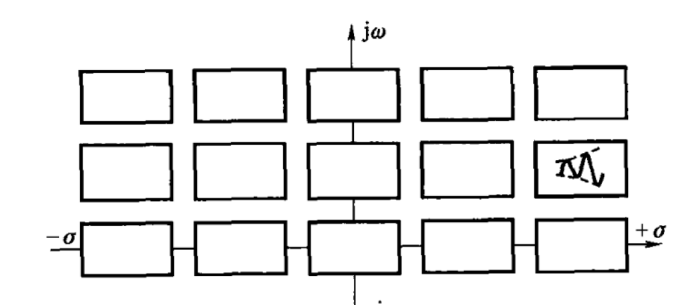
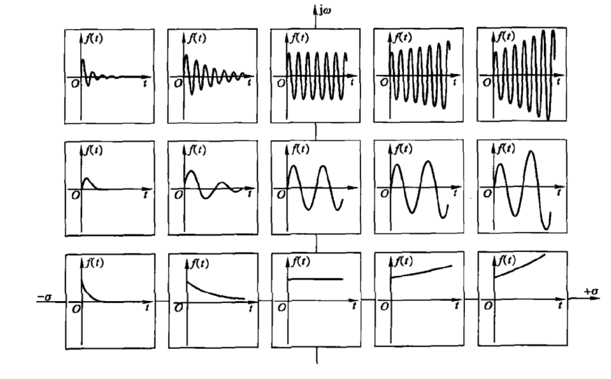

# 信号与系统 第4次作业答案（2025春）

## 题目与答案

### 1

#### 题目

给定系统微分方程、起始状态以及激励信号分别为以下两种情况：

(1) $\dfrac{\mathrm{d}}{\mathrm{d}t}r(t)+2r(t)=e(t),\ r(0_{-})=0,\ e(t)=u(t)$

(2) $\dfrac{\mathrm{d}}{\mathrm{d}t}r(t)+2r(t)=3\dfrac{\mathrm{d}}{\mathrm{d}t}e(t),\ r(0_{-})=0,\ e(t)=u(t)$

判断在起始点是否发生跳变，写出 $r(0_{+})$ 的值。

#### 答案

**答案：**

(1) 将 $e(t)=u(t)$ 带入微分方程，有： $\dfrac{\mathrm{d}}{\mathrm{d}t}r(t)+2r(t)=u(t)$。为了平衡，则一阶导数项含有 $u(t)$ 分量，因此有

$$r(0_{+})-r(0_{-})=\int_{0_{-}}^{0_{+}}\frac{\mathrm{d}}{\mathrm{d}t}r(t)\,\mathrm{d}t=\int_{0_{-}}^{0_{+}}u(t)\,\mathrm{d}t=0$$

故不跳变。

(2) 将 $e(t)=u(t)$ 带入微分方程，有： $\dfrac{\mathrm{d}}{\mathrm{d}t}r(t)+2r(t)=3\delta(t)$。为了平衡，则一阶导数项含有 $\delta(t)$ 分量，因此有

$$r(0_{+})-r(0_{-})=\int_{0_{-}}^{0_{+}}\frac{\mathrm{d}}{\mathrm{d}t}r(t)\,\mathrm{d}t=\int_{0_{-}}^{0_{+}}3\delta(t)\,\mathrm{d}t=3$$

故跳变。

### 2

#### 题目

给定系统微分方程

$$\frac{\mathrm{d}^{2}}{\mathrm{d}t^{2}}r(t)+3\frac{\mathrm{d}}{\mathrm{d}t}r(t)+2r(t)=\frac{\mathrm{d}}{\mathrm{d}t}e(t)+3e(t)$$

$$e(t)=u(t),\quad r(0^{-})=1,\quad r'(0^{-})=2$$

(1) 求自由响应和受迫响应

(2) 求零输入响应

(3) 使用以下三种方法，分别求零状态响应

a. 求出冲激响应，并与输入作卷积

b. 根据零状态响应形式和 $0^{-}$ 处条件，使用待定系数法求解

c. 拉氏变换法

#### 答案

**答案：**

(1) 自由响应： $\left(2e^{-t}-\dfrac{5}{2}e^{-2t}\right)u(t)$，受迫响应： $\dfrac{3}{2}u(t)$。

(2) 零输入响应： $r_{zi}(t)=\left(4e^{-t}-3e^{-2t}\right)u(t)$。

(3) 零状态响应： $r_{zs}(t)=\left(-2e^{-t}+\dfrac{1}{2}e^{-2t}+\dfrac{3}{2}\right)u(t)$。

**解析：**

(1) 先求齐次解形式。根据原方程，写出齐次方程

$$\frac{\mathrm{d}^{2}}{\mathrm{d}t^{2}}r(t)+3\frac{\mathrm{d}}{\mathrm{d}t}r(t)+2r(t)=0$$

对应特征方程

$$\lambda^{2}+3\lambda+2=0$$

解得特征根 $\lambda_{1}=-1,\ \lambda_{2}=-2$，故可得齐次解形式 $a_{1}e^{-t}+a_{2}e^{-2t}$。

再求特解。由于激励函数 $e(t)$ 为常数，故设响应函数的特解形式为 $r(t)=b$（ $t\ge 0$），代入原方程有 $2b=3$，故原方程有一特解 $r(t)=\dfrac{3}{2}$（ $t\ge 0$）。

最后求完全解。为求 $0^{+}$ 处初始条件，先根据冲激函数匹配法，求 $0^{-}$ 到 $0^{+}$ 跳变：将 $e(t)=u(t)$ 代入原方程，得

$$\frac{\mathrm{d}^{2}}{\mathrm{d}t^{2}}r(t)+3\frac{\mathrm{d}}{\mathrm{d}t}r(t)+2r(t)=\delta(t)+3u(t)$$

故可设 $\dfrac{\mathrm{d}^{2}}{\mathrm{d}t^{2}}r(t)=a\delta(t)+b\Delta u(t)$，则 $\dfrac{\mathrm{d}}{\mathrm{d}t}r(t)=a\Delta u(t)$， $r(t)=0$ 代入原方程左端

$$\begin{cases}a=1\\ b+3a=3\end{cases}$$
即 $a=1$， $b=-1$，积分得

$$r'(0^{+})=r'(0^{-})+\int_{0_{-}}^{0_{+}}[\delta(t)-\Delta u(t)]\,\mathrm{d}t=2+1=3$$

$$r(0^{+})=r(0^{-})+\int_{0_{-}}^{0_{+}}\Delta u(t)\,\mathrm{d}t=1+0=1$$

又由于完全解形式为 $r(t)=a_{1}e^{-t}+a_{2}e^{-2t}+\dfrac{3}{2}$（ $t\ge 0$），代入初始条件得

$$\begin{cases}a_{1}+a_{2}+\dfrac{3}{2}=1\\[4pt] -a_{1}-2a_{2}=3\end{cases}$$

最终，完全解为 $r(t)=\left(2e^{-t}-\dfrac{5}{2}e^{-2t}+\dfrac{3}{2}\right)u(t)$。

(2) 零输入响应满足齐次方程

$$\frac{\mathrm{d}^{2}}{\mathrm{d}t^{2}}r(t)+3\frac{\mathrm{d}}{\mathrm{d}t}r(t)+2r(t)=0$$

故有形式 $r_{zi}(t)=a_{1}e^{-t}+a_{2}e^{-2t}$（ $t\ge 0$），代入初始条件

$$r(0^{+})=r(0^{-})=1$$

$$r'(0^{+})=r'(0^{-})=2$$

得

$$\begin{cases}a_{1}+a_{2}=1\\ -a_{1}-2a_{2}=2\end{cases}$$

最终，零输入响应为 $r_{zi}(t)=\left(4e^{-t}-3e^{-2t}\right)u(t)$。

(3) 三种方法如下。

a. 冲激响应 $h(t)$ 满足方程

$$\frac{\mathrm{d}^{2}}{\mathrm{d}t^{2}}h(t)+3\frac{\mathrm{d}}{\mathrm{d}t}h(t)+2h(t)=\frac{\mathrm{d}}{\mathrm{d}t}\delta(t)+3\delta(t)$$

由于 $\delta^{(k)}(t)=0,\ t>0,\ k=0,1,2\dots$，故 $t>0$ 时， $h(t)$ 满足对应齐次方程，有形式 $a_{1}e^{-t}+a_{2}e^{-2t}$。

根据冲激函数匹配法，求 $0^{-}$ 到 $0^{+}$ 跳变：设 $\dfrac{\mathrm{d}^{2}}{\mathrm{d}t^{2}}h(t)=a\delta'(t)+b\delta(t)+c\Delta u(t)$，则 $\dfrac{\mathrm{d}}{\mathrm{d}t}r(t)=a\delta(t)+b\Delta u(t)$， $r(t)=a\Delta u(t)$ 代入原方程左端

$$\begin{cases}a=1\\ b+3a=3\\ c+3b+2a=0\end{cases}$$

即 $a=1$， $b=0$， $c=-2$，积分得

$$h'(0^{+})=h'(0^{-})+\int_{0_{-}}^{0_{+}}[\delta'(t)-2\Delta u(t)]\,\mathrm{d}t=0+0=0$$

$$h(0^{+})=h(0^{-})+\int_{0_{-}}^{0_{+}}\delta(t)\,\mathrm{d}t=0+1=1$$

将 $h(t)=a_{1}e^{-t}+a_{2}e^{-2t}$ 代入初始条件，得

$$\begin{cases}a_{1}+a_{2}=1\\ -a_{1}-2a_{2}=0\end{cases}$$

故冲激响应 $h(t)=\left(2e^{-t}-e^{-2t}\right)u(t)$，然后与输入 $e(t)=u(t)$ 作卷积

$$r_{zs}(t)=h(t)*u(t)=\int_{-\infty}^{t}h(\tau)\,\mathrm{d}\tau=\int_{0}^{t}\left(2e^{-\tau}-e^{-2\tau}\right)\mathrm{d}\tau$$

$$=-2e^{-t}+\frac{1}{2}e^{-2t}+\frac{3}{2},\quad t\ge 0$$

b. 零状态响应满足初始条件 $r(0^{-})=r'(0^{-})=0$，同 (1) 可求得

$$r'(0^{+})=r'(0^{-})+\int_{0_{-}}^{0_{+}}[\delta(t)-\Delta u(t)]\,\mathrm{d}t=0+1=1$$

$$r(0^{+})=r(0^{-})+\int_{0_{-}}^{0_{+}}\Delta u(t)\,\mathrm{d}t=0+0=0$$

设零状态响应形式为 $r_{zs}(t)=a_{1}e^{-t}+a_{2}e^{-2t}+\dfrac{3}{2}$（ $t\ge 0$），代入初始条件得

$$\begin{cases}a_{1}+a_{2}+\dfrac{3}{2}=0\\[4pt] -a_{1}-2a_{2}=1\end{cases}$$

解得 $r_{zs}(t)=\left(-2e^{-t}+\dfrac{1}{2}e^{-2t}+\dfrac{3}{2}\right)u(t)$。

c.（考试时最推荐的方法）零状态响应满足方程

$$\frac{\mathrm{d}^{2}}{\mathrm{d}t^{2}}r_{zs}(t)+3\frac{\mathrm{d}}{\mathrm{d}t}r_{zs}(t)+2r_{zs}(t)=\delta(t)+3u(t)$$

$$r_{zs}(0^{-})=r'_{zs}(0^{-})=0$$

方程两端同时作 Laplace 变换，得

$$s^{2}R_{zs}(s)+3sR_{zs}(s)+2R_{zs}(s)=1+\frac{3}{s}$$

整理得

$$R_{zs}(s)=\frac{s+3}{s(s+1)(s+2)}=-2\cdot\frac{1}{s+1}+\frac{1}{2}\cdot\frac{1}{s+2}+\frac{3}{2}\cdot\frac{1}{s}$$

作 Laplace 逆变换，得 $r_{zs}(t)=\left(-2e^{-t}+\dfrac{1}{2}e^{-2t}+\dfrac{3}{2}\right)u(t)$。

### 3

#### 题目

求下列函数的拉氏逆变换。

(1) $\dfrac{50s+2500}{s^{2}+101s+100}$

(2) $\dfrac{s+5}{(s+1)^{3}(s+4)}$

(3) $\dfrac{1}{s(s^{2}+2)}$

#### 答案

**答案：**

(1)

$$\mathcal{L}^{-1}\left[\frac{50(s+50)}{(s+1)(s+100)}\right]=\mathcal{L}^{-1}\left[\frac{2500}{99}\frac{1}{s+100}+\frac{2450}{99}\frac{1}{s+1}\right]$$

$$=\left[\frac{2500}{99}e^{-100t}+\frac{2450}{99}e^{-t}\right]u(t)$$

(2) 采用部分因式分解法，设

$$\frac{s+5}{(s+1)^{3}(s+4)}=\frac{K_{11}}{(s+1)^{3}}+\frac{K_{12}}{(s+1)^{2}}+\frac{K_{13}}{s+1}+\frac{K_{2}}{s+4}$$

则有

$$K_{11}=(s+1)^{3}\cdot\left.\frac{s+5}{(s+1)^{3}(s+4)}\right|_{s=-1}=\left.\frac{s+5}{s+4}\right|_{s=-1}=\frac{4}{3}$$

$$K_{12}=\left.\frac{\mathrm{d}}{\mathrm{d}s}\left(\frac{s+5}{s+4}\right)\right|_{s=-1}=-\left.\frac{1}{(s+4)^{2}}\right|_{s=-1}=-\frac{1}{9}$$

$$K_{13}=\left.\frac{1}{2}\frac{\mathrm{d}^{2}}{\mathrm{d}s^{2}}\left(\frac{s+5}{s+4}\right)\right|_{s=-1}=\left.\frac{1}{(s+4)^{3}}\right|_{s=-1}=\frac{1}{27}$$

$$K_{2}=(s+4)\cdot\left.\frac{s+5}{(s+1)^{3}(s+4)}\right|_{s=-4}=\left.\frac{s+5}{(s+1)^{3}}\right|_{s=-4}=-\frac{1}{27}$$

故可以得到

$$\mathcal{L}^{-1}\left[\frac{s+5}{(s+1)^{3}(s+4)}\right]=\frac{4}{3}\mathcal{L}^{-1}\left[\frac{1}{(s+1)^{3}}\right]-\frac{1}{9}\mathcal{L}^{-1}\left[\frac{1}{(s+1)^{2}}\right]+\frac{1}{27}\mathcal{L}^{-1}\left[\frac{1}{s+1}\right]-\frac{1}{27}\mathcal{L}^{-1}\left[\frac{1}{s+4}\right]$$

$$=\left[\left(\frac{2}{3}t^{2}-\frac{1}{9}t+\frac{1}{27}\right)e^{-t}-\frac{1}{27}e^{-4t}\right]u(t)$$

(3)

$$\mathcal{L}^{-1}\left[\frac{1}{s(s^{2}+2)}\right]=\mathcal{L}^{-1}\left[\frac{1}{2}\left(\frac{1}{s}-\frac{s}{s^{2}+2}\right)\right]$$

$$=\frac{1}{2}\left[1-\cos(\sqrt{2}t)\right]u(t)$$

### 4

#### 题目

如图所示，为一个反馈系统的系统框图，回答下列问题：

(1) 求出系统函数 $H(s)=\dfrac{V_{2}(s)}{V_{1}(s)}$

(2) 当 $K$ 满足什么条件时，系统是稳定的？

(3) 求出系统临界稳定时的冲激响应 $h(t)$

#### 答案

**答案：**

(1) 由图可知：

$$\left[V_{1}(s)+V_{2}(s)\right]\cdot\frac{s}{s^{2}+4s+4}\cdot K=V_{2}(s)$$

两端同除 $V_{1}(s)$，得：

$$H(s)=\frac{Ks}{s^{2}+(4-K)s+4}$$

(2) 系统稳定：全部极点均落在左半平面，由分母二次函数恒过 $(0,4)$ 易知：只需要对称轴在左半平面，则 $K-4<0$ 即可。

(3) 临界稳定：极点在虚轴上，故 $K=4$， $H(s)=\dfrac{4s}{s^{2}+4}$， $h(t)=4\cos(2t)u(t)$。

### 5

#### 题目

当 $H(s)$ 一阶极点落在下图所示 $s$ 平面图中各方框的位置时，画出对应的 $h(t)$ 波形。图中给出了示例：

#### 答案

**答案：**

图中三行分别对应极点虚部由大到小（第 3 行为实轴上的极点），五列对应极点实部由 $-\sigma$ 变到 $+\sigma$：实部为负时波形衰减，实部为零时等幅（实轴上为常数），实部为正时波形增长。
