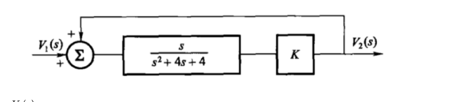
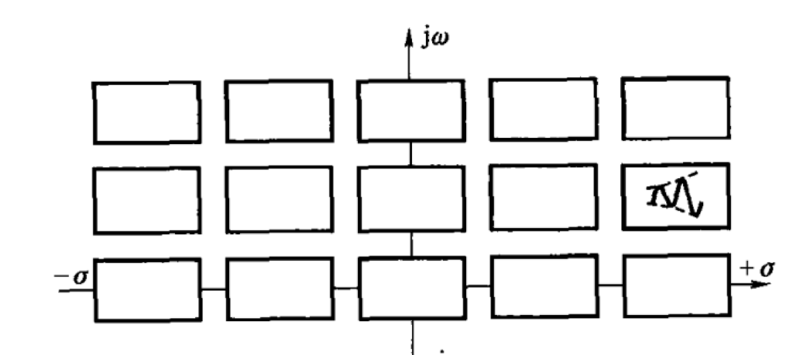

# 信号与系统 第4次作业题目（2025春）

## 题目

### 1

给定系统微分方程、起始状态以及激励信号分别为以下两种情况：

(1) $\dfrac{\mathrm{d}}{\mathrm{d}t}r(t)+2r(t)=e(t),\ r(0_{-})=0,\ e(t)=u(t)$

(2) $\dfrac{\mathrm{d}}{\mathrm{d}t}r(t)+2r(t)=3\dfrac{\mathrm{d}}{\mathrm{d}t}e(t),\ r(0_{-})=0,\ e(t)=u(t)$

判断在起始点是否发生跳变，写出 $r(0_{+})$ 的值。

### 2

给定系统微分方程

$$\frac{\mathrm{d}^{2}}{\mathrm{d}t^{2}}r(t)+3\frac{\mathrm{d}}{\mathrm{d}t}r(t)+2r(t)=\frac{\mathrm{d}}{\mathrm{d}t}e(t)+3e(t)$$

$$e(t)=u(t),\quad r(0^{-})=1,\quad r'(0^{-})=2$$

(1) 求自由响应和受迫响应

(2) 求零输入响应

(3) 使用以下三种方法，分别求零状态响应

a. 求出冲激响应，并与输入作卷积

b. 根据零状态响应形式和 $0^{-}$ 处条件，使用待定系数法求解

c. 拉氏变换法

### 3

求下列函数的拉氏逆变换。

(1) $\dfrac{50s+2500}{s^{2}+101s+100}$

(2) $\dfrac{s+5}{(s+1)^{3}(s+4)}$

(3) $\dfrac{1}{s(s^{2}+2)}$

### 4

如图所示，为一个反馈系统的系统框图，回答下列问题：

(1) 求出系统函数 $H(s)=\dfrac{V_{2}(s)}{V_{1}(s)}$

(2) 当 $K$ 满足什么条件时，系统是稳定的？

(3) 求出系统临界稳定时的冲激响应 $h(t)$

### 5

当 $H(s)$ 一阶极点落在下图所示 $s$ 平面图中各方框的位置时，画出对应的 $h(t)$ 波形。图中给出了示例：

