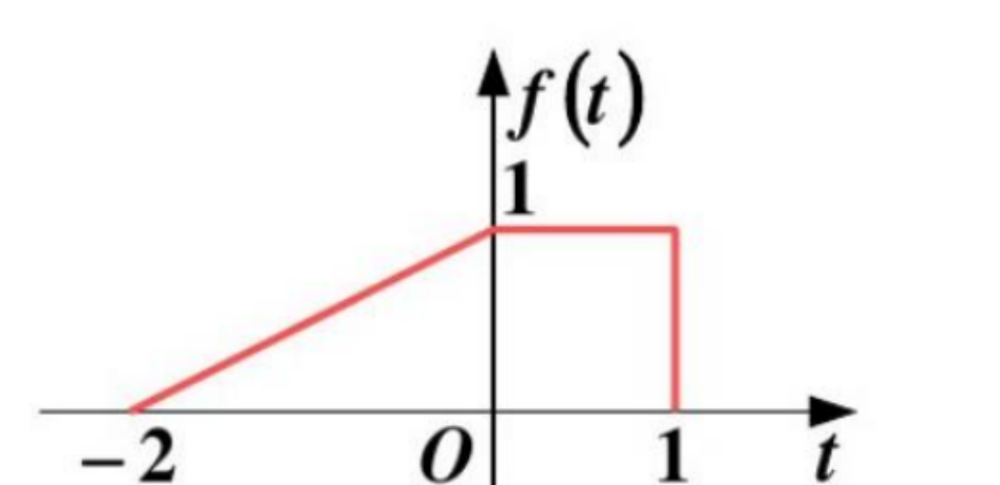
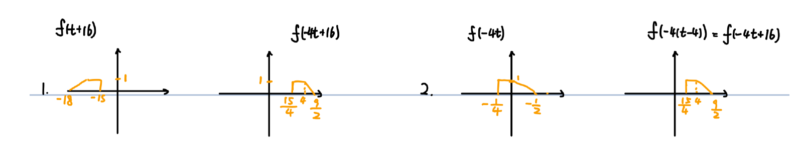

# 信号与系统 第1次作业答案（2026春）

> 上一世，我本是《信号与系统》的宇宙级人才，只因期末没来得及预习课程，导致考试失利，沦落至此。然而一次意外让我获得重生的机会，这一世，我将化身冷面信统学神，势必要拿回属于我的一切！我将先从本次作业开始……

## 题目与答案

### 1

#### 题目

利用冲激函数 $\delta$ 的定义及性质，证明：

(1) $\delta(at)=\dfrac{1}{a}\delta(t)$， $(a>0)$；（提示：利用积分）

(2) $\displaystyle\int_{-\infty}^{\infty}f(t)\delta'(at)\,\mathrm{d}t=-\frac{1}{a^{2}}f'(0)$， $(a>0)$

#### 答案

**答案：**

(1) 注意有 $1=\displaystyle\int_{-\infty}^{\infty}\delta(\alpha t)\,\mathrm{d}\alpha t=\int_{-\infty}^{\infty}\delta(t)\,\mathrm{d}t$，

又 $\displaystyle\int_{-\infty}^{\infty}\delta(\alpha t)\,\mathrm{d}(\alpha t)=\int_{-\infty}^{\infty}\alpha\delta(\alpha t)\,\mathrm{d}t$。

由于 $\forall t\neq 0,\ \delta(\alpha t)=0$，故有 $\delta(\alpha t)=\dfrac{1}{\alpha}\delta(t)$。

(2)

$$\text{左式}=\frac{1}{a}\int_{-\infty}^{\infty}f(t)\,\mathrm{d}(\delta(at))=\left.\frac{1}{a}f(t)\delta(at)\right|_{-\infty}^{\infty}-\frac{1}{a}\int_{-\infty}^{\infty}\delta(at)\,\mathrm{d}(f(t))$$

$$=-\frac{1}{a^{2}}\int_{-\infty}^{\infty}\delta(at)f'(t)\,\mathrm{d}(at)=-\frac{1}{a^{2}}f'(0)$$

### 2

#### 题目

判断下列信号是否为周期信号，若是，请给出周期：

(1) $\sin(t)\cos(t)$

(2) $e^{j3t}$

(3) $\sin(t)+\cos(\pi t)$

#### 答案

**答案：**

(1) $\pi$

(2) $\dfrac{2}{3}\pi$

(3) 不是周期函数

### 3

#### 题目

判断正误：

(1) $x[n]=\sin(n)$ 是数字信号

(2) 周期信号之和可能是非周期信号

(3) 非周期信号之和一定是非周期信号

(4) 能量信号都是非周期信号（不考虑 0）

#### 答案

**答案：**

(1) 错误，因为幅值是连续的，即值可能是无理数

(2) 正确，参考上问的第 3 小问

(3) 错误， $(\sin t+e^{t})+(-e^{t})$ 是周期信号

(4) 正确，否则能量不有限，与定义矛盾

### 4

#### 题目

$f(t)$ 的波形如下，按如下要求绘制 $f(-4t+16)$ 波形

(1) 先平移，后缩放

(2) 先缩放，后平移

#### 答案

**答案：**

(1) 先平移： $f(t+16)$，再缩放得 $f(-4t+16)$。

(2) 先缩放： $f(-4t)$，再平移得 $f(-4(t-4))=f(-4t+16)$。

两种顺序得到的波形一致： $f(-4t+16)$ 在 $\dfrac{15}{4}\le t\le 4$ 上由 0 线性上升到 1，在 $4\le t\le\dfrac{9}{2}$ 上恒为 1，区间外为 0。

### 5

#### 题目

计算：

(1) $3t^{4}\delta(t)$

(2) $\displaystyle\int_{-\infty}^{\infty}f(t_{0}-t)\delta(t)\,\mathrm{d}t$

(3) $\displaystyle\int_{-\infty}^{\infty}\left(e^{t}-5t^{2}\right)\delta(t+3)\,\mathrm{d}t$

(4) $\displaystyle\int_{-\infty}^{\infty}u(t-1)\delta(t-4)\,\mathrm{d}t$

#### 答案

**答案：** 主要利用 $\displaystyle\int_{-\infty}^{\infty}f(t)\delta(t-t_{0})\,\mathrm{d}t=f(t_{0})$

(1) $0$

(2) $f(t_{0})$

(3) $e^{-3}-45$

(4) $1$（ $u(3)=1$）

### 6

#### 题目

判断以下问题，并给出过程

(1) 函数集 $\{1,x,x^{2},\dots\}$ 是否为区间 $(0,2)$ 上的正交函数集？

(2) 函数集 $\{\sin t,\sin(2t),\dots,\sin(nt)\},\ n\in\mathbb{N}^{*}$ 是否为区间 $(0,2\pi)$ 上的正交函数集？

(3) 函数集 $\{\sin t,\sin(2t),\dots,\sin(nt)\},\ n\in\mathbb{N}^{*}$ 是否为区间 $\left(0,\dfrac{1}{2}\pi\right)$ 上的正交函数集？

#### 答案

**答案：**

(1) 错误，（构造反例） $\displaystyle\int_{0}^{2}x\,\mathrm{d}x=2\neq 0$

(2) 正确， $\displaystyle\int_{0}^{2\pi}\sin(mt)\sin(nt)\,\mathrm{d}t=\frac{1}{2}\int_{0}^{2\pi}\cos((m-n)t)\,\mathrm{d}t-\frac{1}{2}\int_{0}^{2\pi}\cos((m+n)t)\,\mathrm{d}t=0$

并且当 $m=n$ 时， $\displaystyle\int_{0}^{2\pi}\sin^{2}(nt)\,\mathrm{d}t=\pi\neq 0$

(3) 错误，取 $m=1,\ n=2$ 有

$$\int_{0}^{\pi/2}\sin t\sin(2t)\,\mathrm{d}t=\int_{0}^{\pi/2}\sin t\cdot 2\sin t\cos t\,\mathrm{d}t=2\int_{0}^{\pi/2}\sin^{2}t\cos t\,\mathrm{d}t=2\int_{0}^{1}u^{2}\,\mathrm{d}u=\frac{2}{3}\neq 0$$

### 7

#### 题目

(1) 对信号 $(t+1)e^{-t^{2}}$ 进行奇偶分解，并写出任意信号 $f(t)$ 的奇偶分解。

(2) 对信号 $f(t)=e^{-t}$ 在区间 $(0,3)$ 做直流-交流分解。

#### 答案

**答案：**

(1) $f_{奇}(t)=\dfrac{f(t)-f(-t)}{2}$， $f_{偶}(t)=\dfrac{f(t)+f(-t)}{2}$。

由此可得

$$(t+1)e^{-t^{2}}=\frac{(t+1)e^{-t^{2}}-(-t+1)e^{-t^{2}}}{2}+\frac{(t+1)e^{-t^{2}}+(-t+1)e^{-t^{2}}}{2}=te^{-t^{2}}+e^{-t^{2}}$$

(2) 直流分量 $DC=\dfrac{1}{3}\displaystyle\int_{0}^{3}e^{-t}\,\mathrm{d}t=\dfrac{1-e^{-3}}{3}$，交流分量 $AC=e^{-t}-\dfrac{1-e^{-3}}{3}$

### 8

#### 题目

对于如下问题：

用 $f(t)=a_{1}t^{2}+a_{2}t+a_{3},\ a_{1}\neq 0$ 在区间 $(-1,1)$ 上基于均方误差准则，近似表示信号 $g(t)=te^{t}$。

raregas 小朋友想起课上老师给出求解系数公式：

$$a_{i}=\frac{\displaystyle\int_{T_{1}}^{T_{2}}f(t)f_{i}(t)\,\mathrm{d}t}{\displaystyle\int_{T_{1}}^{T_{2}}f_{i}(t)f_{i}(t)\,\mathrm{d}t}=\frac{\displaystyle\int_{T_{1}}^{T_{2}}f(t)f_{i}(t)\,\mathrm{d}t}{K_{i}}$$

于是他直接带入 $g(t),\ t^{2},\ t,\ 1$（即直接将 $t^{2},t,1$ 视为基底）求解系数。

【请问】

(1) 他这样做对么？如果正确请求出最终系数，如果错误请说明理由并给出正确思路（摆出系数计算式即可）。

(2) raregas 小朋友从本题中联想到淑芬中的 Taylor 展开，说说本题中对于 $g(t)$ 均方误差准则下的正交分解与 $g(t)$ 在 0 处的二阶 Taylor 展开有什么异同。

#### 答案

**答案：**

(1) 不对，因为公式要求基底是正交的，易见该基底不是正交的。应该先正交化，再求解系数。

(2) 理解处言之有理即可。可以针对二者的计算方式进行思考，如泰勒展开目标在于精确拟合波形的变化趋势，均方误差下的分解侧重于使拟合波形与实际波形「能量」差最小等。

> 去年要求手算出相应系数，raregas 小朋友算吐了最后发现开始忘正交化，功亏一篑。再此附上完整求解系数过程。

方法 1（考虑均方误差）：

均方误差 $\overline{\varepsilon^{2}}=\dfrac{1}{2}\displaystyle\int_{-1}^{1}\left[te^{t}-at^{2}-bt-c\right]^{2}\mathrm{d}t$，对 $a,b,c$ 求偏导，得

$$\frac{\partial\overline{\varepsilon^{2}}}{\partial a}=\int_{-1}^{1}\left(te^{t}-at^{2}-bt-c\right)t^{2}\,\mathrm{d}t=-2e+16e^{-1}-\frac{2}{5}a-\frac{2}{3}c$$

$$\frac{\partial\overline{\varepsilon^{2}}}{\partial b}=\int_{-1}^{1}\left(te^{t}-at^{2}-bt-c\right)t\,\mathrm{d}t=e-5e^{-1}-\frac{2}{3}b$$

$$\frac{\partial\overline{\varepsilon^{2}}}{\partial c}=\int_{-1}^{1}\left(te^{t}-at^{2}-bt-c\right)\mathrm{d}t=2e^{-1}-\frac{2}{3}a-2c$$

令 $\dfrac{\partial\overline{\varepsilon^{2}}}{\partial a}=\dfrac{\partial\overline{\varepsilon^{2}}}{\partial b}=\dfrac{\partial\overline{\varepsilon^{2}}}{\partial c}=0$，得

$$a=\frac{45}{4}\left(\frac{23}{3}e^{-1}-e\right),\quad b=\frac{3}{2}\left(e-5e^{-1}\right),\quad c=\frac{15}{4}e-\frac{111}{4}e^{-1}$$

即

$$f(t)=\left(\frac{345}{4}e^{-1}-\frac{45}{4}e\right)t^{2}+\frac{3}{2}\left(e-5e^{-1}\right)t+\frac{15}{4}e-\frac{111}{4}e^{-1}$$

方法 2（考虑正交函数）：

给出 $(-1,1)$ 上的正交函数集，易知 1 和 $t$ 在区间 $(-1,1)$ 上正交，求 $t^{2}+a_{1}t+a_{2}$ 使其与 1 和 $t$ 正交，即

$$\int_{-1}^{1}t^{2}+a_{1}t+a_{2}\,\mathrm{d}t=0,\qquad \int_{-1}^{1}t\left(t^{2}+a_{1}t+a_{2}\right)\mathrm{d}t=0$$

解得 $a_{1}=0,\ a_{2}=-\dfrac{1}{3}$。即 $\left\{1,t,t^{2}-\dfrac{1}{3}\right\}$ 为 $(-1,1)$ 的一个正交函数集。设 $f(t)=c_{1}+c_{2}t+c_{3}\left(t^{2}-\dfrac{1}{3}\right)$，则

$$c_{1}=\frac{\displaystyle\int_{-1}^{1}te^{t}\,\mathrm{d}t}{\displaystyle\int_{-1}^{1}1^{2}\,\mathrm{d}t}=e^{-1}$$

$$c_{2}=\frac{\displaystyle\int_{-1}^{1}t\left(te^{t}\right)\mathrm{d}t}{\displaystyle\int_{-1}^{1}t^{2}\,\mathrm{d}t}=\frac{3}{2}\left(e-5e^{-1}\right)$$

$$c_{3}=\frac{\displaystyle\int_{-1}^{1}\left(t^{2}-\frac{1}{3}\right)te^{t}\,\mathrm{d}t}{\displaystyle\int_{-1}^{1}\left(t^{2}-\frac{1}{3}\right)^{2}\mathrm{d}t}=\frac{16e^{-1}-2e-\frac{1}{3}\left(2e^{-1}\right)}{\left.\left(\frac{1}{5}t^{5}-\frac{2}{9}t^{3}+\frac{1}{9}t\right)\right|_{-1}^{1}}=\frac{45}{4}\left(\frac{23}{3}e^{-1}-e\right)$$

即

$$f(t)=\left(\frac{345}{4}e^{-1}-\frac{45}{4}e\right)t^{2}+\frac{3}{2}\left(e-5e^{-1}\right)t+\frac{15}{4}e-\frac{111}{4}e^{-1}$$

（其他正交分解类似。）

### 9

#### 题目

给定锯齿波形：

$$f(t)=\begin{cases}t+2\pi, & -2\pi\le t<0\\[4pt] t, & 0\le t<2\pi\end{cases}$$

试使用正弦正交函数集 $\{1,\sin t,\sin 2t,\dots\}$，在区间 $(-2\pi,2\pi)$ 上，基于均方误差准则做正交分解：

$$f(t)\approx c_{0}+c_{1}\sin t+c_{2}\sin(2t)+c_{3}\sin(3t)+\dots+c_{n}\sin(nt)$$

要求：

(1) 求出对应系数 $c_{0},c_{1},c_{2},\dots,c_{n}$ 的表达式；

(2) 计算 $n=2$ 时的均方误差 $\overline{\varepsilon^{2}}$。

本题有一定计算量。

#### 答案

**答案：**

$$c_{0}=\frac{\displaystyle\int_{-2\pi}^{2\pi}f(t)\,\mathrm{d}t}{\displaystyle\int_{-2\pi}^{2\pi}1^{2}\,\mathrm{d}t}=\pi$$

$$c_{n}=\frac{\displaystyle\int_{-2\pi}^{2\pi}\sin(nt)f(t)\,\mathrm{d}t}{\displaystyle\int_{-2\pi}^{2\pi}\sin^{2}(nt)\,\mathrm{d}t}=\frac{\displaystyle\int_{-2\pi}^{0}(t+2\pi)\sin(nt)\,\mathrm{d}t+\int_{0}^{2\pi}t\sin(nt)\,\mathrm{d}t}{\displaystyle\int_{-2\pi}^{2\pi}\frac{1-\cos(2nt)}{2}\,\mathrm{d}t}$$

$$=\frac{\displaystyle\int_{-2\pi}^{2\pi}t\sin(nt)\,\mathrm{d}t}{\displaystyle\int_{-2\pi}^{2\pi}\frac{1}{2}\,\mathrm{d}t}=\frac{\left.\left(-\frac{1}{n}t\cos(nt)+\frac{1}{n^{2}}\sin(nt)\right)\right|_{-2\pi}^{2\pi}}{\displaystyle\int_{-2\pi}^{2\pi}\frac{1}{2}\,\mathrm{d}t}=-\frac{2}{n},\quad n\neq 0$$

因此 $f(t)\approx\pi-\displaystyle\sum_{1}^{n}\frac{2}{n}\sin(nt)$。

$$\overline{\varepsilon^{2}}=\frac{1}{4\pi}\int_{-2\pi}^{2\pi}\left(f(t)-\pi+2\sin(t)+\sin(2t)\right)^{2}\mathrm{d}t$$

$$=\frac{1}{4\pi}\int_{-2\pi}^{2\pi}(f(t)-\pi)^{2}+4\sin^{2}(t)+\sin^{2}(2t)+4(f(t)-\pi)\sin t+2(f(t)-\pi)\sin 2t+4\sin t\sin(2t)\,\mathrm{d}t$$

$$=\frac{1}{4\pi}\int_{-2\pi}^{2\pi}(f(t)-\pi)^{2}+2(1-\cos(2t))+\frac{1-\cos(4t)}{2}+4t\sin t+2t\sin 2t+2[\cos t-\cos(3t)]\,\mathrm{d}t$$

$$=\frac{1}{4\pi}\left[2\int_{-\pi}^{\pi}t^{2}\,\mathrm{d}t+\int_{-2\pi}^{2\pi}\frac{5}{2}+4t\sin t+2t\sin(2t)\,\mathrm{d}t\right]=\frac{\pi^{2}}{3}-\frac{5}{2}$$
