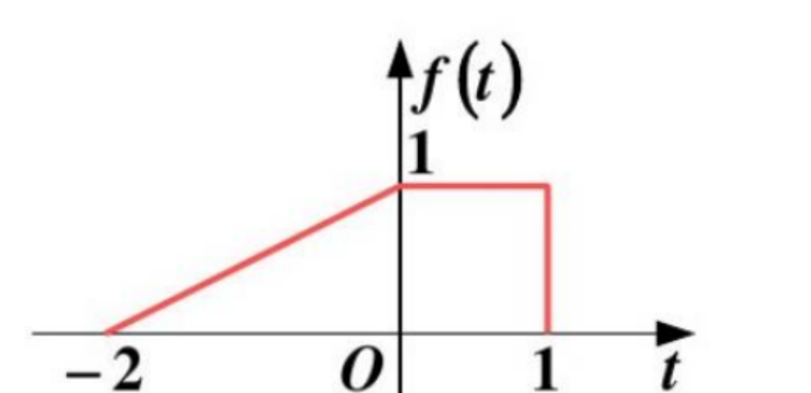

# 信号与系统 第1次作业题目（2026春）

> 上一世，我本是《信号与系统》的宇宙级人才，只因期末没来得及预习课程，导致考试失利，沦落至此。然而一次意外让我获得重生的机会，这一世，我将化身冷面信统学神，势必要拿回属于我的一切！我将先从本次作业开始……

## 题目

### 1

利用冲激函数 $\delta$ 的定义及性质，证明：

(1) $\delta(at)=\dfrac{1}{a}\delta(t)$， $(a>0)$；（提示：利用积分）

(2) $\displaystyle\int_{-\infty}^{\infty}f(t)\delta'(at)\,\mathrm{d}t=-\frac{1}{a^{2}}f'(0)$， $(a>0)$

### 2

判断下列信号是否为周期信号，若是，请给出周期：

(1) $\sin(t)\cos(t)$

(2) $e^{j3t}$

(3) $\sin(t)+\cos(\pi t)$

### 3

判断正误：

(1) $x[n]=\sin(n)$ 是数字信号

(2) 周期信号之和可能是非周期信号

(3) 非周期信号之和一定是非周期信号

(4) 能量信号都是非周期信号（不考虑 0）

### 4

$f(t)$ 的波形如下，按如下要求绘制 $f(-4t+16)$ 波形

(1) 先平移，后缩放

(2) 先缩放，后平移

### 5

计算：

(1) $3t^{4}\delta(t)$

(2) $\displaystyle\int_{-\infty}^{\infty}f(t_{0}-t)\delta(t)\,\mathrm{d}t$

(3) $\displaystyle\int_{-\infty}^{\infty}\left(e^{t}-5t^{2}\right)\delta(t+3)\,\mathrm{d}t$

(4) $\displaystyle\int_{-\infty}^{\infty}u(t-1)\delta(t-4)\,\mathrm{d}t$

### 6

判断以下问题，并给出过程

(1) 函数集 $\{1,x,x^{2},\dots\}$ 是否为区间 $(0,2)$ 上的正交函数集？

(2) 函数集 $\{\sin t,\sin(2t),\dots,\sin(nt)\},\ n\in\mathbb{N}^{*}$ 是否为区间 $(0,2\pi)$ 上的正交函数集？

(3) 函数集 $\{\sin t,\sin(2t),\dots,\sin(nt)\},\ n\in\mathbb{N}^{*}$ 是否为区间 $\left(0,\dfrac{1}{2}\pi\right)$ 上的正交函数集？

### 7

(1) 对信号 $(t+1)e^{-t^{2}}$ 进行奇偶分解，并写出任意信号 $f(t)$ 的奇偶分解。

(2) 对信号 $f(t)=e^{-t}$ 在区间 $(0,3)$ 做直流-交流分解。

### 8

对于如下问题：

用 $f(t)=a_{1}t^{2}+a_{2}t+a_{3},\ a_{1}\neq 0$ 在区间 $(-1,1)$ 上基于均方误差准则，近似表示信号 $g(t)=te^{t}$。

raregas 小朋友想起课上老师给出求解系数公式：

$$a_{i}=\frac{\displaystyle\int_{T_{1}}^{T_{2}}f(t)f_{i}(t)\,\mathrm{d}t}{\displaystyle\int_{T_{1}}^{T_{2}}f_{i}(t)f_{i}(t)\,\mathrm{d}t}=\frac{\displaystyle\int_{T_{1}}^{T_{2}}f(t)f_{i}(t)\,\mathrm{d}t}{K_{i}}$$

于是他直接带入 $g(t),\ t^{2},\ t,\ 1$（即直接将 $t^{2},t,1$ 视为基底）求解系数。

【请问】

(1) 他这样做对么？如果正确请求出最终系数，如果错误请说明理由并给出正确思路（摆出系数计算式即可）。

(2) raregas 小朋友从本题中联想到淑芬中的 Taylor 展开，说说本题中对于 $g(t)$ 均方误差准则下的正交分解与 $g(t)$ 在 0 处的二阶 Taylor 展开有什么异同。

### 9

给定锯齿波形：

$$f(t)=\begin{cases}t+2\pi, & -2\pi\le t<0\\[4pt] t, & 0\le t<2\pi\end{cases}$$

试使用正弦正交函数集 $\{1,\sin t,\sin 2t,\dots\}$，在区间 $(-2\pi,2\pi)$ 上，基于均方误差准则做正交分解：

$$f(t)\approx c_{0}+c_{1}\sin t+c_{2}\sin(2t)+c_{3}\sin(3t)+\dots+c_{n}\sin(nt)$$

要求：

(1) 求出对应系数 $c_{0},c_{1},c_{2},\dots,c_{n}$ 的表达式；

(2) 计算 $n=2$ 时的均方误差 $\overline{\varepsilon^{2}}$。

本题有一定计算量。
