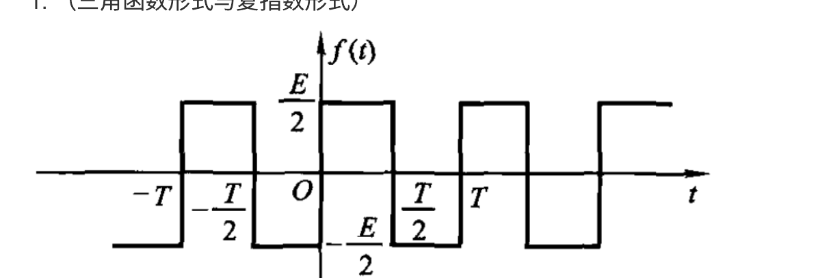
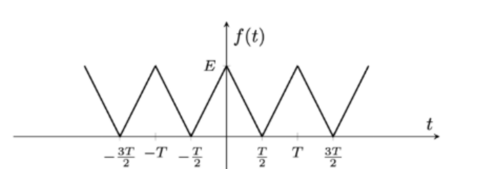
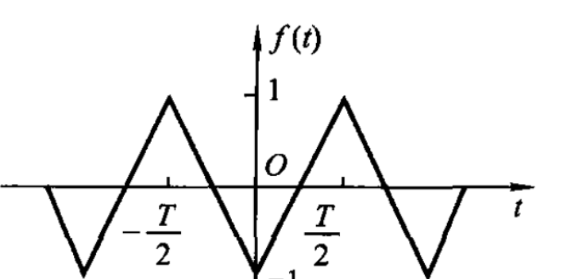
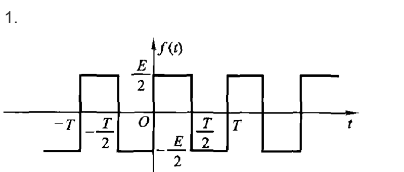
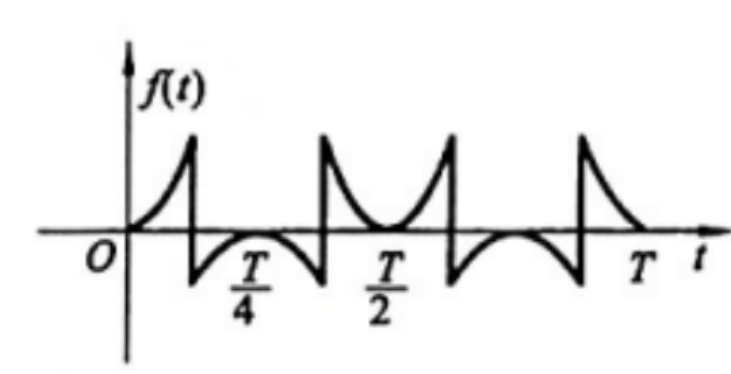
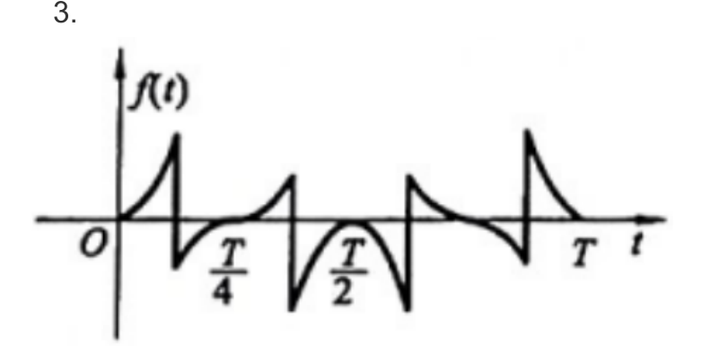
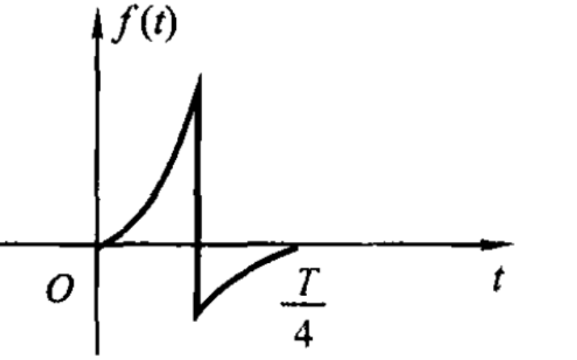
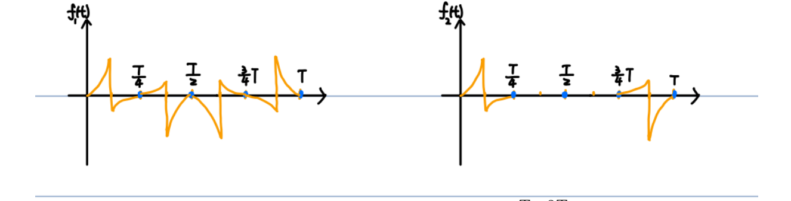
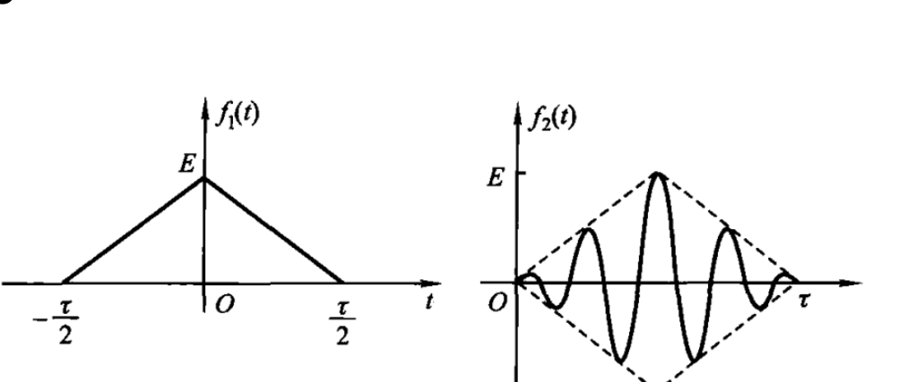

# 信号与系统 第2次作业答案（2026春）

## 题目与答案

### 1

#### 题目

请求出如下周期信号 $f(t)$ 的傅里叶级数，定义域为 $R$。

(1) （三角函数形式与复指数形式）

(2) （三角函数形式）

#### 答案

**答案：**

(1) 由图可写出 $f(t)$ 的表达式

$$f(t)=\begin{cases}-\dfrac{E}{2}, & -\dfrac{T}{2}<t<0\\[6pt] \dfrac{E}{2}, & 0<t<\dfrac{T}{2}\end{cases}$$

三角函数形式傅里叶级数的系数为

$$a_{0}=0$$

$$a_{n}=0\quad (n=1,2,\cdots)$$

$$b_{n}=\begin{cases}0, & (n=2,4,\cdots)\\[4pt] \dfrac{2E}{n\pi}, & (n=1,3,\cdots)\end{cases}$$

所以

$$f(t)=\frac{2E}{\pi}\left[\sin(\omega_{1}t)+\frac{1}{3}\sin(3\omega_{1}t)+\frac{1}{5}\sin(5\omega_{1}t)+\cdots\right]\quad \left(\omega_{1}=\frac{2\pi}{T}\right)$$

复指数形式傅里叶级数的系数为

$$F_{n}=\begin{cases}0, & (n=0,\pm 2,\pm 4,\cdots)\\[4pt] -\dfrac{jE}{n\pi}, & (n=\pm 1,\pm 3,\pm 5,\cdots)\end{cases}$$

所以

$$f(t)=-\frac{jE}{\pi}e^{j\omega_{1}t}+\frac{jE}{\pi}e^{-j\omega_{1}t}-\frac{jE}{3\pi}e^{j3\omega_{1}t}+\frac{jE}{3\pi}e^{-j3\omega_{1}t}-\cdots$$

(2) 由图可写出 $f(t)$ 的表达式

$$f(t)=\begin{cases}\dfrac{2E}{T}t+E, & -\dfrac{T}{2}<t<0\\[6pt] -\dfrac{2E}{T}t+E, & 0<t<\dfrac{T}{2}\end{cases}$$

其三角函数形式傅里叶级数的系数为

$$a_{0}=\frac{E}{2}$$

$$a_{n}=\begin{cases}0, & (n=2,4,\cdots)\\[4pt] \dfrac{4E}{n^{2}\pi^{2}}, & (n=1,3,\cdots)\end{cases}$$

所以

$$f(t)=\frac{E}{2}+\sum_{n=0}^{\infty}\frac{4E}{(2n+1)^{2}\pi^{2}}\cos[(2n+1)\omega_{0}t]$$

### 2

#### 题目

利用信号 $f(t)$ 的对称性，按如下格式，定性判断下列各周期信号的傅里叶级数中所含有的频率分量。

例：

#### 答案

答： $f(t)$ 是偶函数、奇谐函数。其傅里叶级数中仅含有奇次谐波的余弦分量。

(1)

(2)

(3)

**答案：**

(1) $f(t)$ 是【奇】函数、【奇谐】函数。其傅里叶级数中仅含有【奇次谐波的正弦分量】。

(2) $f(t)$ 是【偶】函数、【偶谐】函数。其傅里叶级数中含有【直流】和【偶次谐波的余弦分量】。

(3) $f(t)$ 是【偶】函数、【奇谐】函数。其傅里叶级数中仅含有【奇次谐波的余弦分量】。

### 3

#### 题目

已知周期函数 $f(t)$ 前 $\dfrac{T}{4}$ 的波形如下所示，按要求补全 $f(t)$ 在 $[0,T]$ 的波形。

(1) $f(t)$ 是偶函数，且仅含有奇次谐波

(2) $f(t)$ 是奇函数，且含有偶次和奇次谐波

> 相信自己大胆画。

#### 答案

**答案：**

注意：第 2 问中由于 $f(t)$ 同时含有偶次和奇次谐波，在 $\left(\dfrac{T}{4},\dfrac{3T}{4}\right)$ 可能是任意形状。

### 4

#### 题目

若已知 $\mathcal{F}[f(t)]=F(\omega)$，利用傅里叶变换的性质确定下列信号的傅里叶变换。

(1) $(4-8t)f(-3t)$

(2) $f(6-2t)$

(3) $f(-4t)\cos 8t$

(4) $t\dfrac{\mathrm{d}}{\mathrm{d}t}f(t)$

#### 答案

**答案：**

(1) 定义 $g(t)=f(-3t)$，则根据**尺度变换性质**，有

$$\mathcal{F}[g(t)]=\mathcal{F}[f(-3t)]=\frac{1}{3}F\left(-\frac{\omega}{3}\right)$$

根据**频域微分性质**，有

$$\mathcal{F}[tg(t)]=j\frac{\mathrm{d}}{\mathrm{d}\omega}\left[\frac{1}{3}F\left(-\frac{\omega}{3}\right)\right]=-\frac{j}{9}F'\left(-\frac{\omega}{3}\right)$$

根据**线性性质**，有

$$\mathcal{F}[(4-8t)g(t)]=4\mathcal{F}[g(t)]-8\mathcal{F}[tg(t)]=\frac{4}{3}F\left(-\frac{\omega}{3}\right)+j\frac{8}{9}F'\left(-\frac{\omega}{3}\right)$$

(2) 由于

$$\mathcal{F}[f(-2t)]=\frac{1}{2}F\left(-\frac{\omega}{2}\right)$$

根据**时移性质**，有

$$\mathcal{F}[f(6-2t)]=\mathcal{F}[f(-2(t-3))]=\frac{1}{2}F\left(-\frac{\omega}{2}\right)e^{-j3\omega}$$

(3) 由于

$$\mathcal{F}[f(-4t)]=\frac{1}{4}F\left(-\frac{\omega}{4}\right)$$

根据欧拉公式，有

$$\cos 8t=\frac{1}{2}\left(e^{j8t}+e^{-j8t}\right)$$

根据**频移性质**，有

$$\mathcal{F}[f(-4t)\cos 8t]=\frac{1}{8}F\left(\frac{-\omega+8}{4}\right)+\frac{1}{8}F\left(\frac{-\omega-8}{4}\right)$$

(4) 定义 $g(t)=\dfrac{\mathrm{d}}{\mathrm{d}t}f(t)$，则根据**时域微分性质**，有

$$\mathcal{F}[g(t)]=\mathcal{F}\left[\frac{\mathrm{d}}{\mathrm{d}t}f(t)\right]=j\omega F(\omega)$$

根据**频域微分性质**，有

$$\mathcal{F}[tg(t)]=j\frac{\mathrm{d}}{\mathrm{d}\omega}[j\omega F(\omega)]=-F(\omega)-\omega F'(\omega)$$

### 5

#### 题目

利用时域频域对称性，求出下列信号的傅里叶反变换。

(1) $\pi\delta(\omega-\pi)+3\pi\delta(\omega)+5\pi\delta(\omega+\pi)$

(2) $\pi[u(\omega+\omega_{0})-u(\omega-\omega_{0})]$

(3) $\displaystyle F(\omega)=\begin{cases}\dfrac{\omega_{0}}{\pi}, & (|\omega|\le \omega_{0})\\[6pt] 0, & (else)\end{cases}$

#### 答案

**答案：**

(1) 由于

$$\mathcal{F}[1]=2\pi\delta(\omega)$$

故有

$$\mathcal{F}^{-1}[\pi\delta(\omega)]=\frac{1}{2}$$

根据**傅里叶变换频移性质**，有

$$\mathcal{F}^{-1}[\pi\delta(\omega-\pi)]=\frac{1}{2}e^{j\pi t}$$

$$\mathcal{F}^{-1}[5\pi\delta(\omega+\pi)]=\frac{5}{2}e^{-j\pi t}$$

根据**傅里叶变换线性性质**，有

$$\mathcal{F}^{-1}[\pi\delta(\omega-\pi)+3\pi\delta(\omega)+5\pi\delta(\omega+\pi)]=\frac{1}{2}e^{j\pi t}+\frac{3}{2}+\frac{5}{2}e^{-j\pi t}$$

(2) 令 $F(\omega)=\pi[u(\omega+\omega_{0})-u(\omega-\omega_{0})]$。由于

$$\mathcal{F}[u(t)]=\pi\delta(\omega)+\frac{1}{j\omega}$$

根据**傅里叶变换时移性质**，有

$$\mathcal{F}[F(t)]=\pi\mathcal{F}[u(t+\omega_{0})-u(t-\omega_{0})]$$

$$=\pi\left[\pi\delta(\omega)+\frac{1}{j\omega}\right]\left[e^{j\omega_{0}t}-e^{-j\omega_{0}t}\right]$$

$$=\pi\left[\pi\delta(\omega)+\frac{1}{j\omega}\right]\cdot 2j\sin(\omega_{0}\omega)$$

$$=\frac{2\pi}{\omega}\sin(\omega_{0}\omega)=f(\omega)$$

根据**时域频域对称性**，有

$$\mathcal{F}^{-1}\left[\pi\left(u(\omega+\omega_{0})-u(\omega-\omega_{0})\right)\right]=\mathcal{F}^{-1}[F(\omega)]$$

$$=\frac{1}{2\pi}f(-t)=\frac{\sin(\omega_{0}t)}{t}\quad \left(=\omega_{0}\,\mathrm{Sa}(\omega_{0}t)\right)$$

(3) 注意到 $F(\omega)=\dfrac{\omega_{0}}{\pi}[u(\omega+\omega_{0})-u(\omega-\omega_{0})]$，由上问可推得

$$\frac{\omega_{0}^{2}}{\pi^{2}}\mathrm{Sa}(\omega_{0}t)\leftrightarrow\frac{\omega_{0}}{\pi}[u(\omega+\omega_{0})-u(\omega-\omega_{0})]$$

即所求为

$$f(t)=\left(\frac{\omega_{0}}{\pi}\right)^{2}\mathrm{Sa}(\omega_{0}t)$$

### 6

#### 题目

(1) 已知三角脉冲 $f_{1}(t)$ 的图像，若 $\mathcal{F}[f_{1}(t)]=F_{1}(\omega)$，根据傅里叶变换定义，证明：

$$F_{1}(\omega)=\frac{E\tau}{2}\,\mathrm{Sa}^{2}\left(\frac{\omega\tau}{4}\right)$$

(2) 求 $f_{2}(t)=f_{1}\left(t-\dfrac{\tau}{2}\right)\cos(\omega_{0}t)$ 的傅里叶变换 $F_{2}(\omega)$。

#### 答案

**答案：**

(1) 根据傅里叶变换的定义

$$F_{1}(\omega)=\int_{-\frac{\tau}{2}}^{\frac{\tau}{2}}\left(E-\frac{2E}{\tau}|t|\right)e^{-j\omega t}\,\mathrm{d}t$$

$$=2E\int_{0}^{\frac{\tau}{2}}\left(1-\frac{2}{\tau}t\right)\cos(\omega t)\,\mathrm{d}t$$

$$=\left.\frac{2E}{\omega}\sin(\omega t)\right|_{0}^{\frac{\tau}{2}}-\frac{4E}{\omega\tau}\left[\left.t\sin(\omega t)\right|_{0}^{\frac{\tau}{2}}-\int_{0}^{\frac{\tau}{2}}\sin(\omega t)\,\mathrm{d}t\right]$$

$$=\frac{4E}{\omega^{2}\tau}\left[1-\cos\left(\frac{\omega\tau}{2}\right)\right]$$

$$=\frac{8E}{\omega^{2}\tau}\sin^{2}\left(\frac{\omega\tau}{4}\right)$$

$$=\frac{E\tau}{2}\,\mathrm{Sa}^{2}\left(\frac{\omega\tau}{4}\right)$$

(2) 根据傅里叶变换时移性质，有

$$\mathcal{F}\left[f_{1}\left(t-\frac{\tau}{2}\right)\right]=F_{1}(\omega)e^{-j\omega\frac{\tau}{2}}$$

根据欧拉公式，有

$$\cos(\omega_{0}t)=\frac{1}{2}\left(e^{j\omega_{0}t}+e^{-j\omega_{0}t}\right)$$

因此，可以得到

$$F_{2}(\omega)=\frac{1}{2}\left\{\mathcal{F}\left[f_{1}\left(t-\frac{\tau}{2}\right)e^{j\omega_{0}t}\right]+\mathcal{F}\left[f_{1}\left(t-\frac{\tau}{2}\right)e^{-j\omega_{0}t}\right]\right\}$$

$$=\frac{1}{2}\left[F_{1}(\omega-\omega_{0})e^{-j(\omega-\omega_{0})\frac{\tau}{2}}+F_{1}(\omega+\omega_{0})e^{-j(\omega+\omega_{0})\frac{\tau}{2}}\right]$$

$$=\frac{E\tau}{4}e^{-j\omega\frac{\tau}{2}}\left[\mathrm{Sa}^{2}\frac{(\omega-\omega_{0})\tau}{4}e^{j\omega_{0}\frac{\tau}{2}}+\mathrm{Sa}^{2}\frac{(\omega+\omega_{0})\tau}{4}e^{-j\omega_{0}\frac{\tau}{2}}\right]$$
