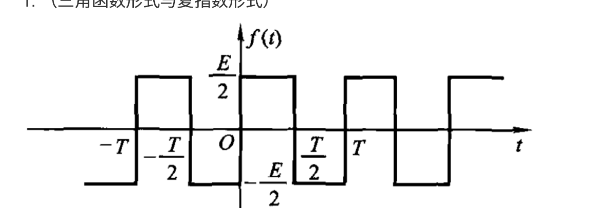
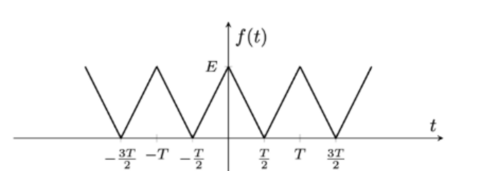
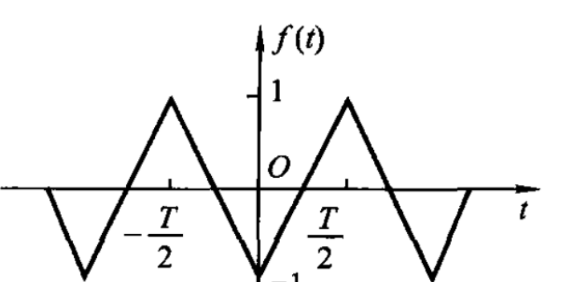
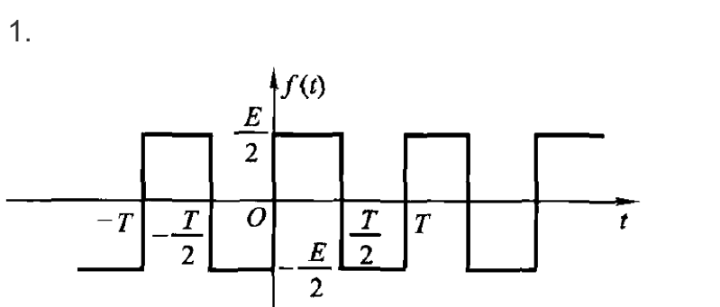
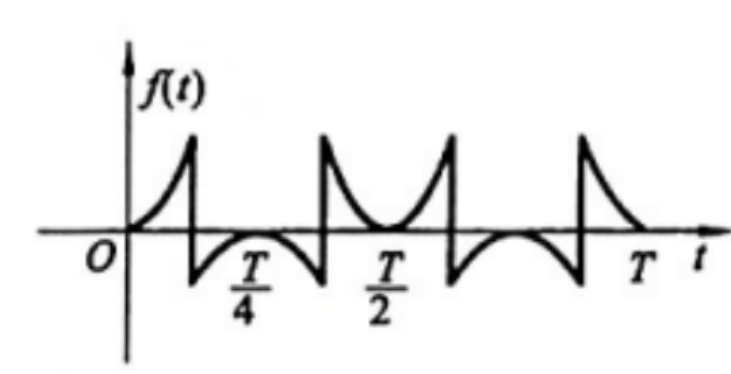
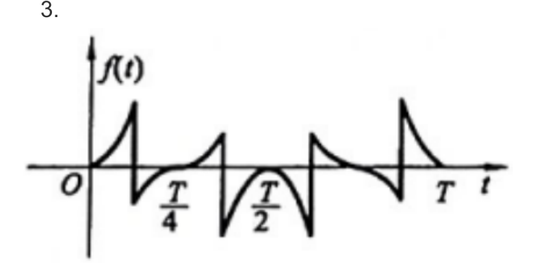
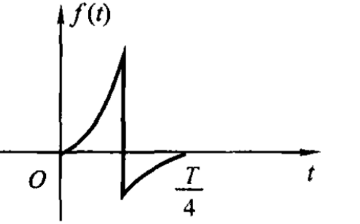
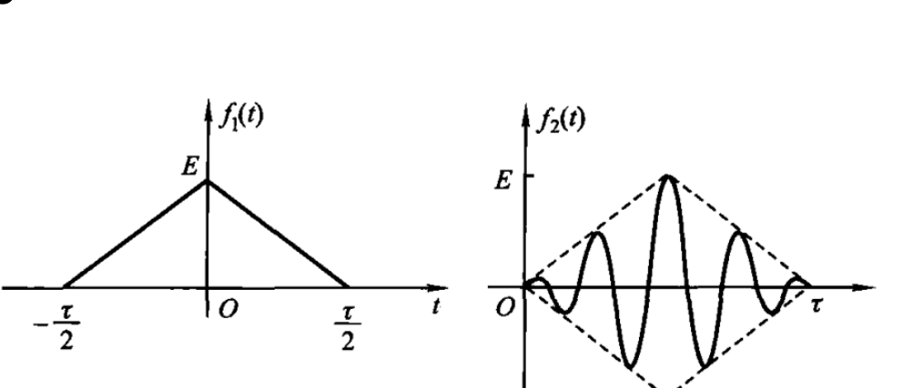

# 信号与系统 第2次作业题目（2026春）

## 题目

### 1

请求出如下周期信号 $f(t)$ 的傅里叶级数，定义域为 $R$。

(1) （三角函数形式与复指数形式）

(2) （三角函数形式）

### 2

利用信号 $f(t)$ 的对称性，按如下格式，定性判断下列各周期信号的傅里叶级数中所含有的频率分量。

例：

答： $f(t)$ 是偶函数、奇谐函数。其傅里叶级数中仅含有奇次谐波的余弦分量。

(1)

(2)

(3)

### 3

已知周期函数 $f(t)$ 前 $\dfrac{T}{4}$ 的波形如下所示，按要求补全 $f(t)$ 在 $[0,T]$ 的波形。

(1) $f(t)$ 是偶函数，且仅含有奇次谐波

(2) $f(t)$ 是奇函数，且含有偶次和奇次谐波

> 相信自己大胆画。

### 4

若已知 $\mathcal{F}[f(t)]=F(\omega)$，利用傅里叶变换的性质确定下列信号的傅里叶变换。

(1) $(4-8t)f(-3t)$

(2) $f(6-2t)$

(3) $f(-4t)\cos 8t$

(4) $t\dfrac{\mathrm{d}}{\mathrm{d}t}f(t)$

### 5

利用时域频域对称性，求出下列信号的傅里叶反变换。

(1) $\pi\delta(\omega-\pi)+3\pi\delta(\omega)+5\pi\delta(\omega+\pi)$

(2) $\pi[u(\omega+\omega_{0})-u(\omega-\omega_{0})]$

(3) $\displaystyle F(\omega)=\begin{cases}\dfrac{\omega_{0}}{\pi}, & (|\omega|\le \omega_{0})\\[6pt] 0, & (else)\end{cases}$

### 6

(1) 已知三角脉冲 $f_{1}(t)$ 的图像，若 $\mathcal{F}[f_{1}(t)]=F_{1}(\omega)$，根据傅里叶变换定义，证明：

$$F_{1}(\omega)=\frac{E\tau}{2}\,\mathrm{Sa}^{2}\left(\frac{\omega\tau}{4}\right)$$

(2) 求 $f_{2}(t)=f_{1}\left(t-\dfrac{\tau}{2}\right)\cos(\omega_{0}t)$ 的傅里叶变换 $F_{2}(\omega)$。
