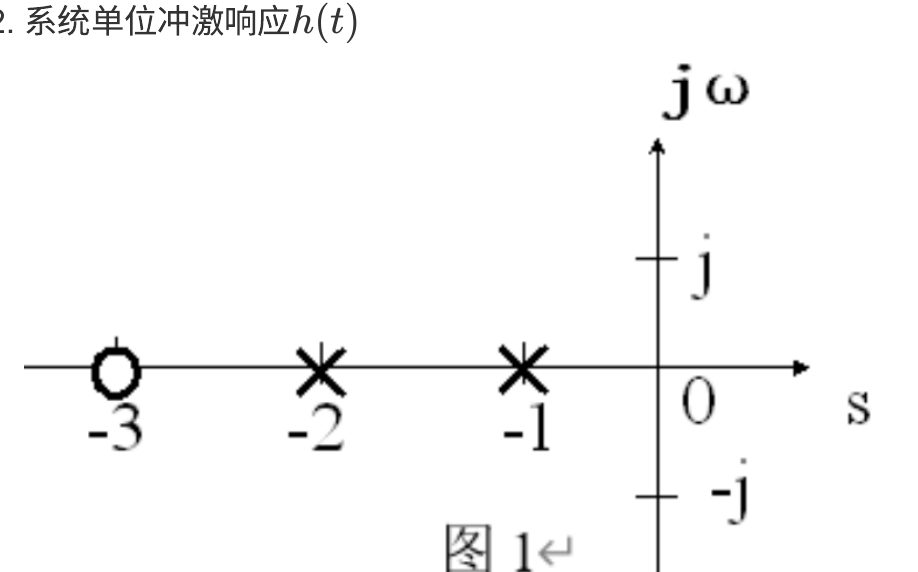
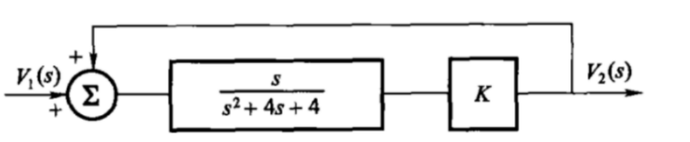
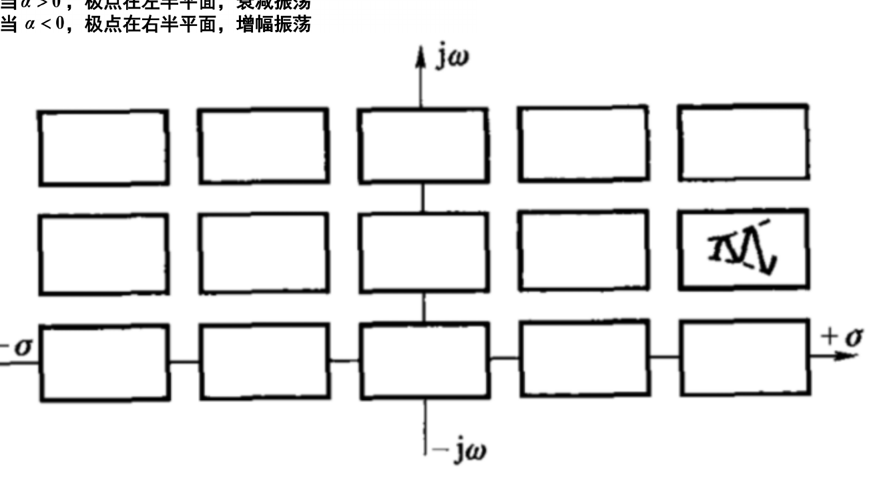
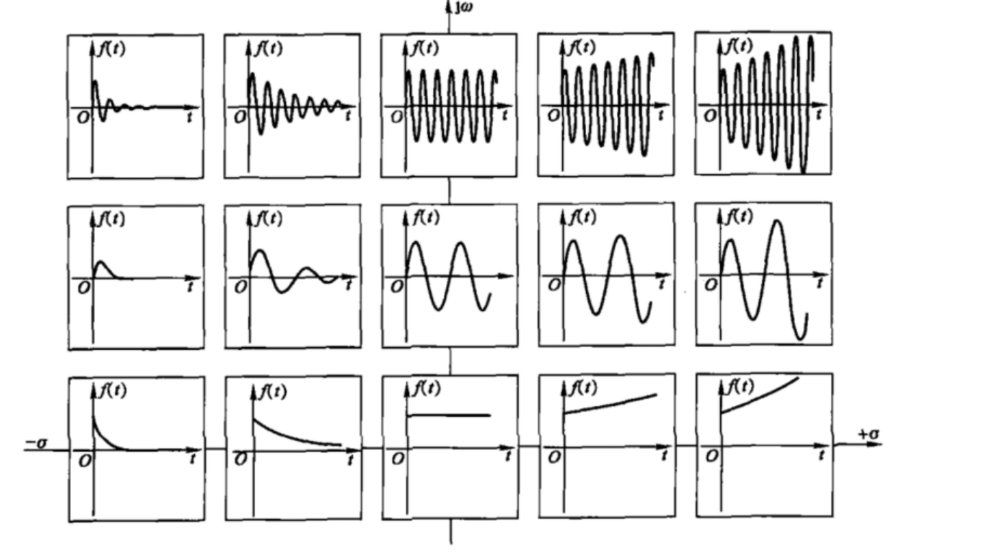

# 信号与系统 第4次作业答案（2026春）

## 题目与答案

### 1

#### 题目

(1) 零输入响应的初始条件为 $r^{(k)}(0_{+})$ ______ $r^{(k)}(0_{-})$（ $=$ or $\neq$）

零状态响应的初始条件为 $r^{(k)}$(______) $=0$（ $0_{+}$ or $0_{-}$）

(2) （单位）冲激响应 是以 ______ 为激励，系统产生的 ______（零状态/零输入）响应，通常用 $h(t)$ 表示。其与系统函数 $H(s)$ 的关系是 ______。

(3) 输入信号 $f(t)$ 经过冲激响应为 $h(t)$ 的系统后，输出信号 $s(t)=$ ______。由此式可知，若该 LTI 系统为因果系统，则在 $t<0$ 时， $h(t)$ 应满足 ______。并说明你的理由。

(4) 若某个 LTI 系统的单位冲激响应为： $h(t)=e^{-t}u(t)$，则其是否为因果系统？若冲激响应改为： $h(t)=e^{|t|}$ 呢？

(5) 如果你的《信号与系统》教材和气体 gg 同时掉水里了，你会先救 ______

A．信统教材　　B．伟大的气体 gg　　C．旁边游泳的 yhgg　　D．钝角

> 可见仅从冲激响应即可判断系统性质，而冲激响应又可由系统函数 $H(s)$ 导出。可见系统函数的重要性。

#### 答案

**答案：**

(1) $=$； $0_{-}$

(2) 冲激信号 $\delta(t)$；【零状态】； $\mathcal{L}[h(t)]=H(s)$

(3) $s(t)=f(t)*h(t)=\displaystyle\int_{-\infty}^{\infty}f(\tau)h(t-\tau)\,\mathrm{d}\tau$； $h(t)=0$

(4) 因果信号，【是】因果系统；不是因果信号，【不是】因果系统

### 2

#### 题目

给定系统微分方程、起始状态以及激励信号分别为以下两种情况：

(1) $\dfrac{\mathrm{d}}{\mathrm{d}t}r(t)+2r(t)=e(t)$， $r(0_{-})=0$， $e(t)=u(t)$

(2) $\dfrac{\mathrm{d}}{\mathrm{d}t}r(t)+2r(t)=3\dfrac{\mathrm{d}}{\mathrm{d}t}e(t)$， $r(0_{-})=0$， $e(t)=u(t)$

判断在起始点是否发生跳变，并写出 $r(0_{+})$ 的值。

#### 答案

**答案：** 本质还是冲激函数匹配做即可。

(1) $r(0_{+})=0$，不跳变

(2) $r(0_{+})=3$，跳变

### 3

#### 题目

给定系统微分方程：

$$\frac{\mathrm{d}^{2}}{\mathrm{d}t^{2}}r(t)+3\frac{\mathrm{d}}{\mathrm{d}t}r(t)+2r(t)=\frac{\mathrm{d}}{\mathrm{d}t}e(t)+3e(t)$$

其中 $e(t)=u(t)$， $r(0^{-})=1$， $r'(0^{-})=2$。

(1) 求自由响应和受迫响应

(2) 求零输入响应

(3) 使用以下三种方法，分别求零状态响应

a. 求出冲激响应，并与输入作卷积

b. 根据零状态响应形式和 $0^{-}$ 处条件，使用待定系数法求解

c. 拉氏变换法

> 注 1：答案能互相印证，先自查再提交哈，一定注意要的是 $0_{+}$ 还是 $0_{-}$！！！
>
> 注 2：能发现其实**拉氏变换法**还是比较方便的。
>
> 注 3：据我观察老师很喜欢这种题（懂我意思吧😊）

#### 答案

**答案：**

(1) 自由响应： $\left(2e^{-t}-\dfrac{5}{2}e^{-2t}\right)u(t)$，受迫响应： $\dfrac{3}{2}u(t)$

(2) 零输入响应： $r_{zi}(t)=\left(4e^{-t}-3e^{-2t}\right)u(t)$

(3) 零状态响应： $r_{zs}(t)=\left(-2e^{-t}+\dfrac{1}{2}e^{-2t}+\dfrac{3}{2}\right)u(t)$

**解析：**

(1) 先求**齐次解**形式。根据原方程，写出齐次方程

$$\frac{\mathrm{d}^{2}}{\mathrm{d}t^{2}}r(t)+3\frac{\mathrm{d}}{\mathrm{d}t}r(t)+2r(t)=0$$

对应特征方程

$$\lambda^{2}+3\lambda+2=0$$

解得特征根 $\lambda_{1}=-1,\ \lambda_{2}=-2$，故可得齐次解形式 $a_{1}e^{-t}+a_{2}e^{-2t}$。

再求**特解**。由于激励函数 $e(t)$ 为常数，故设响应函数的特解形式为 $r(t)=b$（ $t\ge 0$），代入原方程有

$$2b=3$$

故原方程有一特解 $r(t)=\dfrac{3}{2}$（ $t\ge 0$）。

最后求**完全解**。为求 $0^{+}$ 处初始条件，先根据冲激函数匹配法，求 $0^{-}$ 到 $0^{+}$ 跳变：将 $e(t)=u(t)$ 代入原方程，得

$$\frac{\mathrm{d}^{2}}{\mathrm{d}t^{2}}r(t)+3\frac{\mathrm{d}}{\mathrm{d}t}r(t)+2r(t)=\delta(t)+3u(t)$$

故可设 $\dfrac{\mathrm{d}^{2}}{\mathrm{d}t^{2}}r(t)=a\delta(t)+b\Delta u(t)$，则 $\dfrac{\mathrm{d}}{\mathrm{d}t}r(t)=a\Delta u(t)$， $r(t)=0$ 代入原方程左端

$$\begin{cases}a=1\\ b+3a=3\end{cases}$$
即 $a=1$， $b=-1$，积分得

$$r'(0^{+})=r'(0^{-})+\int_{0^{-}}^{0^{+}}[\delta(t)-\Delta u(t)]\,\mathrm{d}t=2+1=3$$

$$r(0^{+})=r(0^{-})+\int_{0^{-}}^{0^{+}}\Delta u(t)\,\mathrm{d}t=1+0=1$$

又由于完全解形式为 $r(t)=a_{1}e^{-t}+a_{2}e^{-2t}+\dfrac{3}{2}$（ $t\ge 0$），代入初始条件得

$$\begin{cases}a_{1}+a_{2}+\dfrac{3}{2}=1\\[4pt] -a_{1}-2a_{2}=3\end{cases}$$

最终，完全解为 $r(t)=\left(2e^{-t}-\dfrac{5}{2}e^{-2t}+\dfrac{3}{2}\right)u(t)$。

(2) 零输入响应满足齐次方程

$$\frac{\mathrm{d}^{2}}{\mathrm{d}t^{2}}r(t)+3\frac{\mathrm{d}}{\mathrm{d}t}r(t)+2r(t)=0$$

故有形式 $r_{zi}(t)=a_{1}e^{-t}+a_{2}e^{-2t}$（ $t\ge 0$），代入初始条件

$$r(0^{+})=r(0^{-})=1$$

$$r'(0^{+})=r'(0^{-})=2$$

得

$$\begin{cases}a_{1}+a_{2}=1\\ -a_{1}-2a_{2}=2\end{cases}$$

最终，零输入响应为 $r_{zi}(t)=\left(4e^{-t}-3e^{-2t}\right)u(t)$。

(3)

a. 冲激响应 $h(t)$ 满足方程

$$\frac{\mathrm{d}^{2}}{\mathrm{d}t^{2}}h(t)+3\frac{\mathrm{d}}{\mathrm{d}t}h(t)+2h(t)=\frac{\mathrm{d}}{\mathrm{d}t}\delta(t)+3\delta(t)$$

由于 $\delta^{(k)}(t)=0,\ t>0,\ k=0,1,2,\dots$，故 $t>0$ 时， $h(t)$ 满足对应齐次方程，有形式 $a_{1}e^{-t}+a_{2}e^{-2t}$。

根据冲激函数匹配法，求 $0^{-}$ 到 $0^{+}$ 跳变：设 $\dfrac{\mathrm{d}^{2}}{\mathrm{d}t^{2}}h(t)=a\delta'(t)+b\delta(t)+c\Delta u(t)$，则 $\dfrac{\mathrm{d}}{\mathrm{d}t}r(t)=a\delta(t)+b\Delta u(t)$， $r(t)=a\Delta u(t)$ 代入原方程左端

$$\begin{cases}a=1\\ b+3a=3\\ c+3b+2a=0\end{cases}$$

即 $a=1$， $b=0$， $c=-2$，积分得

$$h'(0^{+})=h'(0^{-})+\int_{0^{-}}^{0^{+}}[\delta'(t)-2\Delta u(t)]\,\mathrm{d}t=0+0=0$$

$$h(0^{+})=h(0^{-})+\int_{0^{-}}^{0^{+}}\delta(t)\,\mathrm{d}t=0+1=1$$

将 $h(t)=a_{1}e^{-t}+a_{2}e^{-2t}$ 代入初始条件，得

$$\begin{cases}a_{1}+a_{2}=1\\ -a_{1}-2a_{2}=0\end{cases}$$

故冲激响应 $h(t)=\left(2e^{-t}-e^{-2t}\right)u(t)$，然后与输入 $e(t)=u(t)$ 作卷积

$$r_{zs}(t)=h(t)*u(t)=\int_{-\infty}^{t}h(\tau)\,\mathrm{d}\tau=\int_{0}^{t}\left(2e^{-\tau}-e^{-2\tau}\right)\mathrm{d}\tau=-2e^{-t}+\frac{1}{2}e^{-2t}+\frac{3}{2},\quad t\ge 0$$

b. 零状态响应满足初始条件 $r(0^{-})=r'(0^{-})=0$，同第 1 问可求得

$$r'(0^{+})=r'(0^{-})+\int_{0^{-}}^{0^{+}}[\delta(t)-\Delta u(t)]\,\mathrm{d}t=0+1=1$$

$$r(0^{+})=r(0^{-})+\int_{0^{-}}^{0^{+}}\Delta u(t)\,\mathrm{d}t=0+0=0$$

设零状态响应形式为 $r_{zs}(t)=a_{1}e^{-t}+a_{2}e^{-2t}+\dfrac{3}{2}$（ $t\ge 0$），代入初始条件得

$$\begin{cases}a_{1}+a_{2}+\dfrac{3}{2}=0\\[4pt] -a_{1}-2a_{2}=1\end{cases}$$

解得 $r_{zs}(t)=\left(-2e^{-t}+\dfrac{1}{2}e^{-2t}+\dfrac{3}{2}\right)u(t)$。

c. 零状态响应满足方程

$$\frac{\mathrm{d}^{2}}{\mathrm{d}t^{2}}r_{zs}(t)+3\frac{\mathrm{d}}{\mathrm{d}t}r_{zs}(t)+2r_{zs}(t)=\delta(t)+3u(t)$$

$$r_{zs}(0^{-})=r'_{zs}(0^{-})=0$$

方程两端同时作 Laplace 变换，得

$$s^{2}R_{zs}(s)+3sR_{zs}(s)+2R_{zs}(s)=1+\frac{3}{s}$$

整理得

$$R_{zs}(s)=\frac{s+3}{s(s+1)(s+2)}=-2\cdot\frac{1}{s+1}+\frac{1}{2}\cdot\frac{1}{s+2}+\frac{3}{2}\cdot\frac{1}{s}$$

作 Laplace 逆变换，得 $r_{zs}(t)=\left(-2e^{-t}+\dfrac{1}{2}e^{-2t}+\dfrac{3}{2}\right)u(t)$。

### 4

#### 题目

求下列函数的拉氏逆变换。

(1) $\dfrac{50s+2500}{s^{2}+101s+100}$

(2) $\dfrac{s+3}{(s+2)^{3}(s+4)}$

(3) $\dfrac{1}{s(s^{2}+4)}$

#### 答案

**答案：**

(1)

$$\mathcal{L}^{-1}\left[\frac{50(s+50)}{(s+1)(s+100)}\right]=\mathcal{L}^{-1}\left[\frac{2500}{99}\cdot\frac{1}{s+100}+\frac{2450}{99}\cdot\frac{1}{s+1}\right]$$

$$=\left[\frac{2500}{99}e^{-100t}+\frac{2450}{99}e^{-t}\right]u(t)$$

(2) 采用部分分式法，设：

$$\frac{s+3}{(s+2)^{3}(s+4)}=\frac{K_{11}}{(s+2)^{3}}+\frac{K_{12}}{(s+2)^{2}}+\frac{K_{13}}{s+2}+\frac{K_{2}}{s+4}$$

则有

$$K_{11}=(s+2)^{3}\cdot\left.\frac{s+3}{(s+2)^{3}(s+4)}\right|_{s=-2}=\left.\frac{s+3}{s+4}\right|_{s=-2}=\frac{1}{2}$$

$$K_{12}=\left.\frac{\mathrm{d}}{\mathrm{d}s}\left(\frac{s+3}{s+4}\right)\right|_{s=-2}=\left.\frac{(s+4)-(s+3)}{(s+4)^{2}}\right|_{s=-2}=\frac{1}{4}$$

$$K_{13}=\left.\frac{1}{2}\frac{\mathrm{d}^{2}}{\mathrm{d}s^{2}}\left(\frac{s+3}{s+4}\right)\right|_{s=-2}=-\left.\frac{1}{(s+4)^{3}}\right|_{s=-2}=-\frac{1}{8}$$

$$K_{2}=(s+4)\cdot\left.\frac{s+3}{(s+2)^{3}(s+4)}\right|_{s=-4}=\left.\frac{s+3}{(s+2)^{3}}\right|_{s=-4}=\frac{1}{8}$$

故可以得到

$$F(s)=\frac{\frac{1}{2}}{(s+2)^{3}}+\frac{\frac{1}{4}}{(s+2)^{2}}+\frac{-\frac{1}{8}}{s+2}+\frac{\frac{1}{8}}{s+4}$$

再利用拉氏反变换的性质可以推出

$$\mathcal{L}^{-1}[F(s)]=\left[\frac{t^{2}}{4}e^{-2t}+\frac{t}{4}e^{-2t}-\frac{1}{8}e^{-2t}+\frac{1}{8}e^{-4t}\right]u(t)$$

$$=\left[\left(\frac{t^{2}}{4}+\frac{t}{4}-\frac{1}{8}\right)e^{-2t}+\frac{1}{8}e^{-4t}\right]u(t)$$

(3)

$$\mathcal{L}^{-1}\left[\frac{1}{s(s^{2}+4)}\right]=\mathcal{L}^{-1}\left[\frac{1}{4}\left(\frac{1}{s}-\frac{s}{s^{2}+4}\right)\right]=\frac{1}{4}[1-\cos(2t)]u(t)$$

### 5

#### 题目

已知连续线性时不变时间系统的**零极图**如下所示（其中 O 表示零点，X 表示极点），且该系统的**单位阶跃响应**的终值为 48，试求：

(1) 系统函数 $H(s)$

(2) 系统单位冲激响应 $h(t)$

#### 答案

**答案：**

(1) 由已知： $H(s)=\dfrac{K(s+3)}{(s+2)(s+1)}$，又因为单位阶跃响应拉氏变换 $R(s)=\dfrac{1}{s}H(s)$，根据终值定理，有：

$$r(\infty)=\lim_{s\to 0}sR_{zs}(s)=\frac{3}{2}K=48$$

故 $K=32$。 $H(s)=\dfrac{32(s+3)}{(s+2)(s+1)}$

(2) $H(s)=32\left(\dfrac{2}{s+1}-\dfrac{1}{s+2}\right)$

$h(t)=32\left(2e^{-t}-e^{-2t}\right)u(t)$

### 6

#### 题目

如图所示为一个正反馈系统的框图，回答下列问题。其中 $K>0$。

(1) 求出系统函数 $H(s)=\dfrac{V_{2}(s)}{V_{1}(s)}$

(2) 当 $K$ 满足什么条件时，系统是稳定的？

(3) 求出系统临界稳定时的冲激响应 $h(t)$

#### 答案

**答案：**

(1) 由图可知：

$$[V_{1}(s)+V_{2}(s)]\cdot\frac{s}{s^{2}+4s+4}\cdot K=V_{2}(s)$$

两端同除 $V_{1}(s)$，得：

$$H(s)=\frac{Ks}{s^{2}+(4-K)s+4}$$

(2) 系统稳定：全部极点均落在左半平面，由分母二次函数恒过 $(0,4)$ 易知：只需要对称轴在左半平面，则 $K-4<0$ 即可。故 $0<K<4$。

(3) 临界稳定：极点在虚轴上，故 $K=4$， $H(s)=\dfrac{4s}{s^{2}+4}$， $h(t)=4\cos(2t)u(t)$。

### 7

#### 题目

> 噫吁嚱，危乎高哉！信统之难，难于上青天！
>
> **系统函数**之于控制理论，其要甚重，尤以恶名昭著之「自动控制」一课为甚，所遇频仍。今欲彰明**极点**于其间之用，俾诸生得深解其妙。

请结合如下 ppt 内容，绘制出当 $H(s)$ 一阶极点落在下图所示 s 平面图中各方框的位置时，画出对应的 $h(t)$ 波形。图中给出了示例：

H(s) 零、极点与 h(t) 波形特征的对应——一阶极点

| $H_{i}(s)$ | 极点位置 | $h(t)$ |
| --- | --- | --- |
| $H_{i}(s)=\dfrac{1}{s}$ | $p_{i}=0$ 在原点 | $h(t)=\mathcal{L}^{-1}[H_{i}(s)]=u(t)$ |
| $H_{i}(s)=\dfrac{1}{s+a}$ | $p_{i}=-a$ 在实轴上 | $h(t)=e^{-at}u(t)$ |
| $a>0$，在左实轴上 | | $h(t)=e^{-at}u(t)$，指数衰减 |
| $a<0$，在右实轴上 | | $h(t)=e^{-at}u(t)$， $-a>0$，指数增加 |
| $H_{i}(s)=\dfrac{\omega}{s^{2}+\omega^{2}}$ | $p_{i_{1,2}}=\pm j\omega$，在虚轴上 | $h_{i}(t)=\sin(\omega t)u(t)$，等幅振荡 |
| $H_{i}(s)=\dfrac{\omega}{(s+\alpha)^{2}+\omega^{2}}$ | $p_{i_{1,2}}=-\alpha\pm j\omega$ | $h_{i}(t)=e^{-\alpha t}\sin(\omega t)u(t)$ |

当 $\alpha>0$，极点在左半平面，衰减振荡；当 $\alpha<0$，极点在右半平面，增幅振荡。

#### 答案

**答案：**

三行分别对应极点虚部由大到小（第 3 行为实轴上的极点），五列对应极点实部由 $-\sigma$ 变到 $+\sigma$：实部为负时波形衰减，实部为零时等幅（实轴上为常数），实部为正时波形增长。
