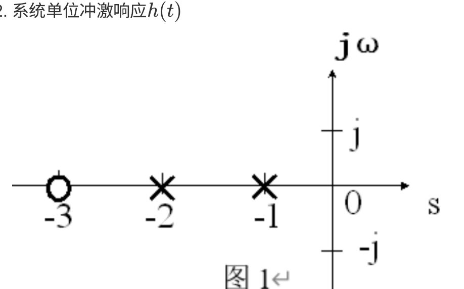
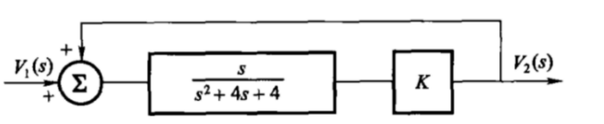
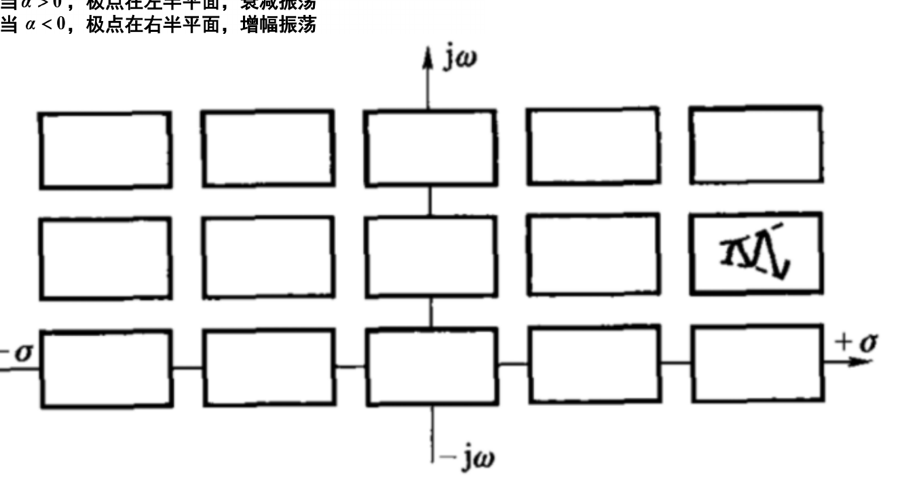

# 信号与系统 第4次作业题目（2026春）

## 题目

### 1

(1) 零输入响应的初始条件为 $r^{(k)}(0_{+})$ ______ $r^{(k)}(0_{-})$（ $=$ or $\neq$）

零状态响应的初始条件为 $r^{(k)}$(______) $=0$（ $0_{+}$ or $0_{-}$）

(2) （单位）冲激响应 是以 ______ 为激励，系统产生的 ______（零状态/零输入）响应，通常用 $h(t)$ 表示。其与系统函数 $H(s)$ 的关系是 ______。

(3) 输入信号 $f(t)$ 经过冲激响应为 $h(t)$ 的系统后，输出信号 $s(t)=$ ______。由此式可知，若该 LTI 系统为因果系统，则在 $t<0$ 时， $h(t)$ 应满足 ______。并说明你的理由。

(4) 若某个 LTI 系统的单位冲激响应为： $h(t)=e^{-t}u(t)$，则其是否为因果系统？若冲激响应改为： $h(t)=e^{|t|}$ 呢？

(5) 如果你的《信号与系统》教材和气体 gg 同时掉水里了，你会先救 ______

A．信统教材　　B．伟大的气体 gg　　C．旁边游泳的 yhgg　　D．钝角

> 可见仅从冲激响应即可判断系统性质，而冲激响应又可由系统函数 $H(s)$ 导出。可见系统函数的重要性。

### 2

给定系统微分方程、起始状态以及激励信号分别为以下两种情况：

(1) $\dfrac{\mathrm{d}}{\mathrm{d}t}r(t)+2r(t)=e(t)$， $r(0_{-})=0$， $e(t)=u(t)$

(2) $\dfrac{\mathrm{d}}{\mathrm{d}t}r(t)+2r(t)=3\dfrac{\mathrm{d}}{\mathrm{d}t}e(t)$， $r(0_{-})=0$， $e(t)=u(t)$

判断在起始点是否发生跳变，并写出 $r(0_{+})$ 的值。

### 3

给定系统微分方程：

$$\frac{\mathrm{d}^{2}}{\mathrm{d}t^{2}}r(t)+3\frac{\mathrm{d}}{\mathrm{d}t}r(t)+2r(t)=\frac{\mathrm{d}}{\mathrm{d}t}e(t)+3e(t)$$

其中 $e(t)=u(t)$， $r(0^{-})=1$， $r'(0^{-})=2$。

(1) 求自由响应和受迫响应

(2) 求零输入响应

(3) 使用以下三种方法，分别求零状态响应

a. 求出冲激响应，并与输入作卷积

b. 根据零状态响应形式和 $0^{-}$ 处条件，使用待定系数法求解

c. 拉氏变换法

> 注 1：答案能互相印证，先自查再提交哈，一定注意要的是 $0_{+}$ 还是 $0_{-}$！！！
>
> 注 2：能发现其实**拉氏变换法**还是比较方便的。
>
> 注 3：据我观察老师很喜欢这种题（懂我意思吧😊）

### 4

求下列函数的拉氏逆变换。

(1) $\dfrac{50s+2500}{s^{2}+101s+100}$

(2) $\dfrac{s+3}{(s+2)^{3}(s+4)}$

(3) $\dfrac{1}{s(s^{2}+4)}$

### 5

已知连续线性时不变时间系统的**零极图**如下所示（其中 O 表示零点，X 表示极点），且该系统的**单位阶跃响应**的终值为 48，试求：

(1) 系统函数 $H(s)$

(2) 系统单位冲激响应 $h(t)$

### 6

如图所示为一个正反馈系统的框图，回答下列问题。其中 $K>0$。

(1) 求出系统函数 $H(s)=\dfrac{V_{2}(s)}{V_{1}(s)}$

(2) 当 $K$ 满足什么条件时，系统是稳定的？

(3) 求出系统临界稳定时的冲激响应 $h(t)$

### 7

> 噫吁嚱，危乎高哉！信统之难，难于上青天！
>
> **系统函数**之于控制理论，其要甚重，尤以恶名昭著之「自动控制」一课为甚，所遇频仍。今欲彰明**极点**于其间之用，俾诸生得深解其妙。

请结合如下 ppt 内容，绘制出当 $H(s)$ 一阶极点落在下图所示 s 平面图中各方框的位置时，画出对应的 $h(t)$ 波形。图中给出了示例：

H(s) 零、极点与 h(t) 波形特征的对应——一阶极点

| $H_{i}(s)$ | 极点位置 | $h(t)$ |
| --- | --- | --- |
| $H_{i}(s)=\dfrac{1}{s}$ | $p_{i}=0$ 在原点 | $h(t)=\mathcal{L}^{-1}[H_{i}(s)]=u(t)$ |
| $H_{i}(s)=\dfrac{1}{s+a}$ | $p_{i}=-a$ 在实轴上 | $h(t)=e^{-at}u(t)$ |
| $a>0$，在左实轴上 | | $h(t)=e^{-at}u(t)$，指数衰减 |
| $a<0$，在右实轴上 | | $h(t)=e^{-at}u(t)$， $-a>0$，指数增加 |
| $H_{i}(s)=\dfrac{\omega}{s^{2}+\omega^{2}}$ | $p_{i_{1,2}}=\pm j\omega$，在虚轴上 | $h_{i}(t)=\sin(\omega t)u(t)$，等幅振荡 |
| $H_{i}(s)=\dfrac{\omega}{(s+\alpha)^{2}+\omega^{2}}$ | $p_{i_{1,2}}=-\alpha\pm j\omega$ | $h_{i}(t)=e^{-\alpha t}\sin(\omega t)u(t)$ |

当 $\alpha>0$，极点在左半平面，衰减振荡；当 $\alpha<0$，极点在右半平面，增幅振荡。

