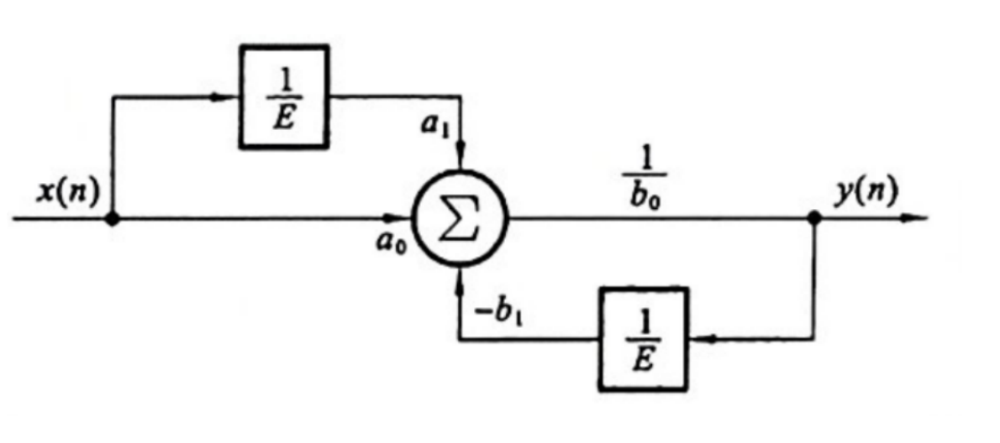

# 信号与系统 第5次作业答案（2026春）

> 题目 PDF 开头为助教 gg 写的《江城子·助教 gg 早八真起不来》（[现代] 稀有气体）：晓窗轻掩梦初长，卸匆忙，懒梳妆。贪落清宵，高卧避晨堂。不踏寒阶趋课席，风未扰，日初阳。今朝偷得半时光，远书章，且瘫床。枕上闲悠，酣睡胜琅浆。笑把早八抛尘外，心畅意，兴悠扬。并附言：有些 uu 课上问助教 gg 问题，我们没能实时回复尊都不好意鼠，真的起不来捏。
>
> Note：本周进入**离散信号**部分的学习，其很多性质以及求解方法与**连续信号**相似，可以类比学习。但需要注意的是，离散并不一定比连续简单，有些时候可能你会更怀念那根「撬棍」（ $\int$）。

## 题目与答案

### 1

#### 题目

判断下列信号是否为**因果/线性/时不变**系统。（答案请以表格形式展现）

(1) $y[n]=\cosh(x[n])$

(2) $y[n]=24n\,x[n]+42n^{2}x[n+1]$

(3) $y[n]=\max(x[n],x^{4}[n])$

(4) $\displaystyle y[n]=\sum_{k=0}^{+\infty}\frac{1}{2^{n}}x[n-k]$

#### 答案

**答案：**

| 小题 | 因果 | 线性 | 时不变 |
| --- | --- | --- | --- |
| (1) | 因果 | 非线性 | 时不变 |
| (2) | 非因果 | 线性 | 时变 |
| (3) | 因果 | 非线性 | 时不变 |
| (4) | 因果 | 线性 | 时变 |

### 2

#### 题目

根据下图确立系统的差分方程，并指出阶次

#### 答案

**答案：** 由图可以写出如下方程：

$$b_{0}y(n)=a_{0}x(n)+a_{1}x(n-1)-b_{1}y(n-1)$$

整理可得：

$$b_{0}y(n)+b_{1}y(n-1)=a_{0}x(n)+a_{1}x(n-1)$$

该方程是【一阶】的。

### 3

#### 题目

给定下列系统的差分方程及其初值，求出其**自由响应**、**受迫响应**、**零输入响应**、**零状态响应**，并最终求出系统的**完全解**：

(1) $y[n]+2y[n-1]+y[n-2]=x[n]$；其中 $x[n]=3^{n}u[n]$， $y[-2]=y[-1]=0$

(2) $y[n]+2y[n-1]+y[n-2]=x[n]$；其中 $x[n]=3^{n}u[n]$， $y[0]=y[1]=0$

(3) $y[n]-3y[n-1]-4y[n-2]=x[n]-x[n-1]$；其中 $x[n]=n^{2}u[n]$， $y[0]=y[1]=0$

#### 答案

**答案：**

所有答案给定响应默认带有 $n\ge 0$ 条件。

(1) 对应齐次方程为

$$y[n]+2y[n-1]+y[n-2]=0$$

$$\lambda^{2}+2\lambda+1=0,\quad \lambda_{1}=\lambda_{2}=-1$$

$$y[n]=(C_{1}n+C_{2})(-1)^{n}$$

（注意到）原方程一个特解为 $y[n]=\dfrac{9}{16}3^{n}$，带入初值可得 $y[n]=\left(\dfrac{1}{4}n+\dfrac{7}{16}\right)(-1)^{n}+\dfrac{9}{16}3^{n},\ n\ge 0$

- 自由响应： $\left(\dfrac{1}{4}n+\dfrac{7}{16}\right)(-1)^{n}$
- 受迫响应： $\dfrac{9}{16}3^{n}$

使用定义求解零输入-零状态即可：

- 零输入响应： $0$
- 零状态响应： $\left(\dfrac{1}{4}n+\dfrac{7}{16}\right)(-1)^{n}+\dfrac{9}{16}3^{n}$

(2)

- 自由响应： $\left(\dfrac{9}{4}n-\dfrac{9}{16}\right)(-1)^{n}$
- 受迫响应： $\dfrac{9}{16}3^{n}$

计算零输入响应的时候不能直接用 0 之后的响应做初值。迭代求得 $y[-1]=3$， $y[-2]=-5$。

- 零输入响应： $(2n-1)(-1)^{n}$
- 零状态响应： $\left(\dfrac{1}{4}n+\dfrac{7}{16}\right)(-1)^{n}+\dfrac{9}{16}3^{n}$

(3)

- 自由响应： $\dfrac{11}{45}4^{n}+\dfrac{1}{5}(-1)^{n}$
- 受迫响应： $-\dfrac{1}{3}n-\dfrac{4}{9}$
- 零输入响应： $-\dfrac{1}{5}4^{n}+\dfrac{1}{5}(-1)^{n}$
- 零状态响应： $\dfrac{1}{9}4^{n+1}-\dfrac{1}{3}n-\dfrac{4}{9}$

### 4

#### 题目

求出下列系统的单位样值响应 $h[n]$

(1) $y[n]+2y[n-1]+y[n-2]=x[n]$

(2) $y[n]-3y[n-1]-4y[n-2]=x[n]-x[n-1]$

并尝试使用单位样值响应**直接卷积**求解上述系统的零状态响应

其中第 1 问， $x[n]=3^{n}u[n]$；第 2 问， $x[n]=n^{2}u[n]$

> 注 1：本题用卷积的定义法并可能涉及高中数列变换的妙妙知识
>
> 注 2：本题可以与上题相互验证
>
> 注 3：做完后会发现，若系统用未精心设计的单位样值信号，直接卷积求零状态响应会异常困难。若稍微设计一下，结果可能为简单等比求和。

#### 答案

**答案：**

> 单位样值响应是激励信号为单位样值信号的**零状态响应**，故所有答案应默认带有 $n\ge 0$ 条件。

(1) $h[n]=(-1)^{n}(n+1)$

$n>0$ 时，方程变为齐次方程，其解为 $(an+b)(-1)^{n}$。因为是因果系统，其样值响应 $h[n]$ 满足 $h[n]=0,\ n<0$，由 $h[-1]=h[-2]=0$，代入系统迭代得到 $h[0]=1$， $h[1]=-2$，解得 $a=b=1$。

$$y[n]=x[n]*h[n]=\sum_{k=-\infty}^{+\infty}(-1)^{k}u[k](k+1)3^{n-k}u[n-k]=3^{n}\sum_{k=0}^{n}(k+1)\left(-\frac{1}{3}\right)^{k}$$

$$=\left(\frac{1}{4}n+\frac{7}{16}\right)(-1)^{n}+\frac{9}{16}3^{n}$$

(2) $h[n]=\dfrac{3}{5}4^{n}+\dfrac{2}{5}(-1)^{n}$

### 5

#### 题目

咕咕嘎嘎！请使用你最喜欢的方法求解 $x_{1}*x_{2}$（卷积）

(1) $x_{1}[n]=2\delta[n]+4\delta[n-1]+4\delta[n-2]+2\delta[n-3]$

$x_{2}[n]=10\delta[n+1]+11\delta[n]$

(2) $x_{1}[n]=2\delta[n+10]+2\delta[n-10]$

$x_{2}[n]=3\delta[n+5]+3\delta[n-5]$

(3) $x_{1}[n]=(-2)^{n}u[n]$

$x_{2}[n]=\delta[n]+\delta[n-1]$

#### 答案

**答案：**

(1) $x_{1}*x_{2}=20\delta[n+1]+62\delta[n]+84\delta[n-1]+64\delta[n-2]+22\delta[n-3]$

(2) $x_{1}*x_{2}=6(\delta[n+15]+\delta[n+5]+\delta[n-5]+\delta[n-15])$

(3) $x_{1}*x_{2}=(-2)^{n}u[n]+(-2)^{n-1}u[n-1]$
