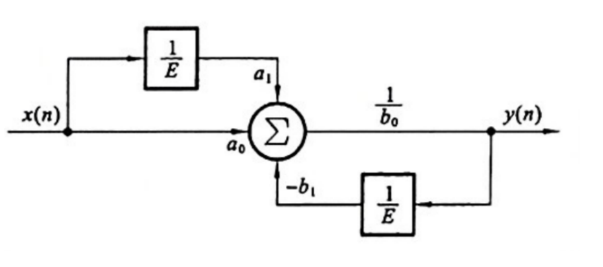

# 信号与系统 第5次作业题目（2026春）

> 题目 PDF 开头为助教 gg 写的《江城子·助教 gg 早八真起不来》（[现代] 稀有气体）：晓窗轻掩梦初长，卸匆忙，懒梳妆。贪落清宵，高卧避晨堂。不踏寒阶趋课席，风未扰，日初阳。今朝偷得半时光，远书章，且瘫床。枕上闲悠，酣睡胜琅浆。笑把早八抛尘外，心畅意，兴悠扬。并附言：有些 uu 课上问助教 gg 问题，我们没能实时回复尊都不好意鼠，真的起不来捏。
>
> Note：本周进入**离散信号**部分的学习，其很多性质以及求解方法与**连续信号**相似，可以类比学习。但需要注意的是，离散并不一定比连续简单，有些时候可能你会更怀念那根「撬棍」（ $\int$）。

## 题目

### 1

判断下列信号是否为**因果/线性/时不变**系统。（答案请以表格形式展现）

(1) $y[n]=\cosh(x[n])$

(2) $y[n]=24n\,x[n]+42n^{2}x[n+1]$

(3) $y[n]=\max(x[n],x^{4}[n])$

(4) $\displaystyle y[n]=\sum_{k=0}^{+\infty}\frac{1}{2^{n}}x[n-k]$

### 2

根据下图确立系统的差分方程，并指出阶次

### 3

给定下列系统的差分方程及其初值，求出其**自由响应**、**受迫响应**、**零输入响应**、**零状态响应**，并最终求出系统的**完全解**：

(1) $y[n]+2y[n-1]+y[n-2]=x[n]$；其中 $x[n]=3^{n}u[n]$， $y[-2]=y[-1]=0$

(2) $y[n]+2y[n-1]+y[n-2]=x[n]$；其中 $x[n]=3^{n}u[n]$， $y[0]=y[1]=0$

(3) $y[n]-3y[n-1]-4y[n-2]=x[n]-x[n-1]$；其中 $x[n]=n^{2}u[n]$， $y[0]=y[1]=0$

### 4

求出下列系统的单位样值响应 $h[n]$

(1) $y[n]+2y[n-1]+y[n-2]=x[n]$

(2) $y[n]-3y[n-1]-4y[n-2]=x[n]-x[n-1]$

并尝试使用单位样值响应**直接卷积**求解上述系统的零状态响应

其中第 1 问， $x[n]=3^{n}u[n]$；第 2 问， $x[n]=n^{2}u[n]$

> 注 1：本题用卷积的定义法并可能涉及高中数列变换的妙妙知识
>
> 注 2：本题可以与上题相互验证
>
> 注 3：做完后会发现，若系统用未精心设计的单位样值信号，直接卷积求零状态响应会异常困难。若稍微设计一下，结果可能为简单等比求和。

### 5

咕咕嘎嘎！请使用你最喜欢的方法求解 $x_{1}*x_{2}$（卷积）

(1) $x_{1}[n]=2\delta[n]+4\delta[n-1]+4\delta[n-2]+2\delta[n-3]$

$x_{2}[n]=10\delta[n+1]+11\delta[n]$

(2) $x_{1}[n]=2\delta[n+10]+2\delta[n-10]$

$x_{2}[n]=3\delta[n+5]+3\delta[n-5]$

(3) $x_{1}[n]=(-2)^{n}u[n]$

$x_{2}[n]=\delta[n]+\delta[n-1]$
