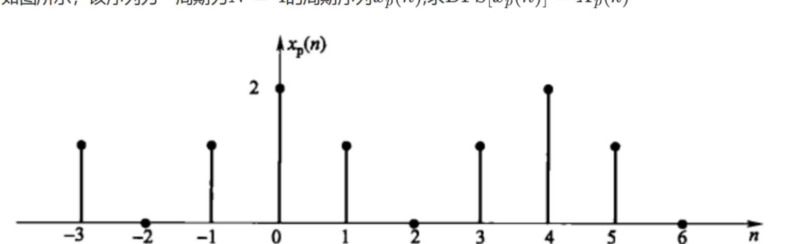
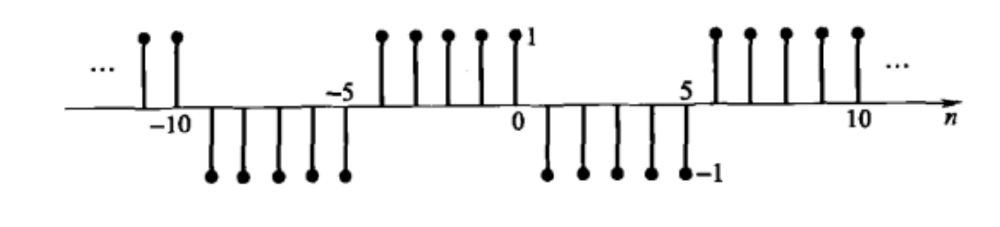

# 信号与系统 第7次作业答案（2026春）

> 咦~ 听说本周六气体 gg 过生日，让我们一起祝他生日快乐🥳（原文配了一张小猫表情包）。

## 题目与答案

### 1

#### 题目

如图所示，该序列为一周期为 $N=4$ 的周期序列 $x_{p}(n)$，求 $\mathrm{DFS}[x_{p}(n)]=X_{p}(k)$

#### 答案

**答案：** 根据 DFS 定义，有

$$X_{p}(k)=\frac{1}{4}\sum_{n=0}^{N-1}x_{p}(n)e^{-j\frac{2\pi}{N}nk}=\frac{1}{4}\sum_{n=0}^{3}x_{p}(n)e^{-j\frac{\pi}{2}nk}$$

$$=\frac{1}{4}\left(2+1\cdot e^{-j\frac{\pi}{2}k}+0+1\cdot e^{-j\frac{3\pi}{2}k}\right)$$

$$=\frac{1}{4}\left(2+e^{-j\frac{\pi}{2}k}+e^{j\frac{\pi}{2}k}\right)$$

$$=\frac{1}{2}\left[1+\cos\left(\frac{\pi}{2}k\right)\right]$$

本课程中教的是要除以 $N$，但是除不除其实都可以，系数不改变频域特征的相对关系。

### 2

#### 题目

周期序列 $x_{p}(n)$ 如图所示，判断下列命题是否正确，并简述理由。

(1) $X_{p}(k)=X_{p}(k+10)$

(2) $X_{p}(k)=X_{p}(-k)$

(3) $X_{p}(0)=0$

(4) $\forall k,\ X_{p}(k)e^{j\left(\frac{2\pi}{5}\right)k}\in\mathbb{R}$

#### 答案

**答案：**

(1) 图示 $x_{p}(n)$ 序列的周期为 10，所以 $X_{p}(k)$ 的周期同样也为 10，故 $X_{p}(k)=X_{p}(k+10)$ 正确。

(2) 假设 $X_{p}(k)=X_{p}(-k)$ 为真。根据题图 9-4， $x_{p}(n)$ 是实序列。按定义有

$$X_{p}^{*}(k)=\left[\sum_{n=0}^{N-1}x_{p}(n)e^{-j\frac{2\pi}{N}nk}\right]^{*}=\sum_{n=0}^{N-1}x_{p}^{*}(n)e^{j\frac{2\pi}{N}nk}$$

$$=\sum_{n=0}^{N-1}x_{p}(n)e^{-j\frac{2\pi}{N}n(-k)}=X_{p}(-k)$$

因而有 $X_{p}(k)=X_{p}^{*}(k)$，即 $X_{p}(k)$ 是实序列。下面考查

$$x_{p}^{*}(-n)=\left[\frac{1}{N}\sum_{k=0}^{N-1}X_{p}(k)e^{-j\frac{2\pi}{N}nk}\right]^{*}=\frac{1}{N}\sum_{k=0}^{N-1}X_{p}^{*}(k)e^{j\frac{2\pi}{N}nk}$$

$$=\frac{1}{N}\sum_{k=0}^{N-1}X_{p}(k)e^{j\frac{2\pi}{N}nk}=x_{p}(n)$$

即 $x_{p}(n)$ 是实偶序列。但由题图 9-4 显然 $x_{p}(n)$ 不满足偶对称性，所以 $X_{p}(k)\neq X_{p}(-k)$。

(3) 根据定义，有

$$X_{p}(0)=\sum_{n=0}^{N-1}x_{p}(n)e^{-j\frac{2\pi}{N}n\cdot 0}=\sum_{n=0}^{N-1}x_{p}(n)=0$$

(4) 令 $W=e^{-j\frac{2\pi}{N}}=e^{-j\frac{\pi}{5}}$，则 $X_{p}(k)e^{-j\frac{2\pi}{5}k}=\displaystyle\sum_{n=0}^{N-1}W^{k(n-2)}$，由 $W^{10k}=1$，

$$\sum_{n=0}^{N-1}W^{k(n-2)}=\left(W^{5k}-1\right)\left(W^{-k}+1+W^{k}+W^{2k}+W^{3k}\right)$$

$k$ 为奇数时 $\left(W^{5k}-1\right)=-2$， $W^{-k}+1+W^{k}\in\mathbb{R}$

但是 $W^{2k}+W^{3k}$ 虚部 $\sin\left(-\dfrac{2k\pi}{5}\right)+\sin\left(-\dfrac{3k\pi}{5}\right)$ 可以不为 0（只要 $k$ 不为 5 的整数倍）

所以命题错误。

### 3

#### 题目

请求解下列信号的 DFT

(1) $x(n)=\sin\left(\dfrac{2\pi}{5}n\right)+\cos\left(\dfrac{4\pi}{5}n\right),\ N=5$

(2) $x(n)=\delta(n)+\delta(n-1)-\delta(n-2)-\delta(n-3),\ N=4$

(3) $x(n)=\delta(n)+\delta(n-1)-\delta(n-2)-\delta(n-3),\ N=5$

细心的 uu 会发现 ppt 前后有点小矛盾，这里我们以下图为准。实际上 $\dfrac{1}{N}$ 给谁其实都不影响，可以参考郑君里老师教材中的说明。

DFT 解决了频域离散化（时频域均离散和有限）的问题

$$X(k)=\mathrm{DFT}[x_{p}(n)]=\sum_{n=0}^{N-1}x(n)e^{-jk\Omega_{0}n}\quad (0\le k\le N-1)$$

$$x(n)=\mathrm{IDFT}[X(k)]=\frac{1}{N}\sum_{k=0}^{N-1}X(k)e^{jk\Omega_{0}n}\quad (0\le n\le N-1)$$

#### 答案

**答案：**

(1)

$$X(k)=\sum_{n=0}^{4}\left(\sin\frac{2\pi}{5}n+\cos\frac{4\pi}{5}n\right)e^{-jk\frac{2\pi}{5}n}$$

- 编程求出结果： $\left(0,\ -\dfrac{5}{2}j,\ \dfrac{5}{2},\ \dfrac{5}{2},\ \dfrac{5}{2}j\right)$

(2)

$$X(k)=1+e^{-jk\frac{\pi}{2}}-e^{-jk\pi}-e^{-jk\frac{3\pi}{2}}$$

(3)

$$X(k)=1+e^{-jk\frac{2\pi}{5}}-e^{-jk\frac{4\pi}{5}}-e^{-jk\frac{6\pi}{5}}$$

### 4

#### 题目

有一信号如下：

$$x(n)=\delta(n)+\delta(n-1)-\delta(n-2)-\delta(n-3),\ N=4$$

(1) 求解 $x(n-1),\ x(n-2)$ 对应的 DFT

(2) 求解 $x(n)$ 的 DTFT $X(\Omega)$

(3) 尝试着将 (2) 中求出的 $X(\Omega)$ 在一个周期内等间隔抽取 2 个样本（DFT 此时会选取 4 个），求出抽样后频率对应的时域序列 $x_{p}(n)$。（可以参考 ppt。答案不唯一，和构造有关，合理即可）

(4) 对比 $x_{p}(n)$ 和 $x(n)$，是否能通过处理由 $x_{p}(n)$ 得到 $x(n)$？

#### 答案

**答案：**

(1) $x(n-1)\rightarrow -1+e^{-jk\frac{\pi}{2}}+e^{-jk\pi}-e^{-jk\frac{3\pi}{2}}$， $x(n-2)\rightarrow -1-e^{-jk\frac{\pi}{2}}+e^{-jk\pi}+e^{-jk\frac{3\pi}{2}}$

(2) $1+e^{-j\Omega}-e^{-2j\Omega}-e^{-3j\Omega}$

(3) $0$（取 0 和半周期上的样本）

(4) 不能，反例参见 (3)

### 5

#### 题目

证明：对任意的长度为 $N$ 的离散信号 $x(n)$，在频域中等间距抽取 $N$ 个样本（即间距 $\dfrac{2\pi}{N}$），这 $N$ 个样本可以通过一定方式构造出原信号 $x(n)$。

> 注 1：从 Q4 中，你可能感受到了一些在某个域上采样与另一个域上延拓的关联。DTFT 到 DFT 的转换与采样定理的思路高度一致，此处提供一种抽象化的思考过程。
>
> 注 2：参考 ppt 中的 DFT 推导过程。

#### 答案

**答案：** 基本类似 ppt 中有关 DFT 的推导过程，言之有理即可。
