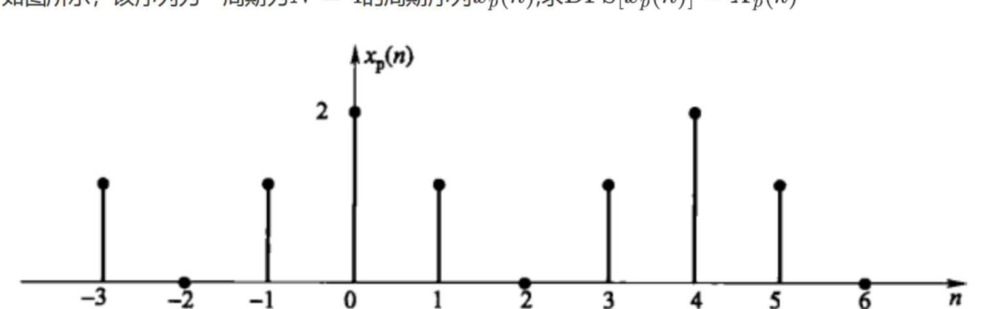
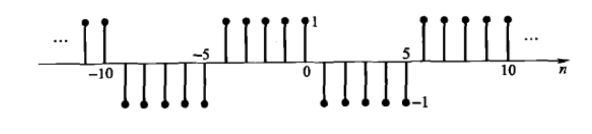

# 信号与系统 第7次作业题目（2026春）

> 咦~ 听说本周六气体 gg 过生日，让我们一起祝他生日快乐🥳（原文配了一张小猫表情包）。

## 题目

### 1

如图所示，该序列为一周期为 $N=4$ 的周期序列 $x_{p}(n)$，求 $\mathrm{DFS}[x_{p}(n)]=X_{p}(k)$

### 2

周期序列 $x_{p}(n)$ 如图所示，判断下列命题是否正确，并简述理由。

(1) $X_{p}(k)=X_{p}(k+10)$

(2) $X_{p}(k)=X_{p}(-k)$

(3) $X_{p}(0)=0$

(4) $\forall k,\ X_{p}(k)e^{j\left(\frac{2\pi}{5}\right)k}\in\mathbb{R}$

### 3

请求解下列信号的 DFT

(1) $x(n)=\sin\left(\dfrac{2\pi}{5}n\right)+\cos\left(\dfrac{4\pi}{5}n\right),\ N=5$

(2) $x(n)=\delta(n)+\delta(n-1)-\delta(n-2)-\delta(n-3),\ N=4$

(3) $x(n)=\delta(n)+\delta(n-1)-\delta(n-2)-\delta(n-3),\ N=5$

细心的 uu 会发现 ppt 前后有点小矛盾，这里我们以下图为准。实际上 $\dfrac{1}{N}$ 给谁其实都不影响，可以参考郑君里老师教材中的说明。

DFT 解决了频域离散化（时频域均离散和有限）的问题

$$X(k)=\mathrm{DFT}[x_{p}(n)]=\sum_{n=0}^{N-1}x(n)e^{-jk\Omega_{0}n}\quad (0\le k\le N-1)$$

$$x(n)=\mathrm{IDFT}[X(k)]=\frac{1}{N}\sum_{k=0}^{N-1}X(k)e^{jk\Omega_{0}n}\quad (0\le n\le N-1)$$

### 4

有一信号如下：

$$x(n)=\delta(n)+\delta(n-1)-\delta(n-2)-\delta(n-3),\ N=4$$

(1) 求解 $x(n-1),\ x(n-2)$ 对应的 DFT

(2) 求解 $x(n)$ 的 DTFT $X(\Omega)$

(3) 尝试着将 (2) 中求出的 $X(\Omega)$ 在一个周期内等间隔抽取 2 个样本（DFT 此时会选取 4 个），求出抽样后频率对应的时域序列 $x_{p}(n)$。（可以参考 ppt。答案不唯一，和构造有关，合理即可）

(4) 对比 $x_{p}(n)$ 和 $x(n)$，是否能通过处理由 $x_{p}(n)$ 得到 $x(n)$？

### 5

证明：对任意的长度为 $N$ 的离散信号 $x(n)$，在频域中等间距抽取 $N$ 个样本（即间距 $\dfrac{2\pi}{N}$），这 $N$ 个样本可以通过一定方式构造出原信号 $x(n)$。

> 注 1：从 Q4 中，你可能感受到了一些在某个域上采样与另一个域上延拓的关联。DTFT 到 DFT 的转换与采样定理的思路高度一致，此处提供一种抽象化的思考过程。
>
> 注 2：参考 ppt 中的 DFT 推导过程。
