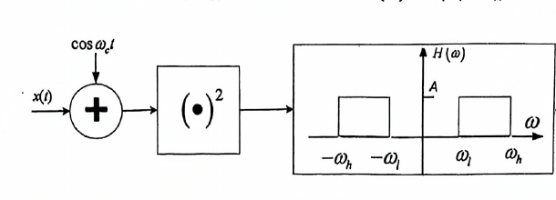

# 信号与系统 2023–2024 学年第二学期期末试卷（未标卷别）参考答案

## 一、（本题 20 分，每小题 5 分）

### 1. 由 $y_{3}(t)\neq y_{1}(t-T)+y_{2}(t-T)$ 分析系统的线性和时不变性

#### 题目

1. 已知一连续系统在输入为 $x_{1}(t)$ 时输出为 $y_{1}(t)$ ，输入为 $x_{2}(t)$ 时输出为 $y_{2}(t)$ ，但输入为 $x_{3}(t)=x_{1}(t-T)+x_{2}(t-T)$ ，输出 $y_{3}(t)\neq y_{1}(t-T)+y_{2}(t-T)$ ，其中 T 为常数。分析说明系统的线性和时不变性。

#### 答案

**答案：**

设系统算子为 $T[\cdot]$ ，已知 $T[x_{1}]=y_{1}$ ， $T[x_{2}]=y_{2}$ ，且

$$T\left[x_{1}(t-T)+x_{2}(t-T)\right]\neq y_{1}(t-T)+y_{2}(t-T).$$

若系统既是线性的又是时不变的，则应有

$$T\left[x_{1}(t-T)+x_{2}(t-T)\right]=T\left[x_{1}(t-T)\right]+T\left[x_{2}(t-T)\right]=y_{1}(t-T)+y_{2}(t-T),$$

（第一步用线性性，第二步用时不变性），这与题给的不等式矛盾。

因此可以断定：**该系统不可能同时具有线性和时不变性**，即系统一定不是线性时不变（LTI）系统。

但仅凭这一条不等式无法进一步区分：系统可能是「线性、时变」，也可能是「非线性、时不变」，还可能是「非线性、时变」。若要唯一确定，需另作两个检验：

- 检验线性：另取 $x_{3}'(t)=x_{1}(t)+x_{2}(t)$ （不作平移），看是否 $y_{3}'=y_{1}+y_{2}$ ；
- 检验时不变：取单一输入 $x_{1}(t)$ ，看 $T[x_{1}(t-T)]$ 是否等于 $y_{1}(t-T)$ 。

### 2. $y(n)=[1+mx(n)]\cos(\omega n)$ 的因果性和稳定性

#### 题目

2\. 某离散时间系统对于输入序列 $x(n)$ 的响应为 $y(n)=[1+mx(n)]\cos(\omega n)$ ，其中 m 和 $\omega$ 为常数，判断并说明系统的因果性和稳定性。

#### 答案

**答案：**

**因果性：** $y(n)$ 只依赖当前时刻的输入 $x(n)$ ，不依赖 $n$ 之后时刻的输入，故系统是**因果**的。

**稳定性：** 设输入有界 $|x(n)|\le B<\infty$ ，则

$$|y(n)|=\left|1+mx(n)\right|\left|\cos(\omega n)\right|\le 1+|m|B<\infty,$$

输出对任意有界输入都有界，故系统是 **BIBO 稳定**的。

（补充：因响应中含因子 $\cos(\omega n)$ ，除非 $\omega$ 是 $2\pi$ 的整数倍，系统对移位不封闭，故系统是时变的。）

### 3. 求 $x(2n+3)\otimes h\left(\dfrac{n}{2}\right)$

#### 题目

3\. 已知 $x(n)=\{1,-1,\underset{\uparrow}{1},1,-2,1,1\}$ ， $h(n)=\{\underset{\uparrow}{1},1,1\}$ ，求 $x(2n+3)\otimes h\left(\dfrac{n}{2}\right)$ 。

#### 答案

**答案：**

由箭头位置， $x(-2)=1,\ x(-1)=-1,\ x(0)=1,\ x(1)=1,\ x(2)=-2,\ x(3)=1,\ x(4)=1$ ，其余为 $0$ ； $h(0)=h(1)=h(2)=1$ ，其余为 $0$ 。

**第一步，抽取：** 令 $a(n)=x(2n+3)$ 。 $2n+3$ 只能取奇数值，落在 $x$ 非零范围内的奇数值只有 $-1,\ 1,\ 3$ ，对应

$$a(-2)=x(-1)=-1,\qquad a(-1)=x(1)=1,\qquad a(0)=x(3)=1,$$

其余 $a(n)=0$ 。

**第二步，插值：** 令 $b(n)=h\left(\dfrac{n}{2}\right)$ 。 $n$ 为偶数时 $b(n)=h(n/2)$ ， $n$ 为奇数时 $b(n)=0$ ，故

$$b(0)=1,\qquad b(2)=1,\qquad b(4)=1,$$

其余 $b(n)=0$ 。

**第三步，卷积：** $y(n)=a(n)*b(n)=\displaystyle\sum_{k}a(k)b(n-k)$ ，非零范围为 $-2\le n\le 4$ ：

| $n$ | $-2$ | $-1$ | $0$ | $1$ | $2$ | $3$ | $4$ |
| --- | --- | --- | --- | --- | --- | --- | --- |
| $y(n)$ | $-1$ | $1$ | $0$ | $1$ | $0$ | $1$ | $1$ |

即

$$y(n)=\{-1,\ 1,\ 0,\ 1,\ 0,\ 1,\ 1\},\qquad -2\le n\le 4 .$$

### 4. $\left[f(2t)\cdot f\left(\dfrac{t}{2}\right)\right]$ 频谱不混迭的最大采样间隔

#### 题目

4\. 已知带限信号 $f(t)$ 的最高角频率为 $\omega_{m}$ ，求信号 $\left[f(2t)\cdot f\left(\dfrac{t}{2}\right)\right]$ 频谱不混迭的最大采样间隔 $T$ 。

#### 答案

**答案：**

$f(t)$ 的最高角频率为 $\omega_{m}$ 。由尺度性质， $f(2t)$ 的最高角频率为 $2\omega_{m}$ ， $f\left(\dfrac{t}{2}\right)$ 的最高角频率为 $\dfrac{\omega_{m}}{2}$ 。

时域相乘对应频域卷积，两者频谱卷积后的非零范围是各自非零范围的和，故乘积信号的最高角频率为

$$\omega_{\max}=2\omega_{m}+\frac{\omega_{m}}{2}=\frac{5\omega_{m}}{2}.$$

频谱不混迭要求抽样角频率满足 $\omega_{s}\ge 2\omega_{\max}=5\omega_{m}$ ，即 $\dfrac{2\pi}{T}\ge 5\omega_{m}$ ，故最大采样间隔为

$$T_{\max}=\frac{2\pi}{5\omega_{m}} .$$

## 二、（本题 10 分）求单位冲激响应 $h(t)$

### 题目

某因果线性时不变系统，输入信号为 $f_{1}(t)=e^{-3t}u(t)$ 时，系统零状态响应为 $y_{1}(t)$ ；输入信号为

$$f_{2}(t)=\frac{\mathrm{d}}{\mathrm{d}t}f_{1}(t)+3\int_{-\infty}^{t}f_{1}(\tau)\,\mathrm{d}\tau$$

时，系统零状态响应为 $y_{2}(t)=-4y_{1}(t)+e^{-2t}u(t)$ 。

求该系统的单位冲激响应 $h(t)$ 。

### 答案

**答案：**

由 $f_{1}(t)=e^{-3t}u(t)$ 得 $F_{1}(s)=\dfrac{1}{s+3}$ ，零状态响应

$$Y_{1}(s)=H(s)F_{1}(s)=\frac{H(s)}{s+3}.$$

由 $f_{2}(t)=\dfrac{\mathrm{d}}{\mathrm{d}t}f_{1}(t)+3\displaystyle\int_{-\infty}^{t}f_{1}(\tau)\,\mathrm{d}\tau$ ，且 $f_{1}(0_{-})=0$ ，得

$$F_{2}(s)=sF_{1}(s)+\frac{3}{s}F_{1}(s)=\left(s+\frac{3}{s}\right)\frac{1}{s+3}=\frac{s^{2}+3}{s(s+3)}.$$

于是

$$Y_{2}(s)=H(s)F_{2}(s)=H(s)\frac{s^{2}+3}{s(s+3)}.$$

另一方面，由题给 $y_{2}(t)=-4y_{1}(t)+e^{-2t}u(t)$ 得

$$Y_{2}(s)=-\frac{4H(s)}{s+3}+\frac{1}{s+2}.$$

两式相等：

$$H(s)\frac{s^{2}+3}{s(s+3)}=-\frac{4H(s)}{s+3}+\frac{1}{s+2},$$

整理得

$$\frac{1}{s+2}=H(s)\left[\frac{s^{2}+3}{s(s+3)}+\frac{4}{s+3}\right]=H(s)\frac{s^{2}+4s+3}{s(s+3)}=H(s)\frac{(s+1)(s+3)}{s(s+3)}=H(s)\frac{s+1}{s},$$

故

$$H(s)=\frac{s}{(s+1)(s+2)}=-\frac{1}{s+1}+\frac{2}{s+2},$$

$$\boxed{h(t)=\left(2e^{-2t}-e^{-t}\right)u(t)} .$$

## 三、（本题 15 分）带通滤波器参数与限制条件

### 题目

### 答案

**答案：**

**(1) 参数 $A$ 、 $\omega_{l}$ 、 $\omega_{h}$**

平方器的输入为 $x(t)+\cos\omega_{c}t$ ，其输出为

$$\left[x(t)+\cos\omega_{c}t\right]^{2}=x^{2}(t)+2x(t)\cos\omega_{c}t+\cos^{2}\omega_{c}t=x^{2}(t)+2x(t)\cos\omega_{c}t+\frac{1}{2}+\frac{1}{2}\cos 2\omega_{c}t .$$

各项的频谱与占据的频带为：

- $x^{2}(t)\ \leftrightarrow\ \dfrac{1}{2\pi}X(\omega)*X(\omega)$ ，占据 $|\omega|\le 2\omega_{M}$ ；
- $2x(t)\cos\omega_{c}t\ \leftrightarrow\ X(\omega-\omega_{c})+X(\omega+\omega_{c})$ ，占据 $\omega_{c}-\omega_{M}\le|\omega|\le\omega_{c}+\omega_{M}$ ；
- $\dfrac{1}{2}$ 为直流分量（ $\omega=0$ 处的冲激）， $\dfrac{1}{2}\cos 2\omega_{c}t$ 占据 $\omega=\pm 2\omega_{c}$ 。

期望输出 $y(t)=x(t)\cos\omega_{c}t$ 的频谱为 $\dfrac{1}{2}\left[X(\omega-\omega_{c})+X(\omega+\omega_{c})\right]$ ，正好是第二项频谱的 $\dfrac{1}{2}$ 。因此带通滤波器应恰好取出 $\pm\omega_{c}$ 附近的那一对边带，并衰减一半：

$$A=\frac{1}{2},\qquad \omega_{l}=\omega_{c}-\omega_{M},\qquad \omega_{h}=\omega_{c}+\omega_{M}.$$

**(2) 对 $\omega_{c}$ 和 $\omega_{M}$ 的限制**

需要限制。因为 $x^{2}(t)$ 的频谱一直延伸到 $|\omega|=2\omega_{M}$ ，若它与通带 $\left[\omega_{c}-\omega_{M},\ \omega_{c}+\omega_{M}\right]$ 重叠，输出中就会混入 $x^{2}(t)$ 的分量，无法得到纯净的 $x(t)\cos\omega_{c}t$ 。故要求通带下边界高于 $x^{2}(t)$ 的频带上界：

$$\omega_{l}>2\omega_{M}\ \Longrightarrow\ \omega_{c}-\omega_{M}>2\omega_{M}\ \Longrightarrow\ \boxed{\omega_{c}>3\omega_{M}} .$$

在此条件下：通带上边界 $\omega_{h}=\omega_{c}+\omega_{M}<2\omega_{c}$ ，故 $\pm 2\omega_{c}$ 处的冲激也被排除；又 $\omega_{l}>0$ ，直流分量同样被排除。
