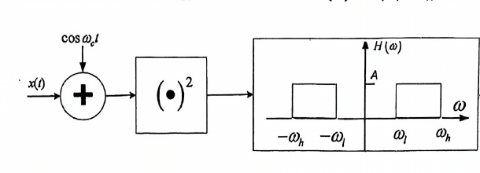

# 信号与系统 2023–2024 学年第二学期期末试卷（未标卷别）

## 一、（本题 20 分，每小题 5 分）

1. 已知一连续系统在输入为 $x_{1}(t)$ 时输出为 $y_{1}(t)$ ，输入为 $x_{2}(t)$ 时输出为 $y_{2}(t)$ ，但输入为 $x_{3}(t)=x_{1}(t-T)+x_{2}(t-T)$ ，输出 $y_{3}(t)\neq y_{1}(t-T)+y_{2}(t-T)$ ，其中 T 为常数。分析说明系统的线性和时不变性。

2. 某离散时间系统对于输入序列 $x(n)$ 的响应为 $y(n)=[1+mx(n)]\cos(\omega n)$ ，其中 m 和 $\omega$ 为常数，判断并说明系统的因果性和稳定性。

3. 已知 $x(n)=\{1,-1,\underset{\uparrow}{1},1,-2,1,1\}$ ， $h(n)=\{\underset{\uparrow}{1},1,1\}$ ，求 $x(2n+3)\otimes h\left(\dfrac{n}{2}\right)$ 。
4. 已知带限信号 $f(t)$ 的最高角频率为 $\omega_{m}$ ，求信号 $\left[f(2t)\cdot f\left(\dfrac{t}{2}\right)\right]$ 频谱不混迭的最大采样间隔 $T$ 。

## 二、（本题 10 分）

某因果线性时不变系统，输入信号为 $f_{1}(t)=e^{-3t}u(t)$ 时，系统零状态响应为 $y_{1}(t)$ ；输入信号为

$$f_{2}(t)=\frac{\mathrm{d}}{\mathrm{d}t}f_{1}(t)+3\int_{-\infty}^{t}f_{1}(\tau)\,\mathrm{d}\tau$$

时，系统零状态响应为 $y_{2}(t)=-4y_{1}(t)+e^{-2t}u(t)$ 。

求该系统的单位冲激响应 $h(t)$ 。

## 三、（本题 15 分）

如题三图所示系统，其中 $x(t)$ 为带限信号，即 $X(\omega)=0,\ |\omega|>\omega_{M}$ 。

1. 确定带通滤波器的参数 $A$ ， $\omega_{l}$ 和 $\omega_{h}$ ，使得 $y(t)=x(t)\cos\omega_{c}t$ ；

2. 是否需要对 $\omega_{c}$ 和 $\omega_{M}$ 加以某种限制，若需要则给出相应的限制。
