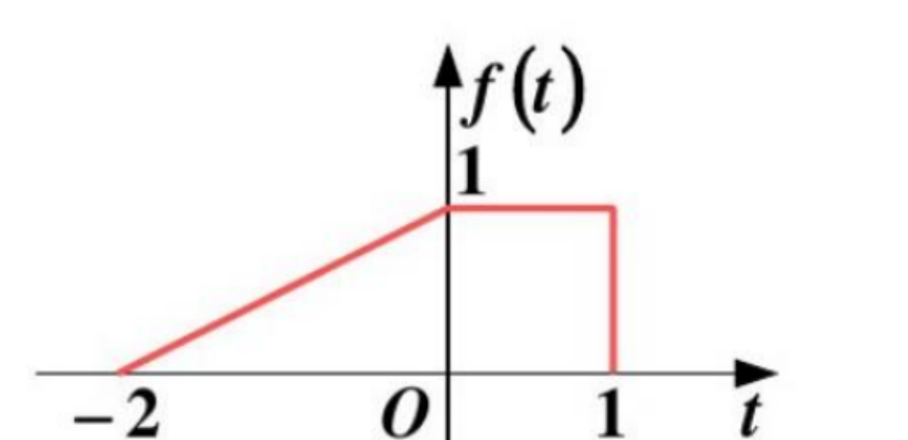

# 信号与系统 第1次作业题目（另一版，2026春）

## 题目

### Q1

请证明：

1. $\displaystyle\int_{-\infty}^{\infty}f(t)\delta(at+b)\,\mathrm{d}t=\int_{-\infty}^{\infty}\frac{f(t)}{|a|}\delta\left(t+\frac{b}{a}\right)\,\mathrm{d}t,\ a\neq 0$
2. $\displaystyle\int_{-\infty}^{\infty}f(t)\delta'(t)\,\mathrm{d}t=-f'(0)$

### Q2

判断下列信号是否为周期信号，若是，则给出周期：

1. $\sin^{2}t$
2. $e^{j2t}$
3. $\cos(t)+\cos(\pi t)$

### Q3

判断正误：

1. $x[n]=\cos(n)$ 是数字信号
2. 周期信号之和也是周期信号
3. 非周期信号之和也是非周期信号
4. 能量信号都是非周期信号（不考虑 0）

### Q4

$f(t)$ 波形如下，用两种不同的运算顺序求 $f(-3t+9)$，并绘制波形

> 提示：先缩放再平移 或 先平移再缩放

### Q5

计算：

1. $\displaystyle\int_{-\infty}^{\infty}f(t_{0}-t)\delta(t)\,\mathrm{d}t$
2. $\displaystyle\int_{-\infty}^{\infty}\left(e^{t}-\cos(\pi t)\right)\delta(t+1)\,\mathrm{d}t$
3. $(\sin t)\delta(t)$
4. $\displaystyle\int_{-\infty}^{\infty}u(t-1)\delta(t-3)\,\mathrm{d}t$

### Q6

判断正误，并给出过程：

1. 函数集 $\{1,x^{1},x^{2},\dots\}$ 是否为区间 $(0,2)$ 上的正交函数集
2. $\cos t,\cos(2t),\dots,\cos(nt),\ n\in\mathbb{N}^{*}$ 是否为区间 $(0,2\pi)$ 上的正交函数集
3. $\cos t,\cos(2t),\dots,\cos(nt),\ n\in\mathbb{N}^{*}$ 是否为区间 $\left(0,\dfrac{\pi}{2}\right)$ 上的正交函数集

### Q7

1. 对 $f(t)=e^{t}+t^{2}-t$ 做奇偶分解
2. 对任意信号 $f(t)$ 做奇偶分解
3. 对 $f(t)=\cos^{2}t$ 做直流交流分解

### Q8

用 $f(t)=at^{2}+bt+c$ 在区间 $(-1,1)$ 上近似表示信号 $e^{t}$（其中 $a,b,c$ 均为确定的参数， $a\neq 0$）

（提示：考虑均方误差准则下的正交分解）

### Q9

设矩形函数 $f(t)$ 有如下定义：

$$
f(t)=\begin{cases}1, & 0<t<\pi\\[4pt] -1, & \pi<t<2\pi\end{cases}
$$

试在 $n=1,2,3,4$ 的情况下使用正弦正交函数集，做均方误差准则下的正交分解：

$$
f(t)\approx c_{1}\sin t+c_{2}\sin(2t)+\dots+c_{n}\sin(nt)
$$

写出对应系数，并计算各情况下的均方误差 $\overline{\varepsilon^{2}}$。
