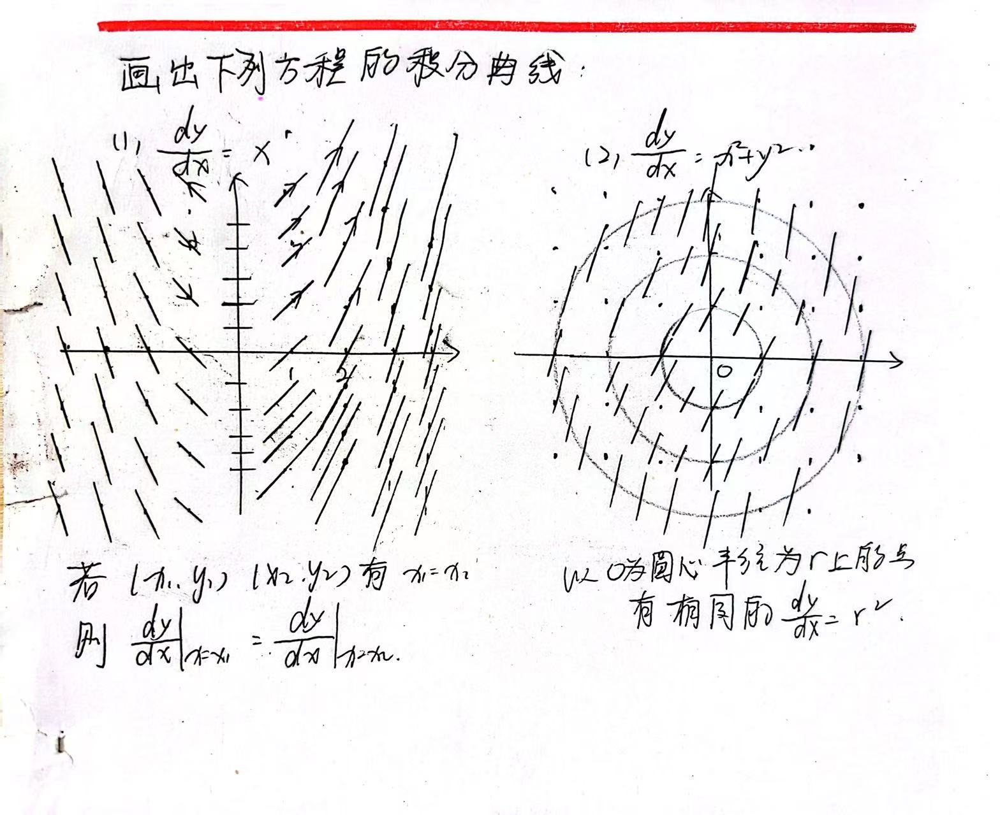
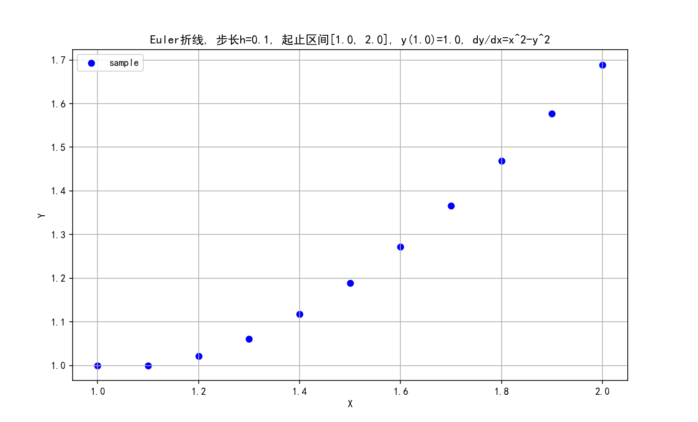

# 微分方程 第14周作业答案（2025春）

## 第 1 题

### 题目

画出下列方程的积分曲线：

(1) $\dfrac{\mathrm{d}y}{\mathrm{d}x} = x$；

(2) $\dfrac{\mathrm{d}y}{\mathrm{d}x} = x^2 + y^2$。

### 答案

**答案：** 用方向场（斜率场）表示积分曲线的走向：



两条说明：

- 对 (1)：若 $(x_1, y_1)$、 $(x_2, y_2)$ 有 $x_1 = x_2$，则 $\left.\dfrac{\mathrm{d}y}{\mathrm{d}x}\right|_{x = x_1} = \left.\dfrac{\mathrm{d}y}{\mathrm{d}x}\right|_{x = x_2}$。
- 对 (2)：以 $O$ 为圆心、半径为 $r$ 上的点有相同的 $\dfrac{\mathrm{d}y}{\mathrm{d}x} = r^2$。

## 第 2 题

### 题目

用 Euler 折线法，取步长 $h = 0.1$，求初值问题

$$
\begin{cases}
\dfrac{\mathrm{d}y}{\mathrm{d}x} = x^2 - y^2, \\
y(1) = 1.
\end{cases}
$$

### 答案

**答案：** 通过 Python 编程实现，代码如下：

```python
import numpy as np
import matplotlib.pyplot as plt
'''
代码能够实现Euler折线,从而在给定某一个积分曲线经过的点(x0, y0)的情况下,对dy/dx=f(x, y)进行数值解逼近
需要输入逼近区间[a, b],以及步长h, 以及x=x0时的初值y=y0
'''

def f(x0, y0): # 只需要修改f函数本身,就可以拟合不同的积分曲线
      f=x0**2-y0**2
      '''
      在f=x^2+y^2情况下,有可能会因为h过小或者区间过长,欧拉折线不收敛,数值爆炸,无法求解.
      '''
      return f

def GetNextY(x0, y0, h):
      '''
      由已知的点(x_k, y_k),根据Euler折线计算出(x_{k+1}, y_{k+1})
      '''
      ans=f(x0, y0)
      y1=ans*h+y0
      return y1

def main():
      '''
      几个参数:
      [a, b]是求解近似积分曲线的区间,n是点的数量
      '''
      a, b, h, y0=map(float, input('请输入a, b, h, y0,用空格隔开,输出完毕按回车\n').split())
      n=int((b-a)/h)
      x=a
      y=y0
      x_list=[x]
      y_list=[y]
      for i in range(n):
            y=GetNextY(x, y, h)
            x+=h
            print(f'x:{x}, y:{y}')
            if np.isnan(y):
               return
            x_list.append(x)
            y_list.append(y)

      x_list=np.array(x_list, np.float32)
      y_list=np.array(y_list, np.float32)

      plt.rcParams['font.sans-serif'] = ['SimHei']   # 中文显示
      plt.figure(figsize=(10, 6))
      plt.scatter(x_list, y_list, color='blue', label='sample')
      plt.title(f'Euler折线, 步长h={h}, 起止区间[{a}, {b}], y({a})={y0}, dy/dx=x^2-y^2')
      plt.xlabel('X')
      plt.ylabel('Y')
      plt.legend()     # 显示图例
      plt.grid(True)    # 显示网格
      plt.show()

if __name__=='__main__':
   main()
```

运行程序，当看到如下方第一行所示提示词后，输入第二行所示的信息：

```text
请输入a, b, h, y0,用空格隔开,输出完毕按回车
1 2 0.1 1
```

可以得到绘制出的欧拉折线上的采样点如下图所示：



读取代码中 print 语句的输出（如下），可以求得 $y(1.4)$：

```text
x:1.1, y:1.0
x:1.2000000000000002, y:1.021
x:1.3000000000000003, y:1.0607559
x:1.4000000000000004, y:1.1172355920615191
x:1.5000000000000004, y:1.1884140552446139
x:1.6000000000000005, y:1.272181258574319
x:1.7000000000000006, y:1.3663367431075455
x:1.8000000000000007, y:1.4686491335509722
x:1.9000000000000008, y:1.5769561058029702
x:2.000000000000001, y:1.6892770498400436
```

从而得出 $y(1.4) = 1.11723$。

## 另一份作答（同目录 [答案].pdf）

同目录的 [微分方程]-[作业]-[第14周]-[2025春]-[答案].pdf 是另一份作答，写在印有题干的横线纸上，题号编为 4.1.1、4.1.2。

### 4.1.1

#### 题目

画出下列方程的积分曲线：

(1) $\dfrac{\mathrm{d}y}{\mathrm{d}x} = x$；

(2) $\dfrac{\mathrm{d}y}{\mathrm{d}x} = x^2 + y^2$。

#### 答案

**答案：** 手绘积分曲线族，(1) 旁标注 $\dfrac{1}{2}x^2$：

.png)

### 4.1.2

#### 题目

用 Euler 折线法，取步长 $h = 0.1$，求初值问题

$$
\begin{cases}
\dfrac{\mathrm{d}y}{\mathrm{d}x} = x^2 - y^2, \\
y(1) = 1.
\end{cases}
$$

的解在 $x = 1.4$ 处的近似值。

#### 答案

**答案：** 如此写得 $y(1.4) = 1.11723$。

.png)
