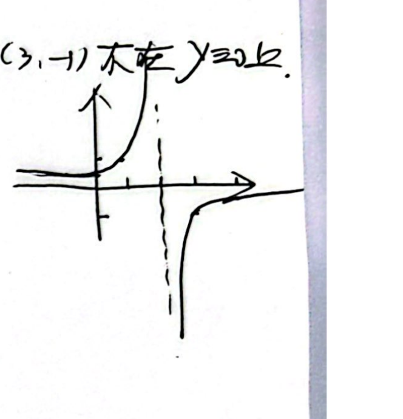

# 微分方程 第15周作业答案（2025春）

## 习题 4.2

### 第 1 题

#### 题目

确定下列方程初值问题解存在且唯一的区间。

(2) $\dfrac{\mathrm{d}y}{\mathrm{d}x} = \sqrt{|y|}$；

(4) $\dfrac{\mathrm{d}y}{\mathrm{d}x} = |y|^{\alpha}$（ $\alpha > 0$）。

#### 答案

**答案：**

**(2)** $\dfrac{\mathrm{d}y}{\mathrm{d}x} = \sqrt{|y|}$

① $y \equiv 0$ 是特解。

② $y > 0$： $\dfrac{\mathrm{d}y}{\mathrm{d}x} = \sqrt{y} \Longrightarrow y = \dfrac{1}{4}(x-c)^2$， $x > c$。

③ $y < 0$： $\dfrac{\mathrm{d}y}{\mathrm{d}x} = \sqrt{-y} \Longrightarrow y = -\dfrac{1}{4}(x-c)^2$， $x < c$。

设初值 $(x_0, y_0)$， $y_0 = \varphi(x_0)$，其中 $y = \varphi(x)$ 是方程的解， $\varphi(x) \ne 0$。当 $y_0 \ne 0$ 时均可唯一确定解；当 $y_0 = 0$ 时有无数多个解。例如 $\forall x_1 > x_0$，

$$
y = \begin{cases} 0, & x \le x_1, \\[4pt] \dfrac{1}{4}(x-x_1)^2, & x > x_1 \end{cases}
$$

都是过 $(x_0, 0)$ 的解。

-解曲线草图.png)

**(4)** $\dfrac{\mathrm{d}y}{\mathrm{d}x} = |y|^{\alpha}$（ $\alpha > 0$）

① $y \equiv 0$ 是特解。

② $y > 0$： $\dfrac{\mathrm{d}y}{\mathrm{d}x} = y^{\alpha} \Longrightarrow y^{1-\alpha} = (1-\alpha)x + C$（ $\alpha \ne 1$）；或 $y = C_0e^{x}$， $C_0 > 0$（ $\alpha = 1$）。

③ $y < 0$： $(-y)^{1-\alpha} = -(1-\alpha)x + C$（ $\alpha \ne 1$）；或 $y = C_0e^{-x}$， $C_0 < 0$（ $\alpha = 1$）。

设初值 $(x_0, y_0)$。当 $y_0 \ne 0$ 时可确定唯一解；当 $y_0 = 0$ 时， $0 < \alpha < 1$ 解不唯一， $\alpha \ge 1$ 解唯一。

实际上 $\dfrac{\mathrm{d}y}{\mathrm{d}x} = f(x,y) = |y|^{\alpha}$ 在 $y \in \mathbb{R}$ 上连续；在 $y \ne 0$ 处 $\dfrac{\partial f}{\partial y}$ 存在且连续，故有解唯一存在。

### 第 2 题

#### 题目

用 Picard 逼近法求方程

$$
\frac{\mathrm{d}y}{\mathrm{d}x} = x^2 + y^2
$$

满足 $y(0) = 0$ 的三次逼近 $\varphi_3(x)$。

#### 答案

**答案：** $f(x,y) = x^2 + y^2$， $(x_0, y_0) = (0,0)$， $\varphi_0(x) = y_0 = 0$，

$$
\varphi_1(x) = y_0 + \int_{x_0}^{x} f(s,\varphi_0(s))\,\mathrm{d}s,\quad
\varphi_2(x) = y_0 + \int_{x_0}^{x} f(s,\varphi_1(s))\,\mathrm{d}s,\quad
\varphi_3(x) = y_0 + \int_{x_0}^{x} f(s,\varphi_2(s))\,\mathrm{d}s,
$$

$$
\therefore\ \varphi_3(x) = \frac{1}{3}x^3 + \frac{1}{63}x^7 + \frac{2}{33 \times 63}x^{11} + \frac{1}{63^2 \times 15}x^{15}.
$$

### 第 4 题

#### 题目

证明

$$
\left|\varphi(x) - \varphi_n(x)\right| \le \frac{ML^n}{(n+1)!}\left|x - x_0\right|^{n+1},\quad n = 1, 2, \cdots
$$

#### 答案

**答案：** 由

$$
\varphi(x) = y_0 + \int_{x_0}^{x} f(s,\varphi(s))\,\mathrm{d}s,\qquad
\varphi_n(x) = y_0 + \int_{x_0}^{x} f(s,\varphi_{n-1}(s))\,\mathrm{d}s\ (n \ge 1),\qquad \varphi_0(x) = y_0,
$$

由 Lipschitz 条件，

$$
|\varphi(x) - \varphi_n(x)| = \left|\int_{x_0}^{x}\left[f(s,\varphi(s)) - f(s,\varphi_{n-1}(s))\right]\mathrm{d}s\right|
\le \left|\int_{x_0}^{x} L\,|\varphi(s) - \varphi_{n-1}(s)|\,\mathrm{d}s\right|.
$$

**$n = 1$ 时：** 其中

$$
\varphi(s) - y_0 = \int_{x_0}^{s} f(t,\varphi(t))\,\mathrm{d}t \le M|s - x_0|,\qquad x_0 \le s \le x_0 + h,
$$

$M = \max\limits_{(x,y) \in D}|f(x,y)|$， $D = \{(x,y)\ |\ |x-x_0| \le a,\ |y-y_0| \le b\}$， $h = \min\left\{a, \dfrac{b}{M}\right\}$。故

$$
|\varphi(x) - \varphi_1(x)| \le L\left|\int_{x_0}^{x} M|s - x_0|\,\mathrm{d}s\right| = LM\frac{(x-x_0)^2}{2} = \frac{ML^1}{2!}|x - x_0|^{2},
$$

即 $k = 1$ 时上述结论成立。

**归纳步骤：** 设 $n = k$ 时成立，即 $|\varphi(s) - \varphi_k(s)| \le \dfrac{ML^k}{(k+1)!}|s - x_0|^{k+1}$，则

$$
\begin{aligned}
|\varphi(x) - \varphi_{k+1}(x)| &= \left|\int_{x_0}^{x}\left[f(s,\varphi(s)) - f(s,\varphi_k(s))\right]\mathrm{d}s\right| \\
&\le \left|\int_{x_0}^{x} L\,|\varphi(s) - \varphi_k(s)|\,\mathrm{d}s\right| \\
&\le \left|\int_{x_0}^{x} L\,\frac{ML^k}{(k+1)!}|s - x_0|^{k+1}\,\mathrm{d}s\right| \\
&= \left|\frac{ML^{k+1}}{(k+1)!}\cdot\frac{(x-x_0)^{k+2}}{k+2}\right| = \frac{ML^{k+1}}{(k+2)!}|x - x_0|^{k+2},
\end{aligned}
$$

成立。由第一数学归纳法，上述命题对 $\forall n \ge 1$ 均成立。

## 习题 4.3

### 第 1 题

#### 题目

证明：对 $\forall x_0 \in \mathbb{R}$、 $\forall y_0 \in (0,1)$，方程

$$
\frac{\mathrm{d}y}{\mathrm{d}x} = y(y-1)
$$

满足 $y(x_0) = y_0$ 的解 $\varphi(x)$ 在 $x \in \mathbb{R}$ 上有定义。

#### 答案

**答案：** $y = 0$、 $y = 1$ 是方程的两解。

且 $f(x,y) = y(y-1)$ 在 $(x,y) \in \mathbb{R}^2$ 上连续， $\dfrac{\partial f}{\partial y} = 2y - 1$ 在 $(x,y) \in \mathbb{R}^2$ 上连续。

由解的唯一存在定理，当 $x_0 \in \mathbb{R}$、 $y_0 \in (0,1)$ 时，取 $h$， $\dfrac{\mathrm{d}y}{\mathrm{d}x} = y(y-1)$ 在 $[x_0 - h, x_0 + h]$ 上解唯一存在。

对其延拓（保证仍有存在性）。知不可与 $y = 0$、 $y = 1$ 相交（相交处解不唯一）。

$\therefore$ 可延拓至 $y = 0$、 $y = 1$ 围成的区域边界， $\therefore$ 在 $x \in \mathbb{R}$ 上有解。

### 第 2 题

#### 题目

确定方程

$$
\frac{\mathrm{d}y}{\mathrm{d}x} = y^2
$$

经过点 $(1,1)$、 $(3,-1)$ 的解的存在区间。

#### 答案

**答案：** ① $y \equiv 0$ 是解。

② $y \not\equiv 0$： $\dfrac{\mathrm{d}y}{y^2} = \mathrm{d}x$， $-\mathrm{d}\left(\dfrac{1}{y}\right) = \mathrm{d}x$， $\therefore -\dfrac{1}{y} = x + C$。

代入 $(1,1)$，得 $C = -2$， $-\dfrac{1}{y} = x - 2$。

代入 $(3,-1)$，得 $C = -2$。 $(1,1)$、 $(3,-1)$ 不在 $y \equiv 0$ 上。

$(1,1)$ 上： $y = -\dfrac{1}{x-2}$，解存在区间 $(-\infty, 2)$。

$(3,-1)$ 上： $y = -\dfrac{1}{x-2}$，解存在区间 $(2, +\infty)$。

### 第 3 题

#### 题目

设 $f(y)$ 在 $y \in \mathbb{R}$ 上连续可微，且 $yf(y) < 0$（ $y \ne 0$）。证明：方程

$$
\frac{\mathrm{d}y}{\mathrm{d}x} = f(y)
$$

满足 $y(x_0) = y_0$ 的解 $y = y(x)$ 在 $x \in [x_0, +\infty)$ 上存在，且 $\lim\limits_{x \to +\infty} y(x) = 0$。

#### 答案

**答案：** 令 $g(x) = (y(x))^2$。欲证 $\lim\limits_{x \to +\infty} y(x) = 0$，可证 $\lim\limits_{x \to +\infty} g(x) = 0$。

$g'(x) = 2y'(x)y(x) = 2\dfrac{\mathrm{d}y}{\mathrm{d}x}y = 2yf(y) < 0$，对 $\forall y$ 成立。

$\therefore g(x)$ 在 $[x_0, +\infty)$ 上递减，故有 $\lim\limits_{x \to +\infty} g(x) = C$， $C \ge 0$。

当 $C = 0$ 时即可（ $C = +\infty$ 不可）。

当 $C > 0$：

$$
\int_{y_0}^{y(x)} \frac{\mathrm{d}y}{f(y)} = \int_{x_0}^{x} \mathrm{d}x = (x - x_0),
$$

$$
\lim_{x \to +\infty}\int_{y_0}^{y(x)} \frac{\mathrm{d}y}{f(y)} = \lim_{x \to +\infty}(x - x_0) = +\infty,
$$

而 $\displaystyle\int_{y_0}^{\ }\frac{\mathrm{d}y}{f(y)}$ 定为有限值，矛盾！ $\therefore C = 0$。

又因 $f(y)$ 在 $y$ 上连续可微，且 $f(y)$ 局部 Lipschitz 连续，故解唯一存在。

递减草图.png)
