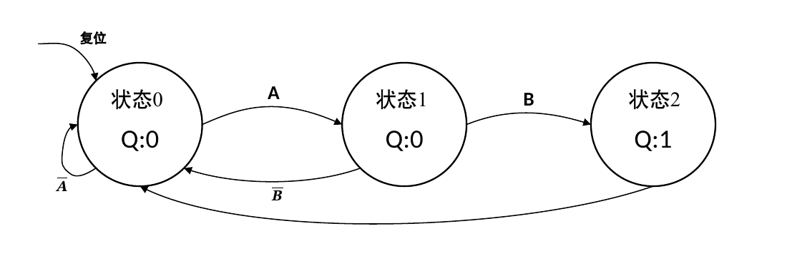

# 计算机系统基础 2021–2022 学年第二学期期末试卷（A 卷）参考答案

## 一、选择题（共 10 题，每题 2 分，共 20 分）

### 1. 二进制补码形式的数据 $1001_2$ 所对应的十进制数是（　　）

#### 题目

(A) $9_{10}$　　(B) $7_{10}$　　(C) $-7_{10}$　　(D) $-6_{10}$

#### 答案

**答案：** (C)。

$1001_2$ 为 4 位补码，最高位是 1，说明是负数。求绝对值：按位取反得 $0110_2$，再加 1 得 $0111_2=7$，故真值为 $-7$。

### 2. 在 MIPS 指令集中可以用来实现跳转到 4GB 空间内任意地址的指令是（　　）

#### 题目

(A) `beq`　　(B) `j`　　(C) `jal`　　(D) `jr`

#### 答案

**答案：** (B)。

`j`（无条件跳转）把 26 位立即数左移 2 位后与 PC 高 4 位拼接，跳转目标由指令直接给出，可覆盖整个 4GB 地址空间。`beq` 是相对转移，范围只有 $\pm 2^{17}$ 字节；`jal` 虽然也能跳到 4GB 内任意地址，但它同时把返回地址写入 `$ra`，用于过程调用，题干只要求"跳转"，故选 (B)。`jr` 跳转到寄存器给出的地址，虽然也能覆盖 4GB，但需要先用其他指令把目标地址装入寄存器。

### 3. 用 $1\text{K}\times 4$ 位的 RAM 芯片构造 $4\text{K}\times 16$ 位的存储器，需要 RAM 芯片的片数以及需要增加的高位地址线分别为（　　）

#### 题目

(A) 16 片和 3 条　　(B) 16 片和 2 条　　(C) 32 片和 4 条　　(D) 64 片和 4 条

#### 答案

**答案：** (B)。

字扩展： $4\text{K}/1\text{K}=4$ 组；位扩展： $16/4=4$ 片并联。共需 $4\times 4=16$ 片。 $1\text{K}=2^{10}$ 需 10 根地址线， $4\text{K}=2^{12}$ 需 12 根，故需增加 $12-10=2$ 条高位地址线（用于片选译码）。

### 4. 为消除单周期数据通路的关键路径，可以通过流水线技术来提高 CPU 性能。以下结论正确的是（　　）

#### 题目

(A) 流水线级数越多，CPU 主频必然也越高　　(B) 流水线各阶段组合逻辑延迟最大者决定 CPU 的最高频率

(C) 流水线不仅能提高系统吞吐率，还能减少单条指令的总执行时间　　(D) 流水线技术无法使得程序指令并行执行

#### 答案

**答案：** (B)。

流水线的时钟周期由各段中组合逻辑延迟最大的一段（含寄存器开销）决定，因此它决定 CPU 的最高频率。(A) 错在"必然"：级数增加会带来寄存器开销和流水线寄存器延迟，划分过细反而可能降低频率。(C) 错：流水线提高的是吞吐率，单条指令的延迟不会减少（通常还略有增加）。(D) 错：流水线正是让多条指令在不同段上并行执行。

### 5. 在虚存系统访存过程中，虚拟地址通过访问 TLB 后转换为物理地址，然后再访问 Cache，以下阐述正确的是（　　）

#### 题目

(A) 若 Cache 被命中，但物理页面也有可能并没有被装载。　　(B) 若页表项已建立，则 TLB 必然不会出现缺失。

(C) 若页表出现缺失，则 TLB 不可能会被命中。　　(D) 若页表出现缺失，则 Cache 可能会被命中。

#### 答案

**答案：** (C)。

页表缺失意味着该虚页没有有效的页表项（页面不在内存），而 TLB 缓存的正是页表项的副本，因此不可能在 TLB 中命中。(A) 错：Cache 用物理地址索引，页面未装载就得不到物理地址，无法访问 Cache。(B) 错：TLB 容量有限，有效页表项可能已被替换出 TLB，仍会缺失。(D) 错：页表缺失时无法完成地址转换，也就无法用物理地址访问 Cache。

### 6. 以下哪项不属于进程控制块中需要记录的信息？（　　）

#### 题目

(A) 进程的标识　　(B) 进程打开文件列表　　(C) 使用中的外设　　(D) 进程总数

#### 答案

**答案：** (D)。

进程总数是系统级的统计信息，通常记录在系统全局数据结构中，不属于某个进程的 PCB。进程标识（PID）、打开文件列表、正在使用的外设（I/O 状态）都是 PCB 的常见内容。

### 7. 以下关于时间片轮转算法说法不正确的是（　　）

#### 题目

(A) 如果时间片设置过长，则退化为 FCFS 算法；　　(B) 如果时间片设置过短，则退化为 SJF 算法；

(C) 为了控制系统响应时间，需要根据系统中进程数量选择时间片大小；　　(D) 用户可以在一个时间片没有用完的情况下主动让出 CPU。

#### 答案

**答案：** (B)。

时间片过短只会导致进程切换过于频繁、上下文切换开销占比过大，并不会退化成 SJF（短作业优先按估计运行时间排序，与时间片无关）。(A) 正确：时间片长到每个进程都能在一个时间片内运行完时，就是先来先服务。(C) 正确。(D) 正确：进程可通过让权（如调用 yield 或阻塞式系统调用）主动放弃 CPU。

### 8. 以下各种说法中正确的是（　　）

#### 题目

(A) 物理地址空间大小和逻辑地址空间大小必须一致；　　(B) 如果系统中安装的内存超过 4GB，则必须采用 64 位操作系统才能管理所有内存；

(C) 段式内存管理中，用户进程通常不能修改段表内容；　　(D) 同一个物理地址被不同用户进程中的程序访问时，所用逻辑地址一定相同。

#### 答案

**答案：** (C)。

段表由操作系统建立和维护，存放在内核空间，用户进程只能通过逻辑地址访问段，不能修改段表。(A) 错：逻辑地址空间通常大于物理地址空间（这正是虚拟存储的前提）。(B) 错：32 位系统可通过 PAE 等扩展机制管理超过 4GB 的物理内存。(D) 错：不同进程有各自独立的逻辑地址空间，同一物理页在不同进程中可以映射到不同的逻辑地址。

### 9. 以下各种说法中正确的是（　　）

#### 题目

(A) 采用 IO 缓冲技术的目的是缓解处理器与外设之间的速度差异；　　(B) 其他条件相同，采用双缓冲一定能比采用单缓冲减少传输和处理总时间；

(C) 如果系统中只有 1 个处理器，则不能通过使用缓冲技术获得更好的 IO 性能；　　(D) 将系统缓冲区中的数据写入磁盘是用户态程序的工作。

#### 答案

**答案：** (A)。

引入缓冲的根本目的就是缓解 CPU 与外设速度不匹配、减少中断次数、提高 CPU 与设备的并行度。(B) 错在"一定"：当 CPU 处理时间远小于传输时间时，双缓冲与单缓冲的总时间相同。(C) 错：单处理器下缓冲同样能让 CPU 与设备并行工作。(D) 错：把系统缓冲区内容写入磁盘是内核（设备驱动程序）的工作。

### 10. 以下各种说法中错误的是（　　）

#### 题目

(A) 如果发生死锁，则系统此时的资源分配状态一定是不安全的；　　(B) 仅有 1 个处理器的系统是不会产生死锁；

(C) 在 5 哲学家就餐问题中，如限制最多 4 个哲学家可以同时就餐，则不会产生死锁；　　(D) 如果每个进程在开始运行时就请求全部资源，则不会产生死锁。

#### 答案

**答案：** (B)。

单处理器系统同样可能死锁：多个进程可以各自持有部分资源并互相等待，这与处理器个数无关（哲学家就餐问题在单处理器上照样可以死锁）。(A) 正确：死锁状态一定是不安全状态。(C) 正确：限制同时就餐人数为 4，总有一人拿不到左筷，从而不会形成循环等待。(D) 正确：一次性申请全部资源破坏了"请求并保持"条件。

## 二、数字逻辑分析题（共 4 小题，共 10 分）

某状态机如下图所示，其中 A、B 为输入，Q 为输出。



### 1. 该状态机是摩尔型还是米里型状态机？（2 分）

#### 题目

1. 该状态机是摩尔型还是米里型状态机？（2 分）

#### 答案

**答案：** **摩尔型（Moore）状态机**。

输出 Q 的取值（Q:0、Q:0、Q:1）标注在状态圈内，只由当前状态决定，与当前输入 A、B 无关；米里型状态机的输出应标注在转移弧上。

### 2. 请说明此状态机的功能（2 分）

#### 题目

2\. 请说明此状态机的功能。（2 分）

#### 答案

**答案：** 这是一个**序列检测器**，检测输入端是否依次出现 "A、B" 这一输入序列，检测到时输出一个时钟周期的高电平。

- 状态 0（S0）：初始/空闲状态。此时若 A=1 转到状态 1，若 A=0 保持状态 0（图中 $\overline{A}$ 自环）。
- 状态 1（S1）：已检测到 A。此时若 B=1 转到状态 2，若 B=0 则退回状态 0（图中 $\overline{B}$ 弧）。
- 状态 2（S2）：已检测到 AB，输出 Q=1；下一拍无条件回到状态 0（图中由状态 2 指向状态 0 的弧），因此 Q=1 只维持一个时钟周期。

### 3. 完成该状态机状态转换表及 Q 的真值表（3 分）

#### 题目

3\. $S_1$ 和 $S_0$ 为状态寄存器， $S_1S_0$ 的二进制编码 $2'b00$、 $2'b01$、 $2'b10$ 分别对应状态 0、状态 1、状态 2。请完成该状态机状态转换表及 Q 的真值表。（3 分）

#### 答案

**答案：** 状态编码：状态 0 = $2'b00$，状态 1 = $2'b01$，状态 2 = $2'b10$， $2'b11$ 为未用状态。

| 现态 $S_1S_0$ | A | B | 次态 $S_1^{+}S_0^{+}$ | Q |
| --- | --- | --- | --- | --- |
| 00 | 0 | × | 00 | 0 |
| 00 | 1 | × | 01 | 0 |
| 01 | × | 0 | 00 | 0 |
| 01 | × | 1 | 10 | 0 |
| 10 | × | × | 00 | 1 |
| 11 | × | × | ××（未用） | × |

复位后进入状态 0（ $S_1S_0=00$）。

### 4. 根据状态转换表写出次态逻辑表达式与 Q 的逻辑表达式（3 分）

#### 题目

4\. 根据状态转换表写出次态逻辑表达式与 Q 的逻辑表达式。（3 分）

#### 答案

**答案：** 记现态为 $S_1,S_0$，次态为 $D_1,D_0$（即 $S_1^{+},S_0^{+}$）：

$$
D_1=\overline{S_1}\,S_0\,B
$$

$$
D_0=\overline{S_1}\,\overline{S_0}\,A
$$

$$
Q=S_1\,\overline{S_0}
$$

## 三、MIPS 汇编题（共 2 小题，共 9 分）

### 1. 补全 swap 过程的 MIPS 汇编代码（6 分）

#### 题目

1. 下面是 C 语言的 swap 过程代码和编译之后的 MIPS 汇编语言片段，请根据注释在横线上补全 MIPS 汇编代码。（6 分）

   ```c
   void swap(int v[], int k)
   //    参数解释：$a0=v[]的地址；$a1=k;    返回地址在 $ra 中
   {    int temp;
        temp = v[k];
        v[k] = v[k+1];
        v[k+1] = temp;
   }
   ```

   ```mips
   swap: sll   $t0, $a1, 2           # $t0=k*4
         add   $t0, $t0, $a0         # $t0=v+k+4
         lw    $t1, __________       # $t1=v[k]
         lw    $t2, __________       # $t2=v[k+1]
         sw    $t2, __________       # v[k]=$t2
         sw    $t1, __________       # v[k+1]=$t1

         jr    __________            # 返回
   ```

题面给出的 C 代码：

```c
void swap(int v[], int k)
//    参数解释：$a0=v[]的地址；$a1=k;    返回地址在 $ra 中
{    int temp;
     temp = v[k];
     v[k] = v[k+1];
     v[k+1] = temp;
}
```

#### 答案

**答案：**

```mips
swap: sll   $t0, $a1, 2           # $t0=k*4
      add   $t0, $t0, $a0         # $t0=v+k*4，即 &v[k]
      lw    $t1, 0($t0)           # $t1=v[k]
      lw    $t2, 4($t0)           # $t2=v[k+1]
      sw    $t2, 0($t0)           # v[k]=$t2
      sw    $t1, 4($t0)           # v[k+1]=$t1

      jr    $ra                   # 返回
```

说明：数组元素为 int（4 字节），故 `sll $t0, $a1, 2` 计算 $4k$；`$t0` 加上数组基址后指向 `v[k]`，`v[k+1]` 与它相隔 4 字节。

### 2. 补全调用 swap(a,10) 的 MIPS 汇编代码段（3 分）

#### 题目

2\. 如果在 C 语言程序中调用上述 swap 过程，将数组 a 的地址和 10 作为参数传递，即 `swap(a,10)`，那么这一调用编译成 MIPS 汇编代码后的片段如下，请在横线上补全该代码段。（3 分）

   ```mips
   la    $a0, __________
   li    $a1, __________
   ______  swap
   ```

#### 答案

**答案：**

```mips
la    $a0, a
li    $a1, 10
jal   swap
```

说明：`la`（load address）把数组 a 的地址装入第一个参数寄存器 `$a0`，`li`（load immediate）把立即数 10 装入第二个参数寄存器 `$a1`，`jal` 跳转并链接，把返回地址写入 `$ra` 后进入 `swap`。

## 四、缓存题（共 4 小题，共 11 分）

某机主存容量为 1MB。CACHE 容量为 16KB，采用 4 路组相联结构，数据块大小为 128 字节，每个数据块需 1 位有效位和 1 位修改位。

### 1. 计算 CACHE 的组数、主存的组数、每个主存组内的数据块数（3 分）

#### 题目

1. 请计算 CACHE 的组数、主存的组数、每个主存组内的数据块数。（3 分）

#### 答案

**答案：**

- 每组容量 = $4\times 128\text{B}=512\text{B}$
- CACHE 组数 = $16\text{KB}/512\text{B}=16384/512=$ **32 组**
- 主存组数 = $1\text{MB}/512\text{B}=1048576/512=$ **2048 组**
- 每个主存组内的数据块数 = **4 块**（与 CACHE 的组内块数相同，即相联度为 4）

### 2. 给出主存的地址格式（各字段名称及其位数）（3 分）

#### 题目

2\. 请给出主存的地址格式（各字段名称及其位数）。（3 分）

#### 答案

**答案：** 主存容量 1MB = $2^{20}$ B，按字节编址，主存地址为 **20 位**：

| 8 | 5 | 7 |
| --- | --- | --- |
| Cache 标记（Tag） | Cache 组号 | 块内地址 |

- 块内地址：块大小 128B = $2^{7}$，故 7 位
- Cache 组号：32 组 = $2^{5}$，故 5 位
- 标记： $20-5-7=8$ 位

### 3. CACHE 的地址标记（Tag）是多少位（1 分）

#### 题目

3\. 请问 CACHE 的地址标记（Tag）是多少位？（1 分）

#### 答案

**答案：** **8 位**（即主存组数 2048 = $2^{11}$ 与 Cache 组数 32 = $2^{5}$ 之差， $11-5+2=8$；或直接由 $20-5-7=8$ 得到）。

### 4. 计算 CACHE 的实际总容量（2 分）

#### 题目

4\. 请计算 CACHE 的实际总容量是多少？（2 分）

#### 答案

**答案：** CACHE 共有 $32\times 4=128$ 个数据块。

每块的标记信息 = Tag 8 位 + 有效位 1 位 + 修改位 1 位 = 10 位。

标记部分总容量 = $128\times 10=1280$ 位 = 160 B。

$$
\text{实际总容量}=16\text{KB}+160\text{B}=16384+160=16544\ \text{B}\approx 16.16\ \text{KB}
$$

### 5. 计算两级存储系统的平均存取时间与相对单级主存的加速比（2 分）

#### 题目

5\. 若 CACHE 的存取时间是 10ns，主存的存取时间是 90ns，CACHE 访问缺失时需要依次访问主存和 CACHE。假设 CACHE 命中率为 0.9，请计算该 CACHE 和主存两级存储系统的平均存取时间，并计算两级存储系统相对单级主存的加速比。（2 分）

#### 答案

**答案：** 命中时存取时间为 10ns；缺失时需依次访问主存和 CACHE，即 $90+10=100$ ns。

$$
\text{平均存取时间}=0.9\times 10+0.1\times 100=9+10=19\ \text{ns}
$$

$$
\text{加速比}=\frac{\text{单级主存存取时间}}{\text{两级平均存取时间}}=\frac{90}{19}\approx 4.74
$$

## 五、MIPS CPU 题（本题共 10 分）

题面指令片段：

```mips
L1:   add   $s0, $t0, $t1
L2:   sub   $s1, $t2, $t3
L3:   and   $s2, $s2, $s1
L4:   or    $s3, $t4, $t5
L5:   slt   $s4, $s2, $t3
```

### （1）列出所有存在着数据相关的指令对与寄存器（5 分）

**答案：**

- `$s1, {L2, L3}`
- `$s2, {L3, L5}`

说明：L2 写 `$s1`、L3 读 `$s1`，构成写-读（RAW）相关；L3 写 `$s2`、L5 读 `$s2`，构成写-读相关。L1 写 `$s0` 但其后没有指令读 `$s0`；L2 与 L5 都是读 `$t3`，属于读-读，不构成数据相关；L3 内部对 `$s2` 的先读后写发生在同一条指令内，不属于指令间的数据相关。

### （2）是否存在寄存器数据冲突？能否用现有转发解决？若用暂停至少需要几个周期？（5 分）

**答案：** **存在寄存器数据冲突**，冲突发生在 `$s2, {L3, L5}` 上。

不暂停时的流水线时空图：

| 指令 | 1 | 2 | 3 | 4 | 5 | 6 | 7 | 8 | 9 |
| --- | --- | --- | --- | --- | --- | --- | --- | --- | --- |
| L1 | IF | D | E | M | W | | | | |
| L2 | | IF | D | E | M | W | | | |
| L3 | | | IF | D | E | M | W | | |
| L4 | | | | IF | D | E | M | W | |
| L5 | | | | | IF | D | E | M | W |

- `$s1, {L2, L3}`：第 5 周期 L2 处于 M 级、L3 处于 E 级，恰好符合"仅支持 M 级向 E 级的转发"，因此这一处冲突可以由转发解决，不需要暂停。
- `$s2, {L3, L5}`：L3 要到第 7 周期才在 W 级把结果写回寄存器堆，而 L5 在第 6 周期就要在 D 级读 `$s2`。M→E 转发只能把 M 级的结果送到 E 级的 ALU 输入端，无法送到 D 级的寄存器读端口；而题目明确说明寄存器堆无内部转发（W 级写与 D 级读不能在同一周期完成），所以 L5 在第 6 周期读到的是旧值。

**结论：在不增加其他转发旁路的情况下，无法解决 `$s2, {L3, L5}` 这处数据冲突。**

采用暂停的方式：必须把 L5 阻塞在 D 级，直到 L3 完成 W 级写回之后的下一个周期才能读到新值，即 L5 的 D 级读要推迟到第 8 周期。L5 原本在第 6 周期进入 D 级，因此**至少需要 2 个周期的暂停**。

暂停 2 个周期后的时空图：

| 指令 | 1 | 2 | 3 | 4 | 5 | 6 | 7 | 8 | 9 | 10 | 11 |
| --- | --- | --- | --- | --- | --- | --- | --- | --- | --- | --- | --- |
| L1 | IF | D | E | M | W | | | | | | |
| L2 | | IF | D | E | M | W | | | | | |
| L3 | | | IF | D | E | M | W | | | | |
| L4 | | | | IF | D | E | M | W | | | |
| L5 | | | | | IF | D | D（暂停） | D（暂停） | E | M | W |

L3 在第 7 周期 W 级写回 `$s2`，L5 在第 8 周期（暂停结束）于 D 级读到新值，第 9 周期进入 E 级。完整执行该指令片段共需 **11 个周期**。

## 六、存储管理（本题共 10 分）

一个 32 位的虚拟存储系统采用两级页表结构，每个页面大小为 4096 字节。该系统逻辑地址中，第 22 到 31 位是页目录的索引，第 12 位到 21 位是页表的索引，页内偏移占第 0 到 11 位。每个页表（目录）项包含 20 位物理页框号和 12 位标志位。

### 1. 该系统的逻辑地址空间一共有多少字节？页表一共有多少页表项？（2 分）

#### 题目

1. 该系统的逻辑地址空间一共有多少字节？页表一共有多少页表项？（2 分）

#### 答案

**答案：**

- 逻辑地址空间 = $2^{32}$ B = **4GB**
- 页目录索引 10 位、页表索引 10 位，故页表项总数 = $2^{10}\times 2^{10}=2^{20}$ = **1M 个页表项**

### 2. 从逻辑地址 0x80000000 开始映射整个页表，给出页目录的起始逻辑地址（4 分）

#### 题目

2\. 假设该系统从逻辑地址 0x80000000 开始映射整个页表，请给出页目录的起始逻辑地址。（写出计算过程）（4 分）

#### 答案

**答案：** 每个页表（目录）项 20 + 12 = 32 位 = 4 字节，整个页表（含页目录）占用

$$
2^{20}\times 4\ \text{B}=2^{22}\ \text{B}=4\ \text{MB}=1024\ \text{页}
$$

从 0x80000000 开始映射 4MB，对应逻辑地址范围 0x80000000 ~ 0x803FFFFF。该范围内任一逻辑地址的页目录索引（22 ~ 31 位）恒为

$$
0x80000000 \gg 22 = 0x200 = 512
$$

自映射要求：页目录自身逻辑地址中的页目录索引字段，必须等于页目录所在的物理页框号。因此页目录的页框号为 512。

页表区在物理内存中从页框 0 开始连续存放，页框 512 即页表区的第 512 页，其逻辑地址为

$$
0x80000000+512\times 4096=0x80000000+0x200000=\boxed{0x80200000}
$$

答：页目录的起始逻辑地址为 **0x80200000**。

### 3. 逻辑地址 0x12345678 对应的页表物理地址为 0x00008000，求对应页表项的物理地址与页目录项中的物理页框号（4 分）

#### 题目

3\. 假设逻辑地址 0x12345678 对应的页表的物理地址为 0x00008000，请给出该逻辑地址对应的页表项的物理地址、该逻辑地址对应的页目录项中包含的物理页框号。（写出计算过程）（4 分）

#### 答案

**答案：** 先分解逻辑地址 0x12345678：

- 页目录索引（22 ~ 31 位）= $0x12345678 \gg 22 = 0x48 = 72$
- 页表索引（12 ~ 21 位）= $(0x12345678 \gg 12)\ \&\ 0x3FF = 0x12345\ \&\ 0x3FF = 0x345 = 837$
- 页内偏移（0 ~ 11 位）= $0x678$

该逻辑地址对应的二级页表物理地址为 0x00008000，页表项大小 4 字节，故

$$
\text{页表项物理地址}=0x00008000+837\times 4=0x8000+0xD14=\boxed{0x00008D14}
$$

该二级页表本身所在的物理页框号为

$$
0x00008000 \div 4096=8=0x8
$$

而页目录项中存放的正是该二级页表的物理页框号，故页目录项中包含的物理页框号为 **0x8**（即 8）。

## 七、磁盘管理（本题共 10 分）

### 题目

请求序列（柱面号）：10，22，20，2，40，6，38；磁头初始位置 20 号柱面，初始向柱面号增大方向移动；每移动 1 个柱面需 4ms；磁盘共 51 个柱面（0-50）；采用电梯调度（SCAN）算法，每次扫描到柱面边界才反向。

### 答案

**答案：**

初始磁头就在 20 号柱面，而请求序列中恰好包含 20 号柱面的请求，因此该请求在 $t=0$ 立即得到服务。

磁头继续向柱面号增大的方向移动，该方向上剩余请求按升序为 22、38、40；服务完 40 后继续扫描到上边界 50 号柱面，然后反向，按降序服务 10、6、2。

实际访问次序为：20 → 22 → 38 → 40 →（扫描到边界 50）→ 10 → 6 → 2。

| 时刻（ms） | 磁头位置 | 本次服务的柱面 | 剩余请求队列 |
| --- | --- | --- | --- |
| 0 | 20 | 20 | 10, 22, 2, 40, 6, 38 |
| 8 | 22 | 22 | 10, 2, 40, 6, 38 |
| 72 | 38 | 38 | 10, 2, 40, 6 |
| 80 | 40 | 40 | 10, 2, 6 |
| 120 | 50（上边界，反向） | — | 10, 2, 6 |
| 280 | 10 | 10 | 2, 6 |
| 296 | 6 | 6 | 2 |
| 312 | 2 | 2 | 空 |

磁头移动的总柱面数：

$$
(22-20)+(38-22)+(40-38)+(50-40)+(50-10)+(10-6)+(6-2)=2+16+2+10+40+4+4=78
$$

$$
\text{寻道总时间}=78\times 4\ \text{ms}=\boxed{312\ \text{ms}}
$$

## 八、进程同步（本题共 10 分）

### 题目

1 个仓库最多容纳 30 件产品（不分类型），每次只允许一个产品进出仓库；甲车间生产 A 产品、乙车间生产 B 产品；3 个 A 客户和 3 个 B 客户分别取 A、B 产品。

### 答案

**答案：**

信号量设置：

| 信号量 | 初值 | 含义 |
| --- | --- | --- |
| `empty` | 30 | 仓库中的空闲位置数，用于限制仓库最多容纳 30 件产品 |
| `mutex` | 1 | 仓库的互斥信号量，保证每次只有一个产品进出仓库 |
| `fullA` | 0 | 仓库中 A 产品的件数 |
| `fullB` | 0 | 仓库中 B 产品的件数 |

```c
semaphore empty = 30;   // 仓库空闲位置数，A、B 产品共用
semaphore mutex = 1;    // 仓库互斥信号量
semaphore fullA = 0;    // 仓库中 A 产品数量
semaphore fullB = 0;    // 仓库中 B 产品数量

// 甲车间：生产 A 产品
process 甲车间() {
    while (true) {
        生产一个 A 产品;
        P(empty);          // 申请一个空闲位置；仓库满时在此阻塞，不能进行新的生产
        P(mutex);          // 互斥进入仓库
        把 A 产品放入仓库;
        V(mutex);          // 退出仓库
        V(fullA);          // A 产品件数加 1，可能唤醒等待的 A 客户
    }
}

// 乙车间：生产 B 产品
process 乙车间() {
    while (true) {
        生产一个 B 产品;
        P(empty);          // 与甲车间共用 empty，因此仓库满时两个车间都停止生产
        P(mutex);
        把 B 产品放入仓库;
        V(mutex);
        V(fullB);          // B 产品件数加 1
    }
}

// 需要 A 产品的客户（共 3 个进程）
process 客户A() {
    while (true) {
        P(fullA);          // 申请一个 A 产品；没有 A 产品时阻塞（不会误取 B 产品）
        P(mutex);          // 互斥进入仓库
        从仓库取出一个 A 产品;
        V(mutex);
        V(empty);          // 释放一个空闲位置，可能唤醒阻塞的生产者
        使用 A 产品;
    }
}

// 需要 B 产品的客户（共 3 个进程）
process 客户B() {
    while (true) {
        P(fullB);          // 申请一个 B 产品
        P(mutex);
        从仓库取出一个 B 产品;
        V(mutex);
        V(empty);
        使用 B 产品;
    }
}
```

要点说明：

- **P 操作顺序不能颠倒**：必须先 `P(empty)`（或 `P(fullA)`/`P(fullB)`）再 `P(mutex)`。若先持有 `mutex` 再去等 `empty`，仓库满时生产者会抱着 `mutex` 阻塞，客户无法进入仓库取货，双方互相等待而形成死锁。
- `empty` 初值 30 承担"仓库最多容纳 30 件（不分类型）"的容量约束；甲、乙两个车间共用同一个 `empty`，所以仓库满时两个车间都不能进行新的生产。
- `fullA` 与 `fullB` 分别记录两类产品的件数，实现"3 个 A 客户只取 A、3 个 B 客户只取 B"的同步关系，避免 A 客户取走 B 产品。
- `mutex` 初值为 1，保证"每次只允许一个产品进出仓库"，甲车间、乙车间、A 客户、B 客户对仓库的访问两两互斥。

## 九、文件系统（本题共 10 分）

磁盘块 4KB；inode 含 10 个直接索引 + 1 个一次间接索引；索引 4 字节，其中 28 位 begin（块区起始块号）、4 位 len（块区内连续块数）；len 为 0 时后续索引的 len 均为 0；块区之间无重叠。

### 1. 该文件系统最大容量是多大？（3 分）

#### 题目

1. 该文件系统最大容量是多大？（3 分）

#### 答案

**答案：** begin 字段 28 位，可表示的磁盘块序号为 $0\sim 2^{28}-1$，即最多 $2^{28}$ 个磁盘块。每块 4KB = $2^{12}$ B。

$$
\text{最大容量}=2^{28}\times 2^{12}\ \text{B}=2^{40}\ \text{B}=\boxed{1\ \text{TB}}
$$

### 2. 该文件系统支持的最大文件是多大？（3 分）

#### 题目

2\. 该文件系统支持的最大文件是多大？（3 分）

#### 答案

**答案：** len 字段 4 位，最大取值 15（len = 0 表示文件到此结束）。

一个一次间接索引块可存放的索引个数：

$$
4\ \text{KB}\div 4\ \text{B}=1024\ \text{个}
$$

- 10 个直接索引最多覆盖： $10\times 15=150$ 块
- 1 个一次间接索引最多覆盖： $1024\times 15=15360$ 块

$$
\text{最大文件}=(150+15360)\times 4\ \text{KB}=15510\times 4\ \text{KB}=62040\ \text{KB}
$$

即 $63\,528\,960$ 字节 $\approx$ **60.59MB**。

### 3. 存储一个 20KB 的文件，索引指向的块区大小有多少种不同的组合形式？（4 分）

#### 题目

3\. 在该文件系统中存储一个大小为 20KB 的文件，考虑其 inode 中的索引指向的块区大小（即相关索引中的 len 部分取值），有多少种不同的组合形式？（4 分）

#### 答案

**答案：** 20KB = $20\text{KB}/4\text{KB}=5$ 个磁盘块。文件按顺序使用 inode 中的索引（先 10 个直接索引，再一次间接索引中的索引），每个被使用的索引 len ≥ 1，所有 len 之和等于 5。因此组合形式数等于把 5 拆成若干个正整数之和的**有序拆分**个数：

$$
2^{5-1}=16\ \text{种}
$$

具体枚举：

| 使用的索引个数 | len 组合 | 种数 |
| --- | --- | --- |
| 1 | 5 | 1 |
| 2 | 1+4、2+3、3+2、4+1 | 4 |
| 3 | 1+1+3、1+2+2、1+3+1、2+1+2、2+2+1、3+1+1 | 6 |
| 4 | 1+1+1+2、1+1+2+1、1+2+1+1、2+1+1+1 | 4 |
| 5 | 1+1+1+1+1 | 1 |

合计 $1+4+6+4+1=16$ 种。

每个 len 最大为 15，而 5 远小于 15，故不受 len 上限约束；可用索引总数为 $10+1024=1034$ 个，远多于 5 个，也不构成约束。因此上述 16 种组合全部可行。
