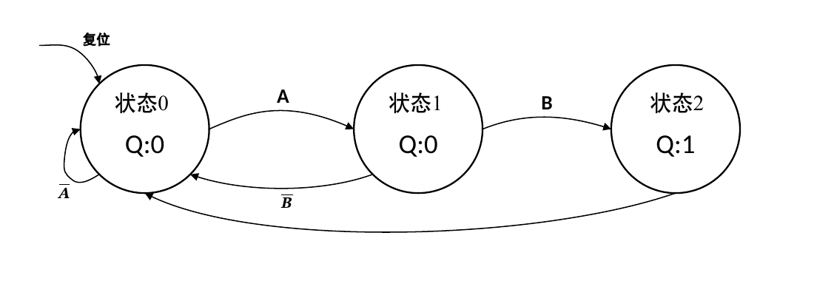
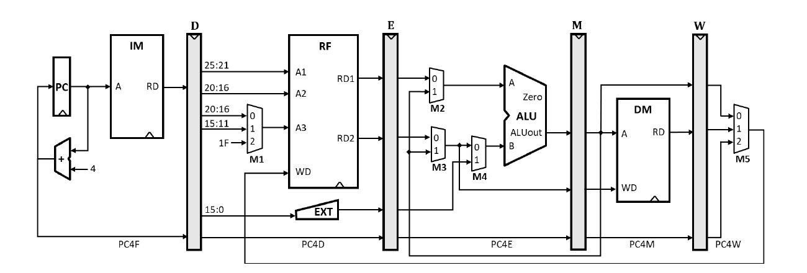

# 计算机系统基础 2021–2022 学年第二学期期末试卷（A 卷）

## 一、选择题（共 10 题，每题 2 分，共 20 分）

1. 二进制补码形式的数据 $1001_2$ 所对应的十进制数是（　　）。

   (A) $9_{10}$　　(B) $7_{10}$　　(C) $-7_{10}$　　(D) $-6_{10}$

2. 在 MIPS 指令集中可以用来实现跳转到 4GB 空间内任意地址的指令是（　　）。

   (A) `beq`　　(B) `j`　　(C) `jal`　　(D) `jr`

3. 用 $1\text{K}\times 4$ 位的 RAM 芯片构造 $4\text{K}\times 16$ 位的存储器，需要 RAM 芯片的片数以及需要增加的高位地址线分别为（　　）。

   (A) 16 片和 3 条　　(B) 16 片和 2 条

   (C) 32 片和 4 条　　(D) 64 片和 4 条
4. 为消除单周期数据通路的关键路径，可以通过流水线技术来提高 CPU 性能。以下结论正确的是（　　）。

   (A) 流水线级数越多，CPU 主频必然也越高

   (B) 流水线各阶段组合逻辑延迟最大者决定 CPU 的最高频率

   (C) 流水线不仅能提高系统吞吐率，还能减少单条指令的总执行时间

   (D) 流水线技术无法使得程序指令并行执行

5. 在虚存系统访存过程中，虚拟地址通过访问 TLB 后转换为物理地址，然后再访问 Cache，以下阐述正确的是（　　）。

   (A) 若 Cache 被命中，但物理页面也有可能并没有被装载。

   (B) 若页表项已建立，则 TLB 必然不会出现缺失。

   (C) 若页表出现缺失，则 TLB 不可能会被命中。

   (D) 若页表出现缺失，则 Cache 可能会被命中。

6. 以下哪项不属于进程控制块中需要记录的信息？（　　）

   (A) 进程的标识　　(B) 进程打开文件列表　　(C) 使用中的外设　　(D) 进程总数

7. 以下关于时间片轮转算法说法不正确的是（　　）。

   (A) 如果时间片设置过长，则退化为 FCFS 算法；

   (B) 如果时间片设置过短，则退化为 SJF 算法；

   (C) 为了控制系统响应时间，需要根据系统中进程数量选择时间片大小；

   (D) 用户可以在一个时间片没有用完的情况下主动让出 CPU。

8. 以下各种说法中正确的是（　　）。

   (A) 物理地址空间大小和逻辑地址空间大小必须一致；

   (B) 如果系统中安装的内存超过 4GB，则必须采用 64 位操作系统才能管理所有内存；

   (C) 段式内存管理中，用户进程通常不能修改段表内容；

   (D) 同一个物理地址被不同用户进程中的程序访问时，所用逻辑地址一定相同。

9. 以下各种说法中正确的是（　　）。

   (A) 采用 IO 缓冲技术的目的是缓解处理器与外设之间的速度差异；

   (B) 其他条件相同，采用双缓冲一定能比采用单缓冲减少传输和处理总时间；

   (C) 如果系统中只有 1 个处理器，则不能通过使用缓冲技术获得更好的 IO 性能；

   (D) 将系统缓冲区中的数据写入磁盘是用户态程序的工作。

10. 以下各种说法中错误的是（　　）。

    (A) 如果发生死锁，则系统此时的资源分配状态一定是不安全的；

    (B) 仅有 1 个处理器的系统是不会产生死锁；

    (C) 在 5 哲学家就餐问题中，如限制最多 4 个哲学家可以同时就餐，则不会产生死锁；

    (D) 如果每个进程在开始运行时就请求全部资源，则不会产生死锁。

## 二、数字逻辑分析题（共 4 小题，共 10 分）

某状态机如下图所示，其中 A、B 为输入，Q 为输出。请回答下列问题。



1. 该状态机是摩尔型还是米里型状态机？（2 分）

2. 请说明此状态机的功能。（2 分）

3. $S_1$ 和 $S_0$ 为状态寄存器， $S_1S_0$ 的二进制编码 $2'b00$、 $2'b01$、 $2'b10$ 分别对应状态 0、状态 1、状态 2。请完成该状态机状态转换表及 Q 的真值表。（3 分）

4. 根据状态转换表写出次态逻辑表达式与 Q 的逻辑表达式。（3 分）

## 三、MIPS 汇编题（共 2 小题，共 9 分）

1. 下面是 C 语言的 swap 过程代码和编译之后的 MIPS 汇编语言片段，请根据注释在横线上补全 MIPS 汇编代码。（6 分）

   ```c
   void swap(int v[], int k)
   //    参数解释：$a0=v[]的地址；$a1=k;    返回地址在 $ra 中
   {    int temp;
        temp = v[k];
        v[k] = v[k+1];
        v[k+1] = temp;
   }
   ```

   ```mips
   swap: sll   $t0, $a1, 2           # $t0=k*4
         add   $t0, $t0, $a0         # $t0=v+k+4
         lw    $t1, __________       # $t1=v[k]
         lw    $t2, __________       # $t2=v[k+1]
         sw    $t2, __________       # v[k]=$t2
         sw    $t1, __________       # v[k+1]=$t1

         jr    __________            # 返回
   ```

2. 如果在 C 语言程序中调用上述 swap 过程，将数组 a 的地址和 10 作为参数传递，即 `swap(a,10)`，那么这一调用编译成 MIPS 汇编代码后的片段如下，请在横线上补全该代码段。（3 分）

   ```mips
   la    $a0, __________
   li    $a1, __________
   ______  swap
   ```

## 四、缓存题（共 4 小题，共 11 分）

某机主存容量为 1MB。CACHE 容量为 16KB，采用 4 路组相联结构，数据块大小为 128 字节，每个数据块需 1 位有效位和 1 位修改位。

1. 请计算 CACHE 的组数、主存的组数、每个主存组内的数据块数。（3 分）

2. 请给出主存的地址格式（各字段名称及其位数）。（3 分）

3. 请问 CACHE 的地址标记（Tag）是多少位？（1 分）

4. 请计算 CACHE 的实际总容量是多少？（2 分）

5. 若 CACHE 的存取时间是 10ns，主存的存取时间是 90ns，CACHE 访问缺失时需要依次访问主存和 CACHE。假设 CACHE 命中率为 0.9，请计算该 CACHE 和主存两级存储系统的平均存取时间，并计算两级存储系统相对单级主存的加速比。（2 分）

## 五、MIPS CPU 题（本题共 10 分）

对于如图所示的 5 级流水线 CPU，执行如下指令片段，请分析和回答如下几个问题。注意：该流水线仅支持 M 级向 E 级的转发（寄存器堆无内部转发）。



```mips
L1:   add   $s0, $t0, $t1
L2:   sub   $s1, $t2, $t3
L3:   and   $s2, $s2, $s1
L4:   or    $s3, $t4, $t5
L5:   slt   $s4, $s2, $t3
```

（1）针对上述指令片段，请列出所有存在着数据相关的指令对与寄存器。（5 分）

【答案书写形式要求】以 `$t0` 为例，书写形式为：`$t0, {L1, L2}`。（答案不包含上述示例）

（2）针对上述指令片段，是否存在寄存器数据冲突的现象？

如果存在冲突，请指出存在寄存器数据冲突的指令以及相应的寄存器；针对图中给出的流水线结构，在不增加其他转发旁路的情况下，是否可以解决上述数据冲突？如果能够解决上述数据冲突，请分析具体执行过程。如果不能解决，请说明理由，并分析若采用暂停的方式使上述程序能够正确执行，至少需要几个周期的暂停？

如果不存在冲突，请分析其具体原因或者执行过程，并且给出完整执行该指令片段所需的最少周期数。

注意：建议采用流水线时空图进行分析。（5 分）

【答案书写形式要求】以 `$t0` 为例，书写形式为：`$t0, {L1, L2}`。（答案不包含上述示例）

## 六、存储管理（本题共 10 分）

一个 32 位的虚拟存储系统采用两级页表结构，每个页面大小为 4096 字节。该系统逻辑地址中，第 22 到 31 位是页目录的索引，第 12 位到 21 位是页表的索引，页内偏移占第 0 到 11 位。每个页表（目录）项包含 20 位物理页框号和 12 位标志位。

1. 该系统的逻辑地址空间一共有多少字节？页表一共有多少页表项？（2 分）

2. 假设该系统从逻辑地址 0x80000000 开始映射整个页表，请给出页目录的起始逻辑地址。（写出计算过程）（4 分）

3. 假设逻辑地址 0x12345678 对应的页表的物理地址为 0x00008000，请给出该逻辑地址对应的页表项的物理地址、该逻辑地址对应的页目录项中包含的物理页框号。（写出计算过程）（4 分）

## 七、磁盘管理（本题共 10 分）

在一个磁盘 IO 调度系统中，某一时刻 t，队列中的磁盘访问请求序列（柱面号）为：10，22，20，2，40，6，38。假设磁头初始位置在第 20 号柱面，初始时磁头向柱面号大的方向移动，磁头每移动 1 个柱面需要 4ms，磁盘共 51 个柱面（编号 0-50）。使用电梯调度算法处理完所有上述请求，每次需要扫描到磁盘柱面边界才开始反向扫描。给出实际磁头访问上述请求柱面的次序，并求磁头寻道总时间。

给出求解过程，包括访问每一请求柱面的时刻、磁头位置、请求队列等。只写出答案不给分。

## 八、进程同步（本题共 10 分）

1 个仓库最多可以容纳 30 件产品（不分产品类型），每次只允许一个产品进出仓库。甲乙两个车间分别生产 A、B 两种产品并共用上述仓库。如果仓库满了，则不能进行新的生产。有 3 个需要 A 产品的客户和 3 个需要 B 产品的客户，分别从仓库提取 A、B 产品。请用 P、V 操作来实现上述甲、乙车间以及 A、B 产品的客户之间的同步与互斥关系。给出伪代码描述，并添加尽量详细的注释，说明使用的信号量含义，以及主要代码含义。

## 九、文件系统（本题共 10 分）

在一个索引结构文件系统中，磁盘块大小为 4KB，inode 中包含 10 个直接索引，之后是 1 个一次间接索引。每个索引（包括直接索引和一次间接索引）分别指向一个“块区”。块区由若干连续磁盘块组成。索引大小为 4 字节（32 位），其中包含 28 位的块区起始磁盘块序号（称为 begin）和 4 位的块区中连续磁盘块数量（称为 len）。如果一个索引中的 len 为 0，则该文件相关后续索引中的 len 均为 0。文件由上述索引给出的所有块区链接而成（块区之间无重叠）。

1. 该文件系统最大容量是多大？（3 分）

2. 该文件系统支持的最大文件是多大？（3 分）

3. 在该文件系统中存储一个大小为 20KB 的文件，考虑其 inode 中的索引指向的块区大小（即相关索引中的 len 部分取值），有多少种不同的组合形式？（4 分）
