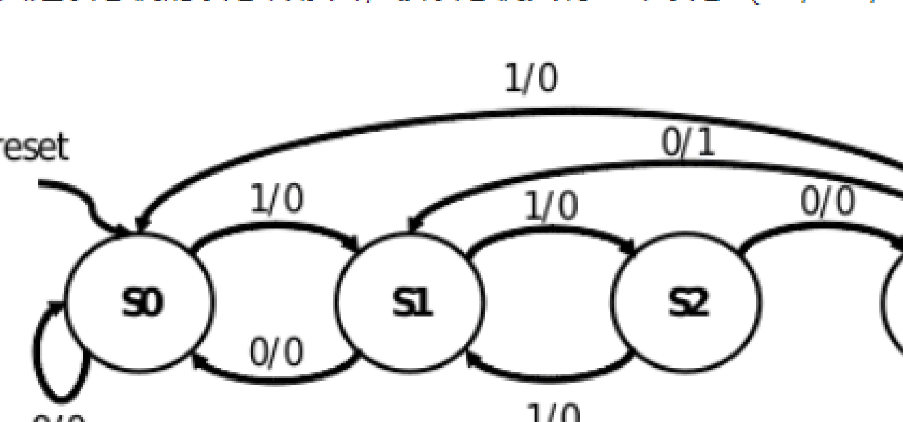

# 计算机系统基础 2022–2023 学年第二学期期末试卷（计算机组成原理部分）参考答案

## 一、单选题（共 10 题，共 20 分）

### 1. 采用 8 位二进制编码格式下，十进制数 $-11_{10}$ 的补码表示为（　　）

#### 题目

(A) $11110100_2$　　(B) $11110111_2$　　(C) $11110101_2$　　(D) $10001011_2$

#### 答案

**答案：** (C)。

$11_{10}=00001011_2$，按位取反得 $11110100_2$，再加 1 得 $11110101_2$。

### 2. 能实现从多个输入端中选出一路作为输出的电路称为（　　）

#### 题目

(A) 触发器　　(B) 计数器　　(C) 数据选择器　　(D) 译码器

#### 答案

**答案：** (C)。

数据选择器（多路选择器 MUX）按地址从多路输入中选一路送到输出端。译码器的作用相反，是把 $n$ 位输入译成 $2^n$ 路互斥的输出。

### 3. 对于 32 位 MIPS 指令集的条件跳转指令 beq 而言，其采用相对寻址方式，可以实现跳转到的地址空间最大范围是（　　）

#### 题目

(A) 128KB　　(B) 256KB　　(C) 256MB　　(D) 4GB

#### 答案

**答案：** (B)。

`beq` 的偏移量字段为 16 位，按字（4 字节）对齐需左移 2 位，因此相对 PC+4 的偏移范围是 $\pm 2^{17}$ 字节，即 $\pm 128$ KB。可跳转到的地址空间总范围为 $2\times 128\text{KB}=$ **256KB**。

### 4. 32 位 MIPS 指令中的立即数，其最大值（　　）

#### 题目

(A) 可以无限大　　(B) 可以等于 $2^{32}$　　(C) 小于 $2^{32}$　　(D) 必然大于 0

#### 答案

**答案：** (C)。

MIPS 的立即数字段只有 16 位：作为有符号立即数（`addi` 等）最大为 $2^{15}-1$；作为无符号立即数（`ori`、`andi` 等）最大为 $2^{16}-1$。两者都远小于 $2^{32}$。(D) 也错：立即数可以是 0，有符号立即数还可以是负数。

### 5. 代码起始地址 0x00060128， $s2$ 初值为 1， $s3$ 初值为 -1，第 2 行的分支指令 bnez 执行完后 PC 的值为（　　）

#### 题目

5\. 下列代码起始地址是 0x00060128，`$s2` 初值为 1，`$s3` 初值为 -1，第 2 行的分支指令 bnez 执行完后 PC 的值为（　　）。

   ```mips
   Loop: slt  $s1, $s2, $s3
         bnez $s1, Loop
   ```

   (A) 0x00060128　　(B) 0x0006012C　　(C) 0x00060130　　(D) 0x00060134

#### 答案

**答案：** (C)。

`slt $s1, $s2, $s3` 的功能是：若 `$s2 < $s3`（有符号比较）则 `$s1 = 1`，否则 `$s1 = 0`。这里 `$s2 = 1`、`$s3 = -1`， $1 < -1$ 不成立，故 `$s1 = 0`。

`bnez $s1, Loop` 在 `$s1 = 0` 时不跳转，PC 取下一条顺序指令的地址。`slt` 位于 0x00060128，`bnez` 位于 0x0006012C，故 `bnez` 执行完后 PC = 0x0006012C + 4 = **0x00060130**。

### 6. 与具备 N 个并行部件的 CPU 相比，一个 N 级流水线 CPU 的吞吐能力（　　）

#### 题目

(A) 具备同等水平　　(B) 小于前者　　(C) 大于前者　　(D) 二者无法比较

#### 答案

**答案：** (B)。

具备 N 个并行部件的 CPU 每个时钟周期最多可同时完成 N 条指令，吞吐率为 N 条/周期；N 级流水线 CPU 在理想情况下每个时钟周期只能流出（完成）1 条指令，吞吐率为 1 条/周期。级数 N 只影响流水线深度和指令延迟，不提高每周期完成的指令条数，因此 N 级流水线的吞吐能力小于具备 N 个并行部件的 CPU。

### 7. 用 $4\text{K}\times 4$ 位的 SRAM 芯片扩展为 $8\text{K}\times 16$ 位的存储器，地址线需要增加的位数以及所需的片数分别为（　　）

#### 题目

(A) 1 位和 8 片　　(B) 1 位和 4 片　　(C) 2 位和 4 片　　(D) 2 位和 2 片

#### 答案

**答案：** (A)。

- 位扩展：每片 4 位，需要 $16/4=4$ 片并联成一组 $4\text{K}\times 16$ 位
- 字扩展： $8\text{K}/4\text{K}=2$ 组
- 共需 $2\times 4=8$ 片
- 地址线： $4\text{K}=2^{12}$ 需 12 根， $8\text{K}=2^{13}$ 需 13 根，故增加 **1 位**（用于片选译码）

### 8. 在主存与 Cache 的数据映射关系中，兼具灵活性与实现成本的一种映射方式是（　　）

#### 题目

(A) 直接映射　　(B) 间接映射　　(C) 全相联映射　　(D) 组相联映射

#### 答案

**答案：** (D)。

直接映射实现最简单、成本最低，但冲突率高、灵活性差；全相联映射最灵活、命中率高，但需要同时比较全部标记，硬件成本高。组相联映射是两者的折中，兼具灵活性与实现成本。

### 9. 假设虚存系统访存过程为：虚拟地址转换为物理地址后再访问 Cache。对于可被 Cache 缓存的某个物理页面来说，以下判断错误的是（　　）

#### 题目

(A) 若页表项已建立，则 TLB 有可能缺失。　　(B) 若 Cache 命中，则物理页面必然被装载了。

(C) 若 TLB 命中，则页表项必然已建立。　　(D) 若 TLB 缺失，则 Cache 必然命中。

#### 答案

**答案：** (D)。

TLB 是否缺失与 Cache 是否命中是相互独立的两件事：TLB 缺失只说明该页表项不在 TLB 中（可能仍在内存页表里），得到物理地址后 Cache 完全可能缺失。因此 (D) 的"必然命中"是错误的。(A) 正确：TLB 容量有限，有效页表项可能被替换出去。(B) 正确：Cache 用物理地址索引，页面未装载就没有物理地址，无从命中。(C) 正确：TLB 是页表项的缓存，命中则对应页表项必然有效。

### 10. 采用 DMA 方式传送数据时，每传送一个数据就要用一个（　　）时间

#### 题目

(A) 指令周期　　(B) 机器周期　　(C) 存储周期　　(D) 总线周期

#### 答案

**答案：** (D)。

DMA 采用周期挪用（周期窃取）方式：DMA 控制器每传送一个数据就要向 CPU 申请并占用一次总线（对主存做一次存取），即占用一个**总线周期**。

部分教材把这里的"总线周期"表述为"存储周期（存取周期）"，两者所指相同——DMA 窃取的是一次主存存取所占的总线周期。

## 二、简答题

### 1. 数字逻辑分析——逻辑化简（5 分）

#### 题目

将下列逻辑函数表达式化简。

$$
F=\overline{A+\overline{A}B+\overline{A}\,\overline{B}}+\overline{\overline{A}+B}
$$

#### 答案

**答案：**

先看第一个大非号内的部分：

$$
A+\overline{A}B+\overline{A}\,\overline{B}=A+\overline{A}\left(B+\overline{B}\right)=A+\overline{A}\cdot 1=A+\overline{A}=1
$$

因此第一个大非号的结果为 $\overline{1}=0$。

再看第二项（用摩根定律）：

$$
\overline{\overline{A}+B}=\overline{\overline{A}}\cdot\overline{B}=A\overline{B}
$$

所以

$$
F=0+A\overline{B}=\boxed{A\overline{B}}
$$

### 2. 数字逻辑分析——函数实现（5 分）

实现逻辑函数 $F=\overline{A}\,\overline{B}C+ABC$。

#### （1）8 选 1 多路选择器（ $A_2=A$、 $A_1=B$、 $A_0=C$，Y 对应 F）

**答案：** 先列真值表： $F=1$ 的最小项为 $ABC=001$ 与 $ABC=111$，其余为 0。

| $A_2A_1A_0$（即 $ABC$） | 选中端 | F | 应接信号 |
| --- | --- | --- | --- |
| 000 | $D_0$ | 0 | 0（接 GND） |
| 001 | $D_1$ | 1 | 1（接 VCC） |
| 010 | $D_2$ | 0 | 0 |
| 011 | $D_3$ | 0 | 0 |
| 100 | $D_4$ | 0 | 0 |
| 101 | $D_5$ | 0 | 0 |
| 110 | $D_6$ | 0 | 0 |
| 111 | $D_7$ | 1 | 1（接 VCC） |

即： $D_1=D_7=1$（接 VCC）， $D_0=D_2=D_3=D_4=D_5=D_6=0$（接 GND）， $\overline{EN}=0$（接 GND，使能有效）。

#### （2）4 选 1 多路选择器加一个非门（ $A_1=A$、 $A_0=B$，C 接非门输入，Y 对应 F）

**答案：** 按 $A_1A_0=AB$ 分组讨论：

| $A_1A_0$（即 $AB$） | 选中端 | F 的取值 | 应接信号 |
| --- | --- | --- | --- |
| 00 | $D_0$ | $\overline{A}\,\overline{B}C\big\vert_{AB=00}=C$ | C |
| 01 | $D_1$ | 0 | 0（接 GND） |
| 10 | $D_2$ | 0 | 0（接 GND） |
| 11 | $D_3$ | $ABC\big\vert_{AB=11}=C$ | C |

即： $D_0=D_3=C$， $D_1=D_2=0$（接 GND）， $\overline{EN}=0$（接 GND）。

按图中给出的接线条件，只有非门输出的 $\overline{C}$ 是"新产生"的信号，而本题在 $AB=00$ 与 $AB=11$ 两组都需要 $C$ 本身，因此图中标注的 C 信号线可直接接入 $D_0$、 $D_3$，此时给出的非门在本实现中用不到（其输出 $\overline{C}$ 可悬空）。若严格限定只能使用非门输出的 $\overline{C}$，则该函数无法用这一片 4 选 1 多路选择器实现——此时需要把非门输出再取反，或改用 $F=\overline{\overline{A}\,\overline{B}\,\overline{C}+AB\overline{C}}$ 这类只需 $\overline{C}$ 的等价形式。

### 3. 数字逻辑分析——有限状态机（10 分）



#### （1）是 Moore 型还是 Mealy 型状态机（1 分）

**答案：** **Mealy 型状态机**。

弧上标注的形式是"输入/输出"（如 1/0、0/1），说明输出由当前状态和当前输入共同决定，因此是 Mealy 型。

#### （2）请描述该状态机的功能（1 分）

**答案：** 这是一个**序列检测器**，用于检测输入序列中出现的子序列 **1100**：当状态机处于 S3（已收到 110）且当前输入为 0 时，输出 Q=1，其余情况下 Q=0。

各状态的含义：S0 为初始状态（尚未匹配到前缀）；S1 表示已收到 "1"；S2 表示已收到 "11"；S3 表示已收到 "110"。

#### （3）请给出状态转换表（需要包括输出信号）（4 分）

**答案：** 状态编码 S0=00、S1=01、S2=10、S3=11。复位后进入 S0。

| 现态 $S_1S_0$ | 输入 A | 次态 $S_1'S_0'$ | 输出 Q |
| --- | --- | --- | --- |
| 00 | 0 | 00 | 0 |
| 00 | 1 | 01 | 0 |
| 01 | 0 | 00 | 0 |
| 01 | 1 | 10 | 0 |
| 10 | 0 | 11 | 0 |
| 10 | 1 | 01 | 0 |
| 11 | 0 | 01 | 1 |
| 11 | 1 | 00 | 0 |

#### （4）根据状态转换表，请写出次态和输出的逻辑表达式（4 分）

**答案：**

$$
S_1'=S_1\overline{S_0}\,\overline{A}+\overline{S_1}S_0A
$$

$$
S_0'=\overline{S_0}A+S_1S_0\overline{A}
$$

$$
Q=S_1S_0\overline{A}
$$

推导说明：

- $S_1'=1$ 出现在 $(S_1S_0,A)=(10,0)$ 与 $(01,1)$ 两行，故 $S_1'=S_1\overline{S_0}\,\overline{A}+\overline{S_1}S_0A$
- $S_0'=1$ 出现在 $(00,1)$、 $(10,1)$、 $(11,0)$ 三行，即 $\overline{S_1}\,\overline{S_0}A+S_1\overline{S_0}A+S_1S_0\overline{A}=\overline{S_0}A+S_1S_0\overline{A}$
- $Q=1$ 只出现在 $(11,0)$ 一行，故 $Q=S_1S_0\overline{A}$

### 4. 指令系统与 MIPS 汇编——用指令实现功能（5 分）

#### （1）用一条指令将数值 0xB33C 分配到寄存器 $t0$ 当中（1 分）

**答案：**

```mips
ori  $t0, $zero, 0xB33C
```

说明：0xB33C 只有 16 位，可直接用 `ori` 把立即数零扩展装入 `$t0`，结果为 0x0000B33C。若用 `addi`，立即数 0xB33C 的最高位为 1，会被符号扩展成 0xFFFFB33C，不符合要求。

#### （2）用不超过 2 条指令将数值 0xF78C033C 分配到寄存器 $t0$ 当中（2 分）

**答案：**

```mips
lui  $t0, 0xF78C
ori  $t0, $t0, 0x033C
```

说明：`lui` 把 0xF78C 装入高 16 位、低 16 位清零；`ori` 再把 0x033C 零扩展后"或"进低 16 位，最终 `$t0 = 0xF78C033C`。

#### （3）用不超过两条指令从内存地址为 0xF78C000C 的单元读取一个字到寄存器 $t0$ 当中（2 分）

**答案：**

```mips
lui  $t1, 0xF78C
lw   $t0, 0x000C($t1)
```

说明：先用 `lui` 构造基地址 0xF78C0000，再用 `lw` 以 16 位有符号偏移 0x000C 访问目标单元。偏移量 0x000C 是正数，不会因符号扩展破坏高 16 位。

### 5. 指令系统与 MIPS 汇编——代码改错（5 分）

#### 题目

将 C 语言代码 A[10]=A[20]+20 转换成 32 位 MIPS 汇编语言的代码段。假设数组的基地址是 $1081344_{10}$，并且该基地址将存放在寄存器 `$s0` 中。某同学采用以下的 MIPS 汇编代码实现了转换：

```mips
lui   $s0, 16
addi  $s0, $zero, 32768
lw    $t0, 80($s0)
addi  $t0, $t0, 20
sw    $t0, 40($s0)
```

经测试，这段代码运行的结果不正确。

请简要描述出错的原因，然后只修改一条指令即可使上述代码能够正确实现现有的功能（5 分）。

#### 答案

**出错原因：** 第 2 条指令 `addi $s0, $zero, 32768` 的目的寄存器仍是 `$s0`，而源寄存器是 `$zero`，它把第 1 条 `lui` 已经装入 `$s0` 的高位结果**完全覆盖**掉了。执行完前两条指令后 `$s0 = 32768 = 0x00008000`，而不是要求的数组基地址 1081344 = 0x00108000，因此后面用 `80($s0)`、`40($s0)` 访问 A[20]、A[10] 时取错了单元。

**修改方法：** 把第 2 条指令改为在 `$s0` 原有高位的基础上叠加低 16 位：

```mips
lui   $s0, 16
ori   $s0, $s0, 0x8000      # 原为 addi $s0, $zero, 32768
lw    $t0, 80($s0)
addi  $t0, $t0, 20
sw    $t0, 40($s0)
```

验证：`lui $s0, 16` 使 `$s0 = 16 \times 2^{16} = 0x00100000 = 1048576`；再 `ori $s0, $s0, 0x8000` 得 `$s0 = 0x00108000 = 1081344`，正是题目给出的数组基地址。偏移量 80 = 20×4（A[20]）、40 = 10×4（A[10]）本身是正确的，无需修改。

写成 `addiu $s0, $s0, 32768` 也能得到同样结果，同样只改动一条指令。

### 6. 指令系统与 MIPS 汇编——程序片段分析（5 分）

#### （1）循环次数与返回值（3 分）

**答案：** 每轮循环把 `$a0` 的最低位取出累加到 `$v0`，再把 `$a0` 逻辑右移一位，直到 `$a0` 变为 0 为止。

| `$a0` 的值 | 循环次数 | 返回值 `$v0` | 说明 |
| --- | --- | --- | --- |
| 15 | 4 | 4 | $15=1111_2$，最低位连续 4 个 1； $15\gg4=0$ |
| 64 | 7 | 1 | $64=1000000_2$，只有 1 个 1； $64\gg7=0$ |
| -1 | 32 | 32 | `srl` 是逻辑右移， $-1$ 的机器数为 $0xFFFFFFFF$，含 32 个 1；右移 32 次后为 0 |

逐轮验证（以 `$a0 = 15` 为例）：第 1 轮 `$t0 = 1`、`$a0 = 7`、`$v0 = 1`，非 0 继续；第 2 轮 `$a0 = 3`、`$v0 = 2`；第 3 轮 `$a0 = 1`、`$v0 = 3`；第 4 轮 `$a0 = 0`、`$v0 = 4`，`bnez` 不跳转，退出。共 4 轮，返回 4。

#### （2）函数功能（2 分）

**答案：** 该函数统计 `$a0` 所传二进制数中 1 的个数（按无符号数逐位计数），并把结果通过 `$v0` 返回。

### 7. 主存储器（10 分）

某 8 位机地址总线 20 位，主存按字节编址；前 64KB 为只读程序区，其余为可读可写用户程序区；可用芯片为 $16\text{K}\times 8$ 位 DRAM 和 $16\text{K}\times 4$ 位 ROM。

#### （1）DRAM 芯片的地址线数量、行选择线与列选择线数量（6 分）

**答案：** DRAM 芯片容量为 $16\text{K}\times 8$ 位， $16\text{K}=2^{14}$，即芯片内部有 $2^{14}$ 个存储单元，需要 14 位地址。

由于芯片内部采用二维地址结构且行、列地址数量相同，故行地址 7 位、列地址 7 位。

DRAM 的行地址与列地址分时复用（先送行地址、再送列地址），因此芯片**外部**引出的地址线只需 **7 条**。

芯片内部的**行选择线**有 $2^7=$ **128 条**，**列选择线**有 $2^7=$ **128 条**（合计 $128\times 128=16384=16\text{K}$ 个存储单元）。

#### （2）构建最大容量主存所需的芯片数（2 分）

**答案：** 地址总线 20 位、按字节编址，允许的最大主存容量为 $2^{20}$ B = 1MB。

- **ROM 区（前 64KB）**：每片 ROM 为 $16\text{K}\times 4$ 位，先用 2 片位扩展成 $16\text{K}\times 8$ 位，再用 $64\text{KB}/16\text{KB}=4$ 组字扩展，共需 $4\times 2=$ **8 片 ROM**
- **DRAM 区（1MB − 64KB = 960KB）**：每片 DRAM 为 $16\text{K}\times 8$ 位，与机器字长一致，无需位扩展； $960\text{KB}/16\text{KB}=60$，共需 **60 片 DRAM**

#### （3）A19 搭接到低电平后可访问的芯片数（2 分）

**答案：** A19 恒为 0，CPU 只能访问地址空间的前一半，即 0x00000 ~ 0x7FFFF，共 $2^{19}$ B = 512KB。

- ROM 区（前 64KB）仍完全落在可访问范围内，故 **8 片 ROM 全部可访问**
- 可访问的用户程序区为 $512\text{KB}-64\text{KB}=448\text{KB}$， $448\text{KB}/16\text{KB}=28$，故最多可访问 **28 片 DRAM**

### 8. 高速缓存（10 分）

主存 1MB 按字节编址；CACHE 4 路组相联、容量 16KB、块大小 16 字节；每块 1 位有效位和 1 位修改位。

#### （1）主存的地址格式（3 分）

**答案：** 主存 1MB = $2^{20}$ B，主存地址 **20 位**。

- CACHE 组数 = $16\text{KB}/(4\times 16\text{B})=16384/64=256=2^{8}$ 组，故组号 **8 位**
- 块大小 16B = $2^{4}$，故块内地址 **4 位**
- 标记 Tag = $20-8-4=$ **8 位**

| 8 | 8 | 4 |
| --- | --- | --- |
| Cache 标记（Tag） | Cache 组号 | 块内地址 |

#### （2）CACHE 的实际物理总容量（2 分）

**答案：** CACHE 共有 $256\times 4=1024$ 个数据块。

每块的标记信息 = Tag 8 位 + 有效位 1 位 + 修改位 1 位 = 10 位。

$$
\text{标记部分}=1024\times 10=10240\ \text{位}=1280\ \text{B}
$$

$$
\text{实际物理总容量}=16\text{KB}+1280\text{B}=16384+1280=17664\ \text{B}\approx 17.25\ \text{KB}
$$

#### （3）CACHE 命中率应不低于多少（2 分）

**答案：** 设命中率为 $h$。命中时访问时间为 20ns；缺失时需依次访问 CACHE 和主存，共 $20+80=100$ ns。

$$
\text{平均访存时间}=20h+100(1-h)=100-80h
$$

要求两级系统的平均访存时间小于单级主存的平均访存时间（80ns）：

$$
100-80h<80\quad\Longrightarrow\quad 80h>20\quad\Longrightarrow\quad h>0.25
$$

即 CACHE 命中率应**高于 25%**（不低于 25% 时两级系统已不劣于单级主存）。

#### （4）LRU 替换策略下的命中率（3 分）

**答案：** 由第 (1) 问，组号为主存地址的第 4 ~ 11 位，Tag 为第 12 ~ 19 位。先把每个地址右移 4 位得到块地址，再取低 8 位作组号：

| 序号 | 主存地址 | 块地址 | 组号 | Tag | 命中/缺失 | 命中时组 5A 内容 |
| --- | --- | --- | --- | --- | --- | --- |
| 1 | A35A2H | A35AH | 5A | A3 | 缺失 | A3 |
| 2 | B45A3H | B45AH | 5A | B4 | 缺失 | A3, B4 |
| 3 | C65A5H | C65AH | 5A | C6 | 缺失 | A3, B4, C6 |
| 4 | E25A9H | E25AH | 5A | E2 | 缺失 | A3, B4, C6, E2（组满） |
| 5 | D7684H | D768H | 68 | D7 | 缺失 | （组 68 单独存放 D7） |
| 6 | B45A0H | B45AH | 5A | B4 | **命中** | A3, B4, C6, E2 |
| 7 | A35A4H | A35AH | 5A | A3 | **命中** | A3, B4, C6, E2 |
| 8 | D75AFH | D75AH | 5A | D7 | 缺失（替换 C6） | A3, B4, E2, D7 |
| 9 | A35AEH | A35AH | 5A | A3 | **命中** | A3, B4, E2, D7 |
| 10 | E25ABH | E25AH | 5A | E2 | **命中** | A3, B4, E2, D7 |

第 8 次访问时组 5A 已满（4 路），按 LRU 规则，最久未被使用的是第 3 次装入的 Tag = C6 块，故换出 C6、换入 D7。

命中次数为 4 次（第 6、7、9、10 次）：

$$
\text{命中率}=\frac{4}{10}=40\%
$$

### 9. 虚拟存储和分层存储系统（10 分）

虚存 2GB、物理内存 128MB；TLB 2 路组相联、共 8 个页表项；页大小 32KB，页表项含 1 位有效位。

#### （1）TLB 命中而 CACHE 缺失需要访问几次主存（1 分）

**答案：** **1 次**。

TLB 命中时不需要访问内存中的页表（省掉 1 次访存）；CACHE 缺失时需要访问主存取数（1 次）。

#### （2）虚拟地址的地址格式（2 分）

**答案：** 虚存 2GB = $2^{31}$ B，虚拟地址 **31 位**。页大小 32KB = $2^{15}$ B，页内偏移 **15 位**，虚页号 = $31-15=$ **16 位**。

| 16 | 15 |
| --- | --- |
| 虚页号 | 页内偏移 |

#### （3）每个进程的虚拟空间最多可有多少页（1 分）

**答案：** $2^{16}=65536$ 页。

#### （4）TLB 的实际大小是多少位（4 分）

**答案：** 物理内存 128MB = $2^{27}$ B，物理地址 27 位；页内偏移 15 位，故实页号 = $27-15=$ **12 位**。

TLB 采用 2 路组相联、共 8 个页表项，故分 $8/2=4$ 组，组号由虚页号的低 2 位给出，其余 14 位作为 Tag 标记。

每个 TLB 表项需要存储：

- Tag 标记（虚页号高 14 位）：14 位
- 实页号：12 位
- 有效位：1 位

每项共 $14+12+1=27$ 位，因此

$$
\text{TLB 实际大小}=8\times 27=216\ \text{位}
$$

若把整个 16 位虚页号都作为标记存入（不按组号拆分存储），则每项为 $16+12+1=29$ 位，TLB 总容量为 $8\times 29=232$ 位。这里按组相联映射的常规实现（组号由地址译码、不占表项位宽）取 216 位。

#### （5）虚拟地址 24547423H 对应的物理地址（2 分）

**答案：**

第一步，分解虚拟地址：

- 页内偏移（低 15 位）= $24547423\text{H}\ \&\ 7FFF\text{H}=7423\text{H}$
- 虚页号 = $24547423\text{H}\gg 15=48A8\text{H}$

第二步，在 TLB 中查找。TLB 共 4 组，组号取虚页号低 2 位：

- 组号 = $48A8\text{H}\ \&\ 3=0$，即第 0 组
- Tag 标记 = $48A8\text{H}\gg 2=122A\text{H}$

第 0 组第一路的 Tag 为 122A，与之相符，且有效位为 1，故 **TLB 命中**，实页号为 **329H**。

第三步，拼装物理地址：

$$
\text{物理地址}=(\text{实页号}\ll 15)+\text{页内偏移}=329\text{H}\times 8000\text{H}+7423\text{H}=1948000\text{H}+7423\text{H}
$$

$$
\boxed{\text{物理地址}=194F423\text{H}}
$$

### 10. MIPS CPU（15 分）

```mips
L1: and $s1, $t0, $t1
L2: or  $s1, $t2, $t3
L3: sub $s2, $s2, $t1
L4: or  $s0, $s0, $t5
L5: slt $s4, $s2, $s0
```

#### （1）列出所有存在着数据相关的指令对与寄存器（6 分）

**答案：**

- `$s1, {L1, L2}`（写-写，WAW/输出相关：L1 与 L2 都写 `$s1`）
- `$s2, {L3, L5}`（写-读，RAW 真数据相关：L3 写 `$s2`，L5 读 `$s2`）
- `$s0, {L4, L5}`（写-读，RAW 真数据相关：L4 写 `$s0`，L5 读 `$s0`）

说明：L3 读 `$t1`、L1 读 `$t1`，都是只读且无人写 `$t1`，不构成相关；L3 内部的"读 `$s2` 再写 `$s2`"发生在同一条指令内，不属于指令间相关。

若只统计写-读（RAW）相关，则为 `$s2, {L3, L5}` 与 `$s0, {L4, L5}` 两组；`$s1, {L1, L2}` 属于写-写（输出）相关，此处一并列出。

#### （2）分析寄存器数据冲突的现象及执行效果（9 分）

**答案：** **存在寄存器数据冲突**，冲突发生在 `$s2, {L3, L5}` 上。

不暂停时的流水线时空图：

| 指令 | 1 | 2 | 3 | 4 | 5 | 6 | 7 | 8 | 9 |
| --- | --- | --- | --- | --- | --- | --- | --- | --- | --- |
| L1 | IF | D | E | M | W | | | | |
| L2 | | IF | D | E | M | W | | | |
| L3 | | | IF | D | E | M | W | | |
| L4 | | | | IF | D | E | M | W | |
| L5 | | | | | IF | D | E | M | W |

逐项分析：

- `$s1, {L1, L2}` 是写-写相关。L1 在第 5 周期写 `$s1`，L2 在第 6 周期写 `$s1`，寄存器堆按顺序写回，后写的 L2 覆盖先写的 L1，最终结果正确，**不产生数据冲突**。
- `$s0, {L4, L5}`：第 7 周期 L4 处于 M 级、L5 处于 E 级，恰好满足"仅支持 M 级向 E 级的转发"，L4 的结果可经旁路直接送到 L5 的 ALU 输入端，**冲突可由现有转发解决，不需要暂停**。
- `$s2, {L3, L5}`：L3 在第 6 周期处于 M 级，而此时 L5 处于 D 级；到第 7 周期 L5 进入 E 级时，L3 已经进入 W 级，M→E 旁路（源必须是 M 级）已不再可用。而题目又说明寄存器堆无内部转发，L3 要到第 7 周期 W 级才把 `$s2` 写回，L5 在第 6 周期 D 级读到的是旧值。**在不增加其他转发旁路的情况下无法解决此冲突。**

**暂停周期数分析：**

采用暂停的方式，L5 必须在 D 级读到 `$s2` 的新值。寄存器堆无内部转发，意味着 W 级在第 $t$ 周期的写入，要到第 $t+1$ 周期才能被 D 级读到：

- L3 在第 7 周期 W 级写回 `$s2` → L5 的 D 级读必须在第 8 周期或之后
- L4 在第 8 周期 W 级写回 `$s0`。若 L5 的 D 级读放在第 8 周期，则 `$s0` 读到的是旧值，而此时 L5 已错过第 7 周期 L4 位于 M 级的转发时机（M→E 旁路要求 L5 在第 7 周期处于 E 级），无法再靠转发取得 `$s0`

因此 L5 的 D 级读必须推迟到**第 9 周期**，才能同时从寄存器堆读到 L3 写回的 `$s2` 和 L4 写回的 `$s0`。

L5 原本在第 6 周期进入 D 级，推迟到第 9 周期读出，需要 **3 个周期的暂停**：

| 指令 | 1 | 2 | 3 | 4 | 5 | 6 | 7 | 8 | 9 | 10 | 11 | 12 |
| --- | --- | --- | --- | --- | --- | --- | --- | --- | --- | --- | --- | --- |
| L1 | IF | D | E | M | W | | | | | | | |
| L2 | | IF | D | E | M | W | | | | | | |
| L3 | | | IF | D | E | M | W | | | | | |
| L4 | | | | IF | D | E | M | W | | | | |
| L5 | | | | | IF | D | D（暂停） | D（暂停） | D（暂停） | E | M | W |

完整执行该指令片段共需 **12 个周期**。
