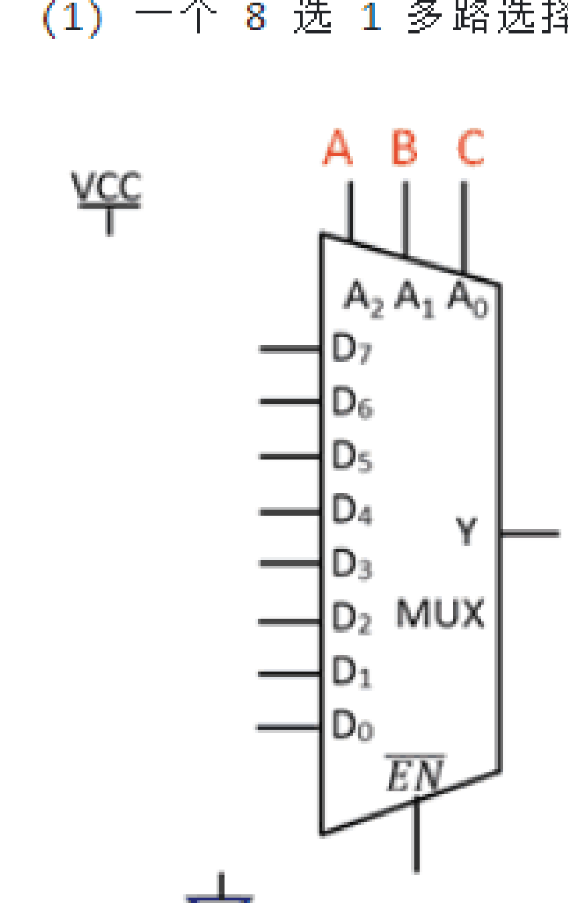
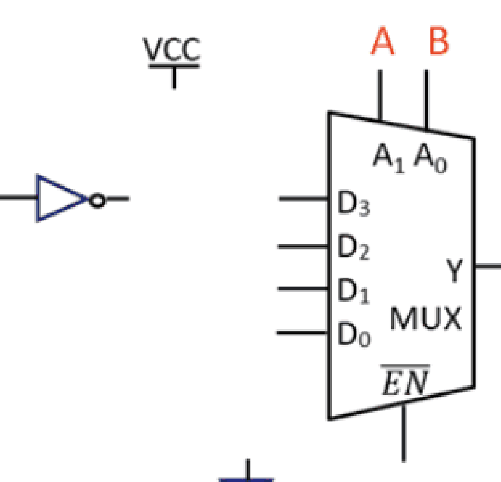
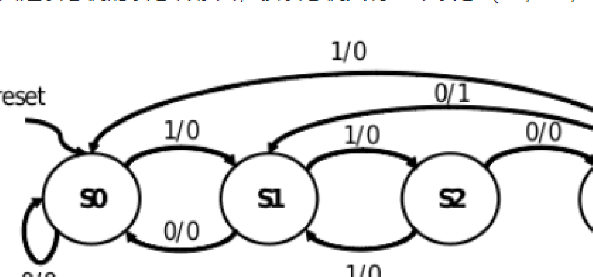
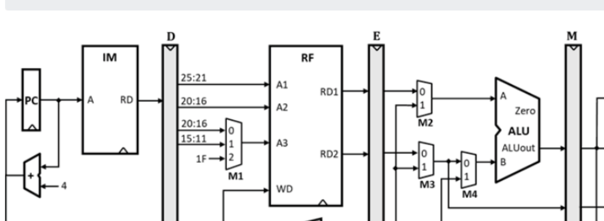

# 计算机系统基础 2022–2023 学年第二学期期末试卷（计算机组成原理部分）

## 一、单选题（共 10 题，共 20 分）

1. 采用 8 位二进制编码格式下，十进制数 $-11_{10}$ 的补码表示为（　　）。

   (A) $11110100_2$　　(B) $11110111_2$

   (C) $11110101_2$　　(D) $10001011_2$

2. 能实现从多个输入端中选出一路作为输出的电路称为（　　）。

   (A) 触发器　　(B) 计数器　　(C) 数据选择器　　(D) 译码器

3. 对于 32 位 MIPS 指令集的条件跳转指令 beq 而言，其采用相对寻址方式，可以实现跳转到的地址空间最大范围是（　　）。

   (A) 128KB　　(B) 256KB　　(C) 256MB　　(D) 4GB

4. 32 位 MIPS 指令中的立即数，其最大值（　　）。

   (A) 可以无限大　　(B) 可以等于 $2^{32}$　　(C) 小于 $2^{32}$　　(D) 必然大于 0

5. 下列代码起始地址是 0x00060128，`$s2` 初值为 1，`$s3` 初值为 -1，第 2 行的分支指令 bnez 执行完后 PC 的值为（　　）。

   ```mips
   Loop: slt  $s1, $s2, $s3
         bnez $s1, Loop
   ```

   (A) 0x00060128　　(B) 0x0006012C　　(C) 0x00060130　　(D) 0x00060134

6. 与具备 N 个并行部件的 CPU 相比，一个 N 级流水线 CPU 的吞吐能力（　　）。

   (A) 具备同等水平　　(B) 小于前者　　(C) 大于前者　　(D) 二者无法比较

7. 用 $4\text{K}\times 4$ 位的 SRAM 芯片扩展为 $8\text{K}\times 16$ 位的存储器，地址线需要增加的位数以及所需的片数分别为（　　）。

   (A) 1 位和 8 片　　(B) 1 位和 4 片　　(C) 2 位和 4 片　　(D) 2 位和 2 片

8. 在主存与 Cache 的数据映射关系中，兼具灵活性与实现成本的一种映射方式是（　　）。

   (A) 直接映射　　(B) 间接映射　　(C) 全相联映射　　(D) 组相联映射

9. 假设虚存系统访存过程为：虚拟地址转换为物理地址后再访问 Cache。对于可被 Cache 缓存的某个物理页面来说，以下判断错误的是（　　）。

   (A) 若页表项已建立，则 TLB 有可能缺失。

   (B) 若 Cache 命中，则物理页面必然被装载了。

   (C) 若 TLB 命中，则页表项必然已建立。

   (D) 若 TLB 缺失，则 Cache 必然命中。

10. 采用 DMA 方式传送数据时，每传送一个数据就要用一个（　　）时间。

    (A) 指令周期　　(B) 机器周期　　(C) 存储周期　　(D) 总线周期

## 二、简答题

### 1. 数字逻辑分析——逻辑化简（5 分）

将下列逻辑函数表达式化简（5 分）。

$$
F=\overline{A+\overline{A}B+\overline{A}\,\overline{B}}+\overline{\overline{A}+B}
$$

### 2. 数字逻辑分析——函数实现（5 分）

请使用下列器件，实现逻辑函数表达式 $F=\overline{A}\,\overline{B}C+ABC$，请给出器件管脚的对应信号（共 5 分）。

**（1）** 一个 8 选 1 多路选择器，将 A、B、C 分别连接至 $A_2$、 $A_1$、 $A_0$ 管脚，输出管脚 Y 对应 F。请给出器件管脚（ $D_7\sim D_0$， $\overline{EN}$）的对应信号（3 分）。



注：在 $\overline{EN}=0$ 时，根据地址 $A_2A_1A_0$ 从 8 路数据 $D_7\sim D_0$ 中选出一路输出至 Y，其功能表（ $\overline{EN}=0$）如下所示：

| $A_2$ | $A_1$ | $A_0$ | Y |
| --- | --- | --- | --- |
| 0 | 0 | 0 | $D_0$ |
| 0 | 0 | 1 | $D_1$ |
| 0 | 1 | 0 | $D_2$ |
| 0 | 1 | 1 | $D_3$ |
| 1 | 0 | 0 | $D_4$ |
| 1 | 0 | 1 | $D_5$ |
| 1 | 1 | 0 | $D_6$ |
| 1 | 1 | 1 | $D_7$ |

**（2）** 一个 4 选 1 多路选择器和一个非门，将 A、B 分别连接至 $A_1$、 $A_0$ 管脚，C 连接至非门输入管脚，输出管脚 Y 对应 F。请给出多路选择器管脚（ $D_3\sim D_0$， $\overline{EN}$）的对应信号（2 分）。



注：在 $\overline{EN}=0$ 时，根据地址 $A_1A_0$ 从 4 路数据 $D_3\sim D_0$ 中选出一路输出至 Y，其功能表（ $\overline{EN}=0$）如下所示：

| $A_1$ | $A_0$ | Y |
| --- | --- | --- |
| 0 | 0 | $D_0$ |
| 0 | 1 | $D_1$ |
| 1 | 0 | $D_2$ |
| 1 | 1 | $D_3$ |

### 3. 数字逻辑分析——有限状态机（10 分）

下图是状态机的状态转移图，该状态机共有 4 个状态（S0，S1，S2，S3），输入是由 0、1 构成的二进制序列（共 10 分）。



约定：

**（1）** 状态 S0、S1、S2、S3 分别编码为 00、01、10、11

**（2）** 当前状态、输入、次态、输出的信号名分别对应： $S_1S_0$、A、 $S_1'S_0'$、Q（注意：次态信号名的右上角有个 $'$ 以示区别）

请回答下列问题。

**（1）** 该状态机是 Moore 型状态机还是 Mealy 型状态机（1 分）

**（2）** 请描述该状态机的功能（1 分）

**（3）** 请给出状态转换表（需要包括输出信号）（4 分）

**（4）** 根据状态转换表，请写出次态和输出的逻辑表达式（4 分）

### 4. 指令系统与 MIPS 汇编——用指令实现功能（5 分）

使用 32 位 MIPS 指令实现以下功能（共 5 分）。

**（1）** 用一条指令将数值 0xB33C 分配到寄存器 `$t0` 当中（1 分）。

**（2）** 用不超过 2 条指令将数值 0xF78C033C 分配到寄存器 `$t0` 当中（2 分）。

**（3）** 用不超过两条指令从内存地址为 0xF78C000C 的单元读取一个字到寄存器 `$t0` 当中（2 分）。

### 5. 指令系统与 MIPS 汇编——代码改错（5 分）

将 C 语言代码 A[10]=A[20]+20 转换成 32 位 MIPS 汇编语言的代码段。假设数组的基地址是 $1081344_{10}$，并且该基地址将存放在寄存器 `$s0` 中。某同学采用以下的 MIPS 汇编代码实现了转换：

```mips
lui   $s0, 16
addi  $s0, $zero, 32768
lw    $t0, 80($s0)
addi  $t0, $t0, 20
sw    $t0, 40($s0)
```

经测试，这段代码运行的结果不正确。

请简要描述出错的原因，然后只修改一条指令即可使上述代码能够正确实现现有的功能（5 分）。

### 6. 指令系统与 MIPS 汇编——程序片段分析（5 分）

下面是用 32 位 MIPS 汇编语言写的一个函数。该函数通过寄存器 `$a0` 接收一个二进制数，通过寄存器 `$v0` 返回一个值。

```mips
        .globl start
        .text
start:  li   $v0, 0
while:  andi $t0, $a0, 1
        srl  $a0, $a0, 1
count:  add  $v0, $v0, $t0
        bnez $a0, while
return: jr   $ra
```

**（1）** 假如 `$a0` 接收的数（用十进制表示）分别是 15，64，-1，则该函数分别会循环多少次，相应的返回值分别是多少（3 分）？

**（2）** 请用 1 至 2 句话简单说明该函数的功能（2 分）。

### 7. 主存储器（10 分）

某 8 位机的地址总线为 20 位，主存按字节编址，其中：地址空间前 64KB 为只读程序区，其余为可读可写的用户程序区，现有若干片容量 $16\text{K}\times 8$ 的 DRAM 芯片和若干片容量为 $16\text{K}\times 4$ 的 ROM 芯片。请问：

**（1）** 若上述 DRAM 芯片内部采用二维地址结构，且其行地址和列地址数量相同，则 DRAM 芯片的地址线有多少条？芯片内的行选择线和列选择线分别有多少条？（6 分）

**（2）** 若要构建该机所允许的最大容量的主存，则需用上述规格的 DRAM 芯片和 ROM 芯片各多少片？（2 分）

**（3）** 若该机最高地址线 A19 与 CPU 断开并搭接到低电平上，则该机实际可访问的 ROM 芯片和 DRAM 芯片的最大数量分别是多少？（2 分）

### 8. 高速缓存（10 分）

某机主存容量为 1MB，按字节编址。CACHE 采用 4 路组相联结构，容量为 16KB，数据块大小为 16 字节。每个数据块需要 1 位有效位和 1 位修改位。

**（1）** 请给出主存的地址格式（各字段名称及其位数）（3 分）

**（2）** 请计算 CACHE 的实际物理总容量是多少？（2 分）

**（3）** 若 CACHE 的存取时间是 20ns，主存的存取时间为 80ns，且 CACHE 访问缺失时需要依次访问 CACHE 和主存。若要求 CACHE-主存存储系统的平均访存时间小于单级主存存储系统的平均访存时间，则 CACHE 命中率应不低于多少？（2 分）

**（4）** 设 CACHE 初态为空，执行某段程序时，经寻址计算，依次访问了主存地址为 A35A2H、B45A3H、C65A5H、E25A9H、D7684H、B45A0H、A35A4H、D75AFH、A35AEH、E25ABH 的 10 个数据块，请计算 CACHE 在 LRU 替换策略下的命中率。（3 分）

### 9. 虚拟存储和分层存储系统（10 分）

现有一计算机系统内有一个 TLB 和一个 L1 Data CACHE，该系统按字节编址，采用页式虚拟存储管理，虚存空间大小为 2GB，物理内存空间大小为 128MB；TLB 采用 2 路组相联映射，共有 8 个页表项。页大小 32KB，页表项中包含 1 位有效位。请问：

**（1）** 在某次访存过程中，若 TLB 命中而 CACHE 缺失，则需要访问几次主存？（1 分）

**（2）** 请给出虚拟地址的地址格式（各字段名称及其位数）（2 分）

**（3）** 每个进程的虚拟空间最多可有多少页？（1 分）

**（4）** TLB 的实际大小是多少位？（4 分）

**（5）** 若在某一时刻，TLB 表项中的数值如下图所示，请给出 24547423H 虚拟地址对应的物理地址（16 进制表示）（2 分）

| 组号 | Tag 标记 | 实页号 | 有效位 | Tag 标记 | 实页号 | 有效位 |
| --- | --- | --- | --- | --- | --- | --- |
| 0 | 122A | 329 | 1 | 3381 | 131 | 1 |
| 1 | 3284 | - | 0 | 1122 | - | 0 |
| 2 | 1452 | 4B2 | 1 | 1313 | 129 | 1 |
| 3 | 23B4 | A10 | 1 | 2DEA | - | 0 |

### 10. MIPS CPU（15 分）



对于如图所示的 5 级流水线 CPU，执行如下指令片段，请分析和回答如下几个问题。注意：该流水线仅支持 M 级向 E 级的转发（寄存器堆无内部转发）。

```mips
L1: and $s1, $t0, $t1
L2: or  $s1, $t2, $t3
L3: sub $s2, $s2, $t1
L4: or  $s0, $s0, $t5
L5: slt $s4, $s2, $s0
```

**（1）** 针对上述指令片段，请列出所有存在着数据相关的指令对与寄存器（6 分）

【答案书写形式要求】以 `$t0` 为例，书写形式为：`$t0, {L1, L2}`。（答案不包含上述示例）

**（2）** 针对上述指令片段，请分析寄存器数据冲突的现象及执行效果（9 分）

如果存在数据冲突，请指出存在寄存器数据冲突的指令以及相应的寄存器；针对图中给出的流水线结构，在不增加其他转发旁路的情况下，是否可以解决上述数据冲突？如果能够解决上述数据冲突，请分析具体执行过程。如果不能解决，请说明理由，并分析至少需要几个周期的暂停才能使上述程序正确执行？

如果不存在数据冲突，请分析其具体原因或者执行过程，并且给出完整执行该指令片段所需的最少周期数。

注意：建议采用流水线时空图进行分析。
