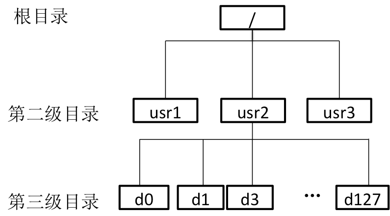

# 计算机系统基础 OS-第10次作业题目（2025春）

## 1

请在课件的基础上进行调研，总结在实现文件系统时可以从哪些方面提高文件系统的性能，简要给出相关方法的具体解决思路。

### 2

简述文件控制块（FCB）中一般都存储哪些信息。

### 3

在文件系统中，访问一个文件 $f$ 时首先需要从目录中找到与 $f$ 对应的目录项。已知文件系统数据块大小为 1KB，一个目录项的大小为 128 字节，文件平均大小为 100KB。该文件系统的目录结构如图所示。不考虑磁盘块的提前读和缓存等加速文件读写的技术，请回答以下问题：

1. 如果采用串联文件实现，同时文件属性直接存储在目录项中，并且根目录的目录项已读入内存中。访问第三级目录下的一个文件中的一个块平均需要访问几次磁盘？
2. 如果采用索引文件实现，目录项中仅存储文件名和 i 节点指针，其中文件名占 14 个字节，i 节点指针占 2 个字节。如果仅采用直接索引，每个第三级目录下的文件数不超过 50 个，且根目录的 i 节点已读入内存，访问第三级目录下的一个文件的一个块平均需要访问几次磁盘？
3. 假设该文件系统所管理的磁盘空间为 16ZB（1ZB = $2^{70}$ B）。如果 inode 中包括 512 字节的索引区，且允许采用一级间接索引进行组织，那么该文件系统支持的最大文件是多少字节？
