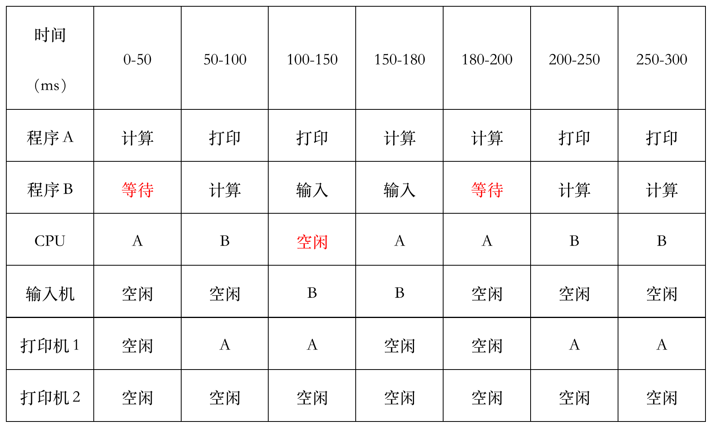

# 计算机系统基础 OS-第1次作业答案（2025春）

## 作业 1

### 1

#### 题目

什么是多道程序设计？多道程序设计与分时系统的区别是什么？

#### 答案

**答案：**

多道程序系统允许内存中同时驻留多个程序，共享 CPU 和计算机的其他资源。若某个程序因等待 I/O 操作而暂停时，立即切换到另一个就绪程序运行，提高资源利用率。

分时系统通过将 CPU 运行时间划分成若干极短片段，将这些时间片分配给各个程序，从而实现近似于多个程序同时执行的效果。其可以满足多个用户同时与系统交互的需求，达到所有用户都近似于独占系统的效果。

多道程序设计与分时系统的使用目标有很大区别。多道程序设计主要目的为提高 CPU 和内存的利用率，尽量让其始终处在工作状态。而分时系统的主要目的在于支持提供公平的资源访问，让多用户同时进行作业。

### 2

#### 题目

什么原因推动了操作系统从批处理发展到多道程序，进而发展到分时系统？

#### 答案

**答案：**

批处理→多道程序：批处理系统 CPU 利用率低下，I/O 机制导致 CPU 空闲时间过长。

多道程序→分时系统：缺乏交互性，无法满足实时操作需求，多用户同时作业需求。

### 3

#### 题目

什么是陷阱？与中断的区别是什么？什么是系统调用？

#### 答案

**答案：**

陷阱（trap）是由当前运行的程序主动或被动触发的事件，用于通知操作系统需要处理异常或者是请求服务。比如程序显式请求系统调用，或者程序中存在非法操作。
中断（interrupt）是由外部硬件设备或者定时器异步触发的，用于通知操作系统响应外部信号。比如硬件设备需要完成 I/O 操作或者定时器到期。

两者的区别如下：

1. 触发源不同：陷阱往往来自程序自身，是同步事件；中断来自外部硬件设备，是异步事件。
2. 响应方式：陷阱必须处理，而中断可被延迟或者是屏蔽。

系统调用（system call）是用户程序向操作系统请求服务的接口，触发陷阱来进入内核态，完成特权操作。是陷阱的一种应用。

### 4

#### 题目

判断：可移植的操作系统可以从一个系统架构移植到另外一个系统架构而无需修改。

1. 请解释为什么构建完全可移植的 OS 是不可能的？
2. 如果需要你设计一个高度可移植的 OS，那么请描述你需要设计的两个层次？

#### 答案

**答案：**

（1）不同 CPU 架构使用完全不同的指令集，不同架构的指令集互不兼容。而操作系统内核中与 CPU 直接交互的部分必须针对特定指令集实现，无法通用。

（2）

1. 硬件抽象层：封装底层硬件的差异性，隔离架构相关的代码，定义统一的接口，不同架构通过接口进行适配。
2. 内核服务层：构建与硬件无关的内核功能，使用统一的接口，屏蔽底层硬件差异，可在不同架构中使用。

### 5

#### 题目

在设计操作系统时，一些设计指标是相互矛盾的，例如资源利用率、吞吐量、处理时间、健壮性等。请给出一对相互矛盾的设计实例。

#### 答案

**答案：**

高吞吐量 vs 响应时间。若要维持高吞吐量，需维持长时间运行任务占用 CPU，减少上下文切换带来的开销，导致短任务等待长任务，增加延迟。而缩短延迟则必须频繁切换任务以求快速响应，导致频繁切换任务，降低吞吐量。

### 6

#### 题目

一个计算机系统有输入机一台、打印机两台，现有二道程序同时投入运行，且程序 A 先开始运行，程序 B 后运行。程序 A 的运行轨迹为：计算 50ms，打印信息 100ms，再计算 50ms，打印信息 100ms，结束。程序 B 运行的轨迹为：计算 50ms，输入数据 80ms，再计算 100ms，结束。要求：

1. 用图画出这二道程序并发执行时的工作情况。
2. 说明在二道程序运行时，CPU 有无空闲等待？若有，在哪段时间内等待？为什么会空闲等待？
3. 程序 A、B 运行时有无等待现象？在什么时候会发生等待现象？

#### 答案

**答案：**

（1）二道程序并发执行时的工作情况如下（红色标注为等待与空闲）：

（2）有，在 100-150ms 时空闲，因为程序 A 在打印，程序 B 在输入，均未计算。

（3）有，B 程序在 0-50ms 和 180-200ms 都发生了等待现象，A 程序无等待现象。
