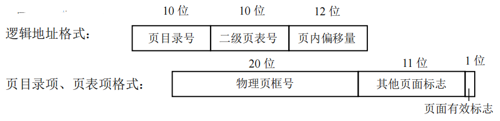
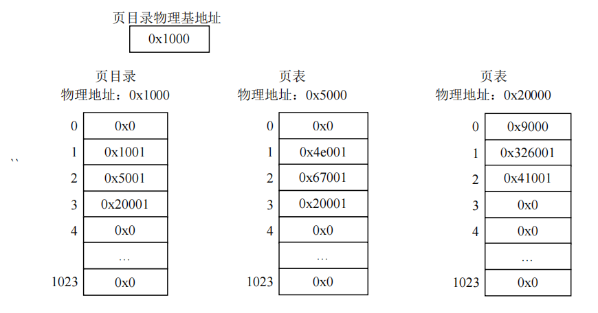
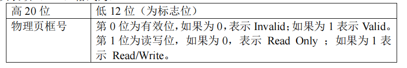
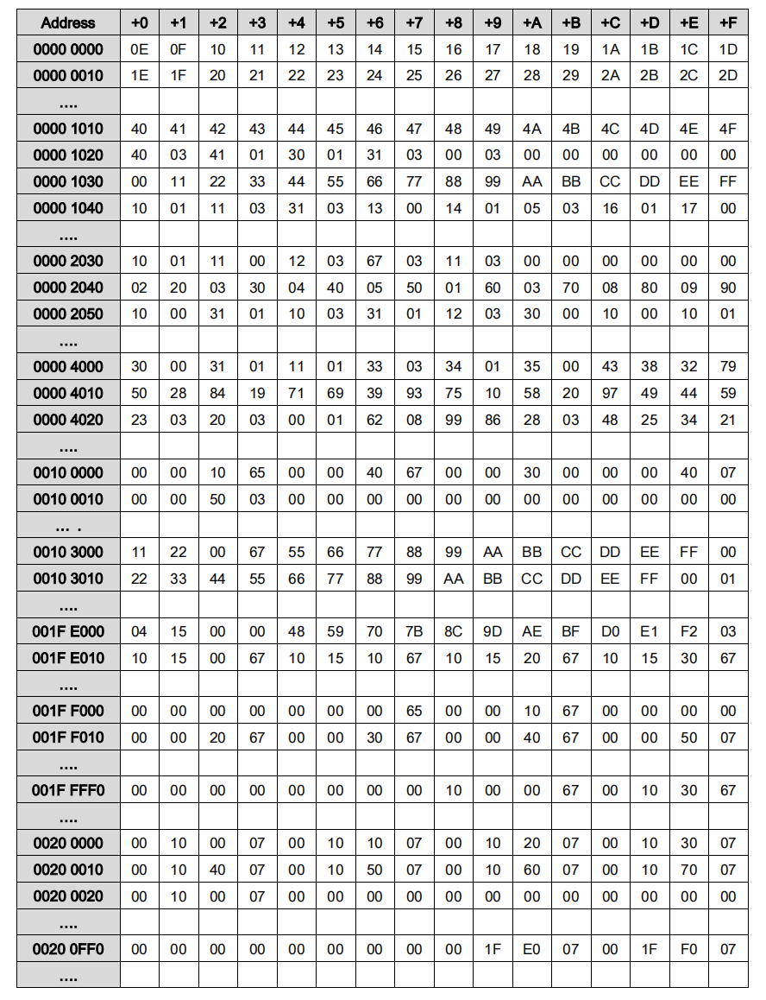

# 计算机系统基础 OS-第2+3次作业答案（2025春）

## 第 2 次作业

### 1

#### 题目

动态内存分配需要对内存分区进行管理，一般使用位图和空闲链表两种方法。128MB 的内存以 $n$ 字节为单元分配，对于链表，假设内存中数据段和空闲区交替排列，长度均为 64KB。并假设链表中的每个节点需要记录 32 位的内存地址信息、16 位长度信息和 16 位下一节点域信息。这两种方法分别需要多少字节的存储空间？哪种方法更好？

#### 答案

**答案：**

位图需要227/n个位，即224/n字节，即（16/n）MB。链表需要16KB。

因此n<1KB时，链表较好；n>1KB时，位图更好；n=1KB时，两者一样。

### 2

#### 题目

在一个交换系统中，按内存地址排列的空闲区大小是：10KB、4KB、20KB、18KB、7KB、9KB、12KB 和 15KB。对于连续的段请求：12KB、10KB、9KB。使用 FirstFit、BestFit、WorstFit 和 NextFit 将找出哪些空闲区？

#### 答案

**答案：**

FirstFit:20KB, 10KB, 18KB

BestFit: 12KB, 10KB, 9KB

WorstFit: 20KB, 18KB, 15KB

NextFit: 20KB, 18KB, 9KB

### 3

#### 题目

解释逻辑地址、物理地址、地址映射，并举例说明。

#### 答案

**答案：**

逻辑地址：程序再编译和运行时使用的地址。

物理地址：内存上实际的硬件地址。

地址映射：将逻辑地址转化为物理地址的过程。

举例：页式映射，逻辑地址为0x1234，页大小为4KB，则页号为1，页内偏移为0x234，页表1对应物理页框号0x3234。所以逻辑地址0x1234经地址映射到物理地址0x3234。

### 4

#### 题目

解释页式（段式）存储管理中为什么要设置页（段）表和快表，简述页式（段式）地址转换过程。

#### 答案

**答案：**

页表的作用是映射逻辑页到物理页框和维护内存的隔离与防护。

段表的作用是映射逻辑段到物理内存。

快表的作用是加速地址转换。

页式地址转换流程：首先拆分逻辑地址为页号和页内偏移，然后查页表获取物理页框号，最终由物理页框号和页内偏移组合生成物理地址。

### 5

#### 题目

叙述缺页中断的处理流程。

#### 答案

**答案：**

当逻辑地址不在页表当中时触发缺页中断。若地址合法，则检查物理内存有无空闲页框，有则直接使用，无则替换一个牺牲页。从外存中加载缺失页面到物理页框中。更新页表和TLB。恢复执行。

### 6

#### 题目

假设一个机器有 38 位的虚拟地址和 32 位的物理地址。

1. 与一级页表相比，多级页表的主要优点是什么？
2. 如果使用二级页表，页面大小为 16KB，每个页表项有 4 个字节。应该为虚拟地址中的第一级和第二级页表域各分配多少位？

#### 答案

**答案：**

 (1)与一级页表相比，多级页表的主要优点是什么？

 与一级页表相比，多级页表的核心优势在于节省物理内存和支持稀疏地址空间。

 (2) 如果使用二级页表，页面大小为16KB，每个页表项有4个字节。应该为虚拟地址中的第一级和第二级页表域各分配多少位？

 一级、二级各分配12位。

### 7

#### 题目

假设页面的访问存在一定的周期性循环，但周期之间会随机出现一些页面的访问。例如： $0,1,2,\dots,511,431,0,1,2,\dots,511,332,0,1,2,\dots,511$ 等。请思考：

1. LRU、FIFO 和 Clock 算法的效果如何？
2. 如果有 500 个页框，能否设计一个优于 LRU、FIFO 和 Clock 的算法？

#### 答案

**答案：**

 (1) LRU、FIFO和Clock算法的效果如何？

 三者均无法显著区分周期性页面和随机页面，导致缺页率高。

 (2) 如果有500个页框，能否设计一个优于LRU、FIFO和Clock的算法？

 把0-498号页面映射到固定页框，每次缺页中断仅置换499号页面。

### 8

#### 题目

一个交换系统通过紧缩技术来清理碎片。如果内存碎片和数据区域是随机分配的。而且假设读写 32 位内存字需要 10nsec。那么如果紧缩 128MB 的内存需要多久？简单起见，假设第 0 个字是碎片的一部分而最高位的字包含了有效的数据。

#### 答案

**答案：**

约0.671秒。

#### OS理论作业3

## 第 3 次作业

### 1

#### 题目

一个 32 位的页式虚拟存储系统采用两级页表管理，其逻辑地址中，第 22 到 31 位是第一级页表（页目录）索引，第 12 位到 21 位是第二级页表索引，页内偏移占第 0 到 11 位。每个页表（目录）项包含 20 位物理页框号和 12 位标志位，其中最后 1 位为页面有效标志。

逻辑地址格式：

| 10 位 | 10 位 | 12 位 |
| --- | --- | --- |
| 页目录号 | 二级页表号 | 页内偏移量 |

页目录项、页表项格式：

| 20 位 | 11 位 | 1 位 |
| --- | --- | --- |
| 物理页框号 | 其他页面标志 | 页面有效标志 |

1. 请问进程整个的地址空间有多少字节？一页有多少字节？
2. 一个进程如果从 0x80000000 开始映射 4MB 大小页表空间，求第一级页表（页目录）的起始逻辑地址，并指出从哪个逻辑地址可以读出第一级页表（页目录）所在的物理页框号。说明理由。（注意 B 代表字节，一个 32 位地址占 4 字节）
3. 如果当前进程的页目录物理基地址、页目录和相应页表内容如下图所示，请描述访问以下逻辑地址时系统进行地址转换的过程，如可行，给出最终访存读取到的数据。逻辑地址：0x0、0x00803004、0x00402001
4. 要想访问物理地址 0x326028，需要使用哪个逻辑地址？

页目录物理基地址：0x1000

| 索引 | 页目录（物理地址 0x1000） | 页表（物理地址 0x5000） | 页表（物理地址 0x20000） |
| --- | --- | --- | --- |
| 0 | 0x0 | 0x0 | 0x9000 |
| 1 | 0x1001 | 0x4e001 | 0x326001 |
| 2 | 0x5001 | 0x67001 | 0x41001 |
| 3 | 0x20001 | 0x20001 | 0x0 |
| 4 | 0x0 | 0x0 | 0x0 |
| ... | ... | ... | ... |
| 1023 | 0x0 | 0x0 | 0x0 |

#### 答案

**答案：**



 (1) 请问进程整个的地址空间有多少字节？一页有多少字节？

 进程整个的地址空间有4GB，一页有4KB。

 (2) 一个进程如果从 0x80000000 开始映射 4MB 大小页表空间，求第一级页表（页目录）的起始逻辑地址，并指出从哪个逻辑地址可以读出第一级页表（页目录）所在的物理页框号。说明理由。（注意 B 代表字节，一个 32 位地址占 4 字节）

 第一级页表的起始逻辑地址为0x80200000。可以从页目录自映射表项地址读出第一级页表所在的物理页框号的逻辑地址，即0x80200800。根据自映射： $PT_{base}=PD_{base}|PD_{base}>>10|PD_{base}>>20$

 (3) 如果当前进程的页目录物理基地址、页目录和相应页表内容如图下所示，请描述访问以下逻辑地址时系统进行地址转换的过程，如可行，给出最终访存读取到的数据。逻辑地址：0x0、0x00803004、0x00402001

 0x0：分解得到虚拟页目录号为0，查询得到页目录项0x0，有效标志位为0，触发缺页中断。

 0x00803004：页目录索引为2，二级页表索引号为3，页内偏移4，查询得到0x5001，有效位1；查询0x5000二级页表，物理页框基地址为0x20000；页内偏移4，得到结果0x326001。

 0x00402001：页目录索引为1，二级页表索引为2，页内偏移1，查询1号页目录项得到0x1001，查找二级页表，得到2号页表项，基地址0x5000，页内偏移1，得到数据0x0。

 (4) 要想访问物理地址 0x326028，需要使用哪个逻辑地址？

 0x00C01028。



### 2

#### 题目

一个 32 位的虚拟存储系统采用两级页表管理，其逻辑地址形式如下：

| 第一级页表（10 位） | 第二级页表（10 位） | 页内偏移（12 位） |
| --- | --- | --- |

物理地址为 32 位，形式为：

| 物理页框号（20 位） | 页内偏移（12 位） |
| --- | --- |

页表项（PTE）格式为：

| 高 20 位 | 低 12 位（为标志位） |
| --- | --- |
| 物理页框号 | 第 0 位为有效位，如果为 0，表示 Invalid；如果为 1 表示 Valid。第 1 位为读写位，如果为 0，表示 Read Only；如果为 1 表示 Read/Write。 |

假设当前进程第一级页表的物理地址为 0x0020 0000，利用后面物理内存的信息，请在下表中写出以下指令的执行结果。

对于 Load 指令，如果成功执行，写出读入的数据（读取一个字节），否则写 Error；对于 Store 指令，如果成功执行，写 OK，否则写 Error。并给出寻址过程。

| 指令 | 结果 |
| --- | --- |
| Load [0x00001022] | |
| Store [0x00C07222] | |
| Store [0x00C005BF] | |
| Load [0x00003013] | |
| Load [0xFF80078F] | |
| Load [0xFFFFF005] | |

物理内存（大尾端）：

```text
Address    +0   +1   +2   +3   +4   +5   +6   +7   +8   +9   +A   +B   +C   +D   +E   +F
0000 0000   0E   0F   10   11   12   13   14   15   16   17   18   19   1A   1B   1C   1D
0000 0010   1E   1F   20   21   22   23   24   25   26   27   28   29   2A   2B   2C   2D
....
0000 1010   40   41   42   43   44   45   46   47   48   49   4A   4B   4C   4D   4E   4F
0000 1020   40   03   41   01   30   01   31   03   00   03   00   00   00   00   00   00
0000 1030   00   11   22   33   44   55   66   77   88   99   AA   BB   CC   DD   EE   FF
0000 1040   10   01   11   03   31   03   13   00   14   01   05   03   16   01   17   00
....
0000 2030   10   01   11   00   12   03   67   03   11   03   00   00   00   00   00   00
0000 2040   02   20   03   30   04   40   05   50   01   60   03   70   08   80   09   90
0000 2050   10   00   31   01   10   03   31   01   12   03   30   00   10   00   10   01
....
0000 4000   30   00   31   01   11   01   33   03   34   01   35   00   43   38   32   79
0000 4010   50   28   84   19   71   69   39   93   75   10   58   20   97   49   44   59
0000 4020   23   03   20   03   00   01   62   08   99   86   28   03   48   25   34   21
....
0010 0000   00   00   10   65   00   00   40   67   00   00   30   00   00   00   40   07
0010 0010   00   00   50   03   00   00   00   00   00   00   00   00   00   00   00   00
....
0010 3000   11   22   00   67   55   66   77   88   99   AA   BB   CC   DD   EE   FF   00
0010 3010   22   33   44   55   66   77   88   99   AA   BB   CC   DD   EE   FF   00   01
....
001F E000   04   15   00   00   48   59   70   7B   8C   9D   AE   BF   D0   E1   F2   03
001F E010   10   15   00   67   10   15   10   67   10   15   20   67   10   15   30   67
....
001F F000   00   00   00   00   00   00   00   65   00   00   10   67   00   00   00   00
001F F010   00   00   20   67   00   00   30   67   00   00   40   67   00   00   50   07
....
001F FFF0   00   00   00   00   00   00   00   00   10   00   00   67   00   10   30   67
....
0020 0000   00   10   00   07   00   10   10   07   00   10   20   07   00   10   30   07
0020 0010   00   10   40   07   00   10   50   07   00   10   60   07   00   10   70   07
0020 0020   00   10   00   07   00   00   00   00   00   00   00   00   00   00   00   00
....
0020 0FF0   00   00   00   00   00   00   00   00   00   1F   E0   07   00   1F   F0   07
....
```

#### 答案

**答案：**

   

 物理地址为32位，形式为：


页表项（PTE）格式为：



假设当前进程第一级页表的物理地址为 0x0020 0000，利用后面物理内存的信息，请在下表中写出以下指令的执行结果。

对于 Load 指令，如果成功执行，写出读入的数据（读取一个字节），否则写 Error；对于 Store 指令，如果成功执行，写 OK，否则写 Error。并给出寻址过程。

Load[0x00001022]：0x20

页目录索引0，页目录项0x00100007，页面有效，二级页表物理基地址0x00100000；页表索引1，二级页表项0x00004067，页面有效；页面物理基地址0x00004000，页内偏移0x22，物理地址0x00004022，数据为0x20

Store[0x00C07222]：ERROR

页目录索引3，页目录项0x00103007，页面有效，二级页表物理基地址0x00103000；页表索引7，二级页表项0xEEFF0001，页面有效；倒数第二位0，只读，返回ERROR。

Store[0x00C005BF]：OK

页目录索引3，页目录项0x00103007，页面有效，二级页表物理基地址0x00103000；页表索引0，二级页表项0x11220067，页面有效；倒数第二位1，可写，写入地址0x112205BF，返回OK。

Load[0x00003013]：0x19

页目录索引0，页目录项0x00100007，页面有效，二级页表物理基地址0x00100000；页表索引3，二级页表项0x00004007，页面有效；页面物理基地址0x00004000，页内偏移0x13，物理地址0x00004013，数据为0x19

Load[0xFF80078F]：ERROR

页目录索引0x3FE，页目录项0x001FE007，页面有效，二级页表物理基地址0x001FE000；页表索引0，二级页表项0x04150000，页面无效，返回ERROR。

Load[0xFFFFF005]：0x66

页目录索引0x3FF，页目录项0x001FF007，页面有效，二级页表物理基地址0x001FF000；页表索引0x3FF，二级页表项0x00103067，页面有效；页面物理基地址0x00103000，页内偏移0x5，物理地址0x00103005，数据为0x66

物理内存（大尾端）


