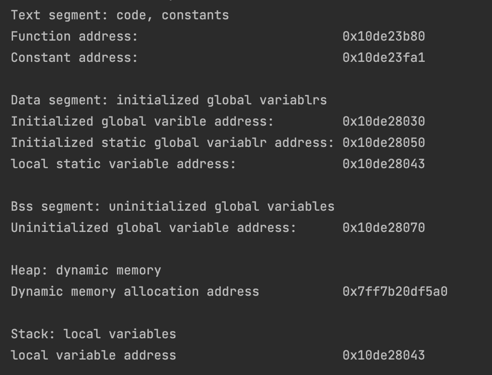

# 计算机系统基础 OS-第2次作业答案（2025春）

## 1

### 题目

假设有一个简单的计算机硬件系统，CPU 是同学们自己设计的，有内存和硬盘（可以没有 MMU），请设计一个尽量简单的启动过程。（要求：列出必要的硬件支持、启动软件的基本功能和启动过程，只要将控制权交给操作系统镜像就算完成启动）

### 答案

**答案：**

硬件支持：

- MIPS体系结构CPU
- Bootloader写在ROM上
-

具体启动过程为分为两个过程，Stage1和Stage2

 CPU上电， 取指寄存器复位到固定值

Stage1: 读取ROM上汇编代码，进行硬件初始化，为Stage2初始化RAM，载入Stage2到RAM，设置堆栈并跳转到Stage2入口

Stage2:在RAM中运行，初始化本阶段所需要硬件设备，载入内核和根文件系统，为内核设置参数，跳转到内核入口

内核完成各类初始化工作了，操作系统启动完成，将控制权交给操作系统

## 2

### 题目

编写一段程序，分别输出属于该程序代码段、数据段、堆和栈的地址。（提示：不要求一定要输出各个段的首地址，不要编一个 ELF 解析程序，只要输出不同类型变量的地址就可以。）

### 答案

**答案：**

```c
#include <stdio.h>
#include <stdlib.h>
#include <string.h>
void code(){
    printf("this is code");
}
const char constans_variable[] = "constans";
char initialized_global_variable[] = "initialized_global";
static char initialized_global_static_variable[] = "initialized_global_static";
char uninitialized_global_variable[100];

int main()
{
    strcpy(uninitialized_global_variable, "uninitialized_global_variable");
    static char local_static_variable[] = "local_static";
    char* dynamic_memory;
    dynamic_memory = (char *)malloc(sizeof(char) * 100);
    char local[] = "local";
    printf("Text segment: code, constants\n");
    printf("Function address:                            %p\n", &code);
    printf("Constant address:                           %p\n", &constans_variable);
    printf("\n");
    printf("Data segment: initialized global variablrs\n");
    printf("Initialized global varible address:            %p\n", &initialized_global_variable);
    printf("Initialized static global variablr address: %p\n", initialized_global_static_variable);
    printf("local static variable address:              %p\n", local_static_variable);
    printf("\n");
    printf("Bss segment: uninitialized global variables\n");
    printf("Uninitialized global variable address:      %p\n", &uninitialized_global_variable);
    printf("\n");
    printf("Heap: dynamic memory\n");
    printf("Dynamic memory allocation address           %p\n", &dynamic_memory);
    printf("\n");
    printf("Stack: local variables\n");
    printf("local variable address                      %p\n", &local_static_variable);
    return 0;
}
```



从结果中可以看出，常量和函数一起放入TEXT段，而TEXT、DATA、BSS和堆依次从低地址空间往高地址延伸，栈空间从高地址向低地址延伸

## 3

### 题目

动态内存分配需要对内存分区进行管理，一般使用位图和空闲链表两种方法。128MB 的内存以 $n$ 字节为单元分配，对于链表，假设内存中数据段和空闲区交替排列，长度均为 64KB。并假设链表中的每个节点需要记录 32 位的内存地址信息、16 位长度信息和 16 位下一节点域信息。这两种方法分别需要多少字节的存储空间？哪种方法更好？

### 答案

**答案：**

对于位图方法，可以用每一个比特代表每一个内存单元的分配情况，如果为0表示未分配，为1表示已分配，128MB的内存共有 $\frac{128}{n}$个内存单元，每个单元对应一个比特，位图总共要占用 $\frac{128}{n}$ 个比特，即 $\frac{16}{n}$MB

链表记录每一块连续内存的相关信息，128MB内存的空间数据段和空闲区交替排列，每段64KB，则需要 $\frac{128\mathrm{MB}/2}{64\mathrm{KB}}=1\mathrm{K}$个段需要记录，链表有1K个节点，每个节点需要 $32+16+16=64$个比特记录，那么链表需要 $1\mathrm{K}*8\mathrm{B}=8\mathrm{KB}$的空间。

如果仅从存储信息所消耗空间代价来看，位图法在 $\mathrm{n}>2048\mathrm{B}$,即分配单元大于2KB的情况下，更好，反之链表法更好。 但是我们在实际应用时需要考虑链表查找时所花费的时间代价，以及位图法的容错能力价差。

## 4

### 题目

在一个内存系统中，按内存地址排列的空闲区大小是：10KB、4KB、20KB、18KB、7KB、9KB、12KB 和 15KB。对于连续的内存请求：12KB、10KB、9KB。使用 FirstFit、BestFit、WorstFit 和 NextFit 将找出哪些空闲区？

### 答案

**答案：**

| 空闲区号 | 1 | 2 | 3 | 4 | 5 | 6 | 7 | 8 |
| --- | --- | --- | --- | --- | --- | --- | --- | --- |
| 空闲区大小 | 10KB | 4KB | 20KB | 18KB | 7KB | 9KB | 12KB | 15KB |

FirstFit为从前往后找到第一个满足需求的内存快，第一个请求12KB会占用3号空闲区，3号变为8KB大小，然后10KB找到第1个空闲区，然后第1个空闲去变为0，然后第3个请求9KB会找到第4个空闲区，第4个空闲区变为9KB

| 空闲区号 | 1 | 2 | 3 | 4 | 5 | 6 | 7 | 8 |
| --- | --- | --- | --- | --- | --- | --- | --- | --- |
| 空闲区大小 | 0KB | 4KB | 8KB | 9KB | 7KB | 9KB | 12KB | 15KB |

BestFit为找到与请求最为接近的空闲区进行分配，12KB请回会找到第7个空闲区，然后第7个空闲区变为0KB，然后第2个请求10KB会找到第1个空闲区，第1个空闲区变为0，第3个请求9KB会找到第6个空闲区，然后第6个空闲区变为0，分配之后的空闲区大小为

| 空闲区号 | 1 | 2 | 3 | 4 | 5 | 6 | 7 | 8 |
| --- | --- | --- | --- | --- | --- | --- | --- | --- |
| 空闲区大小 | 0KB | 4KB | 20KB | 18KB | 7KB | 0KB | 0KB | 15KB |

WorstFit为每次寻找到最大的分区来分配，12KB请求会找到第3个空闲区，第3个空闲区变为8KB，10KB请求会找到第4个空闲区，第4个空闲区会变为8KB，然后9KB请求会找到第8个空闲区，第8个空闲区变为6KB。WorstFit会降低产生内碎片的概率，但是会使大的内存区得到分割，当一个较大的请求作业来的时候会没有足够大的连续空间。

| 空闲区号 | 1 | 2 | 3 | 4 | 5 | 6 | 7 | 8 |
| --- | --- | --- | --- | --- | --- | --- | --- | --- |
| 空闲区大小 | 10KB | 4KB | 8KB | 8KB | 7KB | 9KB | 12KB | 6KB |

NextFit每一次从上一次分配请求空间的下一块空间开始查找，寻找到第一个能满足需求的空间，12KB会找到3号空闲区，3号空闲区变为8KB，10KB请求会找到4号空闲区，4号空闲区变为8KB，9KB请求会找到6号空闲区，6号空闲区变为0KB，NextFit不会使小的内碎片击中在内存的前面部分，但是也容易分割大块空闲区。

| 空闲区号 | 1 | 2 | 3 | 4 | 5 | 6 | 7 | 8 |
| --- | --- | --- | --- | --- | --- | --- | --- | --- |
| 空闲区大小 | 10KB | 4KB | 8KB | 8KB | 7KB | 0KB | 12KB | 15KB |

## 5

### 题目

解释逻辑地址、物理地址、地址映射，并举例说明。

### 答案

**答案：**

逻辑地址是用户编写程序时所用到的地址，物理地址是内存中实际的地址，地址映射是指将逻辑地址转换为物理地址的过程。

例如在我们课程中的32位MIPS体系结构来说，每一个进程都有独立的4GB逻辑地址空间，被分为不同用途的区域，kuseg，kseg0，kseg1，kseg2都有各自的地址映射方式映射到物理内存的空间，有通过MMU进行转换，也有高位清零的转换。例如地址处于 0x80000000~0x9fffffff (kseg0)，则将虚拟地址的最高位置 0得到物理地址，通过 cache 访存。
