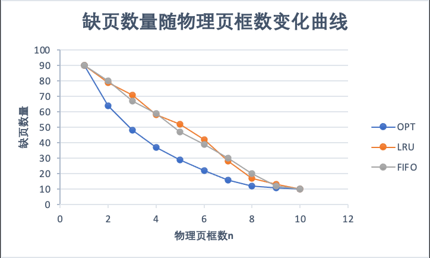

# 计算机系统基础 OS-第3次作业答案（2025春）

## 1

### 题目

叙述缺页中断的处理流程。

### 答案

**答案：**

  在进程执行的过程中访问的页面不在物理内存时，发生缺页中断，需要进行页面替换，步骤如下

1. **保护现场** 陷入内核态，保存必要的信息（OS以及用户进程状态的相关信息
2. **页面定位**   查找发生缺页中断的虚拟页面。这个虚拟页面的相关信息会保存在某一个寄存器中，否则，操作系统必须检索程序计数器，取出这一条相关指令，分析该指令，找出发生页面中断的虚拟页面地址。
3. **权限检查** 检查找到的虚拟页面地址的有效性以及安全保护位。一旦发生保护错误，kill该进程。
4. **调入新页面** 查找一个空闲的页框，即物理内存的页面。如果没有空闲页框，需要通过页面置换算法找到一个需要换出去的页框
5. **写回旧页面** 如果找到的需要替换出去的页框已经发生了修改，则需要将修改之后的内容保存到磁盘上。此时，将该页框置为忙状态。
6. **新页面调入** 页框保存之后，操作系统将要使用的页面在磁盘上的保存的内容复制到这个替换之后的页框中。
7. 步骤5，6会产生写磁盘调用信号，发生上下文切换。
8. **更新页表** 当磁盘中页面内容都装入页框后，向CPU发送一个中断信号。操作系统更新内存中的页表项，将虚拟页面映射的页框号修改为写入的页框，并将页框标记为正常状态。
9. **恢复现场** 恢复缺页中断前的状态，将程序指针重新指向引起缺页中断的指令
10. **继续执行** 程序重新执行引发缺页中断的指令。

## 2

### 题目

假设页面的访问存在一定的周期性循环，但周期之间会随机出现一些页面的访问。例如： $0,1,2,\dots,511,431,0,1,2,\dots,511,332,0,1,2,\dots,511$ 等。请思考：

1. LRU、FIFO 和 Clock 算法的效果如何？
2. 如果有 500 个页框，能否设计一个优于 LRU、FIFO 和 Clock 的算法？

### 答案

**答案：**

 (1) LRU、FIFO和Clock算法的效果如何?
 (2) 如果有500个页框，能否设计一个优于LRU、FIFO和Clock的算法?

**答：**（1）根据题目描述，共有512个页面需要进行加载到内存中。

 如果物理页框数大于等于512，除了第一次循环所有页面会发生缺页中断以外以后，不管哪一种算法之后的每一次访问都不会发生缺页中断，因为这几种算法都没有实际使用过

 如果物理页框数小于512，那么这三种算法几乎是等同的比较差。对于FIFO算法，在物理页框装满之后，需要淘汰最初装入的页面，周期性循环中每一个物理页面淘汰之前都等不到该循环中的物理页再次出现，一定会被淘汰，所以除了随机出现的那一个页面，其余页面访问都会发生缺页中断。CLock算法会给再一次访问的页面“第二次机会”，但是在题目中所描述的周期性循环中，等待被淘汰的页面中除了部分随机访问的页面，大概率不会再次出现，大部分页面大概率都会发生缺页中断。对于LRU算法，与前面两种几乎相同，LRU算法是淘汰最久没有用到的页面，题目中所说的周期性循环中，最久没有用到的页面与最先访问的页面几乎是等价的，所以LRU几乎全部页面访问会发生缺页中断。

 所以，综合两种情况，FIFO、Clock、LRU效果基本相同。

（2）采取FILO方法，先入后出的算法，第一次加载页面时会将前500个页面发生中断，装满之后后面12个页面和随机出现需要替换的页面只在第500个页框发生替换。那么前面499个页框不会发生替换，只替换第500个页框，前面499个页面都会命中。所以命中率大约为 $\frac{512}{500}$,缺页率为 $\frac{512}{12}$ ，效果远好于第一问三种算法。

## 3

### 题目

假设有 10 个页面， $n$ 个页框。页面的访问顺序为

$$0, 9, 8, 4, 4, 3, 6, 5, 1, 5, 0, 2, 1, 1, 1, 1, 8, 8, 5, 3, 9, 8, 9, 9, 6, 1, 8, 4, 6, 4, 3, 7, 1, 3, 2, 9, 8, 6, 2, 9, 2, 7, 2, 7, 8, 4, 2, 3, 0, 1, 9, 4,$$
$$7, 1, 5, 9, 1, 7, 3, 4, 3, 7, 1, 0, 3, 5, 9, 9, 4, 9, 6, 1, 7, 5, 9, 4, 9, 7, 3, 6, 7, 7, 4, 5, 3, 5, 3, 1, 5, 6, 1,$$
$$1, 9, 6, 6, 4, 0, 9, 4, 3$$

当 $n$ 在 $[1,10]$ 中取值时，请编写程序实现 OPT、LRU、FIFO 页面置换算法，并根据页面访问顺序模拟执行，分别计算缺页数量，画出缺页数量随页框数 $n$ 的变化曲线（3 条线）。

### 答案

**答案：**

 答：用python计算三种页面置换算法的缺页数量

  OPT：循环访问请求数组，如果命中就跳过，未命中就发生缺页中断，缺页数量加1，然后检测那物理页框中一个页面最晚被用到，然后替换着一个页面。代码如下

```python
def opt_replace(i, framce_use, page_request_list):
    after = page_request_list[i+1 : ]
    replace = framce_use[0]
    next_use = 0
    for p in framce_use:
        if p in after:
            if after.index(p) > next_use:
                replace = p
                next_use = after.index(p)
        else:
            replace = p
            break
    return replace

def opt(frame_num, page_request_list):
    page_miss = 0
    frame_use = []
    replace = 0
    for i in range(len(page_request_list)):
        pnum = page_request_list[i]
        if pnum in frame_use:
            replace = opt_replace(i, frame_use, page_request_list)
            continue
        else:
            page_miss += 1
            if len(frame_use) < frame_num:
                frame_use.append(pnum)
                replace = opt_replace(i, frame_use, page_request_list)
                continue
            frame_use[frame_use.index(replace)] = pnum
            replace = opt_replace(i, frame_use, page_request_list)
    return page_miss
```

 LRU：循环访问请求数组，如果命中，说明是第二次访问，则需要将这一个页面移到队尾。如果未命中发生缺页中断，缺页数量加1，然后替换队列队头物理页框中的页面，代码如下：

```python
def LRU(frame_num, page_request_list):
    page_miss = 0
    frame_use = []
    for pnum in page_request_list:
        if pnum in frame_use:
            frame_use.remove(pnum)
            frame_use.append(pnum)
            continue
        else:
            page_miss += 1
            if len(frame_use) < frame_num:
                frame_use.append(pnum)
                continue
            else:
                frame_use.remove(frame_use[0])
                frame_use.append(pnum)
    return page_miss
```

 FIFO：循环访问请求数组，如果命中，则跳过。如果未命中发生缺页中断，缺页数量加1，然后替换队列队头物理页框中的页面，代码如下：

```python
def FIFO(frame_num, page_request_list):
    page_miss = 0
    page_use = []
    for pnum in page_request_list:
        if pnum in page_use:
            continue
        else:
            page_miss += 1
            if len(page_use) < frame_num:
                page_use.append(pnum)
            else:
                page_use.remove(page_use[0])
                page_use.append(pnum)
    return page_miss
```

最终结果计算三种算法的缺页数量如下表

| 物理页框数 | 1 | 2 | 3 | 4 | 5 | 6 | 7 | 8 | 9 | 10 |
| --- | --- | --- | --- | --- | --- | --- | --- | --- | --- | --- |
| OPT | 90 | 64 | 48 | 37 | 29 | 22 | 16 | 12 | 11 | 10 |
| LRU | 90 | 79 | 71 | 58 | 52 | 42 | 28 | 17 | 13 | 10 |
| FIFO | 90 | 80 | 67 | 59 | 47 | 39 | 30 | 20 | 12 | 10 |

三种算法缺页数量随页框数n的变化曲线如下



## 4

### 题目

一个 32 位的虚拟存储系统有两级页表，其逻辑地址中，第 22 到 31 位是第一级页表，12 位到 21 位是第二级页表，页内偏移占 0 到 11 位。一个进程的地址空间为 4GB，如果从 0x80000000 开始映射 4MB 大小页表空间，请问第一级页表所占 4KB 空间的起始地址？并说明理由。（注意 B 代表字节，一个 32 位地址占 4 字节）

### 答案

**答案：**

答：0x80020000。

理由：以0x8000000为起始地址映射4MB大小页表空间，这4MB本身时第0x80000000 >>12=0x8000个页表，每一个页表项占4B，一级页表地址相对于0x80000000的偏移为0x20000，所以一级页表所占4KB空间的起始地址为0x80000000+0x20000=0x80020000

## 5

### 题目

一个 32 位的虚拟存储系统有两级页表，其逻辑地址中，第 22 到 31 位是第一级页表（页目录）的索引，第 12 位到 21 位是第二级页表的索引，页内偏移占第 0 到 11 位。每个页表（目录）项包含 20 位物理页框号和 12 位标志位，其中最后 1 位为页有效位。

虚拟地址格式：

| 10 位 | 10 位 | 12 位 |
| --- | --- | --- |
| 页目录号 | 二级页表号 | 页内偏移量 |

页目录项、页表项格式：

| 20 位 | 11 位 | 1 位 |
| --- | --- | --- |
| 物理页框号 | 其他页面标志 | 页面有效标志 |

1. 请问进程整个的地址空间有多少字节？一页有多少字节？
2. 如果当前进程的页目录物理基地址、页目录和相应页表内容如下图所示，请描述访问以下虚拟地址时系统进行地址转换的过程，如可行给出最终访存获取到的数据。虚拟地址：0x0、0x00803004、0x00402001
3. 要想访问物理地址 0x326028，需要使用哪个虚拟地址？

页目录物理基地址：0x1000

| 索引 | 页目录（物理地址 0x1000） | 页表（物理地址 0x5000） | 页表（物理地址 0x20000） |
| --- | --- | --- | --- |
| 0 | 0x0 | 0x0 | 0x9000 |
| 1 | 0x1001 | 0x4e001 | 0x326001 |
| 2 | 0x5001 | 0x67001 | 0x41001 |
| 3 | 0x20001 | 0x20001 | 0x0 |
| 4 | 0x0 | 0x0 | 0x0 |
| ... | ... | ... | ... |
| 1023 | 0x0 | 0x0 | 0x0 |

### 答案

**答案：**

 (1)  请问进程整个的地址空间有多少字节?一页有多少字节?

 (2)  如果当前进程的页目录物理基地质、页目录和相应页表内容如图下所示，请 描述访问以下虚拟地址时 系统进行地址转换的过程，如可行给出最终访存获

 取到的数据。虚拟地址:0x0、0x00803004、0x00402001

 (3)  要想访问物理地址0x326028，需要使用哪个虚拟地址?

 答：（1）进程整个地址空间有32位4GB字节，页内偏移为12位，所以一页有4K个字节

   （2）虚拟地址0x0， 有效位位0，访问页目录的第0项，得到0x0，页面有效位位0，页面还没有装入内    存中，发生缺页中断。

 虚地址0x0080_3004=0b_0000_0000_1000_0000_0011_0000_0000_0100，页目录号0b00_0000_0010      查找页目录项2，页表物理地址为0x5000，有效位位1，二级页表号位0b00_0000_0011,二级页表找     到第3项，有效位位1，物理页框号位0x20，所以对应物理地址为0x0002_0004，得到的数据为          0b0000_0001。

 虚地址0x00402001=0b_0000_0000_0100_0000_0010_0000_0000_0001,页目录号0b_00_0000_0001,

 查找页目录第1项，有效位位1，页表物理地址为0x1000，二级页表号位0x00_0000_0011,查找           0x1000处页表的第3项0x20001,有效位为0，页面物理地址为0x20000加上页内偏移量得到物理地址     为0x0002_0001,读取数据为0b_0000_0000。

(3) 物理地址为 0x326028。页内偏移为0x028，物理页框号为0x326,则对应二级页表项为0x326001,在     0x20000处的页表的第1项为0x326001，二级页表号位位，0b_00_0000_0001, 所以对应页目录项为     0x20001，为页目录的第3项，所以页目录号位0b_00_0000_0011。所以虚拟地址为              0b_0000_0000_1100_0000_0001_0000_0010_1000,即0x00c0_1028。
