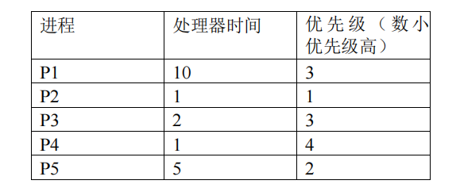
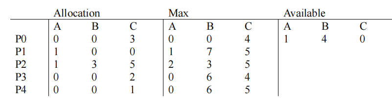

# 计算机系统基础 OS-第5次作业答案（2025春）

## 1

### 题目

有五个进程 P1、P2、P3、P4、P5，它们同时依次进入就绪队列，它们的优先数和需要的处理器时间如下表

| 进程 | 处理器时间 | 优先级（数小优先级高） |
| --- | --- | --- |
| P1 | 10 | 3 |
| P2 | 1 | 1 |
| P3 | 2 | 3 |
| P4 | 1 | 4 |
| P5 | 5 | 2 |

忽略进行调度等所花费的时间，回答下列问题：

1. 写出采用“先来先服务”、“短作业（进程）优先”、“非抢占式的优先数”和“轮转法”等调度算法，进程执行的次序。（其中轮转法的时间片为 2）
2. 分别计算上述算法中各进程的周转时间和等待时间，以及平均周转时间。

### 答案

**答案：**

 忽略进行调度等所花费的时间，回答下列问题：

 (1)写出采用“先来先服务”、“短作业（进程）优先”、“非抢占式的优先数”和“轮转法”等调度算法，进程执行的次序。（其中轮转法的时间片为2）

- 先来先服务：P1, P2, P3, P4, P5

- 短作业优先：P2, P4, P3, P5, P1

- 非抢占式的优先数：P2, P5, P1, P3, P4

- 轮转法：P1, P2, P3, P4, P5, P1, P3, P5, P1, P5, P1

 (2)分别计算上述算法中各进程的周转时间和等待时间，以及平均周转时间。

- 先来先去服务：

| 进程 | 周转时间 | 等待时间 |
| --- | --- | --- |
| P1 | 10 | 0 |
| P2 | 11 | 10 |
| P3 | 13 | 11 |
| P4 | 14 | 13 |
| P5 | 19 | 14 |
| 平均 | 13.4 | 9.6 |

- 短作业优先：

| 进程 | 周转时间 | 等待时间 |
| --- | --- | --- |
| P2 | 1 | 0 |
| P4 | 2 | 1 |
| P3 | 4 | 2 |
| P5 | 9 | 4 |
| P1 | 19 | 9 |
| 平均 | 7 | 3.2 |

- 非抢占式的优先数：

| 进程 | 完成时间 | 周转时间 | 等待时间 |
| --- | --- | --- | --- |
| P2 | 1 | 1 | 0 |
| P5 | 6 | 5 | 1 |
| P1 | 16 | 10 | 6 |
| P3 | 18 | 2 | 16 |
| P4 | 19 | 1 | 18 |
| 平均 | | 3.8 | 8.2 |

- 轮转法：

| 进程 | 完成时间 | 周转时间 | 等待时间 |
| --- | --- | --- | --- |
| P1 | 20 | 10 | 10 |
| P2 | 3 | 1 | 2 |
| P3 | 7 | 2 | 5 |
| P4 | 4 | 1 | 3 |
| P5 | 15 | 5 | 10 |
| 平均 | | 3.8 | 6 |

## 2

### 题目

假设某系统使用时间片轮转调度算法进行 CPU 调度，时间片大小为 5ms，系统共 10 个进程，初始时均处于就绪队列，执行结束前仅处于执行态或就绪态。若队尾的进程 P 所需的 CPU 时间最短，时间为 25ms，不考虑系统开销，则进程 P 的周转时间为？

### 答案

**答案：**

250ms。

## 3

### 题目

某个进程调度程序采用基于优先数（priority）的调度策略，即选择优先数最小的进程运行，运行创建时由用户指定一个 nice 作为静态优先数。为了动态调整优先数，引入运行时间 cpuTime 和等待时间 waitTime，初值为 0。进程处于执行态时，cpuTime 定时加 1，且 waitTime 置 0；进程处于就绪态时，cpuTime 置 0，waitTime 定时加 1。

1. 若调度程序只将 nice 的值作为进程优先数，即 priority = nice，则可能出现饥饿现象。为什么？
2. 使用 nice、cpuTime、waitTime 设计一种动态优先数计算方法，以避免产生饥饿现象，并说明 waitTime 的作用。

### 答案

**答案：**

   (1)若调度程序只将nice的值作为进程优先数，即priority = nice，则可能出现饥饿现象。为什么？

饥饿现象指某些进程长时间无法获得CPU执行机会。当调度程序仅使用静态的 `nice` 值作为优先数（priority = nice）时，优先数较小的进程（优先级高）总是优先被调度执行。如果系统中存在优先数较小的高优先级进程持续处于就绪状态（例如，这些进程频繁产生新任务或计算密集），那么优先数较大的低优先级进程将长期无法被调度。因为调度决策仅基于静态 nice，不考虑进程的等待时间或历史执行情况，低优先级进程的优先数不会随时间变化而改善其调度机会。结果，低优先级进程（如nice值较大的进程）可能无限期等待，导致饥饿现象。

 (2)使用nice，cpuTime，waitTime设计一种动态优先数计算方法，以避免产生饥饿现象，并说明waitTime的作用

$priority=nice+β×cpuTime−α×waitTime$

waitTime作用：waitTime的核心作用是避免饥饿。在动态优先数计算中，waitTIme作为递增因子（与 α结合），使优先数随时间等待而减小，从而提升进程的优先级。这确保了即使低优先级（nice 值大）进程，其 waitTime 增长后 priority会降至足够低（优先级升高），最终获得执行机会。一旦进程被调度，waitTime重置为0，进程从基础 nice 优先级重新开始，避免了无限期延迟。

## 4

### 题目

1. 有 $m$ 个同类资源供 $n$ 个进程共享，若每个进程最多申请 $k$ 个资源（ $k \ge 1$），采用银行家算法分配资源，为保证系统不发生死锁，则各进程的最大需求量之和为？并说明理由。
2. 有 8 台打印机，由 $K$ 个进程竞争使用，每个进程最多使用 3 台打印机。求 $K$ 的最小值，使系统可能发生死锁。
3. 某系统有 $n$ 台互斥使用的同类设备，三个并发进程分别需要 3、4、5 台设备。求 $n$ 的最小值，使系统不发生死锁。

### 答案

**答案：**

$n×k≤m+n−1$

银行家算法通过确保系统始终处于安全状态来避免死锁。一个关键的安全条件是：系统必须有足够的资源来满足至少一个进程的最大需求，即使在最坏情况下（所有进程都只差一个资源就能完成）。最坏情况：每个进程都已获得 k−1个资源，并正在申请最后一个资源。此时，系统已分配的资源总数为 n×(k−1)，剩余资源数为 m−n×(k−1)。为避免死锁，剩余资源数必须至少为 1，以便至少一个进程能获得所需资源并完成，释放其占用的资源。因此：m−n×(k−1)≥1，整理得：n×k≤m+n−1。此条件保证了系统总能在最坏情况下分配资源，避免死锁。若不满足此条件，则可能发生死锁。

 （2）有8台打印机，由K个进程竞争使用，每个进程最多使用3台打印机。求K的最小值，使系统可能发生死锁。

系统可能发生死锁的最小 K 值为 4。

 （3）某系统有n台互斥使用的同类设备，三个并发进程分别需要3，4，5台设备。求n的最小值，使系统不发生死锁。

系统不发生死锁的最小 n 值为 10。

## 5

### 题目

假设具有 5 个进程的进程集合 $P=\{P0,P1,P2,P3,P4\}$，系统中有三类资源 A、B、C，假设在某时刻有如下状态：

| 进程 | Allocation A | Allocation B | Allocation C | Max A | Max B | Max C |
| --- | --- | --- | --- | --- | --- | --- |
| P0 | 0 | 0 | 3 | 0 | 0 | 4 |
| P1 | 1 | 0 | 0 | 1 | 7 | 5 |
| P2 | 1 | 3 | 5 | 2 | 3 | 5 |
| P3 | 0 | 0 | 2 | 0 | 6 | 4 |
| P4 | 0 | 0 | 1 | 0 | 6 | 5 |

Available = (1, 4, 0)

1. 根据上表内容，当前系统是否处于安全状态？
2. 若系统中的可利用资源 Available 为（0,6,2），系统是否安全？若系统处在安全状态，请给出安全序列；若系统处在非安全状态，简要说明原因。

### 答案

**答案：**

 (1)根据上表内容，当前系统是否处于安全状态？

安全。

 (2)若系统中的可利用资源 Available 为（0,6,2），系统是否安全？若系统处在安全状态，请给出安全序列；若系统处在非安全状态，简要说明原因。

安全，安全序列为：P0, P2, P1, P3, P4。

## 6

### 题目

分析磁盘访问数据的时间。假设磁盘请求以柱面 10、35、20、70、2、3 和 38 的次序进入磁盘驱动器。寻道时磁头每移动一个柱面需要 5ms，以下各算法所需的寻道时间是多少：

1. 先来先服务
2. 最短寻道时间优先
3. SCAN 算法
4. CSCAN 算法（磁头总是从编号小的磁道向编号大的磁道扫描）

说明：假设以上三种情况磁头初始位置为 15。对于（3）和（4），磁头当前向大柱面号方向运行，磁盘最大柱面号为 85。

### 答案

**答案：**

   a. 先来先服务

   995ms

   b. 最短寻道时间优先

   405ms

   c. SCAN算法

   775ms

   d. CSCAN算法(磁头总是从编号小的磁道向编号大的磁道扫描)

   1200ms

   说明：假设以上三种情况磁头初始位置为15。对于（3）和（4），磁头当前向大柱面号方向运行，磁盘最大柱面号为85。

## 7

### 题目

在 I/O 系统中引入缓冲区的主要目标是什么？某文件占 8 个磁盘块，现要把该文件的磁盘块逐个读入主存缓冲区，并送用户区进行分析。一个缓冲区与磁盘块大小相等。把一个磁盘块读入缓冲区的时间为 100μs，缓冲区数据传送到用户区的时间是 50μs，CPU 对一块数据进行分析的时间为 50μs。分别计算在单缓冲区和双缓冲区结构下，分析完该文件的时间是多少？

### 答案

**答案：**

主要目标：

- 减少CPU等待时间：通过允许CPU和I/O设备并行工作，当I/O设备在进行数据传输时，CPU可以处理其他任务，从而提高系统效率。
- 平滑数据流：缓冲数据以匹配生产者和消费者的速度差异（例如，磁盘I/O速度与CPU处理速度），避免因速度不匹配导致的阻塞。
- 提高吞吐量：通过重叠I/O操作和CPU处理，减少整体处理时间。
- 支持异步操作：进程可以继续执行而不必等待I/O完成，增强系统响应性。
- 减少中断频率：缓冲区可以累积数据，减少对CPU的中断次数。

单缓冲区结构下1250μs，双缓冲区结构下900μs。
