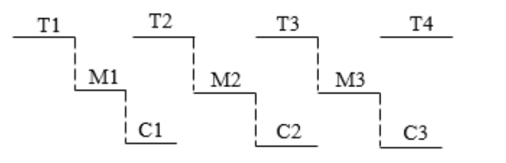
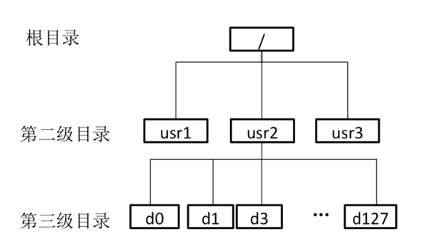

# 计算机系统基础 OS-第6次作业答案（2025春）

## 1

### 题目

I/O 控制有哪几种？简述它们区别。

### 答案

**答案：**

 主要有4种，分别为程序控制I/O（Programmed I/O)，中断驱动方式(Interrupt-drive I/O),直接储存访问(Direct Memory Access), 通道技术(Channel)

区别如下

 程序控制I/O方式需要CPU在进行I/O操作时保持忙等待状态。中断驱动与它的区别在于进行I/O操作时释放了CPU，IO完成后可以通过触发中断使CPU进行处理。DMA相对于中断驱动更进一步的地方在于，一方面可以处理一批数据之后再通知CPU，而中断驱动是在每一个IO操作完成后触发中断。另外，中断驱动触发中断需要进行上下文切换等操作，而DMA是由控制器完成，只有在开始和结束时才通知CPU。通道技术在DMA的基础上进一步减少了CPU的干预过程，通过使用独立于CPU的指令体系，可以进行较复杂的IO操作。

## 2

### 题目

何为设备独立性？如何实现设备独立性？

### 答案

**答案：**

 设备独立性是指操作系统把所有外设设备统一当作文件来看待，只要安装它们的驱动程序，任何用户都可以像使用文件一样，操纵使用这些设备，而不必知道它们的具体存在形式。为了提高操作系统的可适应性和拓展性，在现在操作系统中都毫无例外地实现了设备独立性，也称为设备无关性。即应用程序独立于具体使用的物理设备

 为了实现设备独立性，现代操作系统引入了逻辑设备和物理设备这两个概念，在应用程序中使用逻辑设备名称请求使用某类设备，而系统在实际执行这类请求时，还必须使用物理设备名称。系统需具有将逻辑设备名称转换为物理设备名称的功能。

## 3

### 题目

在 I/O 系统中引入缓冲的主要原因是什么？某文件占 10 个磁盘块，现要把该文件的磁盘块逐个读入主存缓冲区，并送用户区进行分析。一个缓冲区与磁盘块大小相等。把一个磁盘块读入缓冲区的时间为 100μs，缓冲区数据传送到用户区的时间是 50μs，CPU 对一块数据进行分析的时间为 50μs。分别计算在单缓冲区和双缓冲区结构下，分析完该文件的时间是多少？

### 答案

**答案：**

答：在I/O系统中引入缓冲的主要原因是：提高外设的利用率，用于匹配CPU和外设的不同处理速度，减少对CPU的中断次数，提高COU和I/O设备之间的并行性。

单缓冲结构下数据IO的过程如下，T代表了读入缓冲区的时间，M代表缓冲区传送到用户区的时间，C代表CPU对数据进行分析的时间：

由于读入时间T大雨处理时间C，所以每一个磁盘块数据需要的时间为T+M=150 $\mu$s,所有数据完成的时间为 $T_1=(T+M)*10+C=1550\mu$s.
双缓冲结构数据IO示意过程如下，T代表了读入缓冲区的时间，M代表缓冲区传送到用户区的时间，C代表CPU对数据进行分析的时间：

在CPU传输和处理一个缓冲区数据的过程中，IO设备可以向另一个缓冲区读入数据。由于M和C的时间之和等于T=100 $\mu$s,所有数据完成时间为 $T_2=T*10+M+C=1100\mu$s

## 4

### 题目

假设磁盘请求以柱面 10、35、20、70、2、3 和 38 的次序到达。寻道时磁头每移动一个柱面需要 6ms，磁头起停时间忽略不计，计算以下各算法所需的寻道时间是多少：

1. 先来先服务
2. 最短寻道时间优先
3. 扫描算法，假设磁头初始位置为 15，方向向上（向大柱面号）

### 答案

**答案：**

答：先来先服务方式，磁头移动次序为:

$0 \rightarrow 10 \rightarrow 35 \rightarrow 20\rightarrow   70\rightarrow2\rightarrow3\rightarrow38$

寻道时间为 $T_1=(10+35+15+50+68+1+35)*6=1224$ms

最短寻道时间优先，磁头移动的次序为：

$0\rightarrow2\rightarrow3\rightarrow10\rightarrow20\rightarrow35\rightarrow38\rightarrow70$

寻道时间为 $T_2=(70-0)*6=420$ms

查看扫描Look算法，磁头移动的次序为

$15\rightarrow20\rightarrow35\rightarrow38\rightarrow70\rightarrow10\rightarrow3\rightarrow2$

寻道时间为 $T_3=(5+15+3+32+60+7+1)*6=738$ms

## 附加题

### 附 1

请在课件的基础上进行调研，总结在实现文件系统时可以从哪些方面提高文件系统的 性能，简要给出相关方法的具体解决思路。

（1）设计文件系统时应尽量减少访问磁盘的次数来提高文件系统的性能，措施有使用块高速缓存和目录项分解法等等。

（2）改善磁盘性能，包括采用磁盘驱动调度改善进程对磁盘的平均访问时间，采用磁盘碎片整理技术等等。

### 附 2

简述文件控制块(FCB)中一般都存储哪些信息。

- 基本信息
  - 文件名：字符串，可修改，通常在不同系统中允许不同最大长度
  - 物理位置
  - 文件逻辑结构：有/无结构对应记录文件/流式文件
  - 文件物理结构：如顺序、索引等
- 访问控制信息
  - 文件所有者：通常是创建文件的用户
  - 访问权限（控制各用户可使用的访问方式）：如读、写、执行、删除等
- 使用信息
  - 创建时间，上一次修改时间，当前使用信息等

### 附 3

在文件系统中，访问一个文件 f 时首先需要从目录中找到与 f 对应的目录项。已知文 件系统数据块大小为 1KB，一个目录项的大小为 128 字节，文件平均大小为 100KB。该 文件系统的目录结构如图所示。不考虑磁盘块的提前读和缓存等加速文件读写的技术， 请回答以下问题:

#### 1)如果采用串联文件实现，同时文件属性直接存储在目录项中，并且根目录的目录项 已读入内存中。访问第三级目录下的一个文件中的一个块平均需要访问几次磁盘?

 答：访问二级目录，根目录的目录项已经读入内存，所以读取二级目录不需要访问磁盘。

  访问三级目录：一个磁盘1KB，每个目录项128B，所以一个磁盘块可以放8个目录项，如图所示，没个耳机目录下有128个三级目录，这些三级目录在16个磁盘块上。串联文件形式，访问一个三级目录项至少访问一次磁盘，至多访问16次磁盘，平均访问次数为8.5次。

 访问文件块：文件平均大小为100KB，每个磁盘块1KB，每个文件要平均分布在磁盘上，串联文件形式，访问一个块至少访问1次磁盘，至多访问100次，平均访问50.5次

 综上，平均共需要访问磁盘0+8.5+50.5=59次

#### 2)如果采用索引文件实现，目录项中仅存储文件名和 i 节点指针，其中文件名占 14 个 字节，i 节点指针占 2 个字节。如果仅采用直接索引，每个第三级目录下的文件数不超 过 50 个，且根目录的 i 节点已读入内存，访问第三级目录下的一个文件的一个块平均 需要访问几次磁盘?

 答：访问二级目录的i节点1次，访问二级目录内容1次，共2次。

访问三级目录：访问三级目录的i节点1次。访问三级目录内容时，一个目录项占16B，所以一个磁盘块可以存放64个目录项，每个二级目录下有128个三级目录，分布在2个磁盘块上。所以访问三级目录内容至少访问磁盘1次，至多2次，平均1.5次。所以访问三级目录平均访问磁盘2.5次。

访问文件磁盘块：访问磁盘块的i节点1次，访问磁盘块1次，共2次。

综上，平均访问磁盘次数为2+2.5+2=6.5次。

#### 3)假设该文件系统所管理的磁盘空间为 16ZB(1ZB=270B)。如果 inode 中包括 512 字节的 索引区，且允许采用一级间接索引进行组织，那么该文件系统支持的最大文件是多少字节?

 答：文件系统最多允许记录磁盘块书为16ZB/1KB= $2^{64}$ 个磁盘块。为表示这些磁盘块，需要64位即8字节空间，inode中的索引区可以存放512B/8B=64个磁盘块，一级索引指向的磁盘块可以储存1KB/8B=128个磁盘块号，在采用一级索引的情况下，支持的最大文件位 $64 \times 128 \times 1\text{KB}$=8MB.
