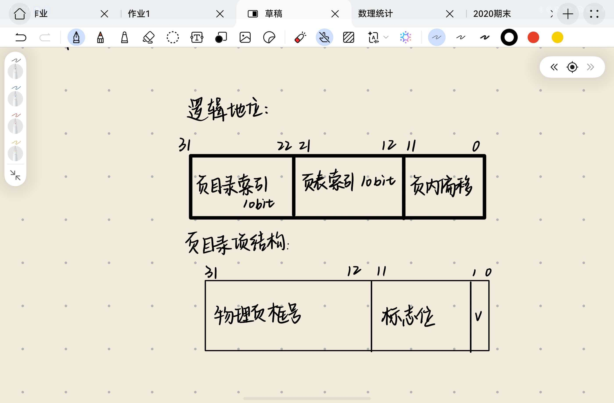

# 计算机系统基础 OS-第3次作业答案（2026春）

## 1

### 题目

一个 32 位的页式虚拟存储系统采用两级页表管理，其逻辑地址中，第 22 到 31 位是第一级页表（页目录）索引，第 12 位到 21 位是第二级页表索引，页内偏移占第 0 到 11 位。每个页表（目录）项包含 20 位物理页框号和 12 位标志位，其中最后 1 位为页面有效标志。

1. 画出逻辑地址结构、页目录项（页表项）结构。
2. 一个进程的地址空间有多少字节？一页有多少字节？
3. 一个进程的二级页表最多占用多少个物理页框？这些物理页框是否需要连续？
4. 一个进程如果从虚拟地址 0x77800000 开始映射 4MB 大小页表空间，求第一级页表（页目录）的起始逻辑地址，并指出从哪个逻辑地址可以读出第一级页表（页目录）所在的物理页框号。说明理由。（注意 B 代表字节，一个 32 位地址占 4 字节）
5. 如果当前进程的页目录物理基地址、页目录和相应页表内容如图下所示，请描述访问以下逻辑地址时系统进行地址转换的过程，如可行，给出最终访存读取到的数据。逻辑地址：0x0、0x00803004、0x00402001
6. 要想访问物理地址 0x326028，需要使用哪个逻辑地址？

页目录物理基地址：0x1000

| 索引 | 页目录 物理地址：0x1000 | 页表 物理地址：0x5000 | 页表 物理地址：0x20000 |
| --- | --- | --- | --- |
| 0 | 0x0 | 0x0 | 0x9000 |
| 1 | 0x1001 | 0x4e001 | 0x326001 |
| 2 | 0x5001 | 0x67001 | 0x41001 |
| 3 | 0x20001 | 0x20001 | 0x0 |
| 4 | 0x0 | 0x0 | 0x0 |
| … | … | … | … |
| 1023 | 0x0 | 0x0 | 0x0 |

### 答案

**答案：**

（1）手绘图如下（原件为手写扫描图）：

（2）一个 32 位的页式虚拟存储系统，地址空间为 $2^{32}$ 字节，即 4GB。

页内偏移占用 12 位，因此一页大小为 $2^{12}$ 字节，即 4KB。

（3）页目录索引是 10 位，所以页目录项数： $2^{10}=1024$。每个页目录项对应一个页表。

页表索引是 10 位，因此一个页表有： $2^{10}=1024$ 个页表项。

每项 4 字节： $1024 \times 4 = 4096$B $= 4$KB。

所以：一个页表刚好占 1 页，即 1 个物理页框。最多：1024 个页表。

所以一个进程的二级页表最多占用 1024 个物理页框。

不要求连续。

（4）起始逻辑地址是 0x77800000。

4MB = $2^{22}$ 恰好对应一个页目录项管理范围 $1024 \times 4$KB = 4MB，所以只对应一个页目录项。

虚拟地址 0x77800000 对应的页目录索引为 0x77800000 >> 22 = 478。

页目录共有 1024 项，每项 4 字节，共： $1024 \times 4 = 4096$B 即 1 页。

页目录所在逻辑页起始地址：0x77800000。

第 478 项地址： $478 \times 4 = 1912 = 0x778$。

对应页目录项的逻辑地址：0x77800000 + $478 \times 4$ = 0x77800778。

因此：逻辑地址 0x77800778 处存放第 478 个页目录项。从这里能读出页目录所在物理页框号。

（5）

逻辑地址：0x0

- 页目录索引：0x0 >> 22 = 0x0
- 页表索引：0x0 >> 12 & 0x3FF = 0x0
- 页内偏移：0x0 & 0xFFF = 0x0
- 页表项地址：页目录基地址 + 页目录索引 * 4 = 0x1000
- 有效位为 0，缺页异常无法访问

逻辑地址：0x00803004

- 页目录索引：0x00803004 >> 22 = 0x2
- 页表索引：0x00803004 >> 12 & 0x3FF = 0x3
- 页内偏移：0x00803004 & 0xFFF = 0x304
- 查页目录[2] = 0x5001，有效，得到页表物理地址 0x5000。
- 查页表 0x5000 的[3] = 0x20001，有效，得到物理页框 0x2000。
- 物理地址 = 0x2000 + 0x004 = 0x2004。
- 最终访存数据：图中未给出页框 0x2000 的内容，数据未知。

逻辑地址：0x00402001

- 页目录索引：0x00402001 >> 22 = 0x1
- 页表索引：0x00402001 >> 12 & 0x3FF = 0x2
- 页内偏移：0x00402001 & 0xFFF = 0x1
- 查页目录[1] = 0x1001，有效，得到页表物理地址 0x1000（即页目录自身，自映射）。
- 查“页表”0x1000 的[2] = 0x5001，有效，得到物理页框 0x5000。
- 物理地址 = 0x5000 + 0x001 = 0x5001。
- 物理地址 0x5001 位于页表 0x5000 内，该页框索引 0 项值为 0x0（占地址 0x5000~0x5003）。假设字节序为小端，读取 0x5001 字节得到数据 0x00（若要求对齐访问则可能异常）。

（6）页框号 = 0x3260，偏移 = 0x028。

页表 0x20000 的[1] = 0x326001（有效）。

页表 0x20000 对应的页目录项：页目录[3] = 0x20001。

逻辑地址重组：

- 页目录索引 = 3
- 页表索引 = 1
- 页内偏移 = 0x028

逻辑地址 = (3 ≪ 22) ∣ (1 ≪ 12) ∣ 0x028 = 0x00C01028

### 2

#### 题目

一个 32 位的页式虚拟存储系统采用两级页表管理，其逻辑地址中，第 22 到 31 位是第一级页表（页目录）索引，第 12 位到 21 位是第二级页表索引，页内偏移占第 0 到 11 位。每个页表（目录）项包含 20 位物理页框号和 12 位标志位：其中第 0 位为有效位，如果为 0，表示 Invalid；如果为 1 表示 Valid；第 1 位为读写位，如果为 0，表示 Read Only；如果为 1 表示 Read/Write。

假设当前进程第一级页表的物理地址为 0x0020 0000，利用后面物理内存的信息，请在下表中写出以下指令的执行结果。

对于 Load 指令，如果成功执行，写出读入的数据（读取一个字节），否则写 Error；对于 Store 指令，如果成功执行，写 OK，否则写 Error。参照给出的例子，在物理内存信息表格中圈出寻址时需要访问的字节，并解释寻址过程。

| 指令 | 结果 |
| --- | --- |
| Load [0x00001022] | 成功读出 0x20 |
| Store [0x00C07222] | |
| Store[0x00C005BF] | |
| Load [0x00003013] | |
| Load [0xFF80078F] | |
| Load [0xFFFFF005] | |

（1）Load [0x00001022]　成功读出 0x20

寻址过程：地址的页目录索引：0，查物理内存 0x00200000 得页目录项 0x00100007，最后 1 位为 1，页面有效，二级页表物理基地址为 0x00100000；地址的页表索引：1，查物理内存 0x00100004 得二级页表项 0x00004067，最后 1 位为 1，页面有效，访问的页面物理基址为 0x00004000，加上页内偏移 0x022，最终需要读取的物理地址为：0x00004022，查物理内存得 0x20。

物理内存（大尾端）

| Address | +0 | +1 | +2 | +3 | +4 | +5 | +6 | +7 | +8 | +9 | +A | +B | +C | +D | +E | +F |
| --- | --- | --- | --- | --- | --- | --- | --- | --- | --- | --- | --- | --- | --- | --- | --- | --- |
| 0000 0000 | 0E | 0F | 10 | 11 | 12 | 13 | 14 | 15 | 16 | 17 | 18 | 19 | 1A | 1B | 1C | 1D |
| 0000 0010 | 1E | 1F | 20 | 21 | 22 | 23 | 24 | 25 | 26 | 27 | 28 | 29 | 2A | 2B | 2C | 2D |
| … | … | … | … | … | … | … | … | … | … | … | … | … | … | … | … | … |
| 0000 1010 | 40 | 41 | 42 | 43 | 44 | 45 | 46 | 47 | 48 | 49 | 4A | 4B | 4C | 4D | 4E | 4F |
| 0000 1020 | 40 | 03 | 41 | 01 | 30 | 01 | 31 | 03 | 00 | 03 | 00 | 00 | 00 | 00 | 00 | 00 |
| 0000 1030 | 00 | 11 | 22 | 33 | 44 | 55 | 66 | 77 | 88 | 99 | AA | BB | CC | DD | EE | FF |
| 0000 1040 | 10 | 01 | 11 | 03 | 31 | 03 | 13 | 00 | 14 | 01 | 05 | 03 | 16 | 01 | 17 | 00 |
| … | … | … | … | … | … | … | … | … | … | … | … | … | … | … | … | … |
| 0000 2030 | 10 | 01 | 11 | 00 | 12 | 03 | 67 | 03 | 11 | 03 | 00 | 00 | 00 | 00 | 00 | 00 |
| 0000 2040 | 02 | 20 | 03 | 30 | 04 | 40 | 05 | 50 | 01 | 60 | 03 | 70 | 08 | 80 | 09 | 90 |
| 0000 2050 | 10 | 00 | 31 | 01 | 10 | 03 | 31 | 01 | 12 | 03 | 30 | 00 | 10 | 00 | 10 | 01 |
| … | … | … | … | … | … | … | … | … | … | … | … | … | … | … | … | … |
| 0000 4000 | 30 | 00 | 31 | 01 | 11 | 01 | 33 | 03 | 34 | 01 | 35 | 00 | 43 | 38 | 32 | 79 |
| 0000 4010 | 50 | 28 | 84 | 19 | 71 | 69 | 39 | 93 | 75 | 10 | 58 | 20 | 97 | 49 | 44 | 59 |
| 0000 4020 | 23 | 03 | 20 | 03 | 00 | 01 | 62 | 08 | 99 | 86 | 28 | 03 | 48 | 25 | 34 | 21 |
| … | … | … | … | … | … | … | … | … | … | … | … | … | … | … | … | … |
| 0010 0000 | 00 | 00 | 10 | 65 | 00 | 00 | 40 | 67 | 00 | 00 | 30 | 00 | 00 | 00 | 40 | 07 |
| 0010 0010 | 00 | 00 | 50 | 03 | 00 | 00 | 00 | 00 | 00 | 00 | 00 | 00 | 00 | 00 | 00 | 00 |
| … | … | … | … | … | … | … | … | … | … | … | … | … | … | … | … | … |
| 0010 3000 | 11 | 22 | 00 | 67 | 55 | 66 | 77 | 88 | 99 | AA | BB | CC | DD | EE | FF | 00 |
| 0010 3010 | 22 | 33 | 44 | 55 | 66 | 77 | 88 | 99 | AA | BB | CC | DD | EE | FF | 00 | 01 |
| … | … | … | … | … | … | … | … | … | … | … | … | … | … | … | … | … |
| 001F E000 | 04 | 15 | 00 | 00 | 48 | 59 | 70 | 7B | 8C | 9D | AE | BF | D0 | E1 | F2 | 03 |
| 001F E010 | 10 | 15 | 00 | 67 | 10 | 15 | 10 | 67 | 10 | 15 | 20 | 67 | 10 | 15 | 30 | 67 |
| … | … | … | … | … | … | … | … | … | … | … | … | … | … | … | … | … |
| 001F F000 | 00 | 00 | 00 | 00 | 00 | 00 | 00 | 65 | 00 | 00 | 10 | 67 | 00 | 00 | 00 | 00 |
| 001F F010 | 00 | 00 | 20 | 67 | 00 | 00 | 30 | 67 | 00 | 00 | 40 | 67 | 00 | 00 | 50 | 07 |
| … | … | … | … | … | … | … | … | … | … | … | … | … | … | … | … | … |
| 001F FFF0 | 00 | 00 | 00 | 00 | 00 | 00 | 00 | 00 | 10 | 00 | 00 | 67 | 00 | 10 | 30 | 67 |
| … | … | … | … | … | … | … | … | … | … | … | … | … | … | … | … | … |
| 0020 0000 | 00 | 10 | 00 | 07 | 00 | 10 | 10 | 07 | 00 | 10 | 20 | 07 | 00 | 10 | 30 | 07 |
| 0020 0010 | 00 | 10 | 40 | 07 | 00 | 10 | 50 | 07 | 00 | 10 | 60 | 07 | 00 | 10 | 70 | 07 |
| 0020 0020 | 00 | 10 | 00 | 07 | 00 | 00 | 00 | 00 | 00 | 00 | 00 | 00 | 00 | 00 | 00 | 00 |
| … | … | … | … | … | … | … | … | … | … | … | … | … | … | … | … | … |
| 0020 0FF0 | 00 | 00 | 00 | 00 | 00 | 00 | 00 | 00 | 00 | 1F | E0 | 07 | 00 | 1F | F0 | 07 |
| … | … | … | … | … | … | … | … | … | … | … | … | … | … | … | … | … |

#### 答案

**答案：**

（1）Store [0x00C07222] → Error

- 地址分解：页目录索引 = 3，页表索引 = 7，页内偏移 = 0x222。
- 查页目录：物理基址 0x00200000，索引 3 的项位于 0x0020000C，读得 4 字节 00 10 30 07，有效位=1，读写位=1，二级页表基址 = 0x00103000。
- 查二级页表：索引 7 的项位于 0x0010301C，读得 4 字节 EE FF 00 01，有效位=1，读写位=0（只读）。
- 写操作因页面只读而失败，结果 Error。
- 圈出的字节：页目录项 0x0020000C~0x0020000F，页表项 0x0010301C~0x0010301F。

（2）Store [0x00C005BF] → OK

- 地址分解：页目录索引 = 3，页表索引 = 0，页内偏移 = 0x5BF。
- 页目录项 3 同上：0x0020000C → 00 10 30 07，有效且可写，页表基址 0x00103000。
- 查页表项 0：位于 0x00103000，读得 4 字节 11 22 00 67，有效位=1，读写位=1。物理页框 = 0x11220000。
- 目标物理地址 = 0x112205BF（页框 0x11220000 + 偏移 0x5BF）。
- 允许写，成功执行，结果 OK。
- 圈出的字节：页目录项 0x0020000C~0x0020000F，页表项 0x00103000~0x00103003，最终写入字节 0x112205BF（不在给出的物理内存片段内，但仍有效）。

（3）Load [0x00003013] → 0x19

- 地址分解：页目录索引 = 0，页表索引 = 3，页内偏移 = 0x013。
- 查页目录项 0：位于 0x00200000，读得 00 10 00 07（0x00100007），有效且可读，页表基址 0x00100000。
- 查页表项 3：位于 0x0010000C，读得 00 00 40 07（0x00004007），有效且可读，物理页框 = 0x00004000。
- 目标物理地址 = 0x00004013，该地址的字节在表 0000 4010 行偏移 +3 处，为 19。
- 成功读出 0x19。
- 圈出的字节：页目录项 0x00200000~0x00200003，页表项 0x0010000C~0x0010000F，数据字节 0x00004013。

（4）Load [0xFF80078F] → Error

- 地址分解：页目录索引 = 0x3FE (1022)，页表索引 = 0，页内偏移 = 0x78F。
- 查页目录项 1022：位于 0x00200FF8，读得 00 1F E0 07（0x001FE007），有效且可读，页表基址 0x001FE000。
- 查页表项 0：位于 0x001FE000，读得 04 15 00 00（0x04150000），有效位=0（无效）。
- 页面无效，缺页异常，结果 Error。
- 圈出的字节：页目录项 0x00200FF8~0x00200FFB，页表项 0x001FE000~0x001FE003。

（5）Load [0xFFFFF005] → 0x66

- 地址分解：页目录索引 = 0x3FF (1023)，页表索引 = 1023，页内偏移 = 0x005。
- 查页目录项 1023：位于 0x00200FFC，读得 00 1F F0 07（0x001FF007），有效且可读，页表基址 0x001FF000。
- 查页表项 1023：位于 0x001FFFFC，读得 00 10 30 67（0x00103067），有效且可读，物理页框 = 0x00103000。
- 目标物理地址 = 0x00103005，该地址的字节在表 0010 3000 行偏移 +5 处，为 66。
- 成功读出 0x66。
- 圈出的字节：页目录项 0x00200FFC~0x00200FFF，页表项 0x001FFFFC~0x001FFFFF，数据字节 0x00103005。
