# 计算机系统基础 计组-第1次作业题目（2026春）

## 第一部分：MIPS 汇编（原件第 1～8 页）

### 第1题

填空

(a) 将 10 进制数 35 转换为 8 位二进制数是 ＿＿＿＿＿＿

(b) 将二进制数 00010101 转换为 16 进制数是 ＿＿＿＿＿＿

(c) 将 10 进制数 -35 转换为 8 位二进制补码是 ＿＿＿＿＿＿

(d) 将 8 进制数 204 转换为 10 进制数是 ＿＿＿＿＿＿

(e) 请判断以下两个补码表示的二进制数做二进制加法后是否溢出：＿＿＿＿＿＿

```text
01101110
00011010
```

(f) 对 8 位 16 进制数 0x88 做符号扩展成 16 位数是：0x＿＿＿＿＿＿＿＿＿

(g) 下列代码段存储在内存中，起始地址为 0x00012344，分支指令执行后 PC 的两个可能的值分别是：0x＿＿＿＿＿＿＿＿＿＿ 和 0x ＿＿＿＿＿＿＿＿＿＿＿＿。同时，请在注释位置用伪代码形式对每条指令做出描述。

```mips
loop: lw       $t0, 0($a0) #
      addi     $a0, $a0, 4 #
      andi     $t1, $t0, 1 #
      beqz     $t1, loop   #
```

### 第2题

将下列汇编语言指令翻译成机器语言代码，以 16 进制表示

```mips
loop:   addu      $a0, $0, $t0       #
        ori       $v0, $0, 4         #
        syscall                      #
        addi      $t0, $t0, -1       #
        bnez      $t0, loop          #
        andi      $s0, $s7, 0xffc0   #
        or        $a0, $t7, $s0      #
        sb        $a0, 4($s6)        #
        srl       $s7, $s7, 4        #
```

### 第3题

写一个 MIPS 汇编程序，要求对内存以“example100”为标签（label）的数据段中前 100 个字（words）的数据求和，并将结果存入紧跟在这 100 个字之后的内存中。

### 第4题

写一段 MIPS 汇编语言代码，将内存中“SRC”标签开始的 100 个字的一块数据转移到内存中另一块以“DEST”标签开始的空间中。

### 第5题

写一个 MIPS 函数 ABS，通过 `$a0` 传入一个 32 位整数，将这个数的绝对值存回 `$a0`。再写一段主程序，调用两次 ABS 并输出结果，每次传给 ABS 的数不同。

### 第6题

写一个函数 FIB(N, &array) 向内存中的一个数组（array）存入斐波那契数列的前 N 个元素。N 和 array 的地址分别通过 `$a0` 和 `$a1` 传递进来。斐波那契数列的前几个元素是：1, 1, 2, 3, 5, 8, 13, …………

### 第7题

写一个函数，从 `$a0`, `$a1`, 和 `$a2` 中接受传递过来的 3 个 32 位整数，按从小到大排序后存回 `$a0`-`$a2`。

## 第二部分：组合逻辑（原件第 30～43 页）

### 一、填空题

1．PN 结的单向导电性即正向偏置时 ＿＿＿＿＿＿，反向偏置时 ＿＿＿＿＿＿。

2．TTL 与非门的两个状态通常称为关态和开态，当输入有一为低电平时，对应的是 ＿＿＿ 态，此时输出为 ＿＿＿＿＿＿；当输入全为高电平时对应的是 ＿＿＿ 态，此时输出为 ＿＿＿＿＿＿。

3．TTL 与非门的额定输出逻辑高电平 $V_{OH}$ = ＿＿＿ 伏，额定输出逻辑低电平 $V_{OL}$ = ＿＿＿ 伏。（设电源电压 $V_{CC}$ = +5V）

4．对于 ECL、TTL、CMOS 集成电路，按工作速度快慢的顺序依次为 ＿＿＿＿＿＿、＿＿＿＿＿＿、＿＿＿＿＿＿，按抗干扰能力强弱的顺序依次为 ＿＿＿＿＿＿、＿＿＿＿＿＿、＿＿＿＿＿＿，按静态功耗低和高的顺序依次为 ＿＿＿＿＿＿、＿＿＿＿＿＿、＿＿＿＿＿＿。

5．逻辑变量和函数只有 ＿＿＿、＿＿＿ 两种取值，而且它们只是表示两种不同的逻辑状态。

6．逻辑函数 $F$ =（含上划线的与或式，见下方页面图），其反函数 $\overline{F}$ = ＿＿＿＿＿＿，其对偶式 $F^{*}$ = ＿＿＿＿＿＿。

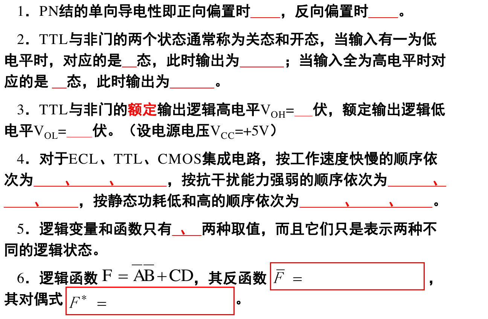

7．函数 $F$ =（含上划线的与或式，见下方页面图）的最简与或式是 $F$ = ＿＿＿＿＿＿

8．从结构看，组合逻辑电路由门电路构成，不含 ＿＿＿＿＿＿，也不含 ＿＿＿＿＿＿，信号从输入开始单向传输到输出。对于组合逻辑电路，任何时刻电路的输出仅由当时的 ＿＿＿＿＿＿ 决定。

9．将加在电路若干输入端中的某一个输入端的信号变换成相应的一组二进制代码输出的过程叫做 ＿＿＿＿＿＿。

10．将二进制代码所表示的信息翻译成对应输出的高低电平信号的过程称为 ＿＿＿＿＿＿；n 位二进制译码器有 ＿＿＿ 个输入，有 ＿＿＿ 个输出，工作时译码器只允许有一个输出有效。

11．输出低电平有效的二-十进制译码器的输入 8421BCD 码 $A_3$~ $A_0$ 为 0110 时，其输出 $Y_0$ ~ $Y_9$ = ＿＿＿＿＿＿。（输出端是否带上划线见下方页面图）

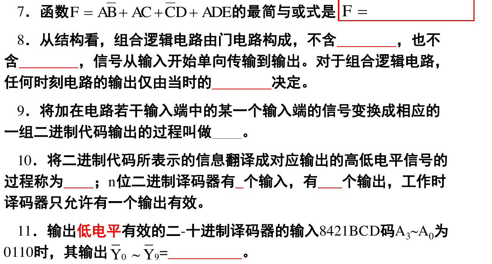

### 二、选择题

1．硅二极管导通和截止的条件是（　　）。

① $U_D$ ≥ 0.7V， $U_D$ < 0.5V

② $U_D$ ≥ 0.5V， $U_D$ < 0.7V

③ $U_D$ ≥ 0.7V， $U_D$ < 0.7V

④ $U_D$ ≥ 0.5V， $U_D$ < 0.5V

2．用电位关系描述晶体三极管工作时的三种状态，正确的可靠工作条件是（　）。

① 截止区： $V_{BE}$ ＜ 0V，放大区： $V_{BC}$ ＞ 0V，饱和区： $V_{BC}$ > 0V 且 $V_{BC}$ ＞ 0V

② 截止区： $V_{BE}$ ＜ $V_T$，放大区： $V_{BE}$ ＞ $V_T$ 且 $V_{BC}$ ＜ 0V；饱和区： $V_{BC}$ ＜ 0V

③ 截止区： $V_{BE}$ ＜ 0V，放大区： $V_{BE}$ ＞ 0.6V，饱和区： $V_{CE}$ ≤ 0.3V

④ 截止区： $V_{BE}$ ≤ 0V； $V_{BC}$ ＜ 0V；放大区： $V_{BE}$ > 0，且 $V_{BC}$ ＜ 0V；饱和区： $V_{BE}$ ≥ 0.7V，且 $V_{BC}$ ＞ 0V

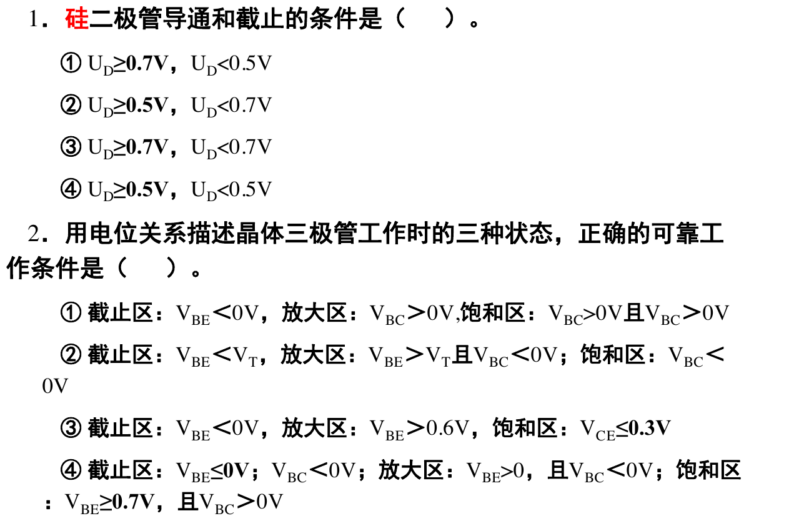

3．二极管门电路如下图所示，假定输入变量的值可在 0V 和 3V 两种电平下变化，输出和输入之间的正逻辑关系为（　）。

① 与逻辑

② 或逻辑

③ 与非

④ 或非

注：“正逻辑”的意思是高电平代表“１”，低电平代表“０”。

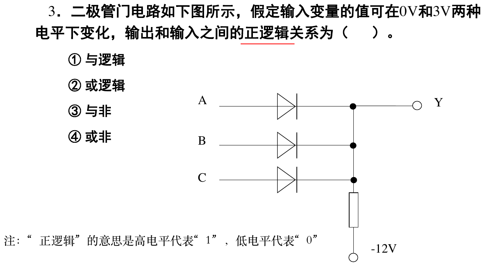

4．为实现 $F$ =（含上划线的与或式，见下方页面图），下列电路接法正确的是（　）。

注：可无视此题

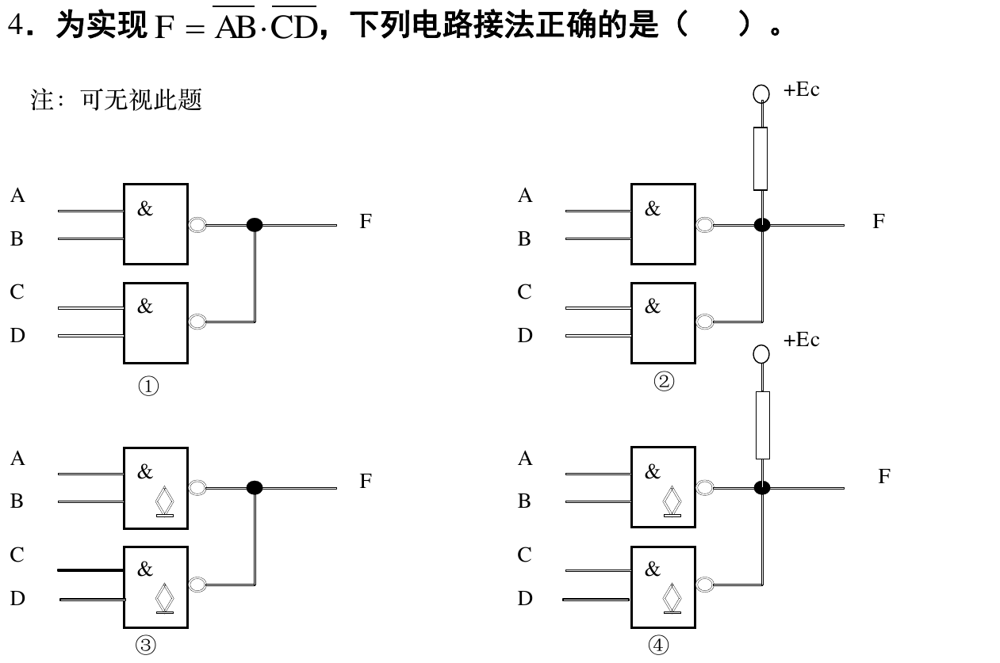

5．函数 $F$ =（含上划线的与或式，见下方页面图）的最简与或式为（　　）。

① 1　　② 0　　③ AB　　④ 以上均不是

6．逻辑函数 $F$ =（含上划线的与或式，见下方页面图），当 ABC 的取值为（　　）时，F = 1。

① 000　② 011　③ 101　④ 111

7．函数 A⊕B 与（另一式见下方页面图）。（　）

① 互为反函数　② 互为对偶式

③ 相等　④ 答案都不正确

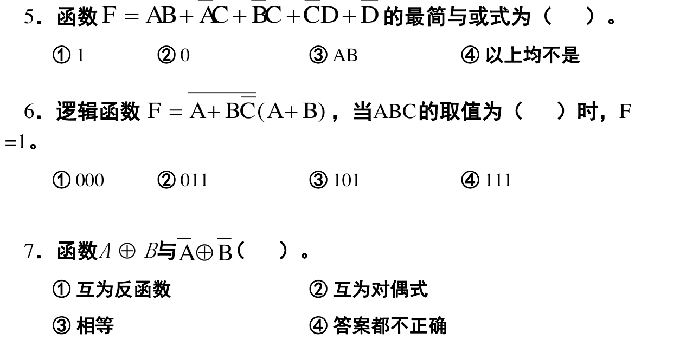

8．组合逻辑电路的竞争-冒险是由于（　）引起的。

① 电路不是最简

② 电路有多个输出

③ 构成电路的逻辑元件存在传输延迟

④ 电路使用不同的门电路

9．能实现从多个输入端中选出一路作为输出的电路称为（　）。

① 触发器　② 计数器　③ 数据选择器　④ 译码器

10．只考虑本位数而不考虑低位来的进位的加法称为（　）。

① 全加　② 半加　③ 全减　④ 半减

11．如需要判断两个二进制数的大小或相等，可使用（　）电路。

① 译码器　② 编码器

③ 数据选择器　④ 数值比较器

### 三、问答与计算题

1．将逻辑函数 $F$ =（含上划线的与或式，见下方页面图）写成标准与或表达式。

2．推导出函数 $F$ =（含上划线的与或式，见下方页面图）的最简与或式。

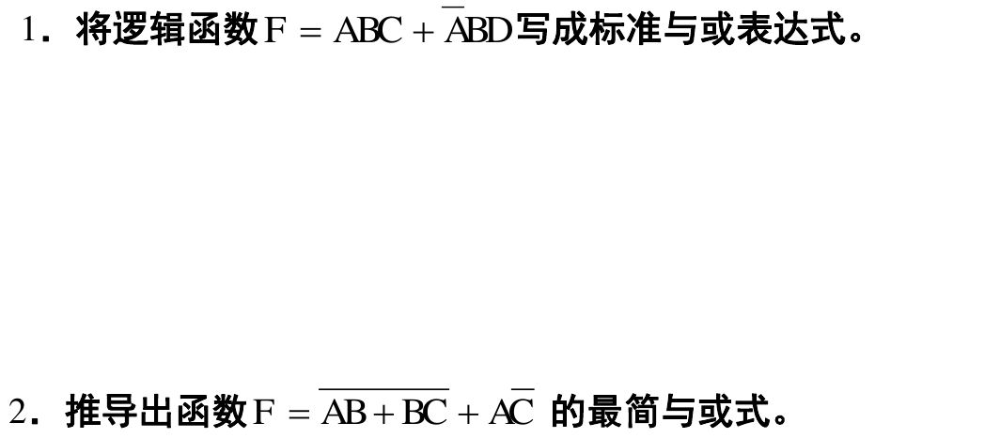

3．列出下述问题的真值表，利用最小项推导法写出其逻辑函数表达式并利用公式简化法进行简化，然后写出完整的 Verilog HDL 程序。

有 3 个温度检测器，当检测的温度超过 60° 时，温度检测器输出信号为 1；低于 60° 时，输出为 0。当两个或两个以上的温度检测器的输出为 1 时，总控制器的输出为 1，以控制调控设备，使温度降低到 60° 以下。

4．用公式法证明下列等式（各式含上划线，见下方页面图）：


5．用 8 选 1 数据选择器 CT74151 实现下列函数：

$$F(A, B, C, D, E) = \sum m(1, 2, 3, 4, 7, 8, 10, 13, 14, 17, 19, 20, 21, 23, 24, 26, 28, 30, 31)$$

6．在三进制数系统中，存在三个数字：0, 1, 2。表 1 定义了一个三进制数的半加器。

（1）设计一个实现此半加器的电路。要求用二进制编码表示三进制数，例如每个三进制数用 2 位表示。令 A = $a_1a_0$，B = $b_1b_0$，Sum = $s_1s_0$，进位信号 Carry 是二进制信号。编码方案为：00 = $(0)_3$，01 = $(1)_3$，10 = $(2)_3$，要求电路的成本最低。

（2）使用上述描述的方法，设计一个三进制全加器电路。

| A | B | Sum | Carry |
| --- | --- | --- | --- |
| 00 | 00 | 00 | 0 |
| 00 | 01 | 01 | 0 |
| 00 | 10 | 10 | 0 |
| 01 | 00 | 01 | 0 |
| 01 | 01 | 10 | 0 |
| 01 | 10 | 00 | 1 |
| 10 | 00 | 10 | 0 |
| 10 | 01 | 00 | 1 |
| 10 | 10 | 01 | 1 |

表 1　三进制半加器

7．7 段数码管是由 7 个独立的发光管构成的，每个发光管有一个驱动控制信号。当驱动控制信号为高电平（逻辑 1）时，则信号对应的发光管发光。现需设计 7 段数码管的控制电路，使之能够根据 4 位输入 x[3:0] 显示 0 ~ 9，A ~ F 共 16 个数字或图案。7 段数码管控制电路输出信号为各数码管的驱动控制信号，即 a，b，c，d，e，f，g。数码管各段的定义和 16 进制数“F”（对应 abcdefg 的二进制输出为 1110001）的显示如下图所示。

（1）请给出 7 段数码管控制电路的输入输出信号真值表。

（2）根据真值表写出各输出信号的逻辑表达式，并化简。

（3）采用结构描述法，用 Verilog 语言实现上述的数码管控制器。

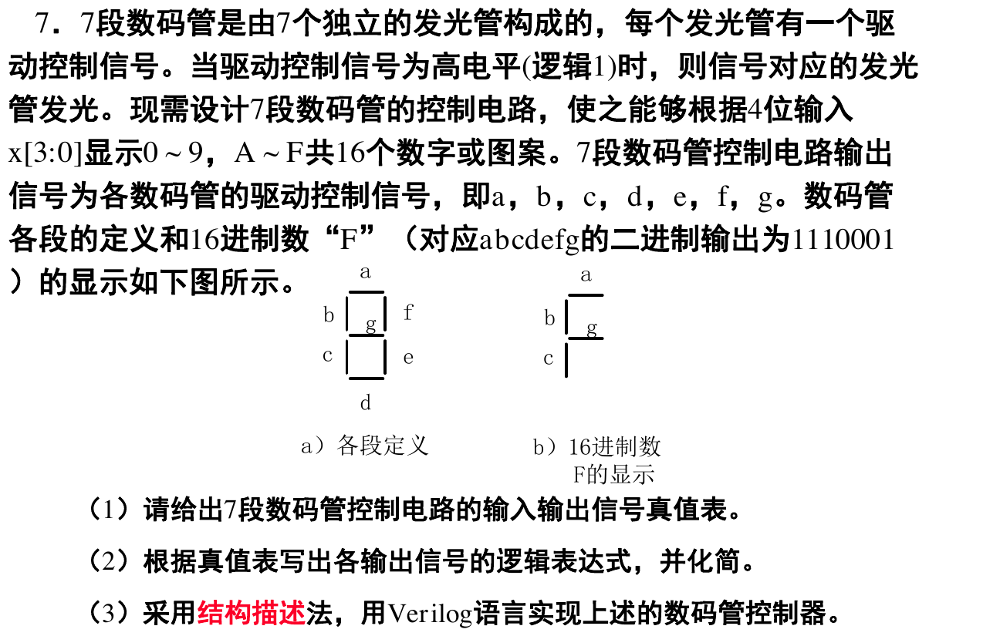

## 第三部分：时序逻辑（原件第 44～59 页）

### 一、填空题

1．根据在 CP 控制下，逻辑功能的不同，常把时钟触发器分为 ＿＿＿＿＿＿、＿＿＿＿＿＿、＿＿＿＿＿＿ 等 3 种类型。

2．由与非门构成的基本 RS 触发器约束条件是 ＿＿＿＿＿＿

3．钟控 JK 触发器的特性方程为 ＿＿＿＿＿＿。

4．时序逻辑电路按触发器时钟端的连接方式不同可以分为 ＿＿＿＿＿＿ 和 ＿＿＿＿＿＿ 两类。

5．n 级移位寄存器可以存放 ＿＿＿ 位二进制数据。

6．集成计数器的模值是固定的，但可以用 ＿＿＿＿＿＿ 和 ＿＿＿＿＿＿ 来改变它们的模值。

7．由 8 级触发器构成的十进制计数器模值为 ＿＿＿＿＿＿。

8．通过级联方法，把两片 4 位二进制计数器 CT74161 连接成为 8 位二进制计数器后，其最大模值是 ＿＿＿＿＿＿。

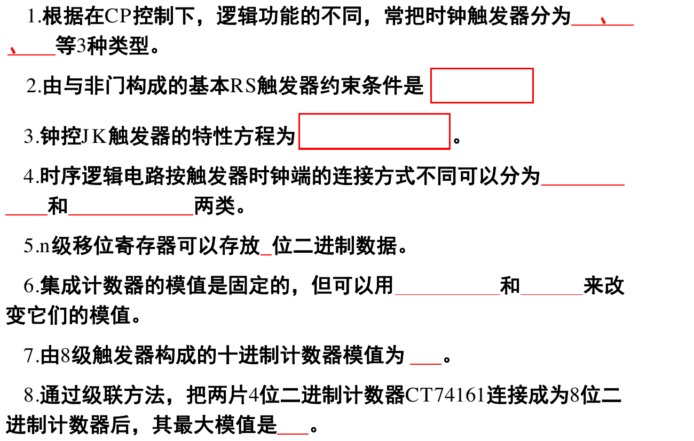

### 二、选择题

1．若 JK 触发器的原始状态为 0，欲在 CP 作用后保持 0 状态，则激励函数 JK 的值应是（　）。

A．J=1，K=1

B．J=0，K=0

C．J=0，K=x

D．J=x，K=x

2．下列电路中，只有（　）不能实现 $Q^{n+1} = \overline{Q^n}$。

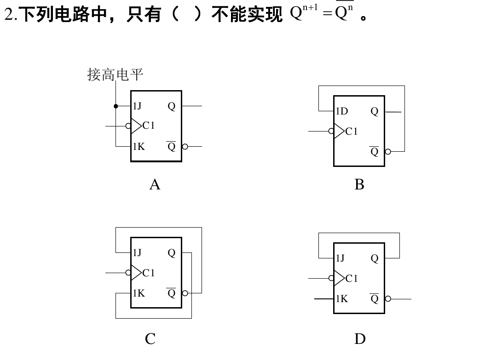

3．如下各触发器电路中，能实现 $Q^{n+1} = \overline{Q^n} + A Q^n$ 功能的电路是（　）。

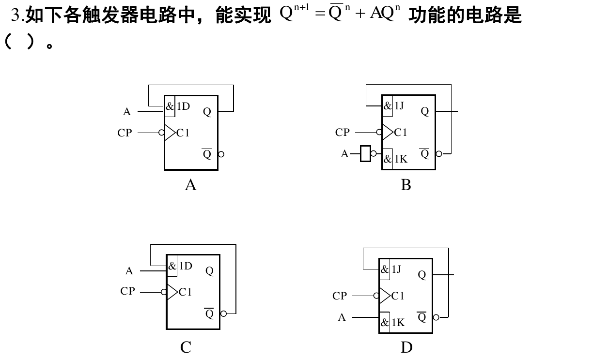

4．用 8 级触发器可以记忆（　）种不同的状态。

A．8　　B．16　　C．128　　D．256

5．同步计数器是指（　　）的计数器。

① 由同类型的触发器构成

② 各触发器时钟端连在一起，统一由系统时钟控制

③ 可用前级的输出做后级触发器的时钟

④ 可用后级的输出做前级触发器的时钟

6．由 10 级触发器构成的二进制计数器，其模值为（　　）。

① 10　② 20　③ 1000　④ 1024

7．同步 4 位二进制减法计数器的借位方程是 $B = Q_4 Q_3 Q_2 Q_1$（各因子是否带上划线见下方页面图），则可知 B 的周期和正脉冲宽度为（　）。

① 16 个 CP 周期和 2 个 CP 周期

② 16 个 CP 周期和 1 个 CP 周期

③ 8 个 CP 周期和 8 个 CP 周期

④ 8 个 CP 周期和 4 个 CP 周期

8．已知 $Q_3$、 $Q_2$、 $Q_1$、 $Q_0$ 是同步十进制计数器的触发器输出，若以 $Q_3$ 作进位 C，则 C 的周期和正脉冲宽度是（　）。

① 10 个 CP 脉冲，正脉冲宽度为 1 个 CP 周期

② 10 个 CP 脉冲，正脉冲宽度为 2 个 CP 周期

③ 8 个 CP 脉冲，正脉冲宽度为 1 个 CP 周期

④ 8 个 CP 脉冲，正脉冲宽度为 2 个 CP 周期

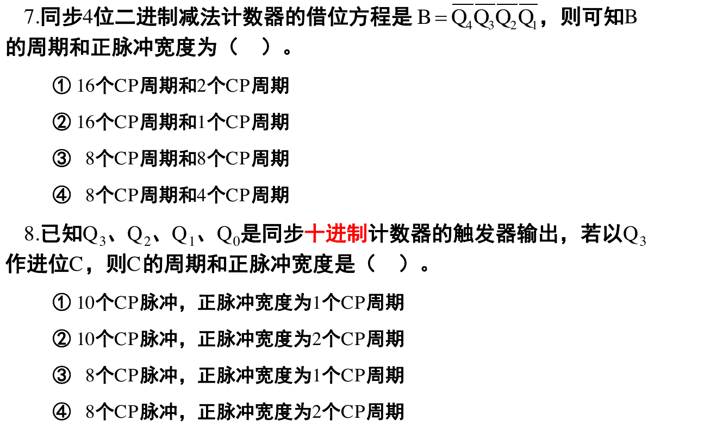

9．一个 4 位移位寄存器原来的状态为 0000，如果串行输入始终为 1，则经过 4 个移位脉冲后寄存器的内容为（　）。

① 0001　② 0111　③ 1110　④ 1111

10．可以用来实现并/串转换和串/并转换的器件是（　　）。

① 计数器　② 移位寄存器

③ 存储器　④ 全加器

11．用反馈复位法来改变由 8 位二进制加法计数器的模值，可以实现（　）模值范围的计数器。

① 1～15　② 1～16　③ 1～32　④ 1～256

12．用 Verilog HDL 设计同步清除的计数器时，在 always 语句的敏感参数表中（　）。

① 需要列出时钟信号和清除信号标示符的有效边沿

② 只需要列出时钟信号标示符的有效边沿

③ 只需要列出清除信号标示符的有效边沿

④ 只需要列出时钟信号或者清除信号标示符的有效边沿

### 三、分析与设计题

1．已知触发器的逻辑符号如图 3.1 所示，输入波形如图 3.2 所示，其中 FF1 是由与非门构成的基本 RS 触发器，FF2 是由或非门构成的基本 RS 触发器，设触发器的初态均为 0。试分别简要说明 2 个电路在不同的输入取值下的逻辑功能，并根据 A、B 输入波形画出 $Q_1$、 $\overline{Q_1}$、 $Q_2$、 $\overline{Q_2}$ 的输出波形图。

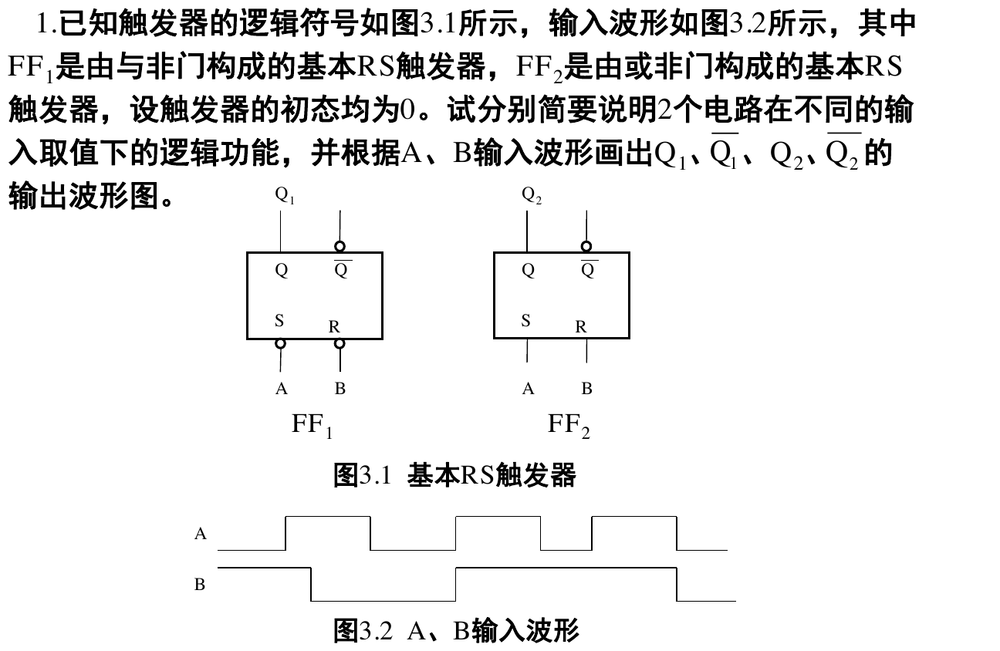

2．分析下图所示电路，要求：

（1）写出分析过程，包括各级触发器的驱动方程和状态方程；

（2）画出状态转换表、状态转换图和时序图；

（3）说明电路特点。

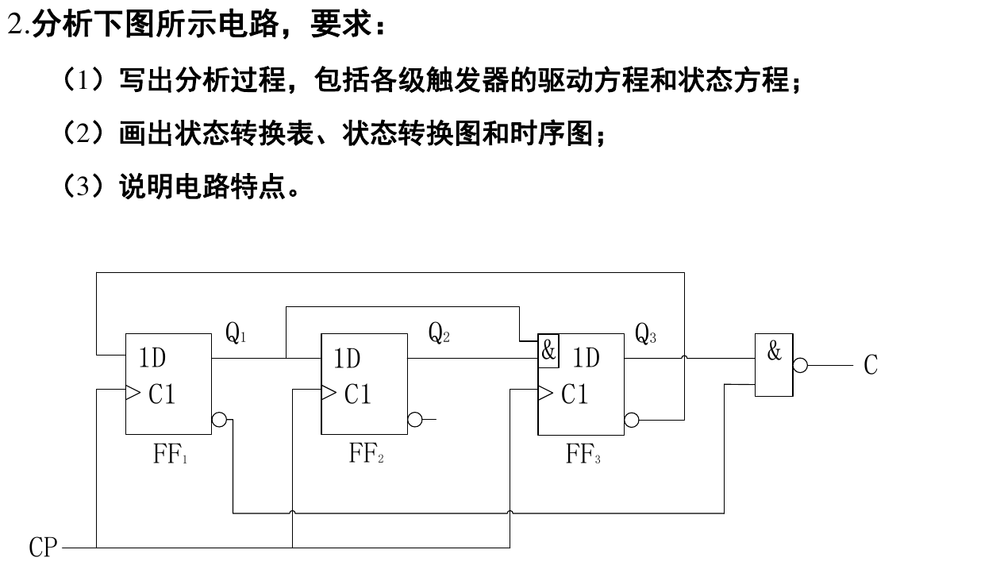

3．集成 4 位二进制计数器 CT74161 的逻辑符号如图 3.3 所示，其功能表如表 3.1 所示，触发器输出低位到高位的次序是 $Q_0$ 至 $Q_3$，输出 $C = E_T Q_3^n Q_2^n Q_1^n Q_0^n$（各因子是否带上划线见下方页面图）。试用一片 CT74161 采用输出 C 预置法实现十二进制计数器，画出电路连接图。

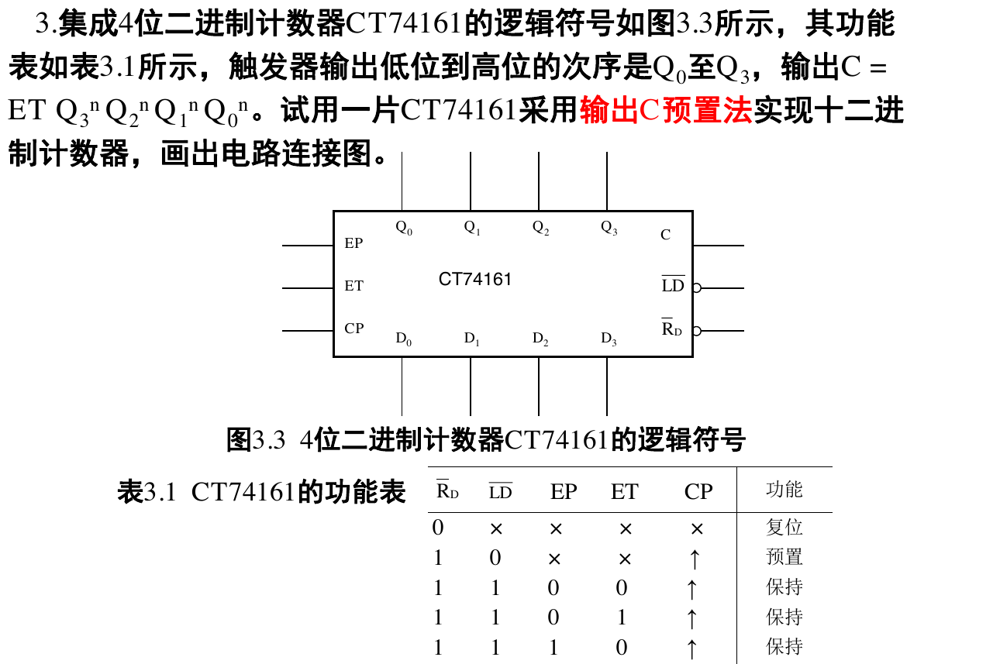

4．分析如图 3.4 所示的状态转换图表示什么类型的状态机。并根据图 3.4 采用 Verilog HDL 设计六进制计数器电路。要求在程序中加上必要的注释。

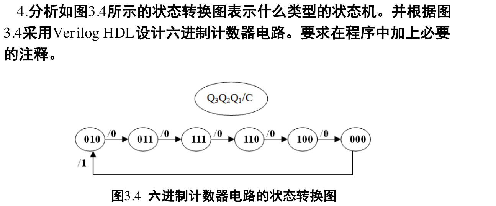

在源程序中，clk 是时钟输入端，上升沿有效；q 是计数器的 3 位状态输出端，cout 是进位输出端。在程序中还设置了 6 个参数（parameter）st0、st1、st2、st3、st4 和 st5，分别代表题中所示状态转换图中的各个状态。

```verilog
module cnt6 (clk, q, cout);
   input clk;
   output reg[2:0] q;
   output reg cout;
   parameter        st0 = 'b010, st1 = 'b011, st2 = 'b111, st3 = 'b110, st4 = 'b100,
st5 = 'b000;______________________________
   always@(posedge clk)
     begin
        case (q)//状态的转移
           st0 :     q = st1;
           st1 :     q = st2;
           st2 :     q = st3;
           st3 :     q = st4;
           st4 :     q = st5;
           st5 :     q = st0;
           default : q = st0;
        endcase
        ______________________________
        ______________________________
     end
endmodule

```

5．使用 D 触发器和与非门设计一个 4 人抢答逻辑电路，具体要求为：

（1）每个参赛者控制一个按钮，用按钮发出抢答信号；

（2）竞赛主持人控制另一个按钮，用于电路复位；

（3）竞赛开始后，先按动按钮者将对应的一个发光二极管点亮，此后其他 3 人再按动按钮对电路不起作用。

6．设计一个自动售货机控制器，每次可以任意投入一枚五分或 1 角的硬币。货物价格为 20 分，当投入足够的钱后，售货机吐出货物并找零钱。请完成下列任务：

（1）画出实现上述功能的状态机；

（2）列出二进制编码的状态转换表和输出逻辑真值表，给出次态每一位编码的逻辑函数表达式和输出逻辑函数表达式，并化简。
