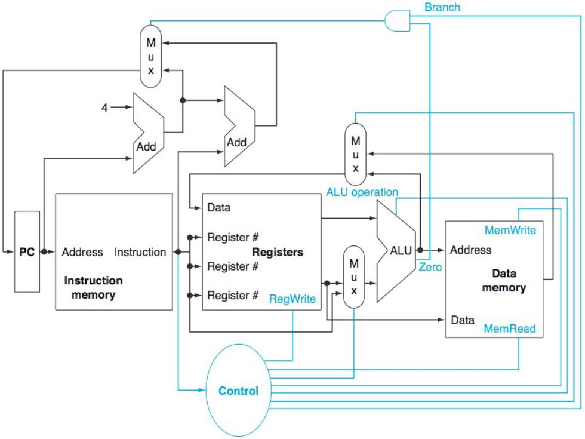
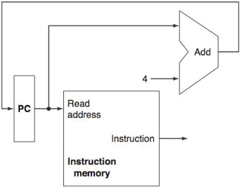
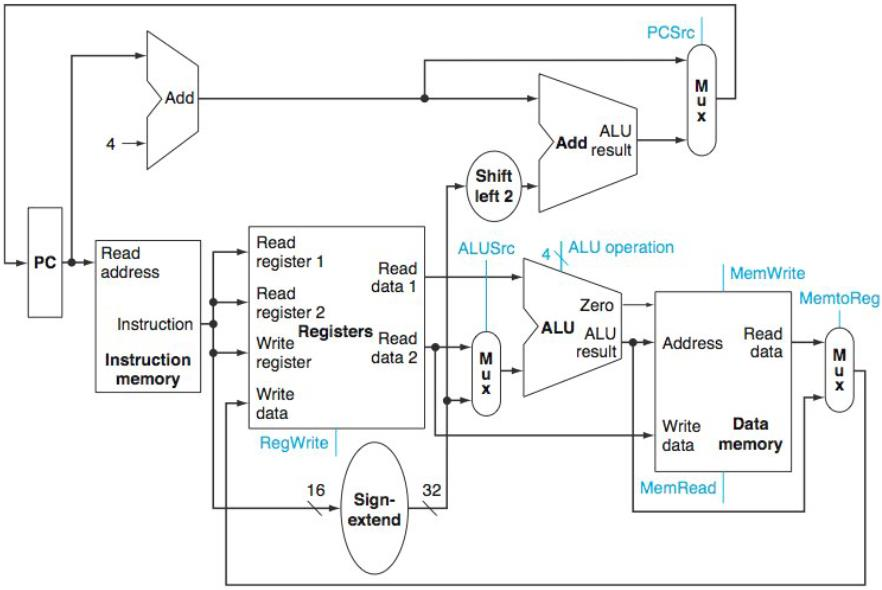
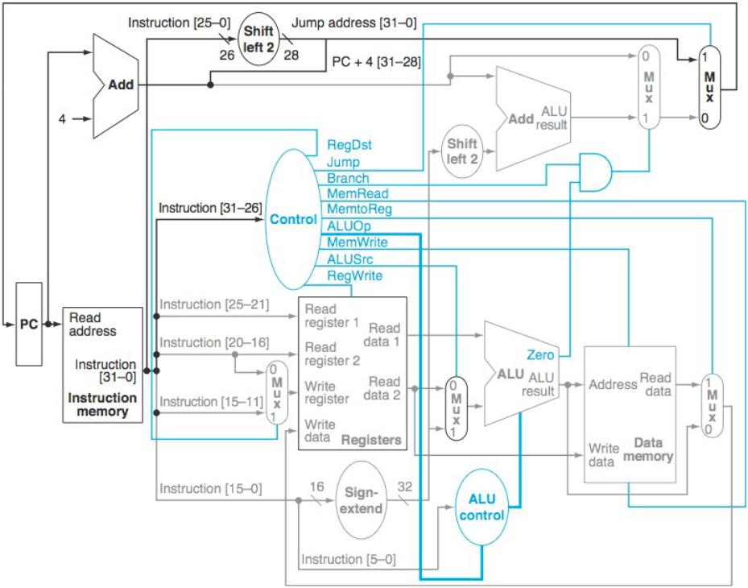

# 计算机系统基础 计组-第3次作业题目（2026春）

## 一

在基本的单周期 MIPS 实现中，不同的指令使用不同的硬件单元。

根据如下指令回答下列 3 个问题。

| | 指令 | 解释 |
| --- | --- | --- |
| a. | add Rd,Rs,Rt | Reg[Rd]=Reg[Rs]+Reg[Rt] |
| b. | lw Rt,Offs(Rs) | Reg[Rt]=Mem[Reg[Rs]+Offs] |

① 对上述指令而言，图 1 中的控制单元要产生哪些控制信号？

② 对上述指令而言，要用到哪些功能单元？

③ 哪些功能单元会产生输出，但输出不会被以上指令用到？对以上指令而言，哪些功能单元不产生任何输出？

图 1（MIPS 指令格式域与基本单周期数据通路）：

不同单元有不同的延迟时间。在图 1 中有七种主要单元。

对一条指令而言，关键路径（产生最长延迟的那条路径）上各个单元的延迟时间决定了该指令的最小延迟。

假设个单元的延迟时间如下表所示，回答下列 3 个问题。

| | 指令存储器 | 加法器 | 多选器 | ALU | 寄存器堆 | 数据存储器 | 控制 |
| --- | --- | --- | --- | --- | --- | --- | --- |
| a. | 400ps | 100ps | 30ps | 120ps | 200ps | 350ps | 100ps |
| b. | 500ps | 150ps | 100ps | 180ps | 220ps | 1000ps | 65ps |

④ 对一条 MIPS 的与指令（AND）而言，关键路径是什么？

⑤ 对一条 MIPS 的装载指令（LW）而言，关键路径是什么？

⑥ 对一条 MIPS 的相等则分支指令（BEQ）而言，关键路径是什么？

### 二

图 1 中基本的单周期 MIPS 实现仅能实现某些指令。

可以在这个指令集中加入新的指令，但决定是否加入取决于给处理器的数据通路和数据通路增加的复杂度。

对于下表中的新指令而言，试回答下列 3 个问题。

| | 指令 | 解释 |
| --- | --- | --- |
| a. | add3 Rd,Rs,Rt,Rx | Reg[Rd]=Reg[Rs]+Reg[Rt]+Reg[Rx] |
| b. | sll Rt,Rd,Shift | Reg[Rd]=Reg[Rt]<<Shift（左移） |

① 对上述指令而言，哪些已有的单元还可以被使用？

② 对上述指令而言，还需要增加哪些功能单元？

③ 为了支持这些指令，需要在控制单元增加哪些信号？

题图：图 1（同上）。

当设计者考虑改进处理器数据通路时，往往要考虑性能与成本的折中。假设我们从图 1 的数据通路出发，其中指令存储器（Instruction Memory）、加法器（Add）、多选器（Mux）、ALU、寄存器堆（Registers）、数据寄存器（Data Memory）和控制单元（Control）的延迟分别为 400ps、100ps、30ps、120ps、200ps、350ps 和 100ps，相应的成本分别为 1000、30、10、100、200、2000 和 500。试根据表中的改进分别回答下列问题。

| | 改进 | 延迟 | 成本 | 优势 |
| --- | --- | --- | --- | --- |
| a. | 更快的加法器 | 加法单元-20ps | 每个加法单元+20 | 把已有的加法器用更快的加法器替代 |
| b. | 更大的寄存器堆 | 寄存器堆+100ps | 寄存器堆+200 | 需要更少的 load 和 store 指令。这将导致指令数减少 5% |

④ 改进前后的时钟周期分别是多少？

⑤ 改进后将获得多大的加速比？

⑥ 比较改进前后的性能/价格比，进行这样的改进是否有意义？

### 三

下表给出了实现处理器数据通路的逻辑单元延迟。试根据下表的两种情况分别回答下列问题。

| | 指令存储器 | 加法器 | 多选器 | ALU | 寄存器堆 | 数据存储器 | 符号扩展 | 左移两位 |
| --- | --- | --- | --- | --- | --- | --- | --- | --- |
| a. | 400ps | 100ps | 30ps | 120ps | 200ps | 350ps | 20ps | 2ps |
| b. | 500ps | 150ps | 100ps | 180ps | 220ps | 1000ps | 90ps | 20ps |

① 如果处理器只需做连续取指这一件事（见图 2），那么时钟周期是多少？

② 考虑一个与图 3 类似的数据通路，但是假设处理器只需处理无条件相对跳转指令，那么时钟周期是多少？

③ 同样考虑一个与图 3 类似的数据通路，但这次假设只需处理有条件相对跳转指令，那么时钟周期是多少？（请注意图 3 中 ALU 的零输出端不是与数据存储器连接，该输出与选择 PC 值来源的多选器的控制有关）

提示：图 3 中靠右侧的加法器延迟应当按照 ALU 来计算。

图 2（只需连续取指的数据通路）：

图 3：

根据下表的两种数据通路的逻辑单元，分别回答下列问题。

| | 单元 |
| --- | --- |
| a. | 执行加 4 的加法器（对 PC） |
| b. | 数据存储器 |

④ 哪些类型的指令需要该单元？

⑤ 对哪些类型的指令而言，该单元位于关键路径上？

⑥ 假设仅需支持 beq 指令和 add 指令，讨论该单元的延迟变化对处理器时钟周期的影响。假设其他单元的延迟不变。

### 四

本题讨论数据通路中不同的单元延迟对整个数据通路时钟周期的影响，以及指令如何利用不同的数据通路单元。根据下面的两种延迟情况，分别回答下列问题。

| | 指令存储器 | 加法器 | 多选器 | ALU | 寄存器堆 | 数据存储器 | 符号扩展 | 左移两位 |
| --- | --- | --- | --- | --- | --- | --- | --- | --- |
| a. | 400ps | 100ps | 30ps | 120ps | 200ps | 350ps | 20ps | 0ps |
| b. | 500ps | 150ps | 100ps | 180ps | 220ps | 1000ps | 90ps | 20ps |

① 如果仅需支持 ALU 类指令（如 add、and 等），处理器的时钟周期是多少？

② 如果仅需支持 lw 类指令，时钟周期是多少？

③ 如果必须支持 add、beq、lw 和 sw 指令，时钟周期是多少？

假设各类型指令所占比例如下表所示，试根据下表的两种情况分别回答下列问题。

| | add | addi | not | beq | lw | sw |
| --- | --- | --- | --- | --- | --- | --- |
| a. | 30% | 15% | 5% | 20% | 20% | 10% |
| b. | 25% | 5% | 5% | 15% | 35% | 15% |

④ 数据存储器平均用了多少时钟周期？

⑤ 符号扩展电路的输入平均用了多少时钟周期？在未用到该输入的其他时间，符号扩展电路在做什么？

⑥ 如果可以将数据通路上某个单元的延迟减少 10%，应该减少哪个单元的延迟？改进后整个处理器的加速比是多少？

### 五

在制造硅芯片时，材料的缺陷和制造错误会导致电路失效。一个非常普遍的问题是一根线上的信号会对相邻线上的信号产生影响，这被称为串扰。有一类串扰问题是这样的，某些线上的信号为常值（如电源线），该线附近的线也被固定为 0（stuck-at-0）或 1（stuck-at-1）。试根据下表的两种缺陷（信号来自图 4）分别回答下列问题。

| | 有问题的信号 |
| --- | --- |
| a. | 指令存储器，输出信号第 7 位 |
| b. | 控制单元，输出信号 MemtoReg |

① 设这样测试处理器的缺陷：先给 PC、寄存器堆、数据和指令存储器中设置一些值（可以自己选择），执行一条指令，然后读出 PC、寄存器堆和存储器中的值；最后检查这些值以判断处理器中是否存在缺陷。你能设计这样一个方案检查该信号上是否有固定为 0 缺陷吗？

② 条件同第①问，但是这次检查固定为 1 缺陷。你能只设计一个测试方案同时检查固定为 0 缺陷和固定为 1 缺陷吗？如果可以，请解释如何实现；如果不能，请说明理由。

③ 如果我们知道一个处理器在该信号上有一个固定为 1 缺陷，它还能用吗？为了使这个处理器仍然可用，我们必须将原来能在正常 MIPS 处理器上运行的程序做一些变换，使之可以在这个处理器上运行。假设指令存储器和数据存储器都很大，足够容纳变换后的程序。提示：将因为该缺陷不能用的指令替换为一系列能用的指令，这一系列指令与原指令功能相同。

图 4：

根据下表的缺陷分别回答下列问题。

| | 缺陷 |
| --- | --- |
| a. | 固定为 1 |
| b. | 如果指令的第 31~26 位全为 0，则固定为 0，否则无缺陷 |

④ 条件同第①问，这次检测控制信号 MemRead 是否存在上表中的缺陷？

⑤ 条件同第①问，这次检测控制信号 Jump 是否存在上表中的缺陷？

⑥ 使用第①问中描述的测试方案，可以一次对几个不同的信号进行测试，但一般来说不可能同时测试到所有信号。试着设计一系列方案对所有多选器输出的上表中的缺陷进行测试（五个多选器输出的每一位都要测试到）。尽量使用较少的测试方案。

### 六

本题讨论处理器时钟周期与控制单元设计之间的相互影响。根据下表的两种数据通路单元延迟情况分别回答下列问题。

| | 指令存储器 | 加法器 | 多选器 | ALU | 寄存器堆 | 数据存储器 | 符号扩展 | 左移两位 | ALU 控制 |
| --- | --- | --- | --- | --- | --- | --- | --- | --- | --- |
| a. | 400ps | 100ps | 30ps | 120ps | 200ps | 350ps | 20ps | 0ps | 50ps |
| b. | 500ps | 150ps | 100ps | 180ps | 220ps | 1000ps | 90ps | 20ps | 55ps |

① 为了避免增加图 4 中数据通路的关键路径长度，留给控制单元产生 MemWrite 信号的时间有多少？

② 图 4 中哪个控制信号最不关键，控制单元需要在多长时间内产生该信号以避免其成为关键路径？

③ 图 4 中哪个控制信号最关键，控制单元需要在多长时间内产生该信号以避免其成为关键路径？

题图：图 4（同上）。

假设控制单元产生控制信号的时间如下表所示，试根据表中的两种情况回答下列问题（各部件的延迟与前面相同）。

| | RegDst | Jump | Branch | MemRead | MemtoReg | ALUOp | MemWrite | ALUSrc | RegWrite |
| --- | --- | --- | --- | --- | --- | --- | --- | --- | --- |
| a. | 720ps | 730ps | 600ps | 400ps | 700ps | 200ps | 710ps | 200ps | 800ps |
| b. | 1600ps | 1600ps | 1400ps | 500ps | 1400ps | 400ps | 1500ps | 400ps | 1700ps |

④ 处理器的时钟周期为多少？

⑤ 如果你可以加速控制信号的产生，但加快一个控制信号 5ps 的代价是处理器成本增加 1 元。那么为了最大化性能你会加速哪些控制信号？这种性能改进的最小代价是多少？

⑥ 如果一个处理器的成本已经很高，那么我们需要在维持处理器性能的同时降低其成本，而不是像第⑤问中所作的那样为提高它的性能而买单。如果你可以使用更慢的逻辑来实现对信号的控制，并且单个控制信号每减慢 5ps，处理其成本就可以节省 1 元，那么在保持处理器性能的同时，你会减慢哪些控制信号？
