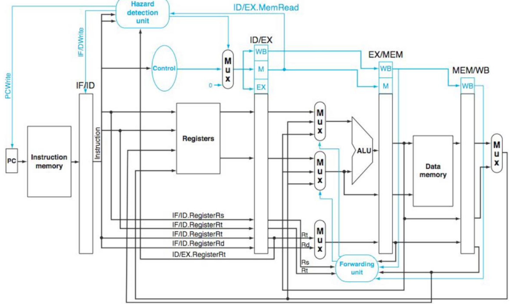

# 计算机系统基础 计组-第4次作业题目（2026春）

## 1

本习题讨论流水线对处理器时钟周期的影响。表中给出了数据通路中不同阶段延迟的两种情况，试根据这两种情况分别回答下列问题。

| | IF | ID | EX | MEM | WB |
| --- | --- | --- | --- | --- | --- |
| a. | 300ps | 400ps | 350ps | 500ps | 100ps |
| b. | 200ps | 150ps | 120ps | 190ps | 140ps |

1) 流水线处理器与非流水线处理器的时钟周期分别是什么？

2) lw 指令在流水线处理器和非流水线处理器中的总延迟分别是多少？

3) 如果可以将原流水线数据通路的一级划分为两级，每级的延迟是原级的一半，会选择哪一级进行划分？划分后处理器的时钟周期为多少？

假设处理器执行的指令比例下表两种情况所示，试根据每种情况分别回答下列问题。

| | ALU | beq | lw | sw |
| --- | --- | --- | --- | --- |
| a. | 50% | 25% | 15% | 10% |
| b. | 30% | 25% | 30% | 15% |

<!-- markdownlint-disable MD029 -->

4) 假设没有阻塞和冒险，数据存储器的利用率是多少（占总周期数的百分比）？

5) 假设没有阻塞和冒险，寄存器堆的写寄存器端口的利用率是多少？

<!-- markdownlint-enable MD029 -->

### 2

本习题讨论数据相关如何影响基本五级流水线的运行。试根据下表的两种指令序列情况分别回答下列问题。

指令序列 a.

```mips
lw $1, 40($6)
add $6, $2, $2
sw $6, 50($1)
```

指令序列 b.

```mips
lw $5, -16($5)
sw $5, -16($5)
add $5, $5, $5
```

1) 指出指令序列中存在的相关及其类型。

2) 假设该流水线处理器没有转发，指出指令序列中存在的冒险并加入 nop 指令以消除冒险。

3) 假设该流水线处理器中有充分的转发。指出指令序列中存在的冒险并加入 nop 指令以消除冒险。

根据下表的两种时钟周期情况，分别回答下列问题。

| | 无转发 | 充分的转发 | 仅 ALU 至 ALU 的转发 |
| --- | --- | --- | --- |
| a. | 300ps | 400ps | 360ps |
| b. | 200ps | 250ps | 220ps |

<!-- markdownlint-disable MD029 -->

4) 该指令序列在无转发和充分的转发时总执行时间分别是多少？后者相对于前者的加速比是多少。

5) 如果仅有 ALU 至 ALU 的转发（没有从 MEM 到 EX 的转发），如何加入 nop 指令以消除可能的冒险？

6) 该指令序列在仅有 ALU 至 ALU 的转发时总执行时间分别是多少？与无转发的情况相比，加速比是多少？

<!-- markdownlint-enable MD029 -->

### 3

本习题讨论指令集对流水线设计的影响。试根据下表的两条新指令回答下列问题。

| | 新指令 | 语义 |
| --- | --- | --- |
| a. | bezi (Rs), Label | if Mem[Rs] = 0 then PC = PC + Offs |
| b. | swi Rd, Rs(Rt) | Mem[Rs+Rt] = Rd |

1) 为了将这条新指令增加到 MIPS 指令集，必须对流水线数据通路做什么改动？

2) 需要在第 1) 问的数据通路上增加哪些控制信号？

3) 对新指令的支持是否会引入新的冒险？已有冒险导致的阻塞是否会更加严重？

### 4

本习题讨论转发、冒险检测和指令集设计之间的关系。分别根据下表的两个指令序列回答下列问题。假设其在一个五级流水线上执行。

指令序列 a.

```mips
lw $1, 40($6)
add $2, $3, $1
add $1, $6, $4
sw $2, 20($4)
and $1, $1, $4
```

指令序列 b.

```mips
add $1, $5, $3
sw $1, 0($2)
lw $1, 4($2)
add $5, $5, $1
sw $1, 0($2)
```

1) 如果没有转发或冒险检测电路，请插入 nop 指令以保证正确执行。

2) 重做第 1) 问，这次仅当通过改变或重排序指令都也不能避免冒险时才插入 nop 指令。假设可以使用寄存器 R7 作为临时寄存器。

3) 如果处理器中存在转发，但忘了实现冒险检测单元（以为实现了），代码执行时会发生什么情况？

4) 如果没有转发，对图中的冒险检测单元来说还需要哪些新的输入输出信号？以该指令序列为例，说明为什么需要这些信号。

图（原件第 8 页；图中蓝色部分是转发单元 Forwarding unit 与冒险检测单元 Hazard detection unit 的相关通路）：


