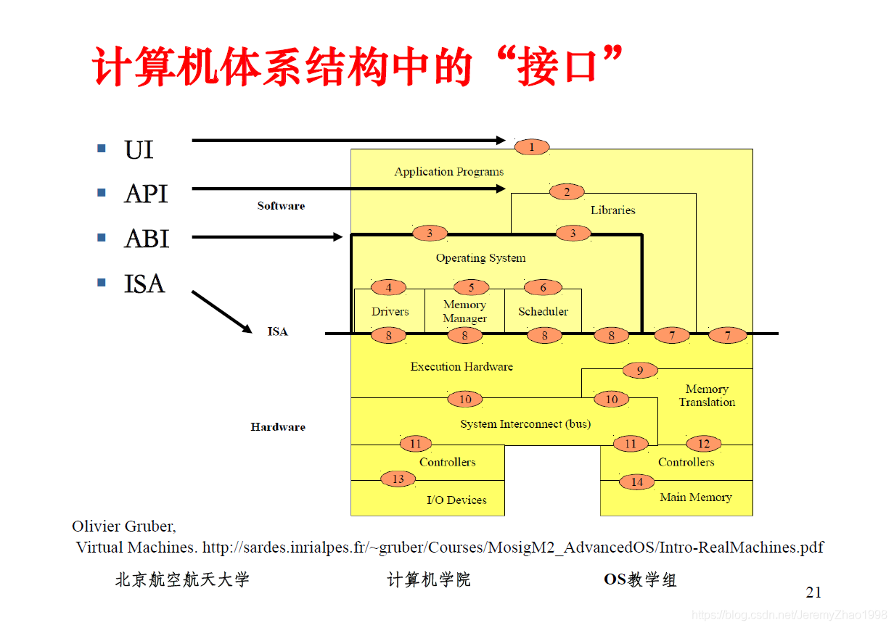
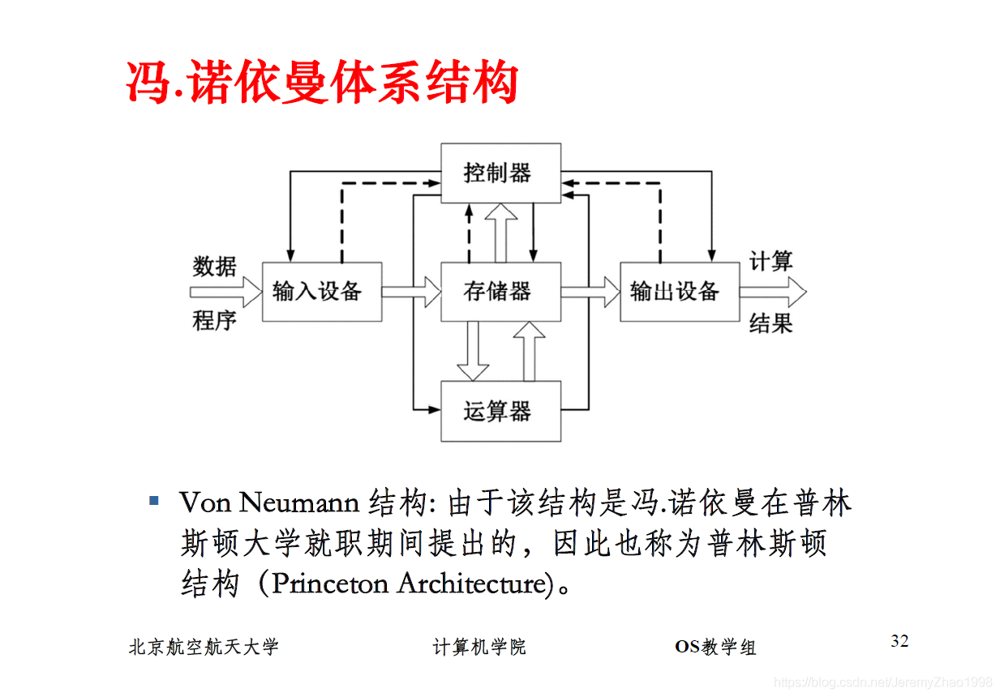
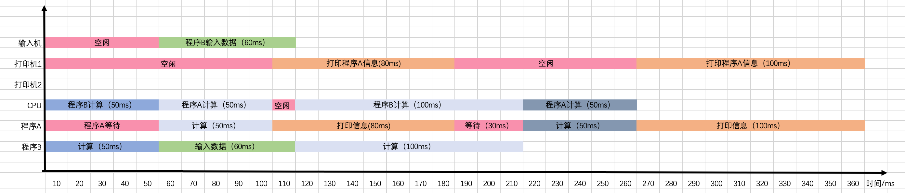
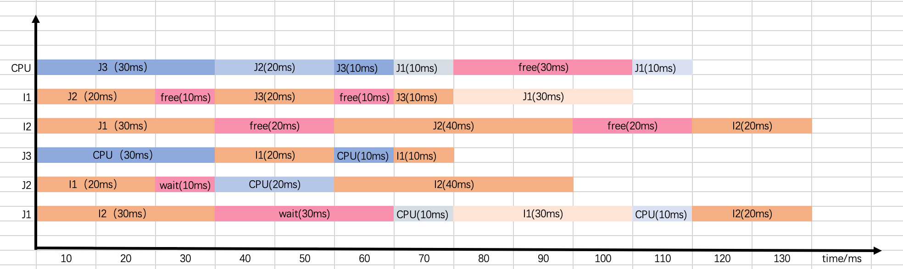

# 计算机系统基础 OS-第1次作业答案（年份未知）

## 1

### 题目

假如没有操作系统，怎样控制硬件？

### 答案

**答案：**

 如果没有操作系统，需要手动根据硬件各自不同的接口输入指令，以此来控制硬件

## 2

### 题目

计算机系统中不同层次接口的作用？

### 答案

**答案：**

 计算机体系结构接口可以分为硬件(ISA)，操作系统(ABI)，系统和应用程序(API)，用户(UI)四个层次.

指令集架构（英语：Instruction Set Architecture，缩写为ISA），又称指令集或指令集体系，是计算机体系结构中与程序设计有关的部分，包含了基本数据类型，指令集，寄存器，寻址模式，存储体系，中断，异常处理以及外部I/O。指令集架构包含一系列的opcode即操作码（机器语言），以及由特定处理器执行的基本命令。

在软件开发中，**应用二进制接口**（英语：application binary interface，缩写为**ABI**）是指两程序模块间的接口；通常其中一个程序模块会是库或操作系统所提供的服务，而另一边的模块则是用户所执行的程序。一个ABI定义了机器代码如何访问数据结构与运算程序，此处所定义的界面相当低端并且相依于硬件。

ABI涵盖了各种细节，如：数据类型的大小、布局和对齐;          调用约定)（控制着函数的参数如何传送以及如何接受返回值），例如，是所有的参数都通过栈传递，还是部分参数通过寄存器传递；哪个寄存器用于哪个函数参数；通过栈传递的第一个函数参数是最先push到栈上还是最后；  系统调用的编码和一个应用如何向操作系统进行系统调用；  以及在一个完整的操作系统ABI中，[目标文件](https://zh.wikipedia.org/wiki/目标文件)的二进制格式、程序库等等。

**应用程序接口**（英语：**a**pplication **p**rogramming **i**nterface[[1\]](https://zh.wikipedia.org/wiki/应用程序接口#cite_note-刘瑞新2018-1)），缩写为**API**[[2\]](https://zh.wikipedia.org/wiki/应用程序接口#cite_note-UnmehopaVemuri2006-2)，是一种[计算](https://zh.wikipedia.org/wiki/计算)[接口](https://zh.wikipedia.org/wiki/接口)，它定义多个[软件](https://zh.wikipedia.org/wiki/软件)[中介](https://zh.wikipedia.org/wiki/中介)之间的[交互](https://zh.wikipedia.org/w/index.php?title=交互&action=edit&redlink=1)，以及可以进行的[调用](https://zh.wikipedia.org/w/index.php?title=调用&action=edit&redlink=1)（call）或[请求](https://zh.wikipedia.org/w/index.php?title=请求&action=edit&redlink=1)（request）的种类，如何进行调用或发出请求，应使用的数据格式，应遵循的惯例等。它还可以提供[扩展机制](https://zh.wikipedia.org/w/index.php?title=扩展机制&action=edit&redlink=1)，以便用户可以通过各种方式对现有功能进行不同程度的扩展[[3\]](https://zh.wikipedia.org/wiki/应用程序接口#cite_note-Fisher1-3)。一个API可以是完全定制的，针对某个组件的，也可以是基于行业标准设计的以确保互操作性。通过[信息隐藏](https://zh.wikipedia.org/wiki/面向对象的程序设计)，API实现了[模块化编程](https://zh.wikipedia.org/wiki/模块化编程)，从而允许用户实现独立地使用接口。

**用户界面**（**User Interface**，简称**UI**，亦称**使用者界面**是系统和用户之间进行交互和信息交换的介质，它实现信息的内部形式与人类可以接受形式之间的转换。

用户界面是介于用户与硬件而设计彼此之间交互沟通相关软件，目的在使得用户能够方便有效率地去操作硬件以达成双向之交互，完成所希望借助硬件完成之工作，用户界面定义广泛，包含了人机交互与图形用户界面，凡参与人类与机械的信息交流的领域都存在着用户界面。

## 3

### 题目

冯诺依曼计算机的主要特点是什么？

### 答案

**答案：**

 冯·诺伊曼结构（von Neumann architecture），也称冯·诺伊曼模型（Von Neumann model）或普林斯顿结构（Princeton architecture），是一种将程序指令存储器和数据存储器合并在一起的计算机设计概念结构。依据冯·诺伊曼结构设计出的计算机称做冯.诺依曼计算机，又称存储程序计算机。体系结构图为

冯·诺依曼体系结构的主要特点有：

1.冯·诺依曼计算机主要由五大部件组成，分别是：运算器、控制器、存储器、输入设备和输出设备；

2.冯诺依曼体系结构的指令和数据均采用二进制码表示；

3.指令和数据以同等地位存放于存储器中，均可按地址寻访；

4.指令由操作码和地址码组成，操作码用来表示操作的性质，地址码用来表示操作数所在存储器中的位置；

5.指令在存储器中按顺序存放，通常指令是按顺序执行的，特定条件下，可以根据运算结果或者设定的条件改变执行顺序；

6.机器以运算器为中心，输入输出设备和存储器的数据传送通过运算器。

## 4

### 题目

设一计算机系统有输入机一台、打印机两台，现有二道程序同时投入运行，且程序 B 先开始运行，程序 A 后运行。程序 A 的运行轨迹为：计算 50ms，打印信息 80ms，再计算 50ms，打印信息 100ms，结束。程序 B 运行的轨迹为：计算 50ms，输入数据 60ms，再计算 100ms，结束。要求：

1. 用图画出这二道程序并发执行时的工作情况。
2. 说明在二道程序运行时，CPU 有无空闲等待？若有，在哪段时间内等待？为什么会空闲等待？
3. 程序 A、B 运行时有无等待现象？在什么时候会发生等待现象？

### 答案

**答案：**

 (1) 用图画出这二道程序并发执行时的工作情况。
 (2) 说明在二道程序运行时，CPU 有无空闲等待?若有，在哪段时间内等待?为什么会空 闲等待?
 (3) 程序 A、B 运行时有无等待现象?在什么时候会发生等待现象?

（1）工作情况如下

（2）由图可以看出，CPU由空闲等待，在100～110ms时会等待。因为此时程序B在输入数据，程序A在打印信息，所以此时CPU在空闲等待。

（3）程序A有两次等待，程序B无等待，程序A发生等待第一次是因为B正在占用CPU进行计算，A不能进行计算，第二次A打印完信息后，B正在进行计算，所以A必须等待。

## 5

### 题目

在单 CPU 和两台 I/O 设备（I1、I2）的多道程序设计环境下，同时投入 3 个作业 J1、J2 和 J3 运行，其对 CPU 和 I/O 设备使用的顺序与时间如下：

- J1：I2(30ms) → CPU(10ms) → I1(30ms) → CPU(10ms) → I2(20ms)
- J2：I1(20ms) → CPU(20ms) → I2(40ms)
- J3：CPU(30ms) → I1(20ms) → CPU(10ms) → I1(10ms)

假定 CPU 和 I/O 设备能够并行，I1 和 I2 能够并行。作业优先级 J1 < J2 < J3，高优先级作业可抢占低优先级作业的 CPU，但不能抢占 I/O 设备。问题：

1. 分别求出 3 个作业的周转时间。（作业的周转时间是指一个作业从提交到处理结束所经历的时间）
2. 计算 CPU 的利用率（计算时间 /（计算时间 + 空闲时间））。
3. 计算 I/O 设备的利用率（工作时间 /（工作时间 + 空闲时间））。

### 答案

**答案：**

 J1: I2(30ms)→CPU (10ms) →I1(30ms) →CPU (10ms) →I2(20ms)

 J2: I1(20ms) →CPU (20ms) →I2(40ms)

 J3: CPU(30ms) →I1(20ms) →CPU(10ms) →I1(10ms)

假定 CPU 和 I/O 设备能够并行，I1 和 I2 能够并行。作业优先级 J1<J2<J3，高优先级作业可抢占 低优先级作业的 CPU，但不能抢占 I/O 设备。
 问题:

–分别求出 3 个作业的周转时间。(作业的周转时间是指指一个作业从提交到处理结束所经 历的时间)
 –计算 CPU 的利用率(计算时间/(计算时间+空闲时间))。
 –计算 I/O 设备的利用率(工作时间/(工作时间+空间时间))

(1)三个作业 $J_1,J_2,J_3$的周转时间分别为130ms, 90ms, 70ms.

(2) CPU利用率为

$$
\eta =\frac{80ms}{130ms} = 61.5\%
$$
(3) $I_1$的利用率为
$$
\eta _1 = \frac{80ms}{130ms}=61.5\%
$$
 $I_2$的利用率为
$$
\eta _2 = \frac{90ms}{130ms}=69.2\%
$$
