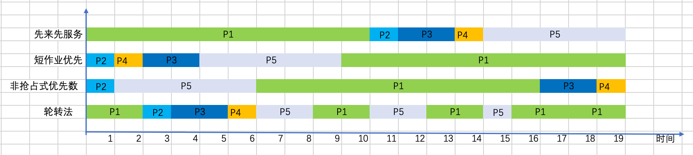

# 计算机系统基础 OS-第5次作业答案（年份未知）

## 1

### 题目

有五个进程 P1、P2、P3、P4、P5，它们同时依次进入就绪队列，它们的优先数和需要的处理器时间如下表

| 进程 | 处理器时间 | 优先级（数小优先级高） |
| --- | --- | --- |
| P1 | 10 | 3 |
| P2 | 1 | 1 |
| P3 | 2 | 3 |
| P4 | 1 | 4 |
| P5 | 5 | 2 |

忽略进行调度等所花费的时间，回答下列问题：

1. 写出采用“先来先服务”、“短作业（进程）优先”、“非抢占式的优先数”和“轮转法”等调度算法，进程执行的次序。（其中轮转法的时间片为 2）
2. 分别计算上述算法中各进程的周转时间和等待时间，以及平均周转时间。

### 答案

**答案：**

1. 各调度算法下进程的执行次序如下。

   

   - 先来先服务：P1 → P2 → P3 → P4 → P5
   - 短作业优先：P2 → P4 → P3 → P5 → P1
   - 非抢占式优先数：P2 → P5 → P1 → P3 → P4
   - 轮转法（时间片为 2）：P1 → P2 → P3 → P4 → P5 → P1 → P5 → P1 → P5 → P1 → P1

2. 各算法下进程的周转时间、等待时间与执行时间如下。

先来先服务

| 进程 | 周转时间 | 等待时间 | 执行时间 |
| --- | --- | --- | --- |
| P1 | 10 | 0 | 10 |
| P2 | 11 | 10 | 1 |
| P3 | 13 | 11 | 2 |
| P4 | 14 | 13 | 1 |
| P5 | 19 | 14 | 5 |

平均周转时间： $(10+11+13+14+19)/5=13.4$

短作业优先

| 进程 | 周转时间 | 等待时间 | 执行时间 |
| --- | --- | --- | --- |
| P1 | 19 | 9 | 10 |
| P2 | 1 | 0 | 1 |
| P3 | 4 | 2 | 2 |
| P4 | 2 | 1 | 1 |
| P5 | 9 | 4 | 5 |

短作业优先的平均周转时间为： $(19+1+4+2+9)/5=7$

非抢占式优先数

| 进程 | 周转时间 | 等待时间 | 执行时间 |
| --- | --- | --- | --- |
| P1 | 16 | 6 | 10 |
| P2 | 1 | 0 | 1 |
| P3 | 18 | 16 | 2 |
| P4 | 19 | 18 | 1 |
| P5 | 6 | 1 | 5 |

非抢占式优先数算法的平均周转时间为： $(16+1+18+19+6)/5=12$

时间片轮转法

| 进程 | 周转时间 | 等待时间 | 执行时间 |
| --- | --- | --- | --- |
| P1 | 19 | 9 | 10 |
| P2 | 3 | 2 | 1 |
| P3 | 5 | 3 | 2 |
| P4 | 6 | 5 | 1 |
| P5 | 15 | 10 | 5 |

时间片轮转法的平均周转时间为： $(19+3+5+6+15)/5=9.6$

## 2

### 题目

一个系统有 4 个进程和 5 个可分配资源，当前分配和最大需求如下：

| 进程 | 已分配资源 | 最大需求量 | 可用资源 |
| --- | --- | --- | --- |
| 进程 A | 10211 | 11213 | 00x12 |
| 进程 B | 20110 | 22210 | |
| 进程 C | 11010 | 21310 | |
| 进程 D | 11110 | 11221 | 111 |

若保持该状态是安全状态，那么 $x$ 的最小值是多少？

### 答案

**答案：** 最小值为 1。

如果 $x=1$，存在安全序列 D, A, B, C。
