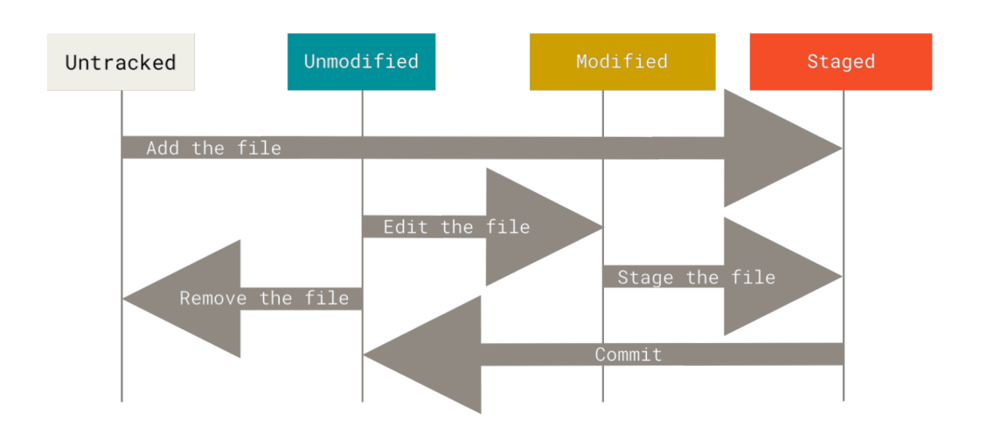
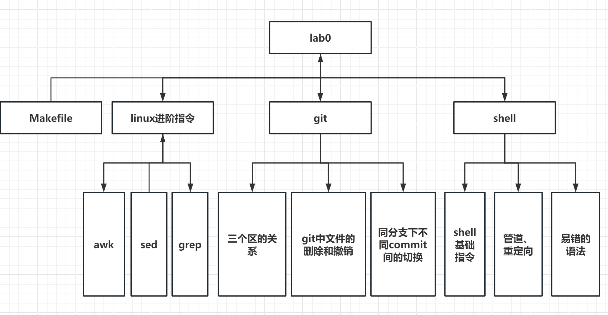

# 实验报告

## 思考题

### 0.1

$Q:$对比```cat Untracked.txt```、```cat Stage.txt```的结果，体会```README.txt```所处位置的不同。```cat Modified.txt```和第一次执行```add```命令之前的status是否一样，并思考原因。
$A:$（以下内容省略掉```Untracked.txt```、```Stage.txt```和```Modified.txt```对```git```指令输出的影响）```Untracked.txt```中，新建的```README.txt```处于未被跟踪状态，没有位于暂存区。而在```Stage.txt```中，第一次修改后的```README.txt```处于被跟踪状态，被加入了暂存区，但此时还未提交，还没有进入存储区。

第一次```add```之前，```status```是```Untracked files```，而在```Modified.txt```的内容里则是同时有```Changes to be committed``` 和```Changes not staged for commit```，两者的具体内容都是```README.txt的modified```

```Modified.txt```中，```README.txt```做的第二次修改并没有用```add```指令加入暂存区。但第一次修改已经加入了暂存区，因此```README.txt```被认为是已经被跟踪的，因此```Modified.txt```中显示该文件被修改。第一次执行```add```指令之前，```README.txt```的新建和修改都没有被追踪，只显示该文件未被追踪

#### 0.2



Q:思考一下箭头中的```add the file```、```stage the file```和```commit```分别对应的是```git```里的哪些命令呢？

A:
（以下回答省略git）

|箭头|命令|
|-|-|
|add the file|add|
|stage the file|add|
|commit|commit|

#### 0.3

Q1: 代码文件```print.c```被错误删除时，应当使用什么命令将其恢复？

A1: ```git checkout print.c```

Q2: 代码文件```print.c```被错误删除后，执行了```git rm print.c``` 命令，此时应当使用什么命令将其恢复？

A2: ```git reset HEAD <file>```+```git checkout --print.c```

Q3: 无关文件 ```hello.txt``` 已经被添加到暂存区时，如何在不删除此文件的前提下将其移出暂存区？

A3:```git rm --chached hello.txt```

#### 0.4

A: 整个流程中，从第三步开始，```git log```显示的```commit```信息如下：

|步|commit信息|
|--|--|
|第四步|1,2,3|
|第五步|1,2|
|第六步|1|
|第七步|3|

在第七步中，我使用第三次提交的hash值，成功回到了最新提交是第三次提交的状态。

```git reset --hard```可以改变仓库状态，让仓库的最新提交和指令指定的一致。该指令可以向前，也可以向后。

#### 0.5

A:

| 命令 | 结果 |
| --- | --- |
| echo first | 屏幕显示first |
| echo secod > output.txt | 屏幕无显示，output.txt内容为second |
| echo third > output.txt | 屏幕无显示，output.txt内容为third |
| echo forth >> output.txt | 屏幕无显示，output.txt内容为third\nforth (\n代表换行) |

#### 0.6

A1: command文件：

```text
echo 'echo Shell Start...'>> test
echo 'echo set a = 1'>> test
echo 'a=1'>> test
echo 'echo set b = 2' >> test
echo 'b=2'>> test
echo 'echo set c = a+b' >> test
echo 'c=$[$a+$b]' >> test
echo 'echo c = $c' >> test
echo 'echo save c to ./file1' >> test
echo 'echo $c>file1' >> test
echo 'echo save b to ./file2' >> test
echo 'echo $b>file2' >> test
echo 'echo save a to ./file3' >> test
echo 'echo $a>file3' >> test
echo 'echo save file1 file2 file3 to file4' >> test
echo 'cat file1>file4' >> test
echo 'cat file2>>file4' >> test
echo 'cat file3>>file4' >> test
echo 'echo save file4 to ./result' >> test
echo 'cat file4>>result' >> test
```

result结果：

```text
3
2
1
```

在test文件中，我们定义了a、b分别为1、2，同时定义了c=a+b，然后将c、b、a的内容分别用echo指令输出，同时重定向到file1、2、3，这样，file1、2、3的内容分别是3、2、1，然后我们把file1、2、3的内容用echo指令输出，并重定向到file4（file2、file3的重定向为在原有内容后添加的重定向）。最后我们将file4的内容输出并重定向到result，于是result的内容就是file1、2、3的内容，为3\n2\n1

A2: 对```echo echo Shell Start```和```echo 'echo Shell Start'```而言，效果没有区别。而对```echo echo $c>file1```与```echo 'echo $c>file1'```而言，有区别，前者会将'echo $c'重定向到file1，而后者则是将'echo $c>file1'输出到屏幕上。

### 实验难点图示



### 实验心得体会

lab0的主要目的是帮助我们熟悉linux及其相关操作，而对于缺乏linux使用经验的我来说，整个实验很重要。指导书等材料提供的知识少且分散，完成一个题目往往需要横跨多个资料乃至搜索引擎，才能获取到足够完成题目的知识。不过，面对那些陌生的指令我，从一头雾水到渐渐了解它们的作用，这个实验还是给了我很大的帮助。

之前受困于对图形化界面的需求感，我一直对命令行终端抱有比较大的畏惧心理。而在本次实验中，我逐渐体会到命令行终端在另一种意义上的便利——舍弃视觉上的快捷而换来无所不能的强大。接下来我还需要进行更多练习，为os之后的lab做好准备。
