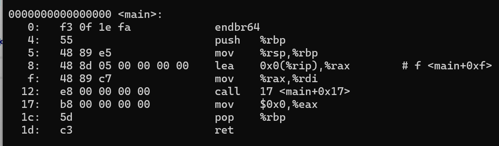
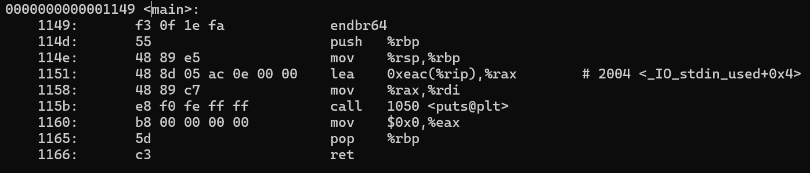
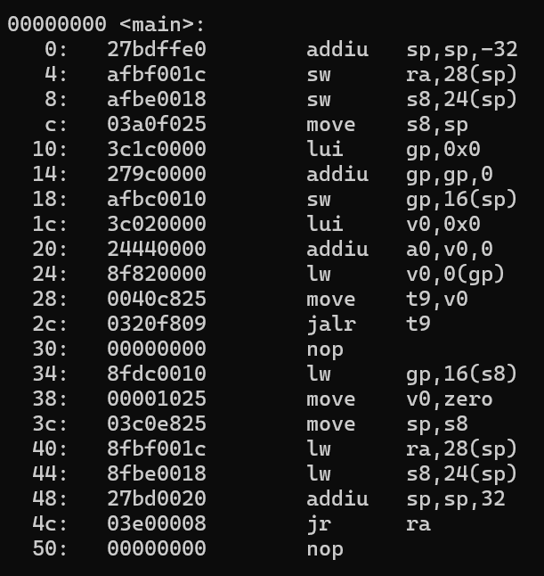
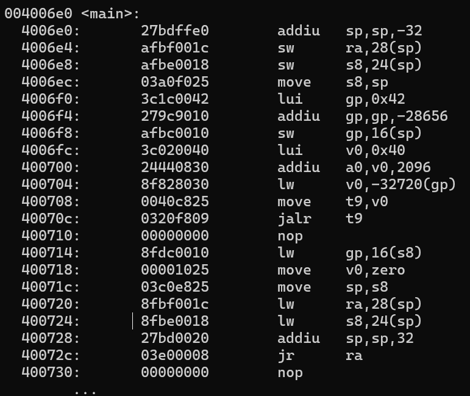
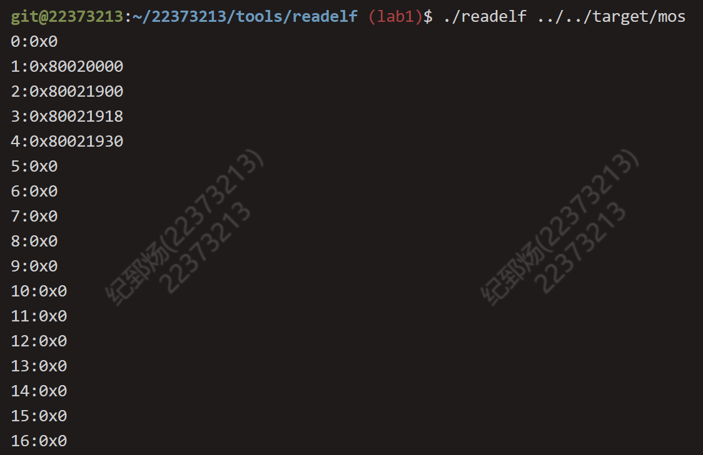
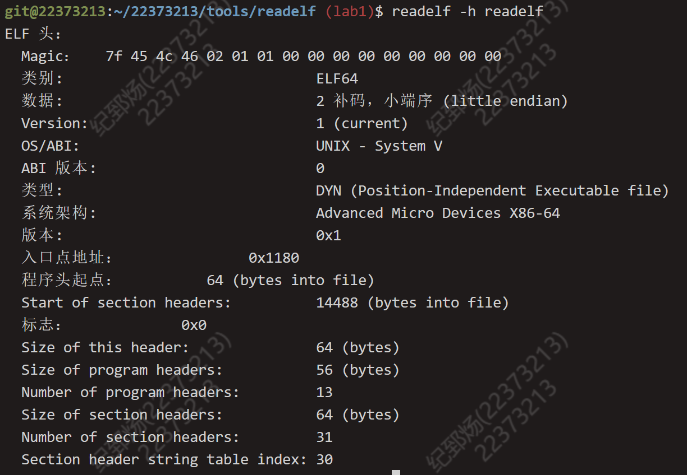
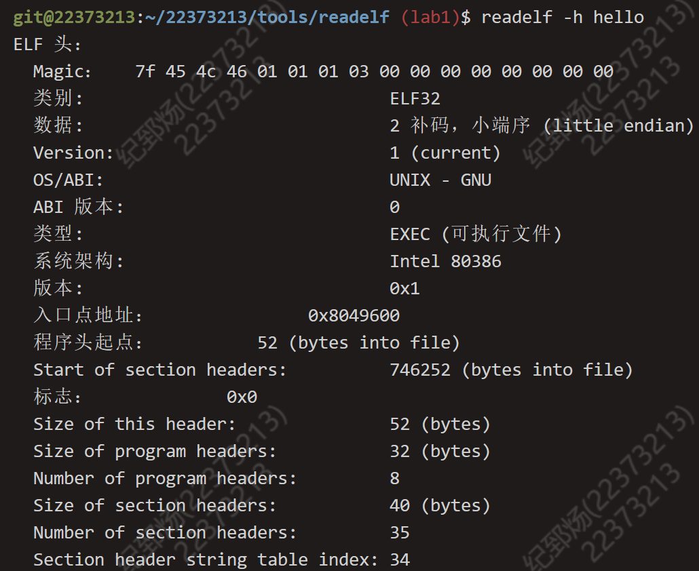
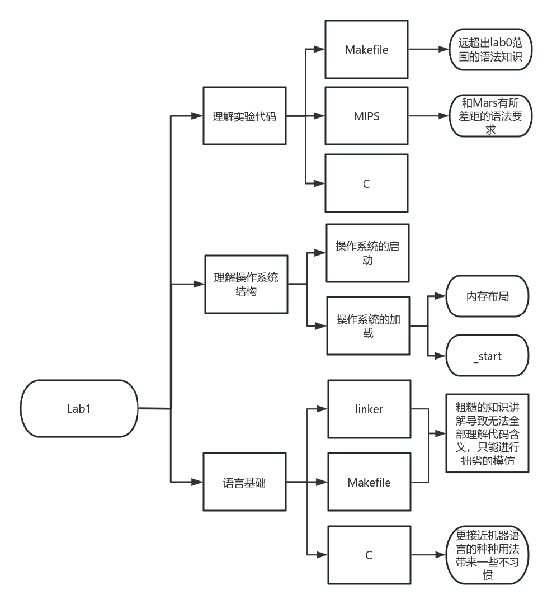

# Lab1实验报告

## Thinking

### 1.1

#### 问题

使用原生x86工具链和MIPS交叉编译工具链，重复编译和解析过程，观察相应的结果，并解释向objdump传入的参数的含义

回答：

#### 现象

使用x86原生工具编译并反汇编（仅展示main函数的部分）

**仅编译不链接：**

**编译并链接：**


使用MIPS交叉编译工具链并反汇编（仅展示main函数的部分）

**仅编译不链接：**

**编译并链接：**


可以明显观察出，使用x86工具链得到的结果明显短于MIPS交叉编译工具链，且两个工具链编译但不链接得到的结果中，均有在main函数中调用printf时跳转的函数地址为0.而在链接后，根据工具链不同，那里被填上了不同的数值。

#### objdump参数解释

objdump命令中，-D代表反汇编机器码的所有section，-S代表将代码段反汇编的同时，将反汇编和源代码交替显示。

因此指导书上的命令表示将所有的section反汇编，并将反汇编代码和原码交替显示。

### 1.2

#### 问题

  1. 尝试使用编写的 readelf 程序解析之前在 target 目录下生成的内核 ELF 文件
  2. 也许你会发现我们编写的 readelf 程序是不能解析 readelf 文件本身的，而我们刚才介绍的系统工具 readelf 则可以解析，这是为什么呢？（提示：尝试使用 readelf -h，并阅读 tools/readelf 目录下的 Makefile，观察 readelf 与 hello 的不同）

#### 解析内核ELF文件

解析结果为：


#### 无法解析readelf原因

```readelf -h readelf``` 结果


```readelf -h hello```结果


因为readelf是在x86架构下编译出的文件，而target目录下的mos文件则是使用交叉编译工具链进行的编译，前者基于的架构、文件类型、cpu位数均和后者有很大区别。

### 1.3

#### 问题

理论课上我们了解到，MIPS 体系结构上电时，启动入口地址为 0xBFC00000（其实启动入口地址是根据具体型号而定的，由硬件逻辑确定，也有可能不是这个地址，但一定是一个确定的地址），但实验操作系统的内核入口并没有放在上电启动地址，而是按照内存布局图放置。思考为什么这样放置内核还能保证内核入口被正确跳转到？

#### 回答

因为在实验中，启动过程的第一阶段是由QEMU模拟器直接加载ELF格式文件来代替的。而我们编写的链接文件，指定了内核的.txt .data .bss等的位置，同时使用了ENTRY(_start)指定了程序入口，对应生成的ELF文件包含了这些信息，所以内核入口能被正确跳转。

## 难点分析



我认为，readelf与printk的实现，本质都是对C语言的语法考察，而在os课程中，更强调C语言作为一门接近机器语言的高级语言的性质。这和之前的数据结构等课程有所不同。熟悉了相关的语法知识后，这两个部分的编程难度都不算大。

而加载内核至位置，这个问题的主要难度在于教程本身提供的知识仅能勉强完成任务，而无法帮助人完全理解相关文件，因此我不得不根据一些猜测才能完成这部分的内容。

## 实验体会

本次实验一大难度在于整合学习到的知识，理解整个系统的代码。刚入手时切实感到了令人头大的难度，但是当我真正理清逻辑时，仿佛一瞬间看清了整个系统的结构，感受到了一种源自于绝对精确的机器的美。

如果说OO让我见识到了什么是真正的高级语言，那么OS就让我见识到了真正闪烁底层逻辑之美的C语言。一直以来，在我看来高级语言到物理硬件间仿佛存在一层认知之幕，完全无法理解它们间的联系。然而现在我勉强能领会到一点从底层贯穿到顶层的技术线，领会到学习了这么久的C/C++的另一面。当printk函数正常运行时，那种满足感更甚于OO写出来一个完整的项目，就好像长久以来仿佛天经地义一般存在于编程世界里的一块幕布被扯了下来，让我能领会代码最底层的逻辑和机器语言升格为高级语言那一瞬间的美。
