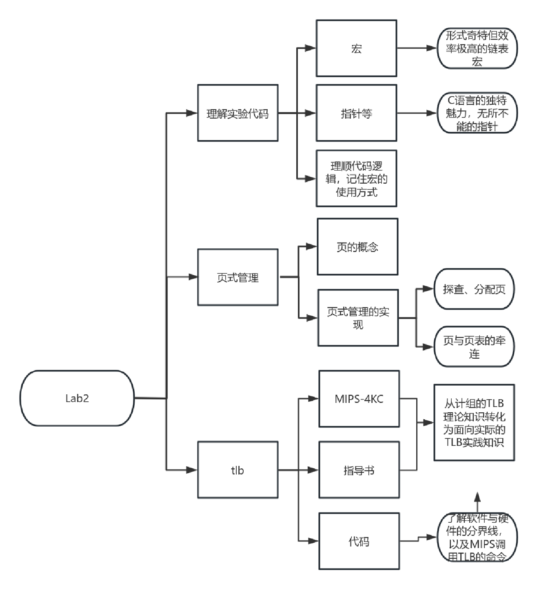

# lab2实验报告

## Thinking

### 2.1

**Q:** 请根据上述说明，回答问题：在编写的 C 程序中，指针变量中存储的地址被视为虚拟地址，还是物理地址？MIPS 汇编程序中 lw 和 sw 指令使用的地址被视为虚拟地址，还是物理地址？

**A:** 都是虚拟地址

### 2.2

**Q:**

- 从可重用性的角度，阐述用宏来实现链表的好处。
- 查看实验环境中的 /usr/include/sys/queue.h，了解其中单向链表与循环链表的实现，比较它们与本实验中使用的双向链表，分析三者在插入与删除操作上的性能差异。

**A:**

- 宏定义封装链表可以以较高的效率实现代码的复用，提高代码的可读性
- 单向链表：在删除和在某一项前面插入时需要从链表头遍历到待删除结点，但是如果在某一项后面插入就可以直接执行该操作
- 循环链表：该链表可以直接在尾部插入，其它情况于单向链表同样
- 双向链表：该链表可以直接插入、删除指定的某一项，但如果想要访问链表的尾节点，仍然需要遍历整个链表

### 2.3

**Q:** 请阅读 include/queue.h 以及 include/pmap.h, 将 Page_list 的结构梳理清楚，选择正确的展开结构。

**A:** C

### 2.4

**Q:**
• 请阅读上面有关 TLB 的描述，从虚拟内存和多进程操作系统的实现角度，阐述 ASID的必要性。
• 请阅读 MIPS 4Kc 文档《MIPS32® 4K™ Processor Core Family Software User’sManual》的 Section 3.3.1 与 Section 3.4，结合 ASID 段的位数，说明 4Kc 中可容纳不同的地址空间的最大数量。

**A:**

  1. 每个进程都有属于自己的页表和虚拟地址空间，同一虚拟地址在不同虚拟地址空间中会被映射到不同的物理地址上，必须区分清楚进程间的差异性才能正确映射地址。

  2. 在JTLB中，ASID占据了8位，同时在3.4节中有写："The ASID field of the virtual address is the same as the ASID field of the TLB entry"，所以最多支持 $2^8$即256个不同的地址空间。

### 2.5

**Q:**
• tlb_invalidate 和 tlb_out 的调用关系？
• 请用一句话概括 tlb_invalidate 的作用。
• 逐行解释 tlb_out 中的汇编代码。

**A:**

  1. tlb_invalidata函数中调用了tlb_out函数。
  2. 令给定进程中的给定虚拟地址对应的TLB表项无效化。
  3.

  ```text
LEAF(tlb_out) #叶函数宏
.set noreorder
 mfc0    t0, CP0_ENTRYHI #取出现在寄存器中的EntryHi
 mtc0    a0, CP0_ENTRYHI #将传入参数写入EntryHi
 nop
 /* Step 1: Use 'tlbp' to probe TLB entry */
 /* Exercise 2.8: Your code here. (1/2) */
 tlbp #根据写入的，即参数a0，查找TLB中对应的表象，并把索引存储在Index寄存器中
 nop
 /* Step 2: Fetch the probe result from CP0.Index */
 mfc0    t1, CP0_INDEX # 将Index寄存器的值传入t1寄存器
.set reorder
 bltz    t1, NO_SUCH_ENTRY #如果这个值小于0，那么说明TLB中没有找到a0对应的项，跳转到对应的位置
.set noreorder
 mtc0    zero, CP0_ENTRYHI #否则，说明TLB中有对应的项，则把EntryHi和EntryLo置为零
 mtc0    zero, CP0_ENTRYLO0
 mtc0    zero, CP0_ENTRYLO1
 nop
 /* Step 3: Use 'tlbwi' to write CP0.EntryHi/Lo into TLB at CP0.Index  */
 /* Exercise 2.8: Your code here. (2/2) */
 tlbwi #然后写入索引指定的TLB表项中，即完成该表项的重置
 nop
.set reorder

NO_SUCH_ENTRY:
 mtc0    t0, CP0_ENTRYHI #恢复现场
 j       ra #返回
END(tlb_out)
  ```

### 2.6

**Q:** 在现代的64位系统中，提供了64位的字长，但实际上不是64位页式存储系统。假设在64位系统中采用三级页表机制，页面大小4KB。由于64位系统中字长为8B，且页目录也占用一页，因此页目录中有512个页目录项，因此每级页表都需要9位。因此在64位系统下，总共需要3 × 9 + 12 = 39位就可以实现三级页表机制，并不需要64位。现考虑上述39位的三级页式存储系统，虚拟地址空间为512GB，若记三级页表的基地址为
，请你计算：

- 三级页表页目录的基地址?
- 映射到页目录自身的页目录项?

**A:**

1. $PT_base|PT_base>>9|PT_base>>18$
2. $PT_base|PT_base>>9|PT_base>>18|PT_base>>27$

### 2.7

**Q:** 简单了解并叙述 X86 体系结构中的内存管理机制，比较 X86 和 MIPS 在内存管理上的区别。

**A:**
**x86体系结构中的内存管理机制**
x86体系结构使用分段和分页两种内存管理技术。分段用于将逻辑地址转换为线性地址，而分页则将线性地址转换为物理地址。这允许操作系统创建看起来连续的地址空间，即使在物理内存上这些数据是分散存储的。

在现代x86架构（特别是x86-64）中，分段已不再像过去那样使用，多数操作系统配置处理器使用平坦模式（flat mode），它们会设置所有段寄存器为基本覆盖整个32位或64位的线性地址空间，实际上使用的是分页机制。

分页允许系统将内存分为多个固定大小的页面，通常为4 KiB。x86支持多级页表，从而可以有效地映射大量的物理内存。分页机制通过页表条目（PTEs）控制内存访问权限，支持物理内存的虚拟化，并在现代计算中用以支持操作系统的内存隔离、保护和交换。

#### x86与MIPS在内存管理上的区别

1. x86架构支持分段和分页，而MIPS只支持分页。
2. x86体系结构的分段可以允许更细粒度的内存保护和访问控制，而MIPS的保护通常通过页表实现。
3. x86具有复杂的内存管理和保护机制，能够支持更大规模和更复杂的操作系统需求，但也导致硬件和软件的复杂度增加。
4. MIPS由于内存管理较为简单，因此在硬件实现上可能更简洁，但它的内存管理能力可能不如x86丰富。

## 实验难点图示



## 体会与感想

个人体会lab2到lab1难度上有一定程度的飞跃。一方面代码量增大很多，另一方面，宏、指针、指针的指针及其对应的含义、与虚拟地址、物理地址的关系容易让人晕头转向。

但是从另一个角度来说，这个lab依旧是让人感到兴奋的。在上个lab中，神秘的、仿佛与生俱来、不言自明的printf揭下了它的面纱，而在这个lab中，我们终于触碰到了硬件与软件交界处的最极限位置。做完这个lab不仅能巩固理论课所学知识还能对整个硬件系统有更深一步的了解
