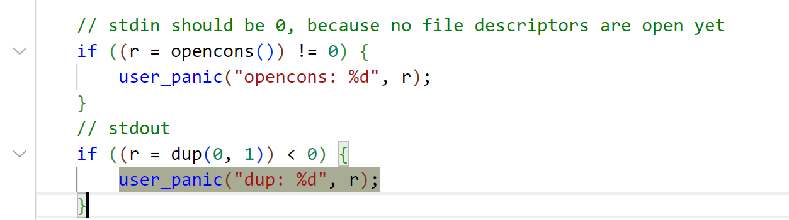

# 计算机系统基础 · 实验 · OS-lab6 · 2024春 · 实验报告

## Tinking

### Thinking 6.1

Q：示例代码中，父进程操作管道的写端，子进程操作管道的读端。如果现在想让父进程作为“读者”，代码应当如何修改？

A：只需要根据fork的结果，交换父进程和子进程应当执行的操作。

### Thinking 6.2

Q：上面这种不同步修改 pp_ref 而导致的进程竞争问题在 user/lib/fd.c 中的 dup 函数中也存在。请结合代码模仿上述情景，分析一下我们的 dup 函数中为什么会出现预想之外的情况？

A：dup函数一共包含两个过程：

- 将newfd所在的虚拟页映射到oldfd所在的物理页
- 将newfd的数据所在的虚拟页映射到oldfd的数据所在的物理页

如果在执行过程中，父进程刚执行完第一个过程，此时因时钟中断而让子进程继续执行，则子进程会判断为写进程已关闭，于是就发生了意料之外的情况

### Thinking 6.3

Q：阅读上述材料并思考：为什么系统调用一定是原子操作呢？如果你觉得不是所有的系统调用都是原子操作，请给出反例。希望能结合相关代码进行分析说明。

A：每次执行系统调用前都会禁用中断，因此系统调用一定是原子操作。

### Thinking 6.4

Q：仔细阅读上面这段话，并思考下列问题

- 按照上述说法控制 pipe_close 中 fd 和 pipe unmap 的顺序，是否可以解决上述场景的进程竞争问题？给出你的分析过程。
- 我们只分析了 close 时的情形，在 fd.c 中有一个 dup 函数，用于复制文件描述符。试想，如果要复制的文件描述符指向一个管道，那么是否会出现与 close 类似的问题？请模仿上述材料写写你的理解。

A：

- 可以解决。如果先解除p[0]的映射，则ref(p[0])更要小于ref(pipe)，永远不会出现ref(p[0]) == ref(pipe)，不会出现进程竞争问题。
- 会，fd的引用总数总是比pipe低一些。当管道的dup进行到一半时，若先映射fd，再映射pipe，就会使得fd的引用次数的+1先于pipe。这样会使得出现pageref(pipe) == pageref(fd)的情况成为可能。这个问题也可以通过调换两个map的顺序来解决。

### Thinking 6.5

Q：在 Lab1 中我们介绍了 data text bss 段及它们的含义，data 段存放初始化过的全局变量，bss 段存放未初始化的全局变量。关于 memsize 和 filesize ，我们在 Note1.3.4中也解释了它们的含义与特点。关于 Note 1.3.4，注意其中关于“bss 段并不在文件中占数据”表述的含义。回顾 Lab3 并思考：elf_load_seg() 和 load_icode_mapper()函数是如何确保加载 ELF 文件时，bss 段数据被正确加载进虚拟内存空间。bss 段在 ELF 中并不占空间，但 ELF 加载进内存后，bss 段的数据占据了空间，并且初始值都是 0。请回顾 elf_load_seg() 和 load_icode_mapper() 的实现，思考这一点是如何实现的？

A：对于bss段中和text&data段共同占据一个页面的部分，就将这一部分置零；对于bss段其它部分，仅使用syscall_mem_malloc分配页面而不映射到任何内容。

### Thinking 6.6

Q： 通过阅读代码空白段的注释我们知道，将标准输入或输出定向到文件，需要我们将其 dup 到 0 或 1 号文件描述符（fd）。那么问题来了：在哪步，0 和 1 被“安排”为标准输入和标准输出？请分析代码执行流程，给出答案。

A：在init.c的main函数中将0和1分别被设置为了标准输入和标准输出。

### Thinking 6.7

Q：在 shell 中执行的命令分为内置命令和外部命令。在执行内置命令时 shell 不需要 fork 一个子 shell，如 Linux 系统中的 cd 命令。在执行外部命令时 shell 需要 fork一个子 shell，然后子 shell 去执行这条命令。

据此判断，在 MOS 中我们用到的 shell 命令是内置命令还是外部命令？请思考为什么Linux 的 cd 命令是内部命令而不是外部命令？

A；

- shell命令是外部命令，因为在执行shell命令时，当前进程会通过fork产生一个子shell，符合外部命令的定义。
- linux中的内部命令由shell程序识别并在shell程序内部完成运行，通常在linux系统加载运行时就被加载并驻留在系统内存中。cd指令非常简单，将其作为内部指令可以避免每次执行都需要fork并加载程序，提高执行效率。

### Thinking 6.8

Q：在你的 shell 中输入命令 ls.b | cat.b > motd。

- 请问你可以在你的 shell 中观察到几次 spawn ？分别对应哪个进程？
- 请问你可以在你的 shell 中观察到几次进程销毁？分别对应哪个进程？

A：

- 2次，这两次生成的子进程分别用于执行ls.b和cat.b
- 2次，这2个进程分别是shell执行ls.b和cat.b时通过spawn生成的子进程

## 实验难点

我认为该实验主要难点是和管道相关的内存分配。

子进程和父进程的内存空间中都分为写端fd和读端fd分配了一个虚拟页，但是子进程和父进程的读端所在的虚拟页映射到了同一个物理页，同样他们的写端所在的虚拟也也都映射到了同一个物理页。

## 体会与感想

在lab6之后，一个真正的操作系统便彻底形成了。自此，OS实验课告一段落。通过自己动手实现一个简单的操作系统，我学会了相当多的实践知识，也对理论课的很多内容有了新的理解。
