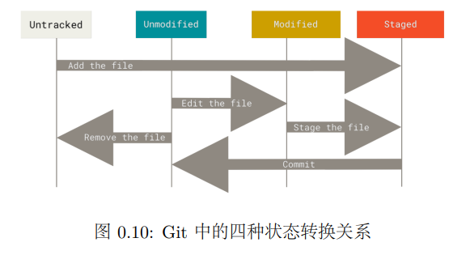
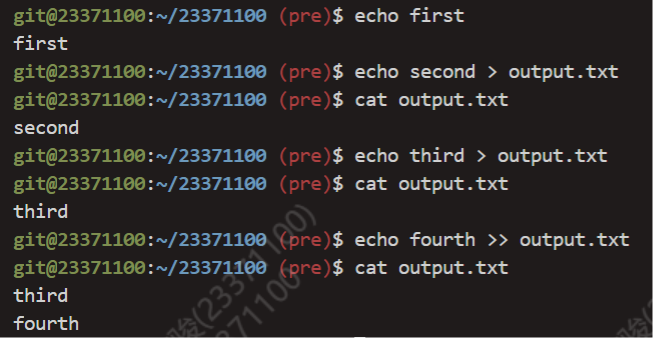
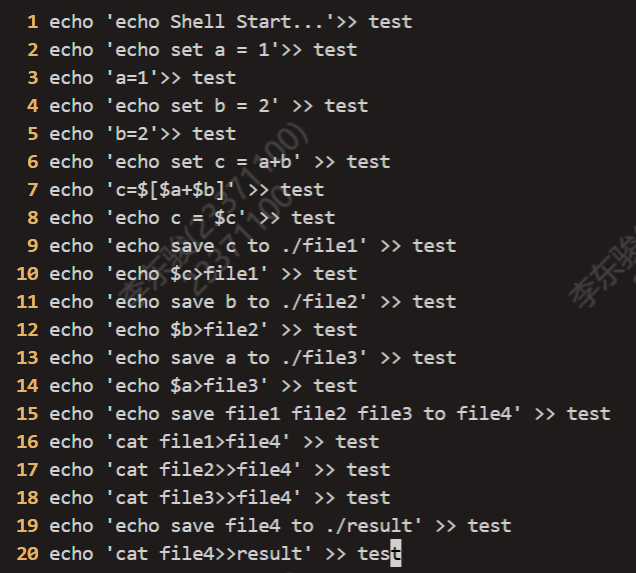
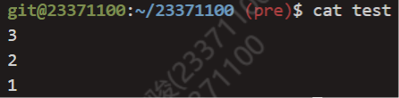

# OS2025-Lab0实验报告

## 一、思考题

### Thinking 0.1

**Question**:

执行命令cat Untracked.txt和cat Stage.txt，对比两次运行的结果，体会README.txt两次所处位置的不同。执行命令cat Modified.txt，观察其结果和第一次执行add命令之前的status是否一样，并思考原因。

**Answer**:

（这里我自己实践得到的，写完才注意到指导书后面附上了结果/(ㄒoㄒ)/~~，但不知道为什么指导书写的是英文，我看到的是中文）

Untracked.txt中显示README.txt为**未跟踪的文件**，说明其当时在工作区，不在缓存区中，是Untracked file。

Stage.txt中显示README.txt为**要提交的变更**，说明其已在缓存区，但还未进入存储区，是Staged file。

Modified.txt中显示README.txt为**尚未暂存以被提交的变更**，说明其已被跟踪，但还未被加入暂存区，是Modified file。

最后的status与第一次执行add之前不一样，区别在于**是否被跟踪**，所以最开始是Untracked file，最后是Modified file。

#### Thinking 0.2

**Question:**

仔细看看0.10，思考一下箭头中的add the file、stage the file和commit分别对应的是 Git 里的哪些命令呢？

**Answer:**

add the file: `git add [filename]`

stage the file: `git add [filename]`

commit: `git commit -m [comment]`

#### Thinking 0.3

**Question1:**

代码文件print.c被错误删除时，应当使用什么命令将其恢复？

**Answer:**

`git checkout -- print.c`

**Question2:**

代码文件print.c被错误删除后，执行了`git rm print.c`命令，此时应当用什么命令将其恢复？

**Answer:**

`git reset HEAD print.c`

**Question3:**

无关文件hello.txt已经被添加到暂存区时，如何在不删除此文件的前提下将其移出暂存区？

**Answer:**

`git rm --cached hello.txt`

#### Thinking 0.4

**Question1:**

进行版本回退。执行命令`git reset --hard HEAD^`后，再执行`git log`，观察其变化。

**Answer:**

git log中含1和2两条commit记录

**Question2:**

找到提交说明为1的哈希值，执行命令`git reset --hard \<hash>`后，再执行`git log`，观察其变化。

**Answer:**

git log中仅含1一条commit记录

**Question3:**

现在已经回到了旧版本，为了再次回到新版本，执行`git reset --hard \<hash>`，再执行`git log`，观察其变化。（使用comment为3的hash值）

**Answer:**

git log含1,2,3三条commit记录

#### Thinking 0.5

**Question:**

执行如下命令，并查看结果

`echo first`

`echo second > output.txt`

`echo third > output.txt`

`echo forth >> output.txt`

**Answer:**

#### Thinking 0.6

**Question1:**

使用你知道的方法（包括重定向）创建下图内容的文件（文件命名为test），将创建该文件的命令序列保存在command文件中，并将test文件作为批处理文件运行，将运行结果输出至result文件中。给出command文件和result文件的内容，并对最后的结果进行解释说明（可以从test文件的内容入手）。

**Answer:**

command文件：

result文件：

说明：

首先定义a=1,b=2,c=a+b=3；

其次输出c到file1，输出b到file2，输出a到file3；

然后将file1,file2,file3依次输出到file4；

最后将file4输出到result，得到如上图所示结果。

**Question2:**

具体实现的过程中思考下列问题：`echo echo Shell Start`与`echo 'echo Shell Start'` 效果是否有区别；`echo echo \$c>file1` 与`echo 'echo \$c>file1'`效果是否有区别.

**Answer:**

`echo echo Shell Start`与`echo 'echo Shell Start'`没有区别。

`echo echo \$c>file1` 与`echo 'echo \$c>file1'`有区别，前者会将'echo \\$c'输出到file1中，后者会在屏幕输出'echo \\\$c>file1'。

## 二、难点分析

Lab0可以主要分为这几个部分的考察：Linux操作（基本+进阶）、Git操作、Makefile、Shell脚本。

Linux基本文件和目录操作和Git操作因为之前自行搭建过博客，所以比较熟悉了，不算难点。

Linux进阶的几种文件操作在理解的时候略微有些困难，需要时常查阅。

Makefile和Shell脚本对我来说比较类似，都属于新的编程语言的学习的感觉。

Makefile的执行逻辑和Shell脚本的符号匹配对我造成了一定的困难。

## 三、实验体会

Lab0整体并不困难，主要是为了帮助我们熟悉在之后的Lab中可能用到的Linux系统相关知识。

指导书给出的知识点略有些琐碎，但也是没办法的事情。毕竟这些知识并不是完全有逻辑链穿起来的。所以需要在日后勤加练习。

感受到了关于计算机本身从底层到抽象过程中所需求的知识量和实践技巧的庞杂，如果想达到很熟练还需要查看很多tutorial，我还任重而道远。

## 四、致谢

[hyggge学长](https://hyggge.github.io/2022/03/21/os/os-lab0-shi-yan-bao-gao/)

[jzygo学长](https://github.com/jzygo/2024-BUAA-OS/blob/c-exercise/%E6%88%91%E7%9A%84%E4%BB%A3%E7%A0%81%E5%92%8C%E5%AE%9E%E9%AA%8C%E6%8A%A5%E5%91%8A.7z)
