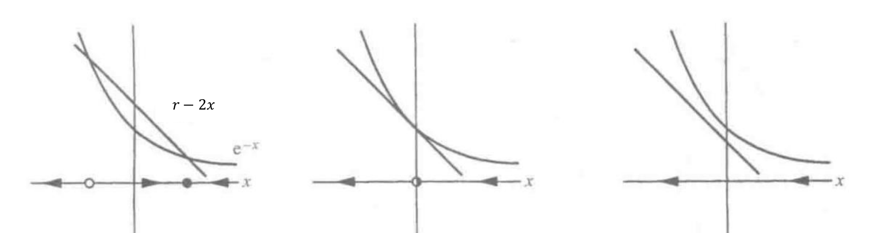
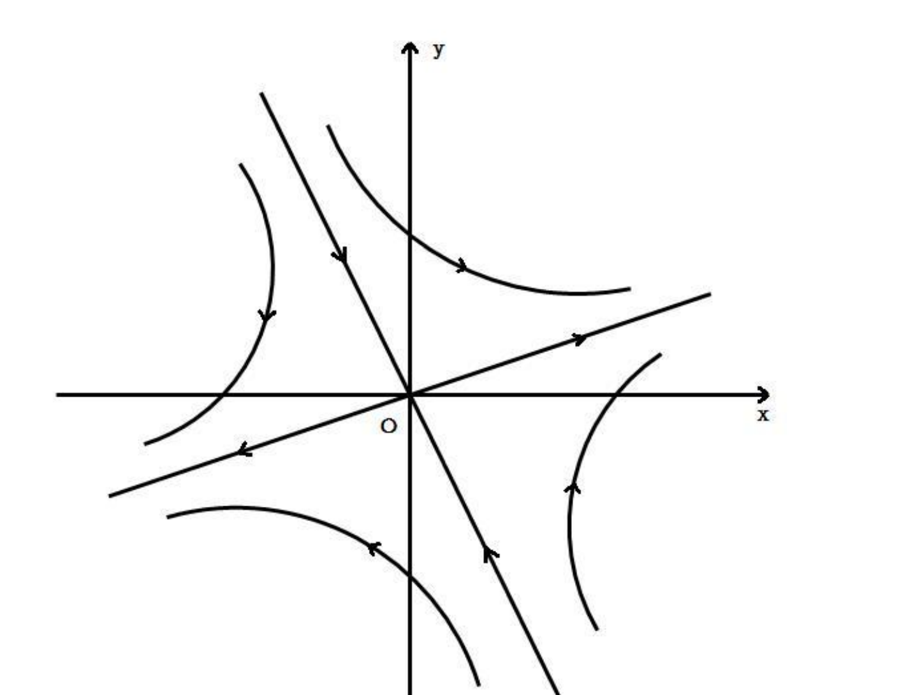

# 动力系统 2022–2023 学年第一学期期末试卷参考答案

>
## 题目 1（5 分）

### 题目

利用线性稳定性分析判断 $\dot{x}=\cos x$ 的不动点的稳定性。

### 答案

不动点出现在 $f(x)=\cos x=0$，（1 分）

因而 $x^{*}=\dfrac{\pi}{2}+k\pi$，式中 $k$ 为整数。（1 分）

于是

$$
f'(x)=-\sin\left(\frac{\pi}{2}+k\pi\right)=\begin{cases}1, & k\text{ 为奇数},\\ -1, & k\text{ 为偶数}\end{cases}
$$

（2 分）

因此，若 $k$ 为奇数， $x^{*}$ 不稳定；若 $k$ 为偶数， $x^{*}$ 稳定。（1 分）

## 题目 2（10 分）

### 题目

判断一阶系统 $\dot{x}=r-2x-e^{-x}$ 随 $r$ 变化时经历的分岔类型，并求出分岔点的 $r$ 值。

### 答案

不动点满足 $f(x)=r-2x-e^{-x}=0$。（2 分）

曲线 $r-2x$ 与曲线 $e^{-x}$ 的交点对应着系统的不动点。（2 分）

判断曲线 $r-2x$ 与曲线 $e^{-x}$ 的交点数量：当 $r$ 充分大时， $r-2x$ 与 $e^{-x}$ 有两个交点；当 $r$ 逐渐减小时，两条曲线经历由相交到相切到相离的变化，不动点的数量由两个变为一个变为零个。

当 $r-2x$ 在 $e^{-x}$ 上方时，流向右即 $x$ 轴正方向；否则，流向左即 $x$ 轴负方向。因此，当有两个交点时，左侧为不稳定结点，右侧为稳定结点；当有一个交点时，不动点变为鞍点；之后不动点消失，因此分岔类型为鞍-结分岔。（2 分）

当 $r,\ x$ 满足如下等式时， $r-2x$ 与 $e^{-x}$ 相切：

$$
\begin{cases}e^{-x}=r-2x,\\[1mm] \dfrac{d}{dx}e^{-x}=\dfrac{d}{dx}(r-2x)\end{cases}
$$

（2 分）

因此， $-e^{-x}=-2$，从而 $x=-\ln 2$， $r=2-2\ln 2$。（2 分）

## 题目 3（10 分）

### 题目

求下述微分方程

$$
\begin{cases}\dot{x}=5x-28y-18z,\\ \dot{y}=-x+5y+3z,\\ \dot{z}=3x-16y-10z\end{cases}
$$

的一般解。

### 答案

该系统为线性系统，考虑其系数矩阵 $A=\begin{pmatrix}5 & -28 & -18\\ -1 & 5 & 3\\ 3 & -16 & -10\end{pmatrix}$，求解其特征值与特征向量。（2 分）

求解可知其特征值为 $\lambda_1=0$， $\lambda_2=-1$， $\lambda_3=1$，对应的特征向量为 $\xi_1=(2,1,-1)^{T}$， $\xi_2=(3,0,1)^{T}$， $\xi_3=(2,-1,2)^{T}$。（4 分）

因此，解的一般形式可写为：

$$
\begin{pmatrix}x\\ y\\ z\end{pmatrix}=k_1\begin{pmatrix}2\\ 1\\ -1\end{pmatrix}+k_2e^{-t}\begin{pmatrix}3\\ 0\\ 1\end{pmatrix}+k_3e^{t}\begin{pmatrix}2\\ -1\\ 2\end{pmatrix}
$$

（4 分）

## 题目 4（10 分）

### 题目

做出下述系统

$$
\begin{cases}\dot{x}=2x+3y,\\ \dot{y}=2x-3y.\end{cases}
$$

判断系统平衡点类型并画出其在原点附近的相图。

### 答案

该系统平衡点为原点，考虑系数矩阵 $A=\begin{pmatrix}2 & 3\\ 2 & -3\end{pmatrix}$，易知特征值为 $\lambda_1=-4$， $\lambda_2=3$，对应的特征向量为 $\xi_1=(1,-2)^{T}$， $\xi_2=(3,1)^{T}$。（4 分）

因为特征值为实数且符号相异，因此该平衡点为鞍点。（2 分）

利用特征向量做相图：

其中两条直线的解析式分别为 $y=\dfrac13x$ 和 $y=-2x$。（4 分）

## 题目 5（15 分）

### 题目

求下述系统

$$
\begin{cases}\dot{x}=-y+x\left(\sqrt{x^{2}+y^{2}}-1\right)^{2},\\ \dot{y}=x+y\left(\sqrt{x^{2}+y^{2}}-1\right)^{2}\end{cases}
$$

的平衡点与极限环，并讨论他们的稳定性（提示：使用极坐标换元）。

### 答案

令 $x=r\cos\theta,\ y=r\sin\theta$（2 分）

则可以将原系统化简为

$$
\begin{cases}\dot{r}=r(r-1)^{2},\\ \dot{\theta}=1\end{cases}
$$

（2 分）

易知该系统的平衡点为 $r_1=0$， $r_2=1$（二重），特征值为 $\lambda_1=1$， $\lambda_2=0$。（2 分）

所以 $r_1=0$ 对应于原系统的平衡点为原点，显然原点为唯一平衡点且不稳定；（3 分）

$r_2=1$ 对应原系统的极限环为 $x^{2}+y^{2}=1$。（2 分）

运用类似后继函数的办法判断极限环稳定性：当 $r>1$ 时， $\dot{r}>0$，因而半径变大远离极限环，即极限环的外侧不稳定；当 $r<1$ 时， $\dot{r}>0$，因而半径变大接近极限环，即极限环的内侧稳定。（4 分）

## 题目 6（15 分）

### 题目

利用李雅普诺夫函数法证明系统

$$
\begin{cases}\dot{x}=-x-3y+2z+yz,\\ \dot{y}=6x-2y-2z+2xz,\\ \dot{z}=-4x+2y-2z-4xy\end{cases}
$$

不存在闭轨。

### 答案

易知原点为该系统的平衡点。

考虑 $V(x,y,z)=x^{2}+ay^{2}+bz^{2}$ 作为李雅普诺夫函数（4 分），则

$$
\dot{V}(x,y,z)=2x\dot{x}+2ay\dot{y}+2bz\dot{z}
$$

$$
=-2x^{2}-4ay^{2}-4bz^{2}+(-6+12a)xy+(4-8b)xz+(-4a+4b)yz+(2+4a-8b)xyz.
$$

（2 分）

当 $a=b=\dfrac12$ 时，所有交叉项的系数同时等于 0，即

$$
\dot{V}(x,y,z)=-2x^{2}-2y^{2}-2z^{2}
$$

（4 分）

此时，对于所有 $(x,y,z)\ne(0,0,0)$，均有 $V(x,y,z)>0$， $\dot{V}(x,y,z)<0$。（3 分）

因此， $V(x,y,z)=x^{2}+\dfrac12y^{2}+\dfrac12z^{2}$ 为李雅普诺夫函数，且系统没有闭轨。（2 分）

## 题目 7（15 分）

### 题目

已知当 $r>1$ 时，逻辑斯蒂映射 $x_{n+1}=rx_n(1-x_n)$ 存在两个不动点 $x^{*}=0$ 和 $x^{*}=1-\dfrac1r$。证明：当 $r>3$ 时逻辑斯蒂映射有一个周期-2 环，并且当 $3<r<1+\sqrt{6}$ 时，周期-2 环是稳定的。

### 答案

当且仅当存在两个点 $p\ne q$，使得 $f(p)=q$， $f(q)=p$ 时，周期-2 环存在。（2 分）

此条件等价于存在一个 $p$，使得 $p$ 是二次迭代映射 $f^{2}(x)=f(f(x))$ 的一个不动点，且 $p$ 不是 $f(x)$ 的不动点。（2 分）

展开方程 $f^{2}(x)=x$，得到 $r^{2}x(1-x)[1-rx(1-x)]-x=0$，（2 分）

利用多项式除法分解出因式 $x$ 和 $x-\left(1-\dfrac1r\right)$，解所得到的二次方程，可得到方程的一对儿根

$$
p,q=\frac{r+1\pm\sqrt{(r-3)(r+1)}}{2r}
$$

（2 分）

要分析 2-周期环的稳定性，等效于分析 $p,q$ 作为 $f^{2}(x)$ 不动点的稳定性。

计算映射 $f^{2}(x)$ 的特征值

$$
\lambda=\left.\frac{d}{dx}\big(f(f(x))\big)\right|_{x=p}=f'(f(p))f'(p)=f'(q)f'(p)
$$

（2 分）

由对称性可知，在 $q$ 点特征值相同。求导并带入 $p,q$ 可得

$$
\lambda=r(1-2p)r(1-2q)
$$

$$
=r^{2}\left[1-2(p+q)+4pq\right]
$$

$$
=r^{2}\left[1-\frac{2(r+1)}{r}+\frac{4(r+1)}{r^{2}}\right]
$$

$$
=4+2r-r^{2}
$$

（3 分）

因此，当 $|4+2r-r^{2}|<1$，即 $3<r<1+\sqrt{6}$ 时，周期-2 环为线性稳定的。（2 分）

## 题目 8（20 分）

### 题目

已知洛伦兹系统

$$
\begin{cases}\dot{x}=\sigma(y-x),\\ \dot{y}=rx-y-xz,\\ \dot{z}=xy-bz\end{cases}\qquad (\sigma,r,b>0,\ \sigma>b+1)
$$

(1) 求解洛伦兹系统的不动点，并求出洛伦兹系统的叉式分岔点 $r_c$；

(2) 设由叉式分岔产生的两个新的不动点为 $C^{+}$ 和 $C^{-}$，求系统在 $C^{+}$ 和 $C^{-}$ 处的雅可比矩阵的特征方程；

(3) 通过寻找方程形如 $\lambda=iw$ 的解，其中 $w$ 为实数，求解使系统存在一对纯虚数特征值时的参数 $r=r_H$ 的取值，并说出系统在 $r=r_H$ 时产生了何种类型的分岔。

### 答案

(1) 对所有的参数值， $(x,y,z)=(0,0,0)$ 始终是系统的一个不动点（2 分）。当 $r>r_c=1$ 时，系统出现一对不动点 $x^{*}=y^{*}=\pm\sqrt{b(r-1)}$， $z^{*}=r-1$。（3 分）

(2) 系统在 $C^{+}$ 和 $C^{-}$ 处的雅可比矩阵为

$$
A=\begin{pmatrix}-\sigma & \sigma & 0\\ r-z^{*} & -1 & -x^{*}\\ y^{*} & x^{*} & -b\end{pmatrix}
$$

（2 分）

所以系统的特征方程为

$$
\begin{vmatrix}-\sigma-\lambda & \sigma & 0\\ r-z^{*} & -1-\lambda & -x^{*}\\ y^{*} & x^{*} & -b-\lambda\end{vmatrix}=0
$$

（2 分）

化简可得

$$
\lambda^{3}+(\sigma+b+1)\lambda^{2}+(r+\sigma)b\lambda+2b\sigma(r-1)=0
$$

（3 分）

(3) 将 $\lambda=iw$ 带入上述特征方程，可以得到

$$
-w^{3}i-(\sigma+b+1)w^{2}+(r+\sigma)bwi+2b\sigma(r-1)=0
$$

（2 分）

合并方程中的虚部与实部，使虚部系数与实部系数同时等于零，可以得到

$$
\begin{cases}-w^{3}+(r+\sigma)bw=0,\\ -(\sigma+b+1)w^{2}+2b\sigma(r-1)=0\end{cases}
$$

（2 分）

因为 $w\ne0$，所以 $w^{2}=(r+\sigma)b$，将其带入实部系数等式可得，

$$
-(\sigma+b+1)(r+\sigma)b+2b\sigma(r-1)=0
$$

将上式分离变量可得

$$
r_H=\sigma\frac{\sigma+b+3}{\sigma-b-1}
$$

（2 分）

因为当 $r=r_H$ 时，一对共轭复根的实部恰好为 0 为纯虚数，因此系统在 $r=r_H$ 时发生了（亚临界）霍普夫分岔（可不说明临界状态）。（2 分）
