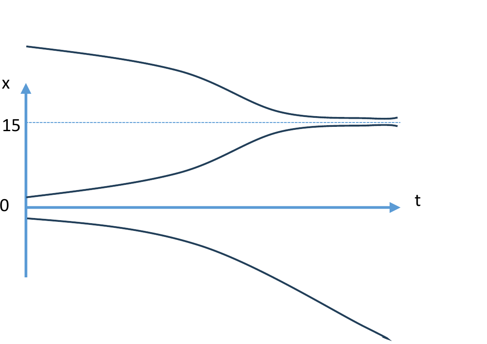
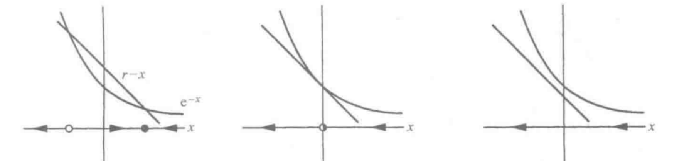
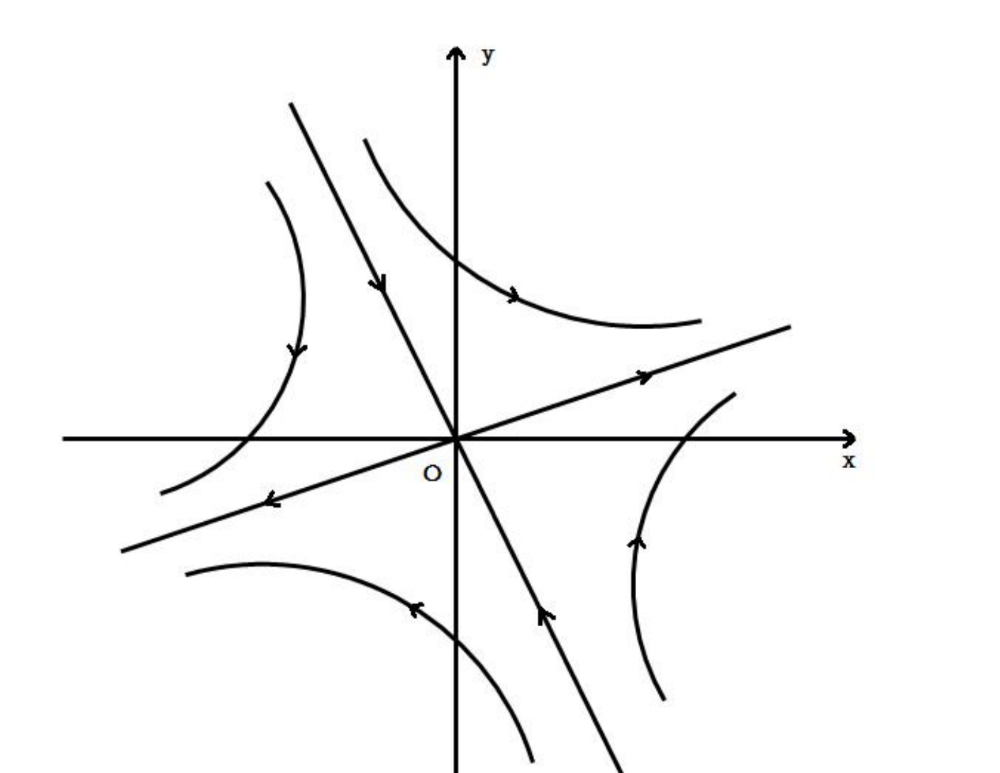

# 动力系统 2023–2024 学年第一学期期末试卷参考答案

>
## 题目 1（5 分）

### 题目

画出非均匀振子

$$
\frac{d\theta}{dt}=\frac12-\sin\theta
$$

在圆上的向量场图。

### 答案

$\dfrac{d\theta}{dt}=0$ 的解为 $\theta=\dfrac{\pi}{6}$ 及 $\theta=\dfrac{5\pi}{6}$，且

$0<\theta<\dfrac{\pi}{6}$ 时， $\dfrac{d\theta}{dt}>0$

$\dfrac{\pi}{6}<\theta<\dfrac{5\pi}{6}$ 时， $\dfrac{d\theta}{dt}<0$

$\dfrac{5\pi}{6}<\theta<2\pi$ 时， $\dfrac{d\theta}{dt}>0$

（3 分，画图说明也可）

因此有，向量图为

（2 分）

## 题目 2（10 分）

### 题目

分析方程

$$
\frac{dx}{dt}=3x\left(1-\frac{x}{15}\right)
$$

的平衡点及稳定性，并画出不同初始条件下 $x(t)$ 随时间变化的图像。

### 答案

平衡点满足 $f(x)=3x\left(1-\dfrac{x}{15}\right)=0$，（2 分）

因此有两个不动点 $x^{*}=0,\ x^{*}=15$

$$
f'(x^{*}=0)>0,\quad f'(x^{*}=15)<0
$$

（2 分）

因而 $x^{*}=0$ 不稳定， $x^{*}=15$ 稳定（2 分）

于是图像为

（4 分）

## 题目 3（10 分）

### 题目

判断一阶系统 $\dot{x}=r-x-e^{-x}$ 随 $r$ 变化时经历的分岔类型，并求出分岔点的 $r$ 值。

### 答案

不动点满足 $f(x)=r-x-e^{-x}=0$。（2 分）

曲线 $r-x$ 与曲线 $e^{-x}$ 的交点对应着系统的不动点。（2 分）

判断曲线 $r-x$ 与曲线 $e^{-x}$ 的交点数量：当 $r$ 充分大时， $r-x$ 与 $e^{-x}$ 有两个交点；当 $r$ 逐渐减小时，两条曲线经历由相交到相切到相离的变化，不动点的数量由两个变为一个变为零个。

当 $r-x$ 在 $e^{-x}$ 上方时，流向右即 $x$ 轴正方向；否则，流向左即 $x$ 轴负方向。因此，当有两个交点时，左侧为不稳定结点，右侧为稳定结点；当有一个交点时，不动点变为鞍点；之后不动点消失，因此分岔类型为鞍-结分岔。（2 分）

当 $r,\ x$ 满足如下等式时， $r-x$ 与 $e^{-x}$ 相切：

$$
\begin{cases}e^{-x}=r-x,\\[1mm] \dfrac{d}{dx}e^{-x}=\dfrac{d}{dx}(r-x)\end{cases}
$$

（2 分）

因此， $-e^{-x}=-1$，从而 $x=0$， $r=1$。（2 分）

## 题目 4（10 分）

### 题目

考虑如下二维系统

$$
\begin{cases}\dfrac{dx}{dt}=2x(1+x^{2}-2y^{2}),\\[2mm] \dfrac{dy}{dt}=-y(1-4x^{2}+3y^{2}).\end{cases}
$$

求出系统的平衡点并判断其稳定性。

### 答案

$$
\begin{cases}\dfrac{dx}{dt}=2x(1+x^{2}-2y^{2})=0,\\[2mm] \dfrac{dy}{dt}=-y(1-4x^{2}+3y^{2})=0\end{cases}
$$

可解出该系统有五个平衡点 $(0,0),\ (1,1),\ (1,-1),\ (-1,1)$ 以及 $(-1,-1)$（2 分）

该系统的雅可比矩阵为

$$
A=\begin{pmatrix}2(1+x^{2}-2y^{2})+4x^{2} & -8xy\\ 8xy & -(1-4x^{2}+3y^{2})-6y^{2}\end{pmatrix}
$$

在 $(0,0)$ 点处，

$$
A=\begin{pmatrix}2 & 0\\ 0 & -1\end{pmatrix}
$$

$\Delta=-2$， $\tau=1$，因此为鞍点（2 分）

在 $(1,1)$ 点处，

$$
A=\begin{pmatrix}4 & -8\\ 8 & -6\end{pmatrix}
$$

$\Delta=-24+64=40>0$， $\tau=-2<0$， $\tau^{2}-4\Delta=-156<0$，因此为稳定焦点（2 分）

同理可得，其余三点均为稳定焦点（4 分）

## 题目 5（10 分）

### 题目

做出下述系统

$$
\begin{cases}\dot{x}=2x+7y,\\ \dot{y}=2x-3y.\end{cases}
$$

判断系统平衡点类型并画出其在原点附近的相图。

### 答案

该系统平衡点为原点，考虑系数矩阵 $A=\begin{pmatrix}2 & 7\\ 2 & -3\end{pmatrix}$，易知特征值为 $\lambda_1=-5$， $\lambda_2=4$，对应的特征向量为 $\xi_1=(1,-1)^{T}$， $\xi_2=(7,2)^{T}$。（4 分）

因为特征值为实数且符号相异，因此该平衡点为鞍点。（2 分）

利用特征向量做相图：

其中两条直线的解析式分别为 $y=-x$ 和 $y=\dfrac27x$（4 分）

## 题目 6（15 分）

### 题目

给出至少 2 种判断二维系统中闭轨不存在的充分条件，及给出至少 1 种判断二维系统中闭轨存在的充分条件。

### 答案

闭轨不存在的充分条件可包括梯度系统、李雅普诺夫函数、Dulac 准则，写出两种即可，每种 5 分。闭轨存在的充分条件可写庞加莱本迪克森定理，5 分。

## 题目 7（20 分）

### 题目

求解逻辑斯蒂映射 $x_{n+1}=rx_n(1-x_n)$ 的不动点并判断他们的稳定性，并证明：当 $r>3$ 时逻辑斯蒂映射有一个周期-2 环。

### 答案

不动点满足 $x^{*}=f(x^{*})=rx^{*}(1-x^{*})$，因此可以解出 $x^{*}=0$ 或者 $x^{*}=1-\dfrac1r$，但是当 $r\ge1$ 时 $x^{*}=1-\dfrac1r$ 才是有意义的（3 分）

稳定性取决于特征乘子 $f'(x^{*})=r-2rx^{*}$。 $f'(0)=r$，所以当 $r<1$ 时稳定， $r>1$ 时不稳定（2 分）

$f'\left(1-\dfrac1r\right)=2-r$，所以当 $1<r<3$ 时稳定， $r>3$ 时不稳定（2 分）

$r>3$ 时，当且仅当存在两个点 $p\ne q$，使得 $f(p)=q$， $f(q)=p$ 时，周期-2 环存在。（3 分）

此条件等价于存在一个 $p$，使得 $p$ 是二次迭代映射 $f^{2}(x)=f(f(x))$ 的一个不动点，且 $p$ 不是 $f(x)$ 的不动点。（3 分）

展开方程 $f^{2}(x)=x$，得到 $r^{2}x(1-x)[1-rx(1-x)]-x=0$，（3 分）

利用多项式除法分解出因式 $x$ 和 $x-\left(1-\dfrac1r\right)$，解所得到的二次方程，可得到方程的一对儿根

$$
p,q=\frac{r+1\pm\sqrt{(r-3)(r+1)}}{2r}
$$

（4 分）

## 题目 8（20 分）

### 题目

已知洛伦兹系统

$$
\begin{cases}\dot{x}=\sigma(y-x),\\ \dot{y}=rx-y-xz,\\ \dot{z}=xy-bz\end{cases}\qquad (\sigma,r,b>0,\ \sigma>b+1)
$$

(1) 求解洛伦兹系统的不动点，并求出洛伦兹系统的叉式分岔点 $r_c$；

(2) 证明洛伦兹系统相空间中的体积按指数收缩。

### 答案

(1) 对所有的参数值， $(x,y,z)=(0,0,0)$ 始终是系统的一个不动点（2 分）。当 $r>r_c=1$ 时，系统出现一对不动点 $x^{*}=y^{*}=\pm\sqrt{b(r-1)}$， $z^{*}=r-1$。（3 分）

(2) 对于任意的三维系统 $\dot{x}=f(x)$，选择相空间中体积为 $V(t)$ 的任一封闭曲面 $S(t)$。（2 分）

用 $n$ 表示 $S$ 上的外法线，因为 $f$ 是点的瞬时速度， $f\cdot n$ 是速度在外法线上的分量（3 分）。因此在时间 $dt$ 内，区域 $dA$ 扫过的体积为 $(f\cdot n\,dt)dA$。

因此

$$
V(t+dt)=V(t)+\int_S (f\cdot n\,dt)\,dA
$$

所以有

$$
\dot{V}=\frac{V(t+dt)-V(t)}{dt}=\int_S (f\cdot n)\,dA
$$

（2 分）

利用散度定理重写上述积分方程，得到

$$
\dot{V}=\int_V \nabla\cdot f\,dA
$$

（2 分）

对于洛伦兹系统

$$
\nabla\cdot f=\frac{\partial}{\partial x}[\sigma(y-x)]+\frac{\partial}{\partial y}[rx-y-xz]+\frac{\partial}{\partial z}[xy-bz]
$$

$$
=-\sigma-1-b<0
$$

由于散度是常数，方程可简化为 $\dot{V}=(-\sigma-1-b)V$，其解为 $V(t)=V(0)e^{-(\sigma+1+b)t}$，因此洛伦兹系统相空间中的体积按指数收缩。（3 分）
