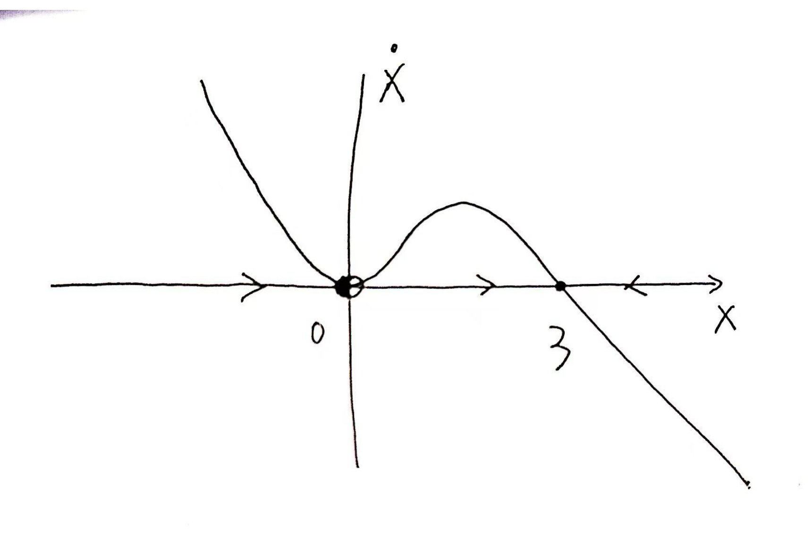
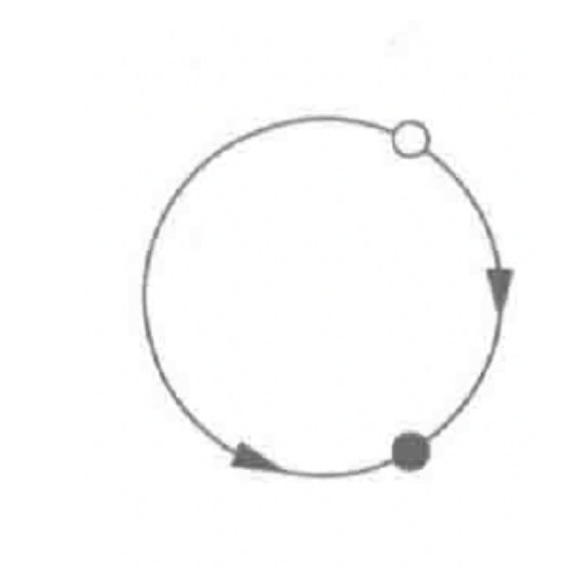
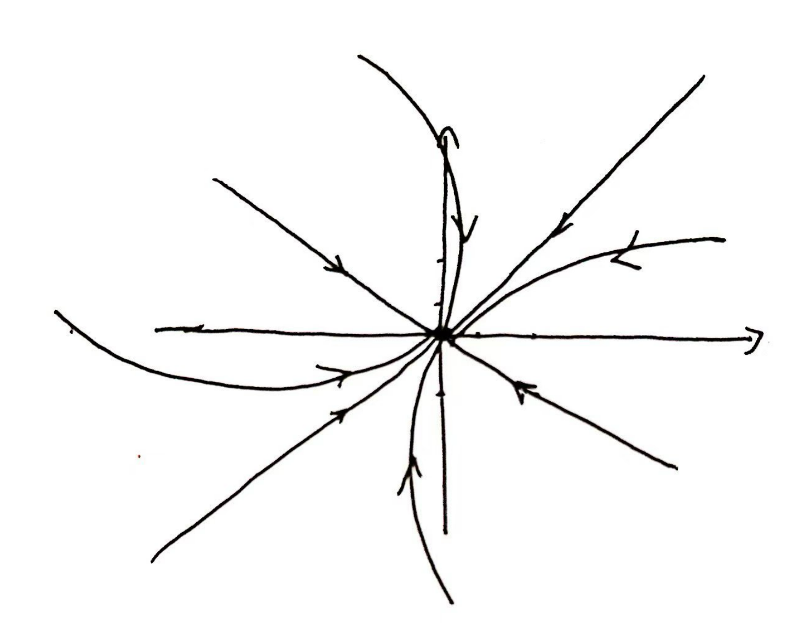
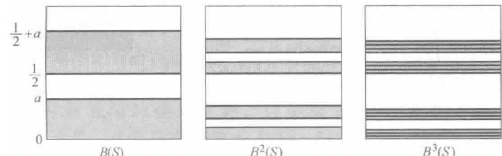

# 动力系统 2024–2025 学年第一学期期末试卷参考答案

>
> 试卷封面同时写有「2024—2025 学年第 1 学期」和「2024 年 1 月 2 日」。2022 级的大三学年是 2024—2025 学年，按学年推断考试日期应为 2025 年 1 月 2 日，试卷日期一栏疑为笔误。
>
> 本目录的「试卷」与「试卷及答案」两份 PDF 的 8 道题目、分值完全一致。

## 题目 1（10 分）

### 题目

分析方程

$$
\dot{x}=x^{2}(3-x)
$$

的不动点及稳定性，并画出系统的相图。

### 答案

系统不动点满足 $\dot{x}=0$，所以不动点为 $x^{*}=0$ 或者 $x^{*}=3$。（4 分）

$$
f'(x^{*})=6x-3x^{2}
$$

$f'(3)=-9<0$ 稳定（2 分）

$f'(0)=0$ 无法直接判断，根据如下系统相图可知， $x^{*}=0$ 为半稳定的。（2 分）

## 题目 2（10 分）

### 题目

设 $a>\omega>0$，求圆周上非均匀振子

$$
\dot{\theta}=\omega-a\cos\theta
$$

的不动点，判断其稳定性，并画出系统的相图。

### 答案

不动点 $\theta^{*}$ 满足

$$
\cos\theta^{*}=\frac{\omega}{a},\qquad \sin\theta^{*}=\pm\sqrt{1-\left(\frac{\omega}{a}\right)^{2}}
$$

（3 分）

其线性稳定性取决于

$$
f'(\theta^{*})=a\sin\theta^{*}=\pm a\sqrt{1-\left(\frac{\omega}{a}\right)^{2}}
$$

（3 分）

因此，对应 $\sin\theta^{*}<0$ 的不动点是稳定的，因为 $f'(\theta^{*})<0$。（2 分）

其向量场如下图所示

（2 分）

## 题目 3（10 分）

### 题目

(1) 给定系统 $\dot{x}=x(r-e^{2x})$，判断 $x^{*}=0$ 在不同参数 $r$ 下的稳定性；

(2) 证明系统 $\dot{x}=x(r-e^{2x})$ 在取某个临界值 $r_c$ 时出现了跨临界分岔，并求出分岔时的临界值 $r_c$。

### 答案

(1) $x^{*}=0$ 为系统的不动点， $f'(x^{*})=r-e^{2x^{*}}-2x^{*}e^{2x^{*}}$，所以 $f'(0)=r-1$（2 分）

因此，当 $r<1$ 时， $x^{*}=0$ 稳定，当 $r>1$ 时， $x^{*}=0$ 不稳定（4 分）

(2) 系统的另一个不动点为 $x^{*}=\dfrac12\ln r$， $f'(x^{*})=-r\ln r$，当 $r<1$ 时， $x^{*}=\dfrac12\ln r$ 不稳定，当 $r>1$ 时， $x^{*}=\dfrac12\ln r$ 稳定，系统 $\dot{x}=x(r-e^{2x})$ 在 $r$ 取临界值 $r_c=1$ 时（2 分）发生了两个不动点的稳定性交换，即系统发生了跨临界分岔。（2 分）

## 题目 4（15 分）

### 题目

考虑如下二维系统

$$
\begin{cases}\dot{x}=x\left(1-(x^{2}+y^{2})\right)-y,\\ \dot{y}=y\left(1-(x^{2}+y^{2})\right)+x.\end{cases}
$$

(1) 求出极坐标变换后的方程；(2) 求出系统的不动点、判断其稳定性；(3) 证明系统有一个极限环。

### 答案

(1) 利用极坐标变化分析， $x=r\cos\theta,\ y=r\sin\theta$，（2 分）

由 $x^{2}+y^{2}=r^{2}$，可知 $x\dot{x}+y\dot{y}=r\dot{r}$，即

$$
r\dot{r}=x^{2}\left(1-(x^{2}+y^{2})\right)-xy+y^{2}\left(1-(x^{2}+y^{2})\right)+xy
$$

$$
=x^{2}+y^{2}-(x^{2}+y^{2})^{2}
$$

$$
=r^{2}-r^{4}
$$

因此， $\dot{r}=r(1-r^{2})$。（2 分）

$$
\dot{\theta}=\frac{x\dot{y}-y\dot{x}}{r^{2}}
$$

$$
=\frac{xy\left(1-(x^{2}+y^{2})\right)+x^{2}-xy\left(1-(x^{2}+y^{2})\right)+y^{2}}{r^{2}}
$$

$$
=\frac{x^{2}+y^{2}}{r^{2}}=1
$$

极坐标变换后的方程为

$$
\begin{cases}\dot{r}=r(1-r^{2}),\\ \dot{\theta}=1.\end{cases}
$$

（2 分）

(2) 系统的不动点为 $(r,\theta)=(0,1)$，（2 分）且 $r>0$ 时 $\dot{r}>0$，所以 $r^{*}=0$ 为一个不稳定不动点。（2 分）

(3) 当 $r^{*}=1$ 是 $r$ 的一个不动点，并且当 $r>1$ 时 $\dot{r}<0$，当 $r<1$ 时 $\dot{r}>0$，所以 $r^{*}=1$ 为一个稳定不动点，所以相平面中所有的轨迹都在单调的靠近单位圆 $r^{*}=1$（2 分）。同时 $\dot{\theta}=1$ 表示系统在单位圆上始终做固定角速度的旋转，不会固定在某一不动点上，因此系统存在一个稳定的极限环。（3 分）

## 题目 5（15 分）

### 题目

对平面系统

$$
\begin{cases}\dot{x}=-3x+2y,\\ \dot{y}=x-2y.\end{cases}
$$

判断系统不动点类型并画出其在原点附近的相图。

### 答案

该系统平衡点为原点，考虑系数矩阵 $A=\begin{pmatrix}-3 & 2\\ 1 & -2\end{pmatrix}$，易知特征值为 $\lambda_1=-4$， $\lambda_2=-1$，对应的特征向量为 $\xi_1=(2,-1)^{T}$， $\xi_2=(1,1)^{T}$。（4 分）

$$
\Delta=4,\quad \tau=-5
$$

$$
\tau^{2}-4\Delta=9>0
$$

因为特征值为实数且符号相同，因此该平衡点为稳定结点。（2 分）

利用特征向量做相图：

其中两条直线的解析式分别为 $y=-\dfrac12x$ 和 $y=x$（4 分）

## 题目 6（15 分）

### 题目

(1) 给出 2 种判断二维系统中闭轨不存在的充分条件。

(2) 使用 Dulac 准则证明系统

$$
\begin{cases}\dot{x}=x(2-y-x^{2}),\\ \dot{y}=y(x-1)\end{cases}
$$

在第一象限 $x>0,\ y>0$ 内没有闭轨（提示：考虑形如 $g=1/xy$ 的辅助函数）；

(3) 证明上一问中的系统在整个平面上没有闭轨。

### 答案

(1) 闭轨不存在的充分条件可包括梯度系统、李雅普诺夫函数、Dulac 准则，写出两种即可，每种 3 分共 6 分。

(2) 通过 Dulac 准则，选择 $g=1/xy$，（2 分）则

$$
\nabla\cdot(g\dot{x})=\frac{\partial}{\partial x}(g\dot{x})+\frac{\partial}{\partial y}(g\dot{y})
$$

$$
=\frac{\partial}{\partial x}\left(\frac{2-y-x^{2}}{y}\right)+\frac{\partial}{\partial y}\left(\frac{x-1}{x}\right)
$$

$$
=-2x/y<0
$$

（4 分）

因为，第一象限时单连通的， $g$ 和 $f$ 满足要求的光滑条件，因此根据狄拉克准则表明第一象限没有闭轨。

(3) 通过指数理论，系统包含四个不动点为 $(x^{*},y^{*})=(0,0),\ (\pm\sqrt{2},0),\ (1,1)$，其中 $(0,0),\ (\pm\sqrt{2},0)$ 均在坐标轴上，不可能存在围住这三个不动点的闭轨。而由第二问系统在第一象限也不存在闭轨，因此系统在整个平面上都没有闭轨。（3 分）

## 题目 7（10 分）

### 题目

求映射 $x_{n+1}=ax_n^{2}\ (a\ne 0)$ 的不动点，并判断其稳定性。

### 答案

不动点满足 $x^{*}=ax^{*2}$，因此可以得到 $x^{*}=0$ 或者 $x^{*}=1/a$（2 分）

当 $x^{*}=0$ 时，特征乘子 $|\lambda|=|f'(x^{*})|=2ax^{*}=0<1$，所以不动点 $x^{*}=0$ 是稳定的；（4 分）

当 $x^{*}=1/a$ 时，特征乘子 $|\lambda|=|f'(x^{*})|=2ax^{*}=2>1$，所以不动点 $x^{*}=1/a$ 是不稳定的；（4 分）

## 题目 8（15 分）

### 题目

证明当 $a<1/2$ 时，对正方形区域 $S\ (0\le x,y\le 1)$ 的面包师映射 $B(x_n,y_n)$

$$
(x_{n+1},y_{n+1})=B(x_n,y_n)=\begin{cases}(2x_n,\ ay_n), & 0\le x_n\le 1/2,\\ (2x_n-1,\ ay_n+1/2), & 1/2<x_n\le 1.\end{cases}
$$

有一个能吸引所有轨迹的分形吸引子 $A$，并计算 $A$ 的盒维数。（即证明存在集合 $A$，使得对于任意的初始条件 $(x_0,y_0)$，当 $n\to+\infty$ 时， $B^{n}(x_0,y_0)$ 到集合 $A$ 的距离收敛于 0）。

### 答案

首先构造这个吸引子， $S$ 在映射 $B$ 下的前三步如下图阴影所示

第一个图形 $B(S)$ 由 2 个高度为 $a$ 的条形组成， $B^{2}(S)$ 由 $2^{2}$ 个高度为 $a^{2}$ 的条形组成。

极限集 $A=B^{\infty}(S)$。（3 分）

对于任意的 $n$，有 $B^{n+1}(S)\subset B^{n}(S)$（2 分）

同时，对于任意的 $(x_0,y_0)$， $B^{n}(x_0,y_0)$ 位于轨迹 $B^{n}(S)$ 中。

$B^{n}(S)$ 由 $2^{n}$ 个高度为 $a^{n}$ 的条形组成（3 分）

又因为极限集 $A$ 也包含在 $B^{n}(S)$ 中，所以这些轨迹上的所有点都位于 $A$ 中长度为 $a^{n}$ 的范围之内。（2 分）

因此，当 $n\to+\infty$ 时， $B^{n}(x_0,y_0)$ 到集合 $A$ 的距离为 $a^{n}$ 趋于 0。即 $A$ 为一个能吸引所有轨迹的分形吸引子。（4 分）

$B^{n}(S)$ 包含 $2^{n}$ 个高度为 $a^{n}$ 长度为 1 的条形，考虑用边长为 $\varepsilon=a^{n}$ 的正方形盒子覆盖 $B^{n}(S)$，则需要 $a^{-n}$ 个盒子能覆盖一个条形，总共需要 $2^{n}a^{-n}$ 个盒子，（3 分）

因此

$$
d=\lim_{\varepsilon\to0}\frac{\ln N(\varepsilon)}{\ln\left(\frac{1}{\varepsilon}\right)}=\lim_{n\to\infty}\frac{\ln\left[(a/2)^{-n}\right]}{\ln(a^{-n})}=\frac{-n(\ln a-\ln 2)}{-n\ln a}=1-\frac{\ln 2}{\ln a}
$$

（3 分）
